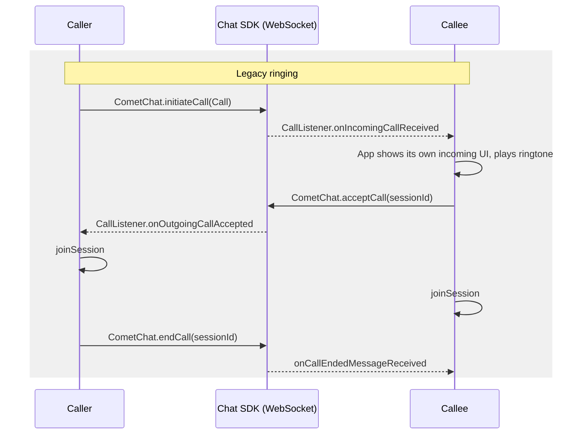
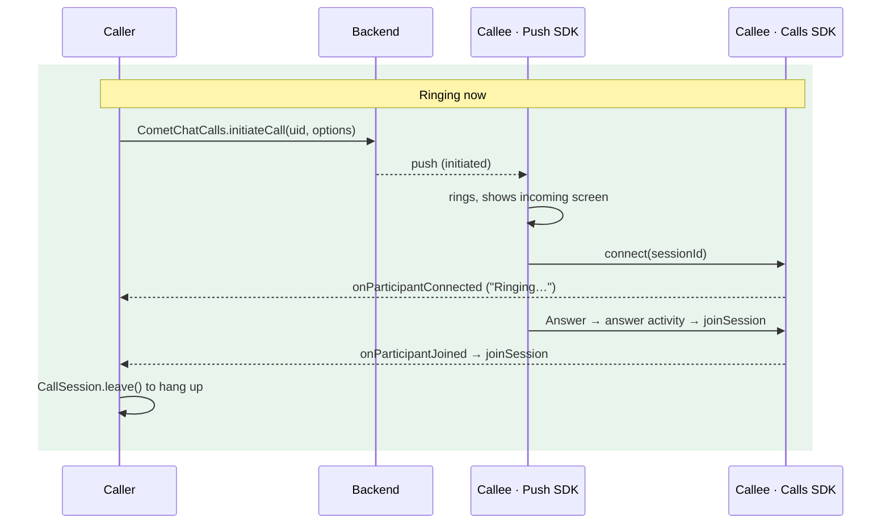

Legacy ringing signalled calls through the Chat SDK: `CometChat.initiateCall` created the call, a `CallListener` on the WebSocket told the callee, `acceptCall` and `rejectCall` answered, and the app rang the device itself, often with a hand-built `ConnectionService`. Ringing now runs on the Calls SDK and the Push Notifications SDK calls module. The Chat SDK's calling methods are superseded by the Calls SDK and no longer used; a coming Chat SDK release marks them deprecated.

This page is the diff. For the full description of the current flow see [Ringing](/calls/android/ringing); for the push side see [Push ringing](/calls/android/voip-calling).

## Why it changed

| Legacy | Now |
|--------|-----|
| Incoming calls arrived on the Chat WebSocket, so a killed or backgrounded app needed a separate push + Telecom integration to ring | One path: the push rings in every app state, with the app killed included |
| Four pieces of app code rang the device (listener, overlay, ringtone, busy check) | The Push SDK rings, draws the incoming screen, handles busy, timeout and missed calls |
| `acceptCall` / `rejectCall` / `endCall` were HTTP calls your app had to sequence with `joinSession` | Answer = join. Decline, timeout and busy are sent by the Push SDK through a durable queue |
| Caller only knew "accepted" or "rejected" | Caller sees "Ringing…" (the callee's device was reached), "answered", and the reason a call ended (`rejected`, `busy`, `unanswered`, `cancelled`) |
| Chat SDK required for calling | Chat SDK needed for chat only; a calls-only app works |

## Before and after





## Step 1: Update dependencies

```kotlin build.gradle.kts
dependencies {
    implementation("com.cometchat:calls-sdk-android:5.1.0")              // was 5.0.x
    implementation("com.cometchat:push-notifications-android:2.0.0")     // was 1.0.x
    implementation("com.cometchat:push-notifications-calls-android:2.0.0") // new: the ringer
    // chat-sdk-android stays for chat; it is no longer used for calls
}
```

- `minSdk` 26 or higher.
- Keep your Firebase Messaging dependency and `google-services.json`; the Push SDK never compiles against Firebase.

<Warning>
`setCallMode` defaults to `AUTO`, which is what this page assumes. Adding the `push-notifications-calls-android` artifact is the opt-in: core detects it and installs the ringer. There is no second initialiser.
</Warning>

## Step 2: Replace the push configuration

<Tabs>
<Tab title="Before (Push SDK 1.0)">
```kotlin
CometChatPushNotifications.init(this,
    PNConfiguration.Builder(appId, region)
        .setNotificationSmallIcon(R.drawable.ic_notification)
        .setVoIPEnabled(true)
        .setInlineReplyEnabled(true)
        .build())

CometChatPushNotifications.setOnCallAnsweredHandler(object : CallAnsweredHandler {
    override fun onCallAnswered(context: Context, callInfo: PNCallInfo) {
        CometChat.acceptCall(callInfo.sessionId, /* … then launch the call screen */)
    }
})
```
</Tab>
<Tab title="After (Push SDK 2.0)">
```kotlin
CometChatPushNotifications.init(this,
    PNConfiguration.Builder(appId, region)
        .setProviderId(PROVIDER_ID)                       // your FCM provider from the dashboard
        .setAnswerActivity(CallScreenActivity::class.java) // opened on Answer with the call in its intent
        .setNotificationSmallIcon(R.drawable.ic_notification)
        .setInlineReplyEnabled(true)
        .build())
```
</Tab>
</Tabs>

If your Chat and Calls SDKs use `overrideClientHost` (a staging or dedicated deployment), pass the same host with `PNConfiguration.Builder.overrideClientHost(host)`. Otherwise the push token registers on the default host and no push ever arrives.

## Step 3: Shrink the Firebase service

<Tabs>
<Tab title="Before">
```kotlin
override fun onMessageReceived(message: RemoteMessage) {
    if (CometChatPushNotifications.isAppInForeground() && isCallPush(message.data)) {
        return   // the WebSocket CallListener handles it
    }
    CometChatPushNotifications.handlePushNotification(this, title, body, icon, uid, guid, message.data)
}

override fun onNewToken(token: String) {
    CometChatPushNotifications.handleTokenRefresh(PushPlatform.FCM_ANDROID, token, PROVIDER_ID)
}
```
</Tab>
<Tab title="After">
```kotlin
override fun onMessageReceived(message: RemoteMessage) {
    val handled = CometChatPushNotifications.handlePushNotification(
        context = this,
        data = message.data,
        sentTimeMs = message.sentTime   // lets the SDK drop a push delivered late
    )
    if (!handled) { /* not a CometChat push */ }
}

override fun onNewToken(token: String) {
    CometChatPushNotifications.handleTokenRefresh(token)
}
```
</Tab>
</Tabs>

Never skip call pushes in the foreground any more. The WebSocket no longer carries call signalling for your app; the push is the only signal, in every state.

## Step 4: Delete the token code

The Push SDK registers the token on login and unregisters it on logout by itself. Remove:

- `FirebaseMessaging.getInstance().token` + `registerToken(...)` / `CometChatNotifications.registerPushToken(...)` after login
- `unregisterToken(...)` / `unregisterPushToken(...)` before logout

Call `registerToken()` yourself only if you set `setAutoRegisterToken(false)`.

## Step 5: Delete the app-side ringing

Everything in this list is now done by the Push SDK. Remove it, or it will fight the SDK's ring (two ringtones, two screens, a busy reject sent on top of the SDK's).

- The Application-level `CometChat.addCallListener(...)` and its `onIncomingCallReceived` handler
- The incoming-call overlay, snackbar, dialog or activity you launched from it
- Your own ringtone / sound manager for incoming calls
- The "already in a call → reject with busy" check
- `CometChatVoIP`, `PhoneAccount` registration, `CometChatVoIPConnectionService`, `CallConnection`, and the `READ_PHONE_STATE`, `MANAGE_OWN_CALLS` and `ANSWER_PHONE_CALLS` permission chain
- Any `isAppInForeground()` gate around call pushes

Keep: `RECORD_AUDIO`, `CAMERA` and `POST_NOTIFICATIONS` in the manifest. The SDKs request them but do not declare them.

## Step 6: Rewrite the call code

| Legacy | Now | Notes |
|--------|-----|-------|
| `CometChat.initiateCall(Call(uid, RECEIVER_TYPE_USER, type), listener)` | `CometChatCalls.initiateCall(context, uid, InitiateCallOptions, listener<InitiatedCall>)` | Set `options.sessionSettings` with the session type, or an audio call opens the camera |
| `CometChat.initiateCall(call, timeoutSeconds, listener)` | No client timeout. The ring window is 45 s on both sides (or the push's `ringTimeout`) | Run your own 45 s timer on the caller if you want the screen to close on its own |
| `CallListener.onIncomingCallReceived(call)` | Nothing to write; the Push SDK rings. For your own state use `IncomingCallListener.onIncomingCallReceived(InitiatedCall)` | One listener whether the call came by push on a killed process or on a live one |
| `CallListener.onOutgoingCallAccepted(call)` | `ParticipantEventListener.onParticipantJoined(participant)` on the session `initiateCall` prepared, via `CometChatCalls.getActiveSession()` | New in-between event: `onParticipantConnected` = the callee's device is ringing |
| `CallListener.onOutgoingCallRejected(call)` | `IncomingCallListener.onIncomingCallEnded(call, "rejected")` or `"busy"` | |
| `CallListener.onIncomingCallCancelled(call)` | `IncomingCallListener.onIncomingCallEnded(call, "cancelled")` on the callee; the Push SDK has already stopped the ring | |
| `CallListener.onCallEndedMessageReceived(call)` | `SessionStatusListener.onSessionLeft()` / `onConnectionClosed()` on the joined session; `onIncomingCallEnded(call, "unanswered")` while ringing | |
| `CometChat.acceptCall(sessionId, listener)` then `joinSession` | Your answer activity reads `CallBundles.getCall(intent)` and calls `joinSession`. Nothing else to send | The Push SDK asked for mic/camera before opening it |
| `CometChat.rejectCall(sessionId, CALL_STATUS_REJECTED, listener)` | Push SDK Decline button. Own incoming screen: `CometChatCallNotifications.decline(context, sessionId)` | Sends `busy` automatically when in another call |
| `CometChat.rejectCall(sessionId, CALL_STATUS_BUSY, listener)` | Nothing; the Push SDK decides busy | |
| `CometChat.rejectCall(sessionId, CALL_STATUS_CANCELLED, listener)` | `CometChatCalls.endCall(sessionId, Constants.CALL_STATUS_CANCELLED, listener<Void>)` | |
| `CallSession.leaveSession()` + `CometChat.endCall(sessionId, listener)` | `CallSession.leave()` | No status to send on a hang-up; the room tells the other side and the backend logs it |
| `CometChat.getActiveCall()` / `clearActiveCall()` | `CometChatCalls.getActiveSession()` (null when no session is prepared or joined) | |
| `CometChat.startCall(...)`, `CallSettings`, `OngoingCallListener` | `joinSession` + the 5.x listeners (see the [v5 migration guide](/calls/android/migration-guide-v5)) | |
| `CometChatCallsConstants.*` | `com.cometchat.calls.constants.Constants.*` | The whole `CometChatCallsConstants` class is deprecated in 5.1 |
| `CometChat.logout(...)` | `CometChatCalls.logout(...)` as well (the UI Kit's `CometChatUIKit.logout` does both) | Otherwise the Calls SDK stays signed in as the old user and a ring is not stopped |

### Caller screen, before and after

<Tabs>
<Tab title="Before">
```kotlin
CometChat.addCallListener(LISTENER_ID, object : CometChat.CallListener() {
    override fun onOutgoingCallAccepted(call: Call) = joinCallSession(call.sessionId)
    override fun onOutgoingCallRejected(call: Call) = finish()
    override fun onIncomingCallReceived(call: Call) {}
    override fun onIncomingCallCancelled(call: Call) {}
})

endButton.setOnClickListener {
    CometChat.rejectCall(sessionId, CometChatConstants.CALL_STATUS_CANCELLED, callback)
}
```
</Tab>
<Tab title="After">
```kotlin
val session = CometChatCalls.getActiveSession()
session?.addParticipantEventListener(this, object : ParticipantEventListener() {
    override fun onParticipantConnected(p: Participant) { if (p.uid != me) status.text = "Ringing…" }
    override fun onParticipantJoined(p: Participant) { if (p.uid != me) joinCallSession(sessionId, type) }
})
CometChatCalls.addIncomingCallListener(LISTENER_ID, object : CometChatCalls.IncomingCallListener() {
    override fun onIncomingCallReceived(call: InitiatedCall) {}
    override fun onIncomingCallEnded(call: InitiatedCall, reason: String) {
        if (call.sessionId == sessionId) finishWith(reason)   // rejected, busy, unanswered, cancelled
    }
})

endButton.setOnClickListener {
    CometChatCalls.endCall(sessionId, Constants.CALL_STATUS_CANCELLED, callback)
}
```
</Tab>
</Tabs>

### Callee screen, before and after

<Tabs>
<Tab title="Before">
```kotlin
// Launched by your CallListener / ConnectionService
acceptButton.setOnClickListener {
    CometChat.acceptCall(sessionId, object : CometChat.CallbackListener<Call>() {
        override fun onSuccess(call: Call) = joinCallSession(call.sessionId)
        override fun onError(e: CometChatException) = finish()
    })
}
declineButton.setOnClickListener {
    CometChat.rejectCall(sessionId, CometChatConstants.CALL_STATUS_REJECTED, callback)
}
```
</Tab>
<Tab title="After">
```kotlin
// Launched by the Push SDK on Answer (PNConfiguration.setAnswerActivity)
override fun onCreate(savedInstanceState: Bundle?) {
    super.onCreate(savedInstanceState)
    val call = CallBundles.getCall(intent) ?: return finish()
    joinCallSession(call.sessionId, call.callType)   // the user already answered
}
// There is no decline button here: the Push SDK's ring screen and notification handle it.
```
</Tab>
</Tabs>

## Step 7: Change the logout

<Tabs>
<Tab title="Calls SDK app">
```kotlin
CometChat.logout(chatCallback)
CometChatCalls.logout(callsCallback)   // new: stops a ringing call, unregisters the push token
```
</Tab>
<Tab title="UI Kit app">
```kotlin
CometChatUIKit.logout(callback)   // instead of CometChat.logout: logs out of Chat and Calls
```
</Tab>
</Tabs>

## If you drew your own incoming-call screen

Keep it, but drive it from the Push SDK instead of the `CallListener`:

1. Register it with `PNConfiguration.Builder.setIncomingCallActivity(YourRingActivity::class.java)`. The Push SDK still rings, pre-warms the session, times out and sends the decline; only the screen is yours.
2. In `onCreate`, read `CallBundles.getCall(intent)` and call `CometChatCallNotifications.onIncomingCallScreenOpened(sessionId) { reason -> finish() }` so the SDK closes the screen when the call ends elsewhere.
3. Answer with `CometChatCallNotifications.answer(context, sessionId)` after asking for the microphone (and camera) yourself; `answer()` skips the SDK's own prompt.
4. Decline with `CometChatCallNotifications.decline(context, sessionId)`.
5. In `onDestroy`, call `CometChatCallNotifications.onIncomingCallScreenClosed(sessionId)`.

Details on the [Push ringing](/calls/android/voip-calling) page.

## What users will notice

- Calls ring with the app killed, from the lock screen, without Telecom permissions.
- The caller sees "Ringing…" once the callee's phone is reached, and the reason when a call is declined or missed.
- Both sides stop ringing after 45 seconds.
- Missed calls appear as notifications on the callee.
- A call during a call is call waiting (answer ends the current call, decline sends busy), not an automatic reject.
- The microphone and camera prompt appears on Answer the first time, on the device that answers.

## Checklist

- [ ] Dependencies bumped, `push-notifications-calls-android` added, `minSdk 26`
- [ ] `PNConfiguration` has `setProviderId` and `setAnswerActivity`; `overrideClientHost` matches the Chat and Calls SDKs if you use one
- [ ] Firebase service passes every push to `handlePushNotification` with `message.sentTime`
- [ ] Manual token registration removed
- [ ] `CometChat.addCallListener`, own incoming UI, ringtone, busy check and the ConnectionService stack removed
- [ ] `initiateCall` sets the session type in `sessionSettings`
- [ ] Caller listens on the prepared session and on `IncomingCallListener`; joins only on `onParticipantJoined`
- [ ] Answer activity reads `CallBundles.getCall(intent)` and joins
- [ ] Hang-up uses `leave()`; no `CometChat.endCall`
- [ ] Logout also logs out of the Calls SDK
- [ ] `ensureRingReady` runs after sign-in and anything other than `READY` is shown to the user
- [ ] Call pushes are sent at high FCM priority
- [ ] Tested: ring with the app killed, decline, cancel, no answer, call during a call, logout while ringing
