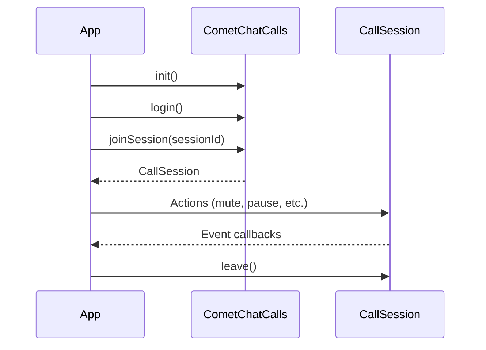

The CometChat Calls SDK enables real-time voice and video calling capabilities in your Android application. Built on top of WebRTC, it provides a complete calling solution with built-in UI components and extensive customization options.
## Prerequisites

Before integrating the Calls SDK, ensure you have:

1. **CometChat Account**: [Sign up](https://app.cometchat.com/signup) and create an app to get your App ID, Region, and API Key
2. **CometChat Users**: Users must exist in CometChat to use calling features. For testing, create users via the [Dashboard](https://app.cometchat.com) or [REST API](/rest-api/users/create). Authentication is handled by the Calls SDK - see [Authentication](/calls/android/authentication)
3. **Android Requirements**:
   - Minimum SDK: **API Level 26 (Android 8.0)** — the Calls SDK 5.1 declares `minSdk 26`, so a lower `minSdkVersion` fails the manifest merger
   - AndroidX compatibility
4. **Permissions**: Camera and microphone permissions for video/audio calls

## Call Flow

Every call is a session joined by id. Where the id comes from depends on the kind of call:

- **Direct call**: your app shares a session id (for example in a message) and each participant calls `joinSession` with it. Group calls and meetings work this way.
- **Ringing call**: the caller starts it with `CometChatCalls.initiateCall`, the Push Notifications SDK rings the callee, and both sides join the session once the callee answers. See [Ringing](/calls/android/ringing) and [Push Ringing](/calls/android/voip-calling).

## Features

<CardGroup cols={2}>

<Card title="Ringing" icon="phone" href="/calls/android/ringing">
  Start a call, ring the callee through push, show "Ringing…", answer, decline, cancel and end
</Card>

<Card title="Call Layouts" icon="grid-2" href="/calls/android/call-layouts">
  Tile and Spotlight view modes for different call scenarios
</Card>

<Card title="Audio Modes" icon="volume-high" href="/calls/android/audio-modes">
  Switch between speaker, earpiece, Bluetooth, and headphones
</Card>

<Card title="Recording" icon="circle-dot" href="/calls/android/recording">
  Record call sessions for later playback
</Card>

<Card title="Transcription" icon="closed-captioning" href="/calls/android/transcription">
  Transcribe calls, show live closed captions, and retrieve transcripts
</Card>

<Card title="Call Logs" icon="clock-rotate-left" href="/calls/android/call-logs">
  Retrieve call history and details
</Card>

<Card title="Participant Management" icon="users" href="/calls/android/participant-management">
  Mute, pin, and manage call participants
</Card>

<Card title="Screen Sharing" icon="display" href="/calls/android/screen-sharing">
  Share your screen (opt-in) and view shared screens
</Card>

<Card title="Picture-in-Picture" icon="window-restore" href="/calls/android/picture-in-picture">
  Continue calls while using other apps
</Card>

<Card title="Raise Hand" icon="hand" href="/calls/android/raise-hand">
  Signal to get attention during calls
</Card>

<Card title="Idle Timeout" icon="timer" href="/calls/android/idle-timeout">
  Automatic session termination when alone in a call
</Card>

</CardGroup>

## Architecture

The SDK is organized around these core components:

| Component | Description |
|-----------|-------------|
| `CometChatCalls` | Main entry point for SDK initialization, authentication, and session management |
| `CallAppSettings` | Configuration for SDK initialization (App ID, Region) |
| `SessionSettings` | Configuration for individual call sessions |
| `CallSession` | Singleton that manages the active call and provides control methods |
| `Listeners` | Event interfaces for session, participant, media, and UI events |

## Sample App

<CardGroup cols={2}>

<Card title="Sample App" icon="github" href="https://github.com/cometchat/calls-sdk-android/tree/v5/samples/sample-app">
  Explore the Android Calls SDK sample app on GitHub
</Card>

<Card title="Changelog" icon="list-check" href="https://github.com/cometchat/calls-sdk-android/releases">
  View the latest releases and changes
</Card>

</CardGroup>
