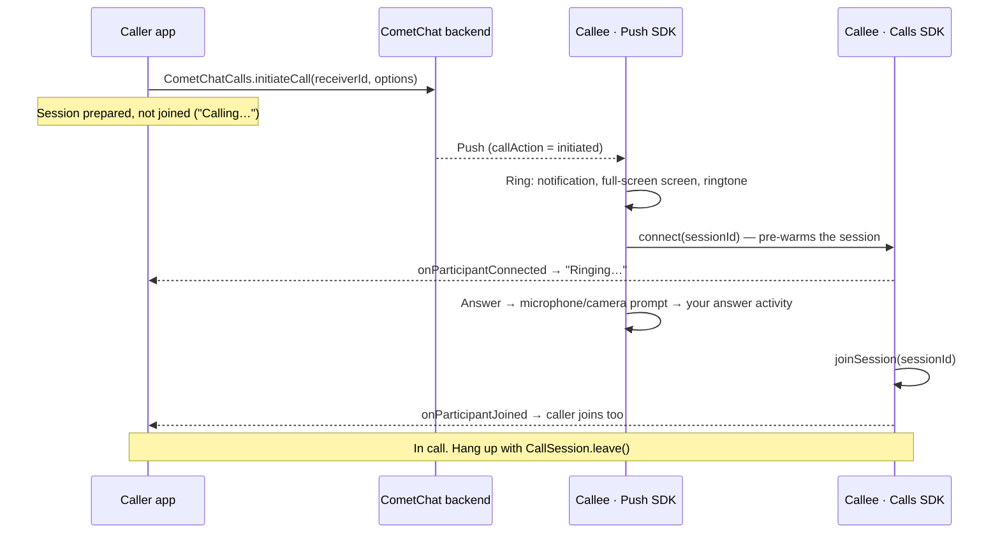

Ringing lets one user call another and lets the callee answer or decline, whether the callee's app is in the foreground, in the background or not running at all.

Two SDKs do the work:

| SDK | Owns |
|-----|------|
| **Calls SDK** (`calls-sdk-android` 5.1+) | Creating the call, the media session, answering, declining, cancelling, ending, and the call events your code listens to |
| **Push Notifications SDK, calls module** (`push-notifications-calls-android` 2.0+) | Ringing the callee's device: the call notification, the full-screen incoming-call screen, the ringtone, the ring timeout, missed calls and busy handling |

<Note>
**Coming from the earlier ringing flow?** The Chat SDK's calling methods (`CometChat.initiateCall`, `acceptCall`, `rejectCall`, `endCall`, `CallListener`) are superseded by the Calls SDK and no longer used; a coming Chat SDK release marks them deprecated. This page describes the replacement. See [Migrating from legacy ringing](/calls/android/migrating-from-legacy-ringing) for a method-by-method mapping.
</Note>

## How ringing works

The caller creates the call with the Calls SDK. The CometChat backend sends a push to the callee. The Push SDK rings the callee's device, and when the callee answers, your call screen joins the session. The caller's app learns that the callee is ringing and has answered from the Calls SDK, without joining the session first.



What each side sees:

| Stage | Caller | Callee |
|-------|--------|--------|
| Call created | `initiateCall` succeeds; show "Calling…" | Push arrives; the Push SDK rings |
| Callee's device reached | `onParticipantConnected` → show "Ringing…" | Ringing |
| Callee answers | `onParticipantJoined` → `joinSession` | Answer activity opens → `joinSession` |
| Callee declines / is busy / does not answer | `onIncomingCallEnded(call, "rejected" / "busy" / "unanswered")` | Ring stops; missed call if unanswered |
| Caller cancels | — (you ended it) | Ring stops; missed call |
| Either side hangs up | `onParticipantLeft` / `onSessionLeft` | same |

## Prerequisites

- [Calls SDK set up](/calls/android/setup) and the user [logged in](/calls/android/authentication).
- Push notifications configured with the Push Notifications SDK 2.0 calls module. The whole push side of ringing is on the [Push ringing](/calls/android/voip-calling) page; this page assumes it is done.
- `RECORD_AUDIO` and `CAMERA` declared in your manifest. The SDKs request them at runtime but do not declare them.
- `minSdk 26`.

```kotlin build.gradle.kts
dependencies {
    implementation("com.cometchat:calls-sdk-android:5.1.0")
    implementation("com.cometchat:push-notifications-android:2.0.0")
    implementation("com.cometchat:push-notifications-calls-android:2.0.0")
}
```

<Warning>
Send call pushes at **high** FCM priority. At normal priority the call still rings, but Android refuses the Push SDK's foreground service, so the process can be killed between the ring and the answer.
</Warning>

## Start a call

`CometChatCalls.initiateCall` creates the call on the backend, which rings the callee, and prepares the caller's media session. The caller does **not** join yet.

<Tabs>
<Tab title="Kotlin">
```kotlin
val options = InitiateCallOptions().apply {
    type = Constants.SESSION_TYPE_AUDIO            // or SESSION_TYPE_VIDEO
    receiverType = Constants.RECEIVER_TYPE_USER
    sessionSettings = CometChatCalls.SessionSettingsBuilder()
        .setSessionType(SessionType.VOICE)          // VIDEO for a video call
        .build()
}

CometChatCalls.initiateCall(context, receiverUid, options,
    object : CometChatCalls.CallbackListener<InitiatedCall>() {
        override fun onSuccess(call: InitiatedCall) {
            Log.d(TAG, "Calling ${call.receiver}, session ${call.sessionId}")
            showOutgoingScreen(call)
            listenOnPreparedSession(call)
        }

        override fun onError(e: CometChatException) {
            Log.e(TAG, "Could not start the call: ${e.message}")
        }
    }
)
```
</Tab>
<Tab title="Java">
```java
InitiateCallOptions options = new InitiateCallOptions();
options.setType(Constants.SESSION_TYPE_AUDIO);            // or SESSION_TYPE_VIDEO
options.setReceiverType(Constants.RECEIVER_TYPE_USER);
options.setSessionSettings(new CometChatCalls.SessionSettingsBuilder()
        .setSessionType(SessionType.VOICE)                // VIDEO for a video call
        .build());

CometChatCalls.initiateCall(context, receiverUid, options,
    new CometChatCalls.CallbackListener<InitiatedCall>() {
        @Override
        public void onSuccess(InitiatedCall call) {
            Log.d(TAG, "Calling " + call.getReceiver() + ", session " + call.getSessionId());
            showOutgoingScreen(call);
            listenOnPreparedSession(call);
        }

        @Override
        public void onError(CometChatException e) {
            Log.e(TAG, "Could not start the call: " + e.getMessage());
        }
    }
);
```
</Tab>
</Tabs>

| Parameter | Description |
|-----------|-------------|
| `receiverUid` | UID of the user to call |
| `options.type` | `Constants.SESSION_TYPE_AUDIO` or `Constants.SESSION_TYPE_VIDEO` |
| `options.receiverType` | `Constants.RECEIVER_TYPE_USER` |
| `options.sessionSettings` | The settings the caller's session is prepared with. See the warning below. |

`InitiatedCall` gives you `sessionId`, `messageId` (the id of the call message in the conversation), `sender`, `senderName`, `senderAvatar`, `receiver`, `receiverType`, `type`, `status`, `initiatedAt` and `conversationId`.

<Warning>
**Always set the session type in `sessionSettings`.** The Calls SDK freezes the session settings when it prepares the session and its default is video, so an audio call started without `setSessionType(SessionType.VOICE)` opens the caller's camera. The settings you pass here are the ones the caller later joins with, so pass the same builder to `joinSession`.
</Warning>

<Note>
There is no client-side ring timeout. Both sides stop at the ring window the backend sends in the push (45 seconds by default). A caller that wants its own screen to time out can end the call as `unanswered` after the same window, as shown under [Ring timeout](#ring-timeout).
</Note>

## Show "Ringing…" and detect the answer

The caller stays on the session that `initiateCall` prepared and listens to it. Do not call `joinSession` yet: joining only when the callee has joined keeps the caller's media off until there is someone to talk to, and it is what makes the two events below arrive.

<Tabs>
<Tab title="Kotlin">
```kotlin
fun listenOnPreparedSession(call: InitiatedCall) {
    val session = CometChatCalls.getActiveSession() ?: return
    val me = CometChatCalls.getLoggedInUser()?.uid

    session.addParticipantEventListener(this /* LifecycleOwner */, object : ParticipantEventListener() {
        // The callee's device received the push and is ringing.
        override fun onParticipantConnected(participant: Participant) {
            if (participant.uid == me) return
            setStatus("Ringing…")
        }

        // The callee answered: now the caller joins.
        override fun onParticipantJoined(participant: Participant) {
            if (participant.uid == me) return
            joinCallSession(call.sessionId, call.type)
        }
    })

    session.addSessionStatusListener(this, object : SessionStatusListener() {
        // The prepared session closed before anyone joined: the call is over.
        // The reason (rejected, busy, …) arrives through onIncomingCallEnded, usually first.
        override fun onConnectionClosed() = closeOutgoingScreen()
        override fun onSessionTimedOut() = closeOutgoingScreen()
    })
}
```
</Tab>
<Tab title="Java">
```java
void listenOnPreparedSession(InitiatedCall call) {
    CallSession session = CometChatCalls.getActiveSession();
    if (session == null) return;
    CallUser loggedIn = CometChatCalls.getLoggedInUser();
    String me = loggedIn != null ? loggedIn.getUid() : null;

    session.addParticipantEventListener(this /* LifecycleOwner */, new ParticipantEventListener() {
        // The callee's device received the push and is ringing.
        @Override
        public void onParticipantConnected(Participant participant) {
            if (participant.getUid().equals(me)) return;
            setStatus("Ringing…");
        }

        // The callee answered: now the caller joins.
        @Override
        public void onParticipantJoined(Participant participant) {
            if (participant.getUid().equals(me)) return;
            joinCallSession(call.getSessionId(), call.getType());
        }
    });

    session.addSessionStatusListener(this, new SessionStatusListener() {
        // The prepared session closed before anyone joined: the call is over.
        // The reason (rejected, busy, …) arrives through onIncomingCallEnded, usually first.
        @Override public void onConnectionClosed() { closeOutgoingScreen(); }
        @Override public void onSessionTimedOut() { closeOutgoingScreen(); }
    });
}
```
</Tab>
</Tabs>

| Event | On the prepared session it means |
|-------|----------------------------------|
| `onParticipantConnected(callee)` | The callee's phone got the push: it is ringing there |
| `onParticipantJoined(callee)` | The callee answered. Call `joinSession` now |
| `onConnectionClosed` / `onSessionTimedOut` | The call ended before anyone joined (declined, cancelled from another device, or the session died) |

Both listeners are lifecycle-aware: pass your activity or fragment as the `LifecycleOwner` and the SDK removes them when it is destroyed.

## Listen for calls starting and ending

`CometChatCalls.addIncomingCallListener` is the one place a call announces itself and its end, on both sides. The Push SDK feeds it from the push, so it fires even when nothing of yours was running when the push arrived.

<Tabs>
<Tab title="Kotlin">
```kotlin
CometChatCalls.addIncomingCallListener("my-screen", object : CometChatCalls.IncomingCallListener() {
    override fun onIncomingCallReceived(call: InitiatedCall) {
        // A call for this user is ringing. The Push SDK already shows the ring;
        // use this for your own state (badge, analytics, refreshing a list).
    }

    override fun onIncomingCallEnded(call: InitiatedCall, reason: String) {
        // Callee: the ring ended (caller cancelled, answered elsewhere, timed out, declined here).
        // Caller: your outgoing call ended with reason "rejected", "busy", "cancelled" or "unanswered".
        if (call.sessionId == currentSessionId) closeOutgoingScreen(reason)
    }
})

// When the screen goes away:
CometChatCalls.removeIncomingCallListener("my-screen")
```
</Tab>
<Tab title="Java">
```java
CometChatCalls.addIncomingCallListener("my-screen", new CometChatCalls.IncomingCallListener() {
    @Override
    public void onIncomingCallReceived(InitiatedCall call) {
        // A call for this user is ringing. The Push SDK already shows the ring;
        // use this for your own state (badge, analytics, refreshing a list).
    }

    @Override
    public void onIncomingCallEnded(InitiatedCall call, String reason) {
        // Callee: the ring ended (caller cancelled, answered elsewhere, timed out, declined here).
        // Caller: your outgoing call ended with reason "rejected", "busy", "cancelled" or "unanswered".
        if (call.getSessionId().equals(currentSessionId)) closeOutgoingScreen(reason);
    }
});

// When the screen goes away:
CometChatCalls.removeIncomingCallListener("my-screen");
```
</Tab>
</Tabs>

| Who | `onIncomingCallEnded` reason |
|-----|------------------------------|
| Caller | `rejected` (callee declined), `busy` (callee was in another call), `unanswered` (nobody answered), `cancelled` (you cancelled from another device). Never `ongoing` or `ended`. |
| Callee, still ringing | `cancelled` (caller gave up), `ongoing` (answered on another device), `rejected` / `busy` (declined here), `unanswered` (ring timed out) |
| Callee, answered | Nothing; the joined session reports the end through `onSessionLeft` / `onConnectionClosed` |

<Warning>
Listener ids are keys. Registering the same id twice replaces the first listener instead of adding a second one, so give each screen a stable id and remove it when the screen is destroyed.
</Warning>

## Answer a call

The Push SDK rings and, on **Answer**, asks for the microphone (and the camera for a video call), then starts the activity you registered with `PNConfiguration.setAnswerActivity`. That activity reads the call from its intent and joins. There is no separate "accept" call to make.

<Tabs>
<Tab title="Kotlin">
```kotlin
class CallScreenActivity : AppCompatActivity() {
    override fun onCreate(savedInstanceState: Bundle?) {
        super.onCreate(savedInstanceState)
        setContentView(R.layout.activity_call)
        setShowWhenLocked(true)
        setTurnScreenOn(true)

        val call = CallBundles.getCall(intent) ?: return finish()
        joinCallSession(call.sessionId, call.callType)
    }
}
```
</Tab>
<Tab title="Java">
```java
public class CallScreenActivity extends AppCompatActivity {
    @Override
    protected void onCreate(Bundle savedInstanceState) {
        super.onCreate(savedInstanceState);
        setContentView(R.layout.activity_call);
        setShowWhenLocked(true);
        setTurnScreenOn(true);

        IncomingCall call = CallBundles.getCall(getIntent());
        if (call == null) { finish(); return; }
        joinCallSession(call.getSessionId(), call.getCallType());
    }
}
```
</Tab>
</Tabs>

`IncomingCall` carries `sessionId`, `callerUid`, `callerName`, `callerAvatarUrl`, `callType`, `receiverType`, `conversationId` and `isVideo`.

## Join the session

Both sides join the same way: the callee from the answer activity, the caller from `onParticipantJoined`. `joinSession` takes over the session that was prepared earlier, so it connects almost at once.

<Tabs>
<Tab title="Kotlin">
```kotlin
fun joinCallSession(sessionId: String, callType: String) {
    val container = findViewById<RelativeLayout>(R.id.call_view_container)
    val isVideo = callType.equals(Constants.SESSION_TYPE_VIDEO, ignoreCase = true)

    val settings = CometChatCalls.SessionSettingsBuilder()
        .setSessionType(if (isVideo) SessionType.VIDEO else SessionType.VOICE)
        .build()

    CometChatCalls.joinSession(sessionId, settings, container,
        object : CometChatCalls.CallbackListener<CallSession>() {
            override fun onSuccess(session: CallSession) {
                Log.d(TAG, "Joined $sessionId")
            }

            override fun onError(e: CometChatException) {
                Log.e(TAG, "Join failed: ${e.message}")
                finish()
            }
        }
    )
}
```
</Tab>
<Tab title="Java">
```java
void joinCallSession(String sessionId, String callType) {
    RelativeLayout container = findViewById(R.id.call_view_container);
    boolean isVideo = Constants.SESSION_TYPE_VIDEO.equalsIgnoreCase(callType);

    SessionSettings settings = new CometChatCalls.SessionSettingsBuilder()
        .setSessionType(isVideo ? SessionType.VIDEO : SessionType.VOICE)
        .build();

    CometChatCalls.joinSession(sessionId, settings, container,
        new CometChatCalls.CallbackListener<CallSession>() {
            @Override
            public void onSuccess(CallSession session) {
                Log.d(TAG, "Joined " + sessionId);
            }

            @Override
            public void onError(CometChatException e) {
                Log.e(TAG, "Join failed: " + e.getMessage());
                finish();
            }
        }
    );
}
```
</Tab>
</Tabs>

See [Join Session](/calls/android/join-session) for the container, [Session Settings](/calls/android/session-settings) for layouts and controls, and [Events](/calls/android/events) for everything the joined session reports.

## Decline a call

Declining is handled by the Push SDK: the Decline button on the notification and on its incoming-call screen sends `endCall(sessionId, "rejected")`, and sends `"busy"` instead when the user is already in another call. The caller receives `onIncomingCallEnded` with that reason.

You only write decline code when you draw your own incoming-call screen:

<Tabs>
<Tab title="Kotlin">
```kotlin
CometChatCallNotifications.decline(context, sessionId)
```
</Tab>
<Tab title="Java">
```java
CometChatCallNotifications.decline(context, sessionId);
```
</Tab>
</Tabs>

Without the Push SDK calls module, decline through the Calls SDK directly: `CometChatCalls.endCall(sessionId, Constants.CALL_STATUS_REJECTED, listener)`.

## Cancel a call

The caller ends a call that is still ringing with `endCall` and the `cancelled` status. The callee's ring stops and a missed call is posted there.

<Tabs>
<Tab title="Kotlin">
```kotlin
fun cancelOutgoingCall(sessionId: String) {
    CometChatCalls.endCall(sessionId, Constants.CALL_STATUS_CANCELLED,
        object : CometChatCalls.CallbackListener<Void>() {
            override fun onSuccess(result: Void?) = closeOutgoingScreen()
            override fun onError(e: CometChatException) {
                Log.e(TAG, "Cancel failed: ${e.message}")
                closeOutgoingScreen()   // close locally either way
            }
        }
    )
}
```
</Tab>
<Tab title="Java">
```java
void cancelOutgoingCall(String sessionId) {
    CometChatCalls.endCall(sessionId, Constants.CALL_STATUS_CANCELLED,
        new CometChatCalls.CallbackListener<Void>() {
            @Override public void onSuccess(Void result) { closeOutgoingScreen(); }
            @Override public void onError(CometChatException e) {
                Log.e(TAG, "Cancel failed: " + e.getMessage());
                closeOutgoingScreen();   // close locally either way
            }
        }
    );
}
```
</Tab>
</Tabs>

Disable the End button after the first tap, and ignore an `onParticipantJoined` that arrives after you cancelled: the cancel wins.

## Ring timeout

The callee's Push SDK ends an unanswered 1:1 call as `unanswered` when its ring window closes (45 seconds unless the push carries a `ringTimeout`). To close the caller's screen at the same moment even if that signal is late, run your own timer from `initiateCall` and end the call with the same status:

<Tabs>
<Tab title="Kotlin">
```kotlin
handler.postDelayed({
    if (!answered) {
        CometChatCalls.endCall(sessionId, Constants.CALL_STATUS_UNANSWERED, callback)
        closeOutgoingScreen()
    }
}, 45_000L)
```
</Tab>
<Tab title="Java">
```java
handler.postDelayed(() -> {
    if (!answered) {
        CometChatCalls.endCall(sessionId, Constants.CALL_STATUS_UNANSWERED, callback);
        closeOutgoingScreen();
    }
}, 45_000L);
```
</Tab>
</Tabs>

## End a call

Hang up by leaving the session. The room tells the other side, which receives `onParticipantLeft` and then `onSessionLeft` or `onConnectionClosed`. No status needs to be sent and the call is logged by the backend.

<Tabs>
<Tab title="Kotlin">
```kotlin
val session = CometChatCalls.getActiveSession()

// The default call UI's End button has already left when this fires; only clean up.
session?.addButtonClickListener(this, object : ButtonClickListener() {
    override fun onLeaveSessionButtonClicked() = finish()
})

// Your own hang-up control:
fun hangUp() {
    CometChatCalls.getActiveSession()?.leave()
    finish()
}
```
</Tab>
<Tab title="Java">
```java
CallSession session = CometChatCalls.getActiveSession();

// The default call UI's End button has already left when this fires; only clean up.
if (session != null) {
    session.addButtonClickListener(this, new ButtonClickListener() {
        @Override public void onLeaveSessionButtonClicked() { finish(); }
    });
}

// Your own hang-up control:
void hangUp() {
    CallSession active = CometChatCalls.getActiveSession();
    if (active != null) active.leave();
    finish();
}
```
</Tab>
</Tabs>

The other participant:

<Tabs>
<Tab title="Kotlin">
```kotlin
session.addSessionStatusListener(this, object : SessionStatusListener() {
    override fun onSessionLeft() = finish()
    override fun onConnectionClosed() = finish()
})
```
</Tab>
<Tab title="Java">
```java
session.addSessionStatusListener(this, new SessionStatusListener() {
    @Override public void onSessionLeft() { finish(); }
    @Override public void onConnectionClosed() { finish(); }
});
```
</Tab>
</Tabs>

<Note>
`CallSession.leaveSession()` is deprecated in 5.1; use `leave()`. Leave only the session your screen owns: after answering a second call over a live one, the first screen's clean-up must not leave the new session.
</Note>

## Second call while in a call

Handled by the Push SDK, the same way a phone does it. A call that arrives while the user is in another call rings over it with "Answering ends your current call". **Answer** leaves the live call, prepares the new one and opens your answer activity again (with `FLAG_ACTIVITY_SINGLE_TOP`, so it arrives in `onNewIntent` if the activity is still up: open a fresh screen for the new session). **Decline** sends `busy` and keeps the live call. A call that arrives while another is already ringing, or while the user's own outgoing call is ringing, is declined as `busy` without ringing.

## Group calls

`initiateCall` is for 1:1 calls. A group call is a session every member joins with `joinSession` using a session id you share with them (for example in a custom message). If a group call rings through the push, declining it or letting it ring out sends nothing: the call carries on for the other members, and the decline is local to that device.

## Logout

Log out of the Calls SDK when the user signs out (`CometChatCalls.logout`, or `CometChatUIKit.logout` when you use the UI Kit). On that logout the Push SDK stops a call still ringing for the old user and unregisters the push token. Logging out of the Chat SDK alone leaves the Calls SDK signed in, so a ring keeps playing for the old user and later declines go out with the old token.

End or cancel any call of your own before logging out; the Calls SDK cannot send after the session is gone.

## Call status values

| Status | Meaning | Sent by |
|--------|---------|---------|
| `initiated` | Created, ringing | Backend, on `initiateCall` |
| `ongoing` | Answered | Backend, when the callee joins |
| `rejected` | Callee declined | Callee's Push SDK |
| `busy` | Callee was in another call | Callee's Push SDK |
| `cancelled` | Caller ended it before an answer | Caller, `endCall` |
| `unanswered` | Nobody answered in the ring window | Callee's Push SDK (and optionally the caller's timer) |
| `ended` | Hung up after being answered | Backend, when the session ends |
| `missed` | How an unanswered or cancelled incoming call appears in call logs | Call logs |

## Related

- [Push ringing](/calls/android/voip-calling): dependencies, `PNConfiguration`, the FCM service, answer activity, your own incoming-call screen, readiness checks and what happens when the app is killed.
- [Migrating from legacy ringing](/calls/android/migrating-from-legacy-ringing).
- [Events](/calls/android/events), [Actions](/calls/android/actions), [Call Logs](/calls/android/call-logs).
