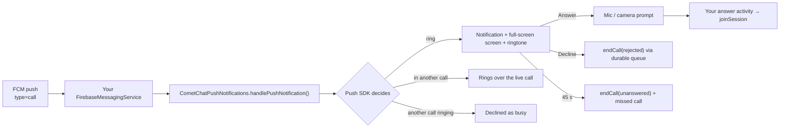

The Push Notifications SDK's calls module turns a CometChat call push into a ringing phone: a call-style notification with Answer and Decline, a full-screen screen over the lock screen, the ringtone, a ring timeout, missed-call notifications and busy handling. It works with the app in the foreground, in the background or not running at all, and needs no Telecom `ConnectionService`.

This page covers the push side of ringing. Starting, answering and ending calls with the Calls SDK is on the [Ringing](/calls/android/ringing) page.



## Prerequisites

- [Calls SDK 5.1 set up](/calls/android/setup) and the user logged in.
- A Firebase project with your Android app, `google-services.json` in the app module, and the Firebase Messaging dependency. The Push SDK never compiles against Firebase; you own it.
- Push notifications enabled in the CometChat dashboard with an **FCM** provider, and that provider's id.
- `minSdk 26`.

## Step 1: Add the dependencies

```kotlin build.gradle.kts
dependencies {
    implementation("com.cometchat:calls-sdk-android:5.1.0")
    implementation("com.cometchat:push-notifications-android:2.0.0")        // routing, tokens, chat notifications
    implementation("com.cometchat:push-notifications-calls-android:2.0.0")  // the ringer
    implementation(platform("com.google.firebase:firebase-bom:33.7.0"))
    implementation("com.google.firebase:firebase-messaging")
}
```

Adding the calls artifact is the whole opt-in: core detects it and installs the ringer. The Chat SDK is optional for both artifacts; a calls-only app works.

## Step 2: Initialise once

Run this once per install, for example in `Application.onCreate`. The configuration is saved to disk, so a push that wakes a cold process still finds it.

<Tabs>
<Tab title="Kotlin">
```kotlin
CometChatPushNotifications.init(
    this,
    PNConfiguration.Builder(APP_ID, REGION)
        .setProviderId(PROVIDER_ID)                        // FCM provider id from the dashboard
        .setAnswerActivity(CallScreenActivity::class.java) // opened on Answer, call in its intent
        .setNotificationSmallIcon(R.drawable.ic_notification)
        .setInlineReplyEnabled(true)                       // chat notifications only
        .build()
)
```
</Tab>
<Tab title="Java">
```java
CometChatPushNotifications.init(
    this,
    new PNConfiguration.Builder(APP_ID, REGION)
        .setProviderId(PROVIDER_ID)                        // FCM provider id from the dashboard
        .setAnswerActivity(CallScreenActivity.class)       // opened on Answer, call in its intent
        .setNotificationSmallIcon(R.drawable.ic_notification)
        .setInlineReplyEnabled(true)                       // chat notifications only
        .build()
);
```
</Tab>
</Tabs>

A calls-only app can start from the settings it already has: `PNConfiguration.from(callAppSettings)` in Kotlin (an extension in the calls module: `import com.cometchat.pushnotification.calls.from`), `CometChatCallPushConfig.from(callAppSettings)` in Java.

| Setter | Default | What it does |
|--------|---------|--------------|
| `setProviderId(id)` | none | The dashboard FCM provider the token is registered under |
| `setAnswerActivity(Class)` | none, **required** | Started when the user answers, with the call in its extras |
| `setCallMode(CallMode.AUTO \| MANUAL)` | `AUTO` | `AUTO` rings. `MANUAL` only parses and forwards; see [MANUAL mode](#manual-mode) |
| `setIncomingCallActivity(Class?)` | the SDK's own screen | Your full-screen ring screen; see [Your own incoming-call screen](#your-own-incoming-call-screen) |
| `setMissedCallActivity(Class?)` | none | Opened when a missed-call notification is tapped. Without it an individual missed-call notification has no tap action |
| `setNotificationSmallIcon(res)` | none | Status-bar icon for every notification |
| `setDefaultRingTimeoutMs(ms)` | 45 000 | Ring window when the push carries no `ringTimeout`; 1 s to 10 min |
| `setShowMissedCallNotification(bool)` | `true` | Post a missed-call notification |
| `setRequestCallPermissions(bool)` | `true` | Ask for microphone (and camera) on Answer |
| `setInlineReplyEnabled(bool)` | `true` | Reply from a chat notification (needs the Chat SDK) |
| `setTokenRegistrar(CHAT \| CALLS \| AUTO)`, `setAuthToken`, `setAutoRegisterToken` | `AUTO`, none, `true` | Token registration; leave the defaults |

`build()` throws if the calls module is present, the mode is `AUTO`, and no answer activity is set.

## Step 3: Delegate from your Firebase service

<Tabs>
<Tab title="Kotlin">
```kotlin
class MyFirebaseService : FirebaseMessagingService() {

    override fun onMessageReceived(message: RemoteMessage) {
        val handled = CometChatPushNotifications.handlePushNotification(
            context = this,
            data = message.data,
            sentTimeMs = message.sentTime
        )
        if (!handled) { /* not a CometChat push: your own handling */ }
    }

    override fun onNewToken(token: String) {
        CometChatPushNotifications.handleTokenRefresh(token)
    }
}
```
</Tab>
<Tab title="Java">
```java
public class MyFirebaseService extends FirebaseMessagingService {

    @Override
    public void onMessageReceived(@NonNull RemoteMessage message) {
        boolean handled = CometChatPushNotifications.handlePushNotification(
            this, message.getData(), message.getSentTime());
        if (!handled) { /* not a CometChat push: your own handling */ }
    }

    @Override
    public void onNewToken(@NonNull String token) {
        CometChatPushNotifications.handleTokenRefresh(token);
    }
}
```
</Tab>
</Tabs>

```xml AndroidManifest.xml
<service
    android:name=".MyFirebaseService"
    android:exported="false">
    <intent-filter>
        <action android:name="com.google.firebase.MESSAGING_EVENT" />
    </intent-filter>
</service>
```

<Warning>
**Pass `sentTimeMs` and hand over every push.** Firebase queues pushes while a device dozes; without the sent time a push delivered late looks fresh and rings for a call that is already over. And do not skip call pushes when the app is in the foreground: the push is the only signal that a call is coming in, in every app state.
</Warning>

<Warning>
**Send call pushes at high FCM priority.** Android lets a background app start a foreground service only with the temporary allowlist that a high-priority data message grants. At normal priority the call still rings, but the process can be killed between the ring and the answer (`BFGS denied` in logcat).
</Warning>

## Step 4: Join from the answer activity

On **Answer** the SDK stops the ring, asks for the microphone (and the camera for a video call), dismisses the keyguard and starts your answer activity with the call in its extras. Read it and join; there is nothing to "accept".

<Tabs>
<Tab title="Kotlin">
```kotlin
class CallScreenActivity : AppCompatActivity() {

    override fun onCreate(savedInstanceState: Bundle?) {
        super.onCreate(savedInstanceState)
        setContentView(R.layout.activity_call)
        setShowWhenLocked(true)
        setTurnScreenOn(true)

        val call = CallBundles.getCall(intent) ?: return finish()
        val settings = CometChatCalls.SessionSettingsBuilder()
            .setSessionType(if (call.isVideo) SessionType.VIDEO else SessionType.VOICE)
            .build()
        CometChatCalls.joinSession(call.sessionId, settings, findViewById(R.id.call_view_container),
            object : CometChatCalls.CallbackListener<CallSession>() {
                override fun onSuccess(session: CallSession) {}
                override fun onError(e: CometChatException) = finish()
            })
    }

    // A second call answered over this one arrives here (SINGLE_TOP): open a fresh screen for it.
    override fun onNewIntent(intent: Intent) {
        super.onNewIntent(intent)
        val next = CallBundles.getCall(intent) ?: return
        if (next.sessionId != CallBundles.getCall(getIntent())?.sessionId) {
            startActivity(Intent(intent).setClass(this, CallScreenActivity::class.java))
            finish()
        }
    }
}
```
</Tab>
<Tab title="Java">
```java
public class CallScreenActivity extends AppCompatActivity {

    @Override
    protected void onCreate(Bundle savedInstanceState) {
        super.onCreate(savedInstanceState);
        setContentView(R.layout.activity_call);
        setShowWhenLocked(true);
        setTurnScreenOn(true);

        IncomingCall call = CallBundles.getCall(getIntent());
        if (call == null) { finish(); return; }
        SessionSettings settings = new CometChatCalls.SessionSettingsBuilder()
            .setSessionType(call.isVideo() ? SessionType.VIDEO : SessionType.VOICE)
            .build();
        CometChatCalls.joinSession(call.getSessionId(), settings, findViewById(R.id.call_view_container),
            new CometChatCalls.CallbackListener<CallSession>() {
                @Override public void onSuccess(CallSession session) {}
                @Override public void onError(CometChatException e) { finish(); }
            });
    }

    // A second call answered over this one arrives here (SINGLE_TOP): open a fresh screen for it.
    @Override
    protected void onNewIntent(Intent intent) {
        super.onNewIntent(intent);
        IncomingCall next = CallBundles.getCall(intent);
        IncomingCall current = CallBundles.getCall(getIntent());
        if (next != null && (current == null || !next.getSessionId().equals(current.getSessionId()))) {
            startActivity(new Intent(intent).setClass(this, CallScreenActivity.class));
            finish();
        }
    }
}
```
</Tab>
</Tabs>

`IncomingCall` fields: `sessionId`, `callerUid`, `callerName`, `callerAvatarUrl`, `callType`, `receiverType`, `receiverUid`, `conversationId`, `initiatedAtMs`, `ringTimeoutMs`, `source` (`PUSH`; `WEBSOCKET` is reserved for web), `extras`, plus the derived `isVideo`, `isPeerCall`, `initials` and `expiresAtMs`. The ring window is anchored to the caller's `initiatedAtMs`, not to a timer on this device, so both sides stop ringing together however late the push arrived; prefer `expiresAtMs` to a timer of your own.

Declare the activity so it can show over the lock screen:

```xml AndroidManifest.xml
<activity
    android:name=".CallScreenActivity"
    android:exported="false"
    android:launchMode="singleTop"
    android:showWhenLocked="true"
    android:turnScreenOn="true" />
```

<Note>
The notification stays as a silent "Connecting call…" entry until the Calls SDK reports the session joined (60 s at most). Once joined, any in-call notification is yours to show; the SDK posts none. For a foreground service during the call see [Background Handling](/calls/android/background-handling).
</Note>

## Step 5: Permissions and ring readiness

Declare in the manifest what the SDKs only request:

```xml AndroidManifest.xml
<uses-permission android:name="android.permission.POST_NOTIFICATIONS" />
<uses-permission android:name="android.permission.RECORD_AUDIO" />
<uses-permission android:name="android.permission.CAMERA" />
```

Everything else (full-screen intent, foreground service of type `phoneCall`, wake lock, vibrate, the ring activity, the answer trampoline and the ring service) comes from the calls module's own manifest. No `MANAGE_OWN_CALLS`, `READ_PHONE_STATE` or `ANSWER_PHONE_CALLS`.

**Microphone and camera.** The SDK asks at the moment of answering: the answer is recorded first so the ring stops, the system prompt appears, and your answer activity opens whatever the user chose. A denied microphone joins muted and never fails the call. Ask earlier as well (at sign-in, for example) so the first call is not where the user meets the prompt, and give your call screen a way to the app's settings page for a permission denied for good. If your app prompts itself, turn the SDK prompt off with `setRequestCallPermissions(false)`.

**Ring readiness.** Several device settings silence a call with no error anywhere. Check once after sign-in and tell the user:

<Tabs>
<Tab title="Kotlin">
```kotlin
CometChatPushNotifications.ensureRingReady(this) { result ->
    val readiness = result.valueOrNull() ?: return@ensureRingReady
    if (readiness != RingReadiness.READY) {
        showBanner("Incoming calls may not ring: $readiness")
        CometChatPushNotifications.settingsIntentFor(this, readiness)?.let(::startActivity)
    }
}
```
</Tab>
<Tab title="Java">
```java
CometChatPushNotifications.ensureRingReady(this, result -> {
    RingReadiness readiness = result.valueOrNull();
    if (readiness != null && readiness != RingReadiness.READY) {
        showBanner("Incoming calls may not ring: " + readiness);
        Intent fix = CometChatPushNotifications.settingsIntentFor(this, readiness);
        if (fix != null) startActivity(fix);
    }
});
```
</Tab>
</Tabs>

| Result | Meaning |
|--------|---------|
| `READY` | Nothing in the way |
| `NOTIFICATIONS_OFF` | The app cannot post notifications. `ensureRingReady` requests `POST_NOTIFICATIONS` itself on Android 13+ |
| `CHANNEL_MUTED` | The user muted or downgraded the incoming-call channel |
| `FSI_REVOKED` | Android 14+ revoked full-screen intents: no ring screen on a locked device, only the heads-up notification |
| `DND_BLOCKING` | Do Not Disturb is filtering |
| `MICROPHONE_DENIED` | The user refused the microphone at an answer; calls still ring but join muted |

Call `ensureRingReady` only after any other permission request of yours has returned; Android drops a request made while another dialog is open.

**Diagnostics for a bug report.** `getDiagnostics(context)` returns a redacted snapshot (whether a provider id exists, never what it is; never a token or payload):

| Key | Read it as |
|-----|------------|
| `hasPersistedConfig` | `false`: `init` never ran, or ran with a different app id |
| `callsModulePresent` | `false`: the calls artifact is not on the classpath, nothing will ring |
| `answerActivityResolves` | `false`: the configured answer activity cannot be found |
| `hasProviderId`, `firebasePresent` | `false`: token registration cannot complete |
| `canUseFullScreenIntent` | `false` on Android 14+: no ring screen on a locked device |
| `incomingChannelImportance` | below `IMPORTANCE_HIGH`: no heads-up and no sound |
| `interruptionFilter` | anything but `INTERRUPTION_FILTER_ALL`: Do Not Disturb is filtering |
| `chatSdkPresent`, `chatLoggedIn`, `callMode`, `sdkInt`, `manufacturer`, `model` | Which auth token registration can use; `MANUAL` explains a phone that never rings by design; OEM background restrictions |

`verifyPushSetup(callback)` registers the token and reports `OK`, `TOKEN_NOT_REGISTERED`, `NOT_LOGGED_IN`, `TEST_PUSH_UNAVAILABLE` (registration worked, the loopback test push is not available on the backend yet: a warning, not a failure) or `TEST_PUSH_TIMEOUT` (the test push never arrived: delivery is broken).

Anything that takes a `PNCallback` can fail with `NOT_INITIALISED`, `NOT_LOGGED_IN`, `PROVIDER_REQUIRED`, `FCM_UNAVAILABLE`, `SERVER_ERROR` or `NETWORK_ERROR`. The token value is never logged, only its length and a six-character prefix.

## How a ring ends

Every way out is handled by the SDK and needs no code in your app.

| What happened | On the callee's device | What the caller learns |
|---------------|------------------------|------------------------|
| The user answers | Ring stops, "Connecting call…" until your screen joins | `onParticipantJoined` |
| The user declines | Ring stops; `endCall(sessionId, "rejected")` is queued and retried across process death | `onIncomingCallEnded(call, "rejected")` |
| The user declines while in another call | Same, with `"busy"` | `"busy"` |
| The caller cancels | Ring stops on the `cancelled` push, or sooner when the prepared session closes; missed-call notification | Nothing; the caller ended it |
| Nobody answers a 1:1 call | At the ring window (45 s by default, anchored to the caller's `initiatedAt`) the ring stops, a missed call is posted and `endCall(sessionId, "unanswered")` is sent | `"unanswered"` |
| Answered on another device | Ring stops on the `ongoing` push, no missed call | `onParticipantJoined` |
| Nobody answers a group call | Ring stops, missed call posted, **nothing sent**; the call keeps running | Nothing |
| The user declines a group call | Ring stops here only; the prepared session is left, nothing sent | Nothing |
| The user logs out while ringing | Ring stops, nothing sent, no missed call | Rings to its own window, then `"unanswered"` |

On a decline or a 1:1 timeout the SDK does not leave the prepared session first: `endCall` announces the status to the room while still in it, then leaves, so the caller hears it at once. Once the session is prepared, the Calls SDK reporting it ended also stops the ring immediately, without waiting for a terminal push.

Declines and `unanswered` go through a WorkManager queue (`cometchat-pn-decline-<sessionId>`): network required, exponential backoff from 10 s, given up after 5 attempts, and a call the server already ended (`ERR_CALL_TERMINATED`) counts as delivered.

## A call while in a call

Call waiting, the way the phone app does it. "In a call" means the Calls SDK is joined to a session, or a call answered here is still joining; a session that is only prepared while it rings does not count.

| Situation | Behaviour |
|-----------|-----------|
| Call while in a call | Rings over the live call with the normal ring; the text adds "Answering ends your current call". The live call is untouched |
| Answer (End & accept) | Leaves the live call, waits for the Calls SDK to release it, prepares the new session, opens the answer activity (`onNewIntent` if it is still up) |
| Decline | `busy` to the caller; the live call continues |
| No action | `unanswered` to the caller, missed call; the live call continues |
| Call while another one is already ringing here | Declined as `busy` without ringing, missed call. The first keeps ringing |
| Call while the user's own outgoing call is ringing | Declined as `busy` without ringing, missed call |

## Missed calls

Posted on channel `missed_calls_v1` as "Missed call" / "Missed group call" with the caller's name and call type, one per session, grouped under the SDK's own summary ("N missed calls") so Android never folds them into your other notifications. The summary is rebuilt from the tray, so it survives the process dying.

Posted when: nobody answers in the ring window; a `cancelled`, `unanswered` or `timed_out` push ends a ring here; such a push arrives for a call that never rang here (the `initiated` push was lost or overtaken); an `initiated` push arrives already expired; a call is declined as busy without ringing.

Not posted when: answered here or on another device; declined (`rejected` or `busy`) here; ended; the user's own outgoing call; logout while ringing.

Tapping the summary opens the launcher. Tapping an individual missed call opens the activity from `setMissedCallActivity` with the call in its extras; **without that setting it does nothing**. Turn missed calls off with `setShowMissedCallNotification(false)`. This is a notification only; call history comes from [Call Logs](/calls/android/call-logs).

## When the app is killed

This is the case the push exists for.

1. The high-priority push starts the app process to run your Firebase service.
2. `handlePushNotification` finds no in-memory configuration and restores it from disk, then installs the calls module.
3. If the Calls SDK is not initialised yet the module initialises it, and resolves the auth token (Chat SDK, then Calls SDK, then an explicit `setAuthToken`).
4. The ring runs on a foreground service of type `phoneCall`, so the system keeps the process alive through the answer. An alarm backs up the ring timeout.
5. On Answer, the trampoline activity asks for permissions and starts your answer activity, which joins.
6. A decline or timeout is sent through the WorkManager queue, so it goes out even if the process dies right after the tap.

Initialise the Calls SDK (and your own SDK setup) in `Application.onCreate` from stored credentials, not only after a screen opens, so the answer activity finds a ready SDK.

## Tokens

You do not register the push token. The SDK fetches it from Firebase and registers it on login, under the Chat auth token when there is one and the Calls auth token otherwise; it unregisters on logout. `registerToken()` / `unregisterToken()` exist for apps that set `setAutoRegisterToken(false)`.

Log out of the Calls SDK when the user signs out (`CometChatCalls.logout`, or `CometChatUIKit.logout` with the UI Kit). That is what stops a ring still playing for the old user and unregisters the token; `CometChat.logout` alone does neither.

## Your own incoming-call screen

Set `setIncomingCallActivity(...)`. The SDK still owns the ringtone, the pre-warm, the timeout, the keep-alive and the decline queue; only the full-screen UI is yours.

<Tabs>
<Tab title="Kotlin">
```kotlin
class MyRingActivity : AppCompatActivity() {
    private var call: IncomingCall? = null

    override fun onCreate(savedInstanceState: Bundle?) {
        super.onCreate(savedInstanceState)
        setShowWhenLocked(true); setTurnScreenOn(true)
        val call = CallBundles.getCall(intent) ?: return finish()
        this.call = call
        setContentView(R.layout.activity_ring)
        callerName.text = call.callerName

        // Close when the ring ends elsewhere: caller cancelled, answered on another device, timed out.
        CometChatCallNotifications.onIncomingCallScreenOpened(call.sessionId) { finish() }

        answerButton.setOnClickListener {
            // Ask for RECORD_AUDIO (+ CAMERA if call.isVideo) yourself: answer() skips the SDK prompt.
            CometChatCallNotifications.answer(this, call.sessionId)
        }
        declineButton.setOnClickListener {
            CometChatCallNotifications.decline(this, call.sessionId)
            finish()
        }
    }

    override fun onDestroy() {
        call?.let { CometChatCallNotifications.onIncomingCallScreenClosed(it.sessionId) }
        super.onDestroy()
    }
}
```
</Tab>
<Tab title="Java">
```java
public class MyRingActivity extends AppCompatActivity {
    private IncomingCall call;

    @Override
    protected void onCreate(Bundle savedInstanceState) {
        super.onCreate(savedInstanceState);
        setShowWhenLocked(true); setTurnScreenOn(true);
        call = CallBundles.getCall(getIntent());
        if (call == null) { finish(); return; }
        setContentView(R.layout.activity_ring);
        callerName.setText(call.getCallerName());

        // Close when the ring ends elsewhere: caller cancelled, answered on another device, timed out.
        CometChatCallNotifications.onIncomingCallScreenOpened(call.getSessionId(), (Runnable) this::finish);

        answerButton.setOnClickListener(v -> {
            // Ask for RECORD_AUDIO (+ CAMERA if call.isVideo()) yourself: answer() skips the SDK prompt.
            CometChatCallNotifications.answer(this, call.getSessionId());
        });
        declineButton.setOnClickListener(v -> {
            CometChatCallNotifications.decline(this, call.getSessionId());
            finish();
        });
    }

    @Override
    protected void onDestroy() {
        if (call != null) CometChatCallNotifications.onIncomingCallScreenClosed(call.getSessionId());
        super.onDestroy();
    }
}
```
</Tab>
</Tabs>

If the same activity is also your answer activity (one screen that rings, then becomes the call), the ring ends with `RING_END_ANSWERED` a moment before the answer intent reaches it through `onNewIntent`. Use the overload that passes the reason and finish only on other reasons:

```kotlin
CometChatCallNotifications.onIncomingCallScreenOpened(call.sessionId) { reason ->
    if (reason != CometChatCallNotifications.RING_END_ANSWERED) finish()
}
```

Without `onIncomingCallScreenOpened`, a cancelled call leaves your screen on the lock screen showing an Answer button for a call that no longer exists.

## Theming the SDK's incoming-call screen

The SDK's screen and notifications read their look from resources. Override any of them by name in your app's `res/` (an app's resource wins over the library's); there is no runtime theme API.

| Colour | Default | Used for |
|--------|---------|----------|
| `cometchat_pn_call_background` | `#0E0E10` | Screen background |
| `cometchat_pn_call_text` | `#F2F2F2` | Caller name |
| `cometchat_pn_call_text_secondary` | `#9A9AA1` | "Incoming audio call" line |
| `cometchat_pn_call_avatar` | `#3B5BDB` | Initials circle |
| `cometchat_pn_call_accept` | `#1B8F3A` | Answer button, notification Answer action |
| `cometchat_pn_call_decline` | `#C62828` | Decline button, notification Decline action |

```xml res/values/colors.xml
<color name="cometchat_pn_call_background">#FFFFFF</color>
<color name="cometchat_pn_call_text">#141414</color>
<color name="cometchat_pn_call_accept">#09C26F</color>
<color name="cometchat_pn_call_decline">#F44649</color>
```

Also overridable:

- **Strings**: `cometchat_pn_incoming_call_text`, `cometchat_pn_incoming_group_call_text`, `cometchat_pn_action_answer`, `cometchat_pn_action_decline`, `cometchat_pn_call_type_audio`, `cometchat_pn_call_type_video`, `cometchat_pn_connecting_call_text`, `cometchat_pn_call_waiting_text`, `cometchat_pn_missed_call_title`, `cometchat_pn_missed_group_call_title`, `cometchat_pn_missed_call_text`, `cometchat_pn_missed_calls_summary`, and the channel names and descriptions `cometchat_pn_channel_{incoming,ongoing,missed}_{name,description}`.
- **Drawables**: `cometchat_pn_ic_call`, `cometchat_pn_ic_call_end`, `cometchat_pn_ic_notification_call`, `cometchat_pn_ic_notification_call_missed`, `cometchat_pn_bg_button_accept`, `cometchat_pn_bg_button_decline`, `cometchat_pn_bg_avatar_circle`.
- **Theme**: `CometChatPNIncomingCallTheme`.
- **Layout**: `cometchat_pn_activity_incoming_call`, which must keep the view ids `cometchat_pn_initials`, `cometchat_pn_caller_name`, `cometchat_pn_call_type`, `cometchat_pn_decline` and `cometchat_pn_answer`.

The avatar is always the caller's initials; the screen does not load the avatar URL. The ringtone is the device's default ringtone on channel `incoming_calls_v1`; because Android freezes a channel's sound at creation, the SDK never changes it afterwards.

<Note>
If you use the CometChat UI Kit, it already overrides the six colours with its own light and dark palette. Your app's override still wins over the UI Kit's.
</Note>

## MANUAL mode

`setCallMode(CallMode.MANUAL)` makes the SDK parse, gate and forward only. It never rings and never touches the Calls SDK on its own. The call reaches `CometChatCalls.IncomingCallListener.onIncomingCallReceived`, and from there every step is yours:

```kotlin
CometChatCallNotifications.Calls.showIncomingNotification(context, call)   // post the ring, arm expiry
CometChatCallNotifications.Calls.verify(context, call)                     // pre-warm connect()
CometChatCallNotifications.Calls.keepAlive(context, call)                  // foreground service while ringing
CometChatCallNotifications.Calls.stopRinging(context, sessionId)
CometChatCallNotifications.Calls.showMissedCall(context, call)
```

<Warning>
In MANUAL mode with nothing built, the call is silently lost: no notification, no ringtone, no screen, nothing sent to the caller, who rings out to `unanswered`. Use MANUAL only if you are rebuilding the whole ring.
</Warning>

## Knowing about a call in your own code

Listen on the Calls SDK, not on this SDK. It is the same callback whether the call arrived by push on a killed process or on a live one:

```kotlin
CometChatCalls.addIncomingCallListener("my-screen", object : CometChatCalls.IncomingCallListener() {
    override fun onIncomingCallReceived(call: InitiatedCall) { /* badge, list refresh, analytics */ }
    override fun onIncomingCallEnded(call: InitiatedCall, reason: String) { /* … */ }
})
```

Ids are keys: the same id registered twice replaces the listener. Remove it when the screen goes away.

## Push SDK identifiers

| Kind | Value |
|------|-------|
| Notification channels | `incoming_calls_v1` (high, ringtone, vibration), `ongoing_calls_v1` (low, "Connecting call…"), `missed_calls_v1` (default) |
| Statuses the SDK sends with `endCall` | `rejected`, `busy`, `unanswered` |
| Intent extras | `com.cometchat.pushnotification.calls.call.<key>`; read with `CallBundles.getCall` |
| Timings | ring window 45 s default, answer connecting cap 60 s, decline queue 5 attempts |

## Troubleshooting

| Symptom | Check |
|---------|-------|
| No push arrives | Package name matches the Firebase app; `google-services.json` present; provider id set; the user is logged in (the token registers on login) |
| Push arrives, nothing rings | `handlePushNotification` is called for every push with `sentTimeMs`; `ensureRingReady` is `READY`; the push was not older than its ring window |
| Rings but no full-screen screen on a locked phone | `FSI_REVOKED` on Android 14+: send the user to the settings page from `settingsIntentFor` |
| Rings, then the process dies before Answer | Call pushes sent at normal priority (`BFGS denied`); send at high priority |
| Caller never sees "Ringing…" | The caller joined right after `initiateCall` instead of listening on the prepared session |
| Ring keeps playing after the user logged out | The app logged out of the Chat SDK only; also log out of the Calls SDK |
| Tapping a missed call does nothing | Set `setMissedCallActivity` |
| Two ringtones or two screens | Legacy app-side ringing (`CallListener` overlay, own sound) still in place; remove it |

## Related

- [Ringing](/calls/android/ringing): starting, answering and ending calls with the Calls SDK.
- [Migrating from legacy ringing](/calls/android/migrating-from-legacy-ringing).
- [Background Handling](/calls/android/background-handling): a foreground service during the call.
- [Android Push Notifications](/notifications/android-push-notifications): chat notifications with the same SDK.
