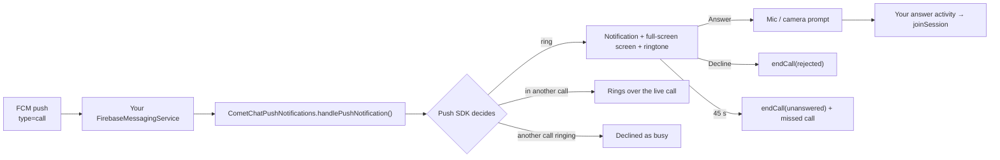

The Push Notifications SDK's calls module turns a CometChat call push into a ringing phone: a call-style notification with Answer and Decline, a full-screen screen over the lock screen, the ringtone, a ring timeout, missed-call notifications and busy handling. It works with the app in the foreground, in the background or not running at all, and needs no Telecom `ConnectionService`.

This page covers the push side of ringing. Starting, answering and ending calls with the Calls SDK is on the [Ringing](/calls/android/ringing) page.



## Prerequisites

- [Calls SDK 5.1 set up](/calls/android/setup) and the user logged in.
- A Firebase project with your Android app, `google-services.json` in the app module, and the Firebase Messaging dependency. The Push SDK never compiles against Firebase; you own it.
- Push notifications enabled in the CometChat dashboard with an **FCM** provider, and that provider's id.
- `minSdk 26`.

## Step 1: Add the dependencies

```kotlin build.gradle.kts
dependencies {
    implementation("com.cometchat:calls-sdk-android:5.1.0")
    implementation("com.cometchat:push-notifications-android:2.0.0")        // routing, tokens, chat notifications
    implementation("com.cometchat:push-notifications-calls-android:2.0.0")  // the ringer
    implementation(platform("com.google.firebase:firebase-bom:33.7.0"))
    implementation("com.google.firebase:firebase-messaging")
}
```

Adding the calls artifact turns ringing on. The Chat SDK is optional; a calls-only app works.

## Step 2: Initialise once

Run this once per install, for example in `Application.onCreate`. The configuration is saved to disk, so a push that wakes a cold process still finds it.

<Tabs>
<Tab title="Kotlin">
```kotlin
CometChatPushNotifications.init(
    this,
    PNConfiguration.Builder(APP_ID, REGION)
        .setProviderId(PROVIDER_ID)                        // FCM provider id from the dashboard
        .setAnswerActivity(CallScreenActivity::class.java) // opened on Answer, call in its intent
        .setNotificationSmallIcon(R.drawable.ic_notification)
        .setInlineReplyEnabled(true)                       // chat notifications only
        .build()
)
```
</Tab>
<Tab title="Java">
```java
CometChatPushNotifications.init(
    this,
    new PNConfiguration.Builder(APP_ID, REGION)
        .setProviderId(PROVIDER_ID)                        // FCM provider id from the dashboard
        .setAnswerActivity(CallScreenActivity.class)       // opened on Answer, call in its intent
        .setNotificationSmallIcon(R.drawable.ic_notification)
        .setInlineReplyEnabled(true)                       // chat notifications only
        .build()
);
```
</Tab>
</Tabs>

| Setter | Default | What it does |
|--------|---------|--------------|
| `setProviderId(id)` | none | The dashboard FCM provider the token is registered under |
| `setAnswerActivity(Class)` | none, **required** | Started when the user answers, with the call in its extras |
| `setIncomingCallActivity(Class?)` | the SDK's own screen | Your full-screen ring screen; see [Your own incoming-call screen](#your-own-incoming-call-screen) |
| `setMissedCallActivity(Class?)` | none | Opened when a missed-call notification is tapped. Without it an individual missed-call notification has no tap action |
| `setNotificationSmallIcon(res)` | none | Status-bar icon for every notification |
| `setDefaultRingTimeoutMs(ms)` | 45 000 | Ring window when the push carries no `ringTimeout`; 1 s to 10 min |
| `setShowMissedCallNotification(bool)` | `true` | Post a missed-call notification |
| `setRequestCallPermissions(bool)` | `true` | Ask for microphone (and camera) on Answer |
| `setInlineReplyEnabled(bool)` | `true` | Reply from a chat notification (needs the Chat SDK) |

## Step 3: Delegate from your Firebase service

<Tabs>
<Tab title="Kotlin">
```kotlin
class MyFirebaseService : FirebaseMessagingService() {

    override fun onMessageReceived(message: RemoteMessage) {
        val handled = CometChatPushNotifications.handlePushNotification(
            context = this,
            data = message.data,
            sentTimeMs = message.sentTime
        )
        if (!handled) { /* not a CometChat push: your own handling */ }
    }

    override fun onNewToken(token: String) {
        CometChatPushNotifications.handleTokenRefresh(token)
    }
}
```
</Tab>
<Tab title="Java">
```java
public class MyFirebaseService extends FirebaseMessagingService {

    @Override
    public void onMessageReceived(@NonNull RemoteMessage message) {
        boolean handled = CometChatPushNotifications.handlePushNotification(
            this, message.getData(), message.getSentTime());
        if (!handled) { /* not a CometChat push: your own handling */ }
    }

    @Override
    public void onNewToken(@NonNull String token) {
        CometChatPushNotifications.handleTokenRefresh(token);
    }
}
```
</Tab>
</Tabs>

```xml AndroidManifest.xml
<service
    android:name=".MyFirebaseService"
    android:exported="false">
    <intent-filter>
        <action android:name="com.google.firebase.MESSAGING_EVENT" />
    </intent-filter>
</service>
```

<Warning>
**Pass `sentTimeMs` and hand over every push.** Firebase queues pushes while a device dozes; without the sent time a push delivered late looks fresh and rings for a call that is already over. And do not skip call pushes when the app is in the foreground: the push is the only signal that a call is coming in, in every app state.
</Warning>

<Warning>
**Send call pushes at high FCM priority.** Android lets a background app start a foreground service only with the temporary allowlist that a high-priority data message grants. At normal priority the call still rings, but the process can be killed between the ring and the answer (`BFGS denied` in logcat).
</Warning>

## Step 4: Join from the answer activity

On **Answer** the SDK stops the ring, asks for the microphone (and the camera for a video call) and starts your answer activity with the call in its extras. Read it and join; there is nothing to "accept".

<Tabs>
<Tab title="Kotlin">
```kotlin
class CallScreenActivity : AppCompatActivity() {

    override fun onCreate(savedInstanceState: Bundle?) {
        super.onCreate(savedInstanceState)
        setContentView(R.layout.activity_call)
        setShowWhenLocked(true)
        setTurnScreenOn(true)

        val call = CallBundles.getCall(intent) ?: return finish()
        val settings = CometChatCalls.SessionSettingsBuilder()
            .setSessionType(if (call.isVideo) SessionType.VIDEO else SessionType.VOICE)
            .build()
        CometChatCalls.joinSession(call.sessionId, settings, findViewById(R.id.call_view_container),
            object : CometChatCalls.CallbackListener<CallSession>() {
                override fun onSuccess(session: CallSession) {}
                override fun onError(e: CometChatException) = finish()
            })
    }

    // A second call answered over this one arrives here (SINGLE_TOP): open a fresh screen for it.
    override fun onNewIntent(intent: Intent) {
        super.onNewIntent(intent)
        val next = CallBundles.getCall(intent) ?: return
        if (next.sessionId != CallBundles.getCall(getIntent())?.sessionId) {
            startActivity(Intent(intent).setClass(this, CallScreenActivity::class.java))
            finish()
        }
    }
}
```
</Tab>
<Tab title="Java">
```java
public class CallScreenActivity extends AppCompatActivity {

    @Override
    protected void onCreate(Bundle savedInstanceState) {
        super.onCreate(savedInstanceState);
        setContentView(R.layout.activity_call);
        setShowWhenLocked(true);
        setTurnScreenOn(true);

        IncomingCall call = CallBundles.getCall(getIntent());
        if (call == null) { finish(); return; }
        SessionSettings settings = new CometChatCalls.SessionSettingsBuilder()
            .setSessionType(call.isVideo() ? SessionType.VIDEO : SessionType.VOICE)
            .build();
        CometChatCalls.joinSession(call.getSessionId(), settings, findViewById(R.id.call_view_container),
            new CometChatCalls.CallbackListener<CallSession>() {
                @Override public void onSuccess(CallSession session) {}
                @Override public void onError(CometChatException e) { finish(); }
            });
    }

    // A second call answered over this one arrives here (SINGLE_TOP): open a fresh screen for it.
    @Override
    protected void onNewIntent(Intent intent) {
        super.onNewIntent(intent);
        IncomingCall next = CallBundles.getCall(intent);
        IncomingCall current = CallBundles.getCall(getIntent());
        if (next != null && (current == null || !next.getSessionId().equals(current.getSessionId()))) {
            startActivity(new Intent(intent).setClass(this, CallScreenActivity.class));
            finish();
        }
    }
}
```
</Tab>
</Tabs>

`IncomingCall` gives you `sessionId`, `callerUid`, `callerName`, `callerAvatarUrl`, `isVideo`, `receiverType` and `receiverUid`.

Declare the activity so it can show over the lock screen:

```xml AndroidManifest.xml
<activity
    android:name=".CallScreenActivity"
    android:exported="false"
    android:launchMode="singleTop"
    android:showWhenLocked="true"
    android:turnScreenOn="true" />
```

<Note>
The SDK posts no notification during the call. For a foreground service while the call runs, see [Background Handling](/calls/android/background-handling).
</Note>

## Step 5: Permissions and ring readiness

Declare in the manifest what the SDKs only request:

```xml AndroidManifest.xml
<uses-permission android:name="android.permission.POST_NOTIFICATIONS" />
<uses-permission android:name="android.permission.RECORD_AUDIO" />
<uses-permission android:name="android.permission.CAMERA" />
```

Everything else comes from the calls module's own manifest.

**Microphone and camera.** The SDK asks when the user answers. A denied microphone joins muted and does not fail the call. Ask earlier as well (at sign-in, for example) so the first call is not where the user meets the prompt, and give your call screen a way to the app's settings page for a permission denied for good. If your app prompts itself, turn the SDK prompt off with `setRequestCallPermissions(false)`.

**Ring readiness.** Several device settings silence a call with no error anywhere. Check once after sign-in and tell the user:

<Tabs>
<Tab title="Kotlin">
```kotlin
CometChatPushNotifications.ensureRingReady(this) { result ->
    val readiness = result.valueOrNull() ?: return@ensureRingReady
    if (readiness != RingReadiness.READY) {
        showBanner("Incoming calls may not ring: $readiness")
        CometChatPushNotifications.settingsIntentFor(this, readiness)?.let(::startActivity)
    }
}
```
</Tab>
<Tab title="Java">
```java
CometChatPushNotifications.ensureRingReady(this, result -> {
    RingReadiness readiness = result.valueOrNull();
    if (readiness != null && readiness != RingReadiness.READY) {
        showBanner("Incoming calls may not ring: " + readiness);
        Intent fix = CometChatPushNotifications.settingsIntentFor(this, readiness);
        if (fix != null) startActivity(fix);
    }
});
```
</Tab>
</Tabs>

| Result | Meaning |
|--------|---------|
| `READY` | Nothing in the way |
| `NOTIFICATIONS_OFF` | The app cannot post notifications. `ensureRingReady` requests `POST_NOTIFICATIONS` itself on Android 13+ |
| `CHANNEL_MUTED` | The user muted or downgraded the incoming-call channel |
| `FSI_REVOKED` | Android 14+ revoked full-screen intents: no ring screen on a locked device, only the heads-up notification |
| `DND_BLOCKING` | Do Not Disturb is filtering |
| `MICROPHONE_DENIED` | The user refused the microphone at an answer; calls still ring but join muted |

Call `ensureRingReady` only after any other permission request of yours has returned; Android drops a request made while another dialog is open.

## How a ring ends

The SDK handles every way a ring ends; you write no code for it. A decline sends `rejected` to the caller (`busy` if the user is in another call). A 1:1 call nobody answers stops after the ring window (45 s by default), posts a missed call and sends `unanswered`. A cancel by the caller, or an answer on another device, stops the ring here.

A call that arrives during another call rings over it with "Answering ends your current call". Answering leaves the live call and joins the new one; declining sends `busy` and the live call continues.

## Missed calls

The SDK posts a missed-call notification when a call is not answered here. Tapping it opens the activity from `setMissedCallActivity` with the call in its extras; **without that setting the tap does nothing**. Turn them off with `setShowMissedCallNotification(false)`. Call history comes from [Call Logs](/calls/android/call-logs).

## When the app is killed

The high-priority push starts the app process and the SDK rings from its saved configuration. Initialise the Calls SDK (and your own SDK setup) in `Application.onCreate` from stored credentials, not only after a screen opens, so the answer activity finds a ready SDK.

## Tokens and logout

You do not register the push token: the SDK registers it on login and unregisters it on logout. Log out of the Calls SDK when the user signs out (`CometChatCalls.logout`, or `CometChatUIKit.logout` with the UI Kit). That stops a ring still playing for the old user and unregisters the token; `CometChat.logout` alone does neither.

## Your own incoming-call screen

Set `setIncomingCallActivity(...)`. The SDK still plays the ringtone and handles the timeout and the decline; only the full-screen UI is yours.

<Tabs>
<Tab title="Kotlin">
```kotlin
class MyRingActivity : AppCompatActivity() {
    private var call: IncomingCall? = null

    override fun onCreate(savedInstanceState: Bundle?) {
        super.onCreate(savedInstanceState)
        setShowWhenLocked(true); setTurnScreenOn(true)
        val call = CallBundles.getCall(intent) ?: return finish()
        this.call = call
        setContentView(R.layout.activity_ring)
        callerName.text = call.callerName

        // Close when the ring ends elsewhere: caller cancelled, answered on another device, timed out.
        CometChatCallNotifications.onIncomingCallScreenOpened(call.sessionId) { finish() }

        answerButton.setOnClickListener {
            // Ask for RECORD_AUDIO (+ CAMERA if call.isVideo) yourself: answer() skips the SDK prompt.
            CometChatCallNotifications.answer(this, call.sessionId)
        }
        declineButton.setOnClickListener {
            CometChatCallNotifications.decline(this, call.sessionId)
            finish()
        }
    }

    override fun onDestroy() {
        call?.let { CometChatCallNotifications.onIncomingCallScreenClosed(it.sessionId) }
        super.onDestroy()
    }
}
```
</Tab>
<Tab title="Java">
```java
public class MyRingActivity extends AppCompatActivity {
    private IncomingCall call;

    @Override
    protected void onCreate(Bundle savedInstanceState) {
        super.onCreate(savedInstanceState);
        setShowWhenLocked(true); setTurnScreenOn(true);
        call = CallBundles.getCall(getIntent());
        if (call == null) { finish(); return; }
        setContentView(R.layout.activity_ring);
        callerName.setText(call.getCallerName());

        // Close when the ring ends elsewhere: caller cancelled, answered on another device, timed out.
        CometChatCallNotifications.onIncomingCallScreenOpened(call.getSessionId(), (Runnable) this::finish);

        answerButton.setOnClickListener(v -> {
            // Ask for RECORD_AUDIO (+ CAMERA if call.isVideo()) yourself: answer() skips the SDK prompt.
            CometChatCallNotifications.answer(this, call.getSessionId());
        });
        declineButton.setOnClickListener(v -> {
            CometChatCallNotifications.decline(this, call.getSessionId());
            finish();
        });
    }

    @Override
    protected void onDestroy() {
        if (call != null) CometChatCallNotifications.onIncomingCallScreenClosed(call.getSessionId());
        super.onDestroy();
    }
}
```
</Tab>
</Tabs>

Without `onIncomingCallScreenOpened`, a cancelled call leaves your screen on the lock screen showing an Answer button for a call that no longer exists.

## Theming the SDK's incoming-call screen

The SDK's screen and notifications read their look from resources. Override any of them by name in your app's `res/` (an app's resource wins over the library's); there is no runtime theme API.

| Colour | Default | Used for |
|--------|---------|----------|
| `cometchat_pn_call_background` | `#0E0E10` | Screen background |
| `cometchat_pn_call_text` | `#F2F2F2` | Caller name |
| `cometchat_pn_call_text_secondary` | `#9A9AA1` | "Incoming audio call" line |
| `cometchat_pn_call_avatar` | `#3B5BDB` | Initials circle |
| `cometchat_pn_call_accept` | `#1B8F3A` | Answer button, notification Answer action |
| `cometchat_pn_call_decline` | `#C62828` | Decline button, notification Decline action |

```xml res/values/colors.xml
<color name="cometchat_pn_call_background">#FFFFFF</color>
<color name="cometchat_pn_call_text">#141414</color>
<color name="cometchat_pn_call_accept">#09C26F</color>
<color name="cometchat_pn_call_decline">#F44649</color>
```

The strings, drawables and layout of the screen (all prefixed `cometchat_pn_`) can be overridden the same way.

<Note>
If you use the CometChat UI Kit, it already overrides the six colours with its own light and dark palette. Your app's override still wins over the UI Kit's.
</Note>

## Knowing about a call in your own code

Listen on the Calls SDK, not on this SDK. It is the same callback whether the call arrived by push on a killed process or on a live one:

```kotlin
CometChatCalls.addIncomingCallListener("my-screen", object : CometChatCalls.IncomingCallListener() {
    override fun onIncomingCallReceived(call: InitiatedCall) { /* badge, list refresh, analytics */ }
    override fun onIncomingCallEnded(call: InitiatedCall, reason: String) { /* … */ }
})
```

Ids are keys: the same id registered twice replaces the listener. Remove it when the screen goes away.

## Troubleshooting

| Symptom | Check |
|---------|-------|
| No push arrives | Package name matches the Firebase app; `google-services.json` present; provider id set; the user is logged in (the token registers on login) |
| Push arrives, nothing rings | `handlePushNotification` is called for every push with `sentTimeMs`; `ensureRingReady` is `READY`; the push was not older than its ring window |
| Rings but no full-screen screen on a locked phone | `FSI_REVOKED` on Android 14+: send the user to the settings page from `settingsIntentFor` |
| Rings, then the process dies before Answer | Call pushes sent at normal priority (`BFGS denied`); send at high priority |
| Caller never sees "Ringing…" | The caller joined right after `initiateCall` instead of listening on the prepared session |
| Ring keeps playing after the user logged out | The app logged out of the Chat SDK only; also log out of the Calls SDK |
| Tapping a missed call does nothing | Set `setMissedCallActivity` |
| Two ringtones or two screens | Legacy app-side ringing (`CallListener` overlay, own sound) still in place; remove it |

## Related

- [Ringing](/calls/android/ringing): starting, answering and ending calls with the Calls SDK.
- [Migrating from legacy ringing](/calls/android/migrating-from-legacy-ringing).
- [Background Handling](/calls/android/background-handling): a foreground service during the call.
- [Android Push Notifications](/notifications/android-push-notifications): chat notifications with the same SDK.
