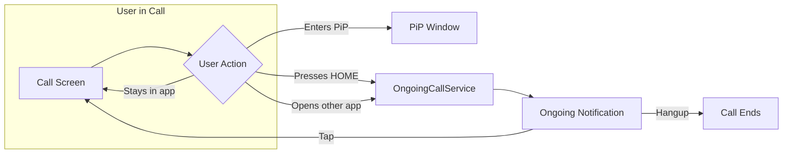

Keep calls alive when users navigate away from your app. Background handling ensures the call continues running when users press the home button, switch to another app, or lock their device.

## Overview

When a user leaves your call screen, the operating system may terminate it to free resources. The SDK provides `CometChatOngoingCallService` — a utility that:
- Keeps the call session active in the background
- Shows an ongoing notification in the status bar (Android)
- Allows users to return to the call with a single tap
- Provides a hangup action directly from the notification



## When to Use

| Scenario | Solution |
|----------|----------|
| User stays in call screen | No action needed |
| User enters Picture-in-Picture | [PiP Mode](/calls/flutter/picture-in-picture) handles this |
| User presses HOME during call | **Use CometChatOngoingCallService** |
| User switches to another app | **Use CometChatOngoingCallService** |
| Receiving calls when app is killed | [VoIP Calling](/calls/flutter/voip-calling) handles this |

<Note>
Background Handling is different from [VoIP Calling](/calls/flutter/voip-calling). VoIP handles **receiving** calls when the app is not running. Background Handling keeps a **joined** call alive when the user leaves the app, for every kind of call: ringing calls, direct calls, group calls and meetings.
</Note>

<Tip>
**Using the CometChat UI Kit?** Its call screen starts `CometChatOngoingCallService` when the call joins and stops it when the call ends. You only need to declare the service, as in [Step 1](#step-1-declare-the-service-and-permissions-android).
</Tip>

<Warning>
`CometChatOngoingCallService` starts an Android foreground service with a persistent notification showing mute/unmute and hang up actions. On iOS, this is a no-op since iOS uses CallKit for ongoing call notifications.
</Warning>

---

## Implementation

### Step 1: Declare the service and permissions (Android)

Add the ongoing call service and the notification permission to `android/app/src/main/AndroidManifest.xml`:

```xml
<manifest xmlns:android="http://schemas.android.com/apk/res/android">

    <uses-permission android:name="android.permission.POST_NOTIFICATIONS" />

    <application>
        <!-- REQUIRED. The SDK ships the service class but does not declare it for you. -->
        <service
            android:name="com.cometchatcalls.cometchatcalls_plugin.services.OngoingCallService"
            android:exported="false"
            android:foregroundServiceType="microphone|camera" />
    </application>

</manifest>
```

The Calls SDK declares the foreground service permissions the service needs (`FOREGROUND_SERVICE`, `FOREGROUND_SERVICE_MICROPHONE` and `FOREGROUND_SERVICE_CAMERA`). On Android 13 and later, request `POST_NOTIFICATIONS` at runtime as well.

<Warning>
The `<service>` element is not optional. `OngoingCallService` lives in the SDK, but an Android app must declare every service it starts in its own manifest. Without it the call keeps running while your app is open, but no ongoing notification appears and the call can be stopped as soon as the user leaves the app. The SDK logs a warning when the service is not declared.
</Warning>

#### Optional: keep the notification when the microphone is denied

If a user joins a call without granting the microphone, the call continues listen-only. To keep the ongoing notification and the background protection in that case, add the `mediaPlayback` type and its permission:

```xml
<uses-permission android:name="android.permission.FOREGROUND_SERVICE_MEDIA_PLAYBACK" />

<service
    android:name="com.cometchatcalls.cometchatcalls_plugin.services.OngoingCallService"
    android:exported="false"
    android:foregroundServiceType="mediaPlayback|microphone|camera" />
```

<Note>
Google Play asks you to justify each foreground service type your app declares. Declare `mediaPlayback` only if you can justify it for your app.
</Note>

### Step 2: Start the service on join, stop it on leave

Start the ongoing call service when the user joins the call session, and stop it when the call ends. Pass `isVideo: false` for an audio call, so the service doesn't use the camera.

```dart
import 'package:cometchat_calls_sdk/cometchat_calls_sdk.dart';
import 'package:flutter/material.dart';

class CallScreen extends StatefulWidget {
  final String sessionId;
  final bool isVideo;

  const CallScreen({super.key, required this.sessionId, required this.isVideo});

  @override
  State<CallScreen> createState() => _CallScreenState();
}

class _CallScreenState extends State<CallScreen> {
  Widget? callWidget;
  late final CallScreenSessionListener _sessionListener;

  @override
  void initState() {
    super.initState();
    _sessionListener = CallScreenSessionListener(
      isVideo: widget.isVideo,
      onCallEnded: () {
        if (mounted) Navigator.of(context).pop();
      },
    );
    CallSession.getInstance()?.addSessionStatusListener(_sessionListener);
    _joinCall();
  }

  void _joinCall() {
    final sessionSettings = (SessionSettingsBuilder()
          ..setType(widget.isVideo ? SessionType.video : SessionType.audio))
        .build();

    CometChatCalls.joinSession(
      sessionId: widget.sessionId,
      sessionSettings: sessionSettings,
      onSuccess: (Widget? widget) {
        setState(() => callWidget = widget);
      },
      onError: (CometChatCallsException e) {
        debugPrint("Failed to join: ${e.message}");
        if (mounted) Navigator.of(context).pop();
      },
    );
  }

  @override
  void dispose() {
    // Always stop the service when the call screen goes away
    CometChatOngoingCallService.abort();
    CallSession.getInstance()?.removeSessionStatusListener(_sessionListener);
    super.dispose();
  }

  @override
  Widget build(BuildContext context) {
    return Scaffold(
      body: callWidget ?? const Center(child: CircularProgressIndicator()),
    );
  }
}

class CallScreenSessionListener extends SessionStatusListeners {
  final bool isVideo;
  final VoidCallback onCallEnded;

  CallScreenSessionListener({required this.isVideo, required this.onCallEnded});

  @override
  void onSessionJoined() {
    // Start the foreground service (Android only, no-op on iOS)
    CometChatOngoingCallService.launch(isVideo: isVideo);
  }

  @override
  void onSessionLeft() {
    CometChatOngoingCallService.abort();
    onCallEnded();
  }

  @override
  void onConnectionClosed() {
    CometChatOngoingCallService.abort();
    onCallEnded();
  }
}
```

The service and its notification stay for the whole call, whether your app is in the foreground or not, until you call `abort()`.

<Note>
Flutter listeners are not lifecycle-aware. You must manually remove listeners in `dispose()` and call `CometChatOngoingCallService.abort()` to clean up.
</Note>

---

## API Reference

### CometChatOngoingCallService

| Method | Description |
|--------|-------------|
| `launch({bool? isVideo})` | Starts the Android foreground service with an ongoing notification. Pass `isVideo: false` for an audio call; when omitted, the service reads the type from the session. No-op on iOS. |
| `abort()` | Stops the foreground service and removes the notification. No-op on iOS. |

<Note>
On iOS, ongoing call state is managed by CallKit automatically. `CometChatOngoingCallService.launch()` and `abort()` are safe to call on iOS — they simply do nothing.
</Note>

---

## Related Documentation

- [Picture-in-Picture](/calls/flutter/picture-in-picture) - Keep call visible while using other apps
- [VoIP Calling](/calls/flutter/voip-calling) - Receive calls when app is killed
- [Events](/calls/flutter/events) - Listen for session events
