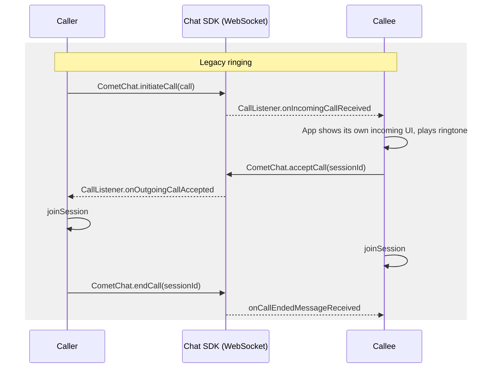
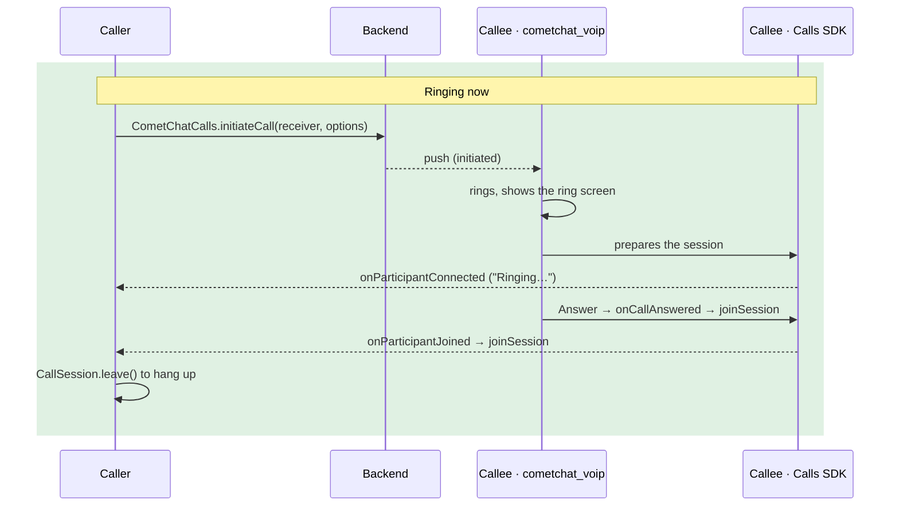

Legacy ringing signalled calls through the Chat SDK: `CometChat.initiateCall` created the call, a `CallListener` on the WebSocket told the callee, `acceptCall` and `rejectCall` answered, and the app rang the device itself, often with its own FCM, PushKit and CallKit code or `flutter_callkit_incoming`. Ringing now runs on the Calls SDK and `cometchat_voip`. The Chat SDK's calling methods are superseded by the Calls SDK and no longer used; a coming Chat SDK release marks them deprecated.

This page is the diff. For the full description of the current flow see [Ringing](/calls/flutter/ringing); for the push side see [Push Ringing](/calls/flutter/voip-calling).

{/* TODO(RC): every API on this page is from cometchat_calls_sdk 5.1.0-team and cometchat_voip 2.0.0-beta (release/2.0). Re-check against the released packages before publishing. */}

## Why it changed

| Legacy | Now |
|--------|-----|
| Incoming calls arrived on the Chat WebSocket, so a killed or backgrounded app needed separate push and CallKit code to ring | One path: the push rings in every app state, with the app killed included |
| Your app rang the device: listener, incoming screen, ringtone, busy check | `cometchat_voip` rings, draws the incoming screen, and handles busy, timeout and missed calls |
| `acceptCall`, `rejectCall` and `endCall` were requests your app had to sequence with `joinSession` | Answer means join. Decline, timeout and busy are sent by `cometchat_voip` from a queue that survives the app being killed |
| The caller only knew "accepted" or "rejected" | The caller sees "Ringing…" (the callee's phone was reached), the answer, and the reason a call ended (`rejected`, `busy`, `unanswered`, `cancelled`) |
| The Chat SDK was required for calling | The Chat SDK is needed for chat only; a calls-only app works |

## Before and after





## Step 1: Update dependencies

```yaml
dependencies:
  cometchat_calls_sdk: ^5.1.0 # was 5.0.x
  cometchat_voip: ^2.0.0      # new: rings incoming calls
  # cometchat_sdk stays for chat; it is no longer used for calls
```

{/* TODO(RC): confirm the published versions of cometchat_calls_sdk and cometchat_voip on pub.dev. */}

- `minSdk 26` on Android, `platform :ios, '15.1'` on iOS.
- Keep `firebase_core`, `firebase_messaging` and your Firebase configuration.
- Remove packages you used only to ring calls, such as `flutter_callkit_incoming`.

## Step 2: Initialize cometchat_voip

Initialize it right after the Calls SDK, from the same `CallAppSettings`:

```dart
await CometChatVoip.init(
  CometChatVoipConfig.fromCallAppSettings(
    callAppSettings,
    providerId: "PROVIDER_ID",
  ),
);
```

`callMode` defaults to `CometChatCallMode.auto`, which is what this page assumes: `cometchat_voip` rings the call and draws the ring screen. Do this in your Android background message handler too (Step 3). The options are on [Push Ringing](/calls/flutter/voip-calling#step-2-initialize).

## Step 3: Shrink your push handlers

<Tabs>
<Tab title="Before">
```dart
@pragma('vm:entry-point')
Future<void> onBackgroundMessage(RemoteMessage message) async {
  if (message.data["type"] == "call") {
    // Parse the CometChat payload, then ring with your own code
    await FlutterCallkitIncoming.showCallkitIncoming(callKitParams(message.data));
  } else {
    showChatNotification(message);
  }
}

FirebaseMessaging.onMessage.listen((RemoteMessage message) {
  // Calls were skipped in the foreground: CallListener showed them
  if (message.data["type"] != "call") showChatNotification(message);
});
```
</Tab>
<Tab title="After">
```dart
@pragma('vm:entry-point')
Future<void> onBackgroundMessage(RemoteMessage message) async {
  // Initialize the Calls SDK and cometchat_voip here first (see Push Ringing, Step 3)
  bool isCallPush = await CometChatVoip.handlePushNotification(
    message.data,
    sentTime: message.sentTime, // lets cometchat_voip drop a push delivered late
  );
  if (!isCallPush) showChatNotification(message);
}

FirebaseMessaging.onMessage.listen((RemoteMessage message) async {
  bool isCallPush = await CometChatVoip.handlePushNotification(
    message.data,
    sentTime: message.sentTime,
  );
  if (!isCallPush) showChatNotification(message);
});
```
</Tab>
</Tabs>

Never skip call pushes in the foreground any more. The WebSocket no longer carries call signalling for your app; the push is the only signal, in every app state.

On iOS, delete the PushKit and CallKit code in `AppDelegate`: `cometchat_voip` receives VoIP pushes and reports calls to CallKit itself. Keep no `PKPushRegistry` of your own; a second registry takes the VoIP pushes and those calls never ring.

## Step 4: Change the token code

<Tabs>
<Tab title="Before">
```dart
// Android
await CometChatNotifications.registerPushToken(
  PushPlatforms.FCM_FLUTTER_ANDROID,
  fcmToken: fcmToken,
  providerId: "FCM_PROVIDER_ID",
);

// iOS: the VoIP token forwarded from AppDelegate
await CometChatNotifications.registerPushToken(
  PushPlatforms.APNS_FLUTTER_VOIP,
  voipToken: voipToken,
  providerId: "APNS_VOIP_PROVIDER_ID",
);
```
</Tab>
<Tab title="After">
```dart
// Android: after login
await CometChatVoip.registerPushToken(token: fcmToken);
FirebaseMessaging.instance.onTokenRefresh.listen(CometChatVoip.handleTokenRefresh);

// iOS: nothing; cometchat_voip registers the PushKit token on login

// Before logout, on both platforms
await CometChatVoip.unregisterPushToken();
```
</Tab>
</Tabs>

Chat notifications keep their own setup; see [Flutter push notifications](/notifications/flutter-push-notifications).

## Step 5: Delete the app-side ringing

Everything in this list is now done by `cometchat_voip`. Remove it, or it will fight the new ring (two ringtones, two screens, a busy reject sent on top of `cometchat_voip`'s).

- `CometChat.addCallListener(...)` and its `onIncomingCallReceived` handler
- The incoming call screen, overlay or dialog you showed from it
- Your own ringtone for incoming calls
- The "already in a call, reject with busy" check
- Your call handling with `flutter_callkit_incoming` or a CallKit or ConnectionService integration of your own, with its event listeners
- Any "app in foreground" check around call pushes

Keep the microphone and camera usage descriptions in `Info.plist`.

## Step 6: Rewrite the call code

| Legacy | Now | Notes |
|--------|-----|-------|
| `CometChat.initiateCall(Call(...))` | `CometChatCalls.initiateCall(receiver:, options:)` | Set `options.type` and `options.sessionSettings`: the type defaults to video, and the session is prepared with these settings |
| `CallListener.onIncomingCallReceived` | Nothing to write; `cometchat_voip` rings. For your own state use `CometChatVoip.onCallRinging` | The same whether the call arrived on a killed app or a running one |
| `CallListener.onOutgoingCallAccepted` | `onParticipantJoined` for the callee, on the session `initiateCall` prepared (`CallSession.getInstance()`) | New in-between event: `onParticipantConnected` means the callee's phone is ringing |
| `CallListener.onOutgoingCallRejected` | `IncomingCallListener.onIncomingCallEnded(call, "rejected")` or `"busy"` | The caller's app needs `cometchat_voip` too |
| `CallListener.onIncomingCallCancelled` | `CometChatVoip.onCallEnded` with `cancelled`; the ring has already stopped | |
| `CallListener.onCallEndedMessageReceived` | `onSessionLeft` / `onConnectionClosed` on the joined session | |
| `CometChat.acceptCall`, then `joinSession` | `joinSession` in `CometChatVoip.onCallAnswered`. Nothing else to send | `cometchat_voip` asked for the microphone and camera on Answer |
| `CometChat.rejectCall(sessionId, rejected)` | The Decline action of `cometchat_voip`. Your own ring screen: `CometChatVoip.decline(sessionId)` | Sends `busy` by itself when the user is in another call |
| `CometChat.rejectCall(sessionId, busy)` | Nothing; `cometchat_voip` decides busy | |
| `CometChat.rejectCall(sessionId, cancelled)` | `CometChatCalls.endCall(sessionId:, status: EndCallStatus.cancelled)` | |
| `leaveSession()` and `CometChat.endCall` | `CallSession.getInstance()?.leave()` | No status to send on a hang-up; a peer call ends for both people |
| `CometChat.getActiveCall()` / `clearActiveCall()` | `CometChatCalls.getActiveSession()` | `CometChatVoip.getActiveCall()` for the call ringing on this phone |
| `CometChat.logout` | `CometChatCalls.logout` as well | Otherwise the Calls SDK stays signed in as the old user |

### Caller, before and after

<Tabs>
<Tab title="Before">
```dart
class OutgoingCallListener with CallListener {
  @override
  void onOutgoingCallAccepted(Call call) => joinCall(call.sessionId!);

  @override
  void onOutgoingCallRejected(Call call) => closeOutgoingScreen();
}

CometChat.addCallListener("outgoing-call", OutgoingCallListener());

// End button while ringing
CometChat.rejectCall(sessionId, CometChatCallStatus.cancelled,
  onSuccess: (Call call) {},
  onError: (CometChatException e) {},
);
```
</Tab>
<Tab title="After">
```dart
class ReceiverEvents extends ParticipantEventListeners {
  final InitiatedCall call;
  ReceiverEvents(this.call);

  @override
  void onParticipantConnected(Participant participant) {
    if (participant.uid == call.receiver) setStatus("Ringing…");
  }

  @override
  void onParticipantJoined(Participant participant) {
    if (participant.uid == call.receiver) joinCall(call.sessionId, isVideo: call.isVideo);
  }
}

class CallEndedListener extends IncomingCallListener {
  final String sessionId;
  CallEndedListener(this.sessionId);

  @override
  void onIncomingCallEnded(InitiatedCall call, String reason) {
    if (call.sessionId == sessionId) closeOutgoingScreen(reason); // rejected, busy, unanswered, cancelled
  }
}

// In initiateCall's onSuccess
CallSession.getInstance()?.addParticipantEventListener(ReceiverEvents(call));
CometChatCalls.addIncomingCallListener("outgoing-call", CallEndedListener(call.sessionId));

// End button while ringing
CometChatCalls.endCall(
  sessionId: sessionId,
  status: EndCallStatus.cancelled,
  onSuccess: () {},
  onError: (CometChatCallsException e) {},
);
```
</Tab>
</Tabs>

### Callee, before and after

<Tabs>
<Tab title="Before">
```dart
class IncomingCallHandler with CallListener {
  @override
  void onIncomingCallReceived(Call call) => showIncomingScreen(call);

  @override
  void onIncomingCallCancelled(Call call) => closeIncomingScreen();
}

// Accept button
CometChat.acceptCall(sessionId,
  onSuccess: (Call call) => joinCall(call.sessionId!),
  onError: (CometChatException e) {},
);

// Decline button
CometChat.rejectCall(sessionId, CometChatCallStatus.rejected,
  onSuccess: (Call call) {},
  onError: (CometChatException e) {},
);
```
</Tab>
<Tab title="After">
```dart
// cometchat_voip rings the phone and handles Answer and Decline.
CometChatVoip.onCallAnswered.listen((CometChatVoipCall call) {
  showCallScreen();
  joinCall(call.sessionId, isVideo: call.isVideo); // the user already answered
});

CometChatVoip.onCallEnded.listen((CometChatCallEnded ended) {
  // Cancelled, answered elsewhere or rang out: close anything you showed
});
```
</Tab>
</Tabs>

## Step 7: Change the logout

<Tabs>
<Tab title="Before">
```dart
await CometChatNotifications.unregisterPushToken();
CometChat.logout(
  onSuccess: (String message) {},
  onError: (CometChatException e) {},
);
```
</Tab>
<Tab title="After">
```dart
await CometChatVoip.unregisterPushToken();
CometChatCalls.logout(
  onSuccess: (String message) {},
  onError: (CometChatCallsException e) {},
);
// Log out of the Chat SDK as well if your app uses chat
```
</Tab>
</Tabs>

## If you drew your own incoming call screen

Keep it, but drive it from `cometchat_voip` instead of the `CallListener`. Set `callMode: CometChatCallMode.autoCustomScreen` and show your screen from `CometChatVoip.onRingScreenRequested`; answer with `CometChatVoip.answer(sessionId)` and decline with `CometChatVoip.decline(sessionId)`. `cometchat_voip` still rings, times out and sends the decline; only the screen is yours. See [Your own ring screen](/calls/flutter/voip-calling#your-own-ring-screen).

## What users will notice

- Calls ring with the app killed and on the lock screen.
- The caller sees "Ringing…" once the callee's phone is reached, and the reason when a call is declined or missed.
- An unanswered call stops ringing after 45 seconds.
- Missed calls appear as notifications on the callee's phone.
- A call during a call is call waiting (answering ends the current call, declining sends busy), not an automatic reject.
- The microphone and camera prompt appears on Answer the first time, on the phone that answers.

## Rolling out

Your users won't all update at once, so for a while some phones run your old app and some run the new one. Two things keep calls working between them.

**Turn on the ringing migration setting in the dashboard** before you release the new app:

1. Open your app in the [CometChat dashboard](https://app.cometchat.com).
2. Go to the calling settings. {/* TODO(RC): exact menu path */}
3. Turn on the migration setting. {/* TODO(RC): exact name of the toggle */}

{/* TODO(RC): add the dashboard screenshot here. */}

**Keep `acceptOnAnswer` on** in `CometChatVoipConfig` (it's the default). When a user on the new app answers, it also reports the answer the legacy way, so a caller still on the old app joins the call. Turn it off once every caller has the new app.

## Checklist

- [ ] `cometchat_calls_sdk` and `cometchat_voip` added; `minSdk 26` and iOS 15.1
- [ ] `cometchat_voip` initialized at app start and in the Android background message handler
- [ ] Every push goes to `handlePushNotification` with `message.sentTime`, in the foreground too
- [ ] Legacy token registration replaced; the token is unregistered before logout
- [ ] `CometChat.addCallListener`, your own incoming screen, ringtone, busy check and CallKit or `flutter_callkit_incoming` code removed
- [ ] `initiateCall` sets `type` and the session settings, with `setPeerCall(true)`
- [ ] The caller listens on the prepared session and on `IncomingCallListener`, and joins only on `onParticipantJoined`
- [ ] The callee joins in `onCallAnswered`
- [ ] Hang-up uses `leave()`; no `CometChat.endCall`
- [ ] Logout also logs out of the Calls SDK
- [ ] `checkRingReadiness` runs after login, and anything other than `ready` is shown to the user
- [ ] Call pushes are sent at high priority
- [ ] The dashboard migration setting is on before the release
- [ ] Tested on real devices: ring with the app killed, decline, cancel, no answer, a call during a call, logout while ringing
