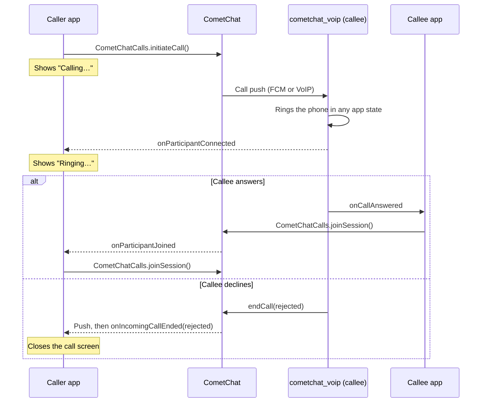

Ringing lets one user call another and lets the callee answer or decline, whether the callee's app is in the foreground, in the background, killed, or the phone is locked.

| Package | Owns |
|---------|------|
| **Calls SDK** (`cometchat_calls_sdk`) | Creating the call, the call session, cancelling and ending, and the call events your code listens to |
| **cometchat_voip** | Ringing the callee's phone: the call notification, the ring screen (CallKit on iOS), the ringtone, Answer and Decline, the ring timeout, missed calls and busy handling |

<Note>
**Coming from the earlier ringing flow?** The Chat SDK's calling methods (`CometChat.initiateCall`, `acceptCall`, `rejectCall`, `endCall`, `CallListener`) are superseded by the Calls SDK and no longer used; a coming Chat SDK release marks them deprecated. This page describes the replacement. See [Migrating from Legacy Ringing](/calls/flutter/migrating-from-legacy-ringing) for a method-by-method mapping.
</Note>

{/* TODO(RC): every API on this page is from cometchat_calls_sdk 5.1.0-team and cometchat_voip release/2.0. Re-check the snippets against the released packages before publishing. */}

## How ringing works

The caller creates the call with the Calls SDK. CometChat sends a push to the callee, `cometchat_voip` rings the callee's phone, and when the callee answers, both sides join the call session.



## Prerequisites

- The [Calls SDK set up](/calls/flutter/setup) and the user [logged in](/calls/flutter/authentication) on both devices.
- `cometchat_voip` set up on **both** the caller's and the callee's app. The whole push side of ringing is on the [Push Ringing](/calls/flutter/voip-calling) page; this page assumes it is done. The caller needs it too: a decline reaches the caller as a push.

## Start a call

`CometChatCalls.initiateCall` creates the call, which rings the callee, and prepares the caller's call session. The caller does **not** join yet.

```dart
SessionSettings callSettings({required bool isVideo}) {
  return (SessionSettingsBuilder()
        ..setType(isVideo ? SessionType.video : SessionType.audio)
        ..setPeerCall(true))
      .build();
}

void startCall(String receiverUid, {bool isVideo = false}) {
  CometChatCalls.initiateCall(
    receiver: receiverUid,
    options: InitiateCallOptions(
      type: isVideo ? CallType.video : CallType.audio,
      receiverType: ReceiverType.user,
      sessionSettings: callSettings(isVideo: isVideo),
    ),
    onSuccess: (InitiatedCall call) {
      showOutgoingScreen(call); // "Calling…"
      listenForAnswer(call);
    },
    onError: (CometChatCallsException e) {
      debugPrint("Could not start the call: ${e.message}");
    },
  );
}
```

| Parameter | Description |
|-----------|-------------|
| `receiver` | UID of the user to call, or the GUID of the group |
| `options.type` | `CallType.audio` or `CallType.video` |
| `options.receiverType` | `ReceiverType.user` (the default) for a user UID, or `ReceiverType.group` for a group GUID |
| `options.sessionSettings` | The settings the caller's session is prepared with. See the warning below. |

`InitiatedCall` gives you `sessionId`, `messageId` (the id of the call message in the conversation), `sender`, `receiver`, `receiverType`, `type`, `status`, `initiatedAt`, `conversationId` and `isVideo`.

<Warning>
**Always set the call type.** `options.type` defaults to video, so an audio call started without it rings the callee as a video call. The session settings are fixed when the session is prepared, so build them the way the call should start. For a 1:1 call include `setPeerCall(true)`, so the call ends for both users when either one hangs up; leave it off for a group call, which should carry on while members remain.
</Warning>

## Show "Ringing…" and detect the answer

The caller stays on the session that `initiateCall` prepared and listens to it. Don't call `joinSession` yet: the caller joins only once the callee has joined.

```dart
void listenForAnswer(InitiatedCall call) {
  final session = CallSession.getInstance();
  session?.addParticipantEventListener(ReceiverEvents(call));
  session?.addSessionStatusListener(PreparedSessionEvents());
  CometChatCalls.addIncomingCallListener("outgoing-call", CallEndedListener(call.sessionId));
}

class ReceiverEvents extends ParticipantEventListeners {
  final InitiatedCall call;
  ReceiverEvents(this.call);

  // The callee's phone received the push and is ringing.
  @override
  void onParticipantConnected(Participant participant) {
    if (participant.uid == call.receiver) setStatus("Ringing…");
  }

  // The callee answered: now the caller joins.
  @override
  void onParticipantJoined(Participant participant) {
    if (participant.uid == call.receiver) joinCall(call.sessionId, isVideo: call.isVideo);
  }
}

class PreparedSessionEvents extends SessionStatusListeners {
  // The prepared session closed before anyone joined: the call is over.
  // The reason (rejected, busy, …) arrives through onIncomingCallEnded, usually first.
  @override
  void onConnectionClosed() => closeOutgoingScreen();

  @override
  void onSessionTimedOut() => closeOutgoingScreen();
}
```

| Event | On the prepared session it means |
|-------|----------------------------------|
| `onParticipantConnected` (callee) | The callee's phone got the push and is ringing |
| `onParticipantJoined` (callee) | The callee answered. Call `joinSession` now |
| `onConnectionClosed` / `onSessionTimedOut` | The call ended before anyone joined |

Remove the listeners when the outgoing call screen closes (`removeParticipantEventListener`, `removeSessionStatusListener`, `CometChatCalls.removeIncomingCallListener`).

<Warning>
Don't treat the call's server status `ongoing` as the answer. The callee's phone prepares the session while it rings, so the server can report `ongoing` before anyone answers. Only `onParticipantJoined` means the callee answered.
</Warning>

## Listen for calls ending

The caller learns how a call ended from the Calls SDK's incoming call listener; the callee learns it from `cometchat_voip`.

```dart
// Caller
class CallEndedListener extends IncomingCallListener {
  final String sessionId;
  CallEndedListener(this.sessionId);

  @override
  void onIncomingCallEnded(InitiatedCall call, String reason) {
    if (call.sessionId != sessionId) return;
    // `reason` is the native end reason and its wording differs per platform.
    // Normalise it before comparing.
    closeOutgoingScreen(CometChatCallEndReason.fromWire(reason));
  }
}

// Callee
CometChatVoip.onCallEnded.listen((CometChatCallEnded ended) {
  closeRingUi(ended.call.sessionId); // ended.reason says why
});
```

| Who | How the call ended |
|-----|--------------------|
| Caller | `onIncomingCallEnded` hands you a native reason string. Normalised with `CometChatCallEndReason.fromWire(reason)`: `declined` (the callee declined, here or because they were in another call), `timedOut` (nobody answered), `cancelled` (you cancelled from another device), `answeredElsewhere` (the callee answered; on the caller this doesn't mean another of your devices), `remoteEnded` (the other side ended it, or a reason this version doesn't recognise), `failed` (the call couldn't be set up), `filtered` (dropped before it rang) |
| Callee, still ringing | `onCallEnded` reason: `cancelled` (the caller gave up), `answeredElsewhere` (answered on another device), `timedOut` (nobody answered), `declined` (declined here) |
| Callee, answered | Nothing; the joined session reports the end through `onSessionLeft` / `onConnectionClosed` |

<Note>
**Normalise the caller's reason; don't compare the raw string.** The two platforms use different words for the same end: Android reports the call status (`cancelled`, `rejected`, `busy`, `ended`, `unanswered`, `ongoing`), iOS reports a CallKit reason (`cancelled`, `declined`, `timedOut`, `answeredElsewhere`, `remoteEnded`, `failed`, `filtered`), and an end that arrives as a push is already in the second vocabulary. So `reason == "rejected"` matches on Android only. `CometChatCallEndReason.fromWire(reason)`, from `cometchat_voip`, reads every vocabulary and returns one value — the same values the callee's `onCallEnded` reports. It folds a busy decline, and Android's `ended`, into `declined`, so on the caller you can't tell "declined" from "was in another call".
</Note>

## Answer a call

`cometchat_voip` rings and, on **Answer**, asks for the microphone (and the camera for a video call) and opens your app. Listen for the answer and join. There is no separate "accept" call to make.

```dart
CometChatVoip.onCallAnswered.listen((CometChatVoipCall call) {
  showCallScreen();
  joinCall(call.sessionId, isVideo: call.isVideo);
});
```

Subscribe as early as possible after `CometChatVoip.init`. A call answered from the push that started the app is held until something listens. On iOS, `onCallAnswered` can fire while the phone is still locked; join right away, which connects the audio before the user unlocks.

## Join the session

Both sides join the same way: the callee from `onCallAnswered`, the caller from `onParticipantJoined`. `joinSession` takes over the session that was prepared earlier, so it connects almost at once.

```dart
void joinCall(String sessionId, {required bool isVideo}) {
  CometChatCalls.joinSession(
    sessionId: sessionId,
    sessionSettings: callSettings(isVideo: isVideo),
    onSuccess: (Widget? callWidget) {
      showCallWidget(callWidget); // place it in your widget tree
    },
    onError: (CometChatCallsException e) {
      debugPrint("Join failed: ${e.message}");
      closeCallScreen();
    },
  );
}
```

On iOS, join within 20 seconds of the answer; a call that hasn't joined by then is ended. See [Join Session](/calls/flutter/join-session) for rendering the call UI, [Session Settings](/calls/flutter/session-settings) for layouts and controls, and [Events](/calls/flutter/events) for everything the joined session reports.

## Decline a call

Declining is handled by `cometchat_voip`: the Decline action on the notification, the ring screen and CallKit sends `rejected`, or `busy` when the user is already in another call, and keeps retrying until it's delivered, even if the app is killed. The caller receives `onIncomingCallEnded`, which normalises to `declined` either way — see [Listen for calls ending](#listen-for-calls-ending).

You only write decline code when you draw your own ring screen:

```dart
CometChatVoip.decline(sessionId);
```

## Cancel a call

The caller ends a call that is still ringing with `endCall` and the `cancelled` status. The callee's ring stops and a missed call is shown there.

```dart
void cancelCall(String sessionId) {
  CometChatCalls.endCall(
    sessionId: sessionId,
    status: EndCallStatus.cancelled,
    onSuccess: () => closeOutgoingScreen(),
    onError: (CometChatCallsException e) {
      debugPrint("Cancel failed: ${e.message}");
      closeOutgoingScreen(); // close locally either way
    },
  );
}
```

Disable the End button after the first tap, and ignore an `onParticipantJoined` that arrives after you cancelled: the cancel wins.

## Ring timeout

The callee's `cometchat_voip` ends an unanswered 1:1 call as `unanswered` when its ring time is up (45 seconds unless the push carries its own). To close the caller's screen at the same moment even if that signal is late, run your own timer from `initiateCall` and end the call with the same status:

```dart
Timer(const Duration(seconds: 45), () {
  if (!answered) {
    CometChatCalls.endCall(
      sessionId: sessionId,
      status: EndCallStatus.unanswered,
      onSuccess: () {},
      onError: (CometChatCallsException e) {},
    );
    closeOutgoingScreen();
  }
});
```

## End a call

Hang up by leaving the session. For a peer call (`setPeerCall(true)`), the other side's session ends too, and it receives `onSessionLeft` or `onConnectionClosed`. No status needs to be sent.

```dart
Future<void> hangUp() async {
  await CallSession.getInstance()?.leave();
  closeCallScreen();
}
```

The other participant:

```dart
class CallScreenEvents extends SessionStatusListeners {
  @override
  void onSessionLeft() => closeCallScreen();

  @override
  void onConnectionClosed() => closeCallScreen();
}
```

<Note>
`leaveSession()` is deprecated; use `leave()`. Leave only the session your screen owns: after answering a second call over a live one, the first screen's clean-up must not leave the new session.
</Note>

## Second call while in a call

Handled by `cometchat_voip`, the way a phone does it. A call that arrives while the user is in another call rings over it with "Answering ends your current call" (CallKit's **End & Accept** on iOS). **Answer** ends the live call and `onCallAnswered` fires for the new one: close the old call screen and join the new call. **Decline** sends `busy` and keeps the live call. On Android, a call that arrives while another is already ringing, or while the user's own outgoing call is ringing, is declined as `busy` without ringing. See [A call while in a call](/calls/flutter/voip-calling#a-call-while-in-a-call).

## Group calls

`initiateCall` also rings a group: pass the group's GUID as `receiver` and set `options.receiverType` to `ReceiverType.group`. Every member of the group whose app is set up for ringing is rung, and the first member to answer joins the session; the others keep ringing until they answer, decline or the ring time runs out.

A group ring ends on each member's phone on its own, and nothing is sent back to the caller: a member who declines or lets the call ring out sends no `rejected` and no `unanswered`, so the caller learns only that somebody joined, through `onParticipantJoined`. Decide yourself when to give up on a group call — a timer on the caller, or `endCall` with `EndCallStatus.cancelled`.

A session every member joins without ringing is still an option: share a session id with them (for example in a custom message) and have each one call `joinSession`.

## Logout

Before logging the user out, unregister the push token with `CometChatVoip.unregisterPushToken()`, then log out of the Calls SDK with `CometChatCalls.logout`. End or cancel any call of your own first; the Calls SDK can't send after the session is gone.

## Call status values

| Status | Meaning | Sent by |
|--------|---------|---------|
| `initiated` | Created, ringing | CometChat, on `initiateCall` |
| `ongoing` | Answered | CometChat, when the callee answers |
| `rejected` | The callee declined | The callee's `cometchat_voip` |
| `busy` | The callee was in another call | The callee's `cometchat_voip` |
| `cancelled` | The caller ended it before an answer | The caller, `endCall` |
| `unanswered` | Nobody answered in the ring time | The callee's `cometchat_voip` (and optionally the caller's timer) |
| `ended` | Hung up after being answered | CometChat, when the session ends |
| `missed` | How an unanswered or cancelled incoming call appears in call logs | Call logs |

## Related

- [Push Ringing](/calls/flutter/voip-calling): packages and platform setup, initializing `cometchat_voip`, handing over pushes, the push token, ring readiness, the call modes and what happens when the app is killed.
- [Migrating from Legacy Ringing](/calls/flutter/migrating-from-legacy-ringing).
- [Events](/calls/flutter/events), [Actions](/calls/flutter/actions), [Call Logs](/calls/flutter/call-logs).
