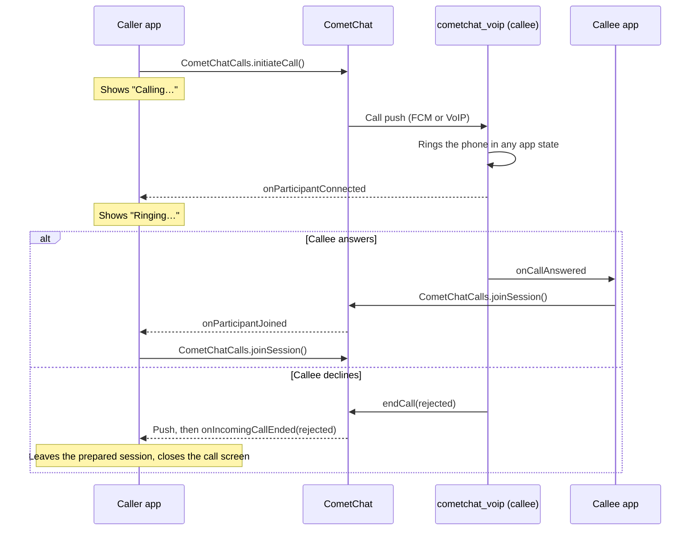

Ringing lets one user call another and lets the callee answer or decline, whether the callee's app is in the foreground, in the background, killed, or the phone is locked.

| Package | Owns |
|---------|------|
| **Calls SDK** (`cometchat_calls_sdk`) | Creating the call, the call session, cancelling and ending, and the call events your code listens to |
| **cometchat_voip** | Ringing the callee's phone: the call notification, the ring screen (CallKit on iOS), the ringtone, Answer and Decline, the ring timeout, missed calls and busy handling |

<Note>
**Coming from the earlier ringing flow?** The Chat SDK's calling methods (`CometChat.initiateCall`, `acceptCall`, `rejectCall`, `endCall`, `CallListener`) are superseded by the Calls SDK and no longer used; a coming Chat SDK release marks them deprecated. This page describes the replacement. See [Migrating from Legacy Ringing](/calls/flutter/migrating-from-legacy-ringing) for a method-by-method mapping.
</Note>

## How ringing works

The caller creates the call with the Calls SDK. CometChat sends a push to the callee, `cometchat_voip` rings the callee's phone, and when the callee answers, both sides join the call session.



## Prerequisites

- The [Calls SDK set up](/calls/flutter/setup) and the user [logged in](/calls/flutter/authentication) on both devices.
- `cometchat_voip` set up on **both** the caller's and the callee's app. The whole push side of ringing is on the [Push Ringing](/calls/flutter/voip-calling) page; this page assumes it is done. The caller needs it too: a decline reaches the caller as a push.
- The caller's microphone and camera permissions, requested by your app before `initiateCall`. `cometchat_voip` asks only on the phone that answers.

## Start a call

`CometChatCalls.initiateCall` creates the call, which rings the callee, and prepares the caller's call session. The caller does **not** join yet.

```dart
SessionSettings callSettings({required bool isVideo, bool isPeerCall = true}) {
  return SessionSettingsBuilder()
      .setType(isVideo ? SessionType.video : SessionType.audio)
      .setPeerCall(isPeerCall) // 1:1: the call ends for both when either leaves
      .startVideoPaused(!isVideo)
      // The builder defaults to the loudspeaker. A voice call on the callee's
      // phone starts on the earpiece; this matches it.
      .setAudioMode(isVideo ? AudioMode.speaker : AudioMode.earpiece)
      .build();
}

void startCall(String receiverUid, {bool isVideo = false}) {
  CometChatCalls.initiateCall(
    receiver: receiverUid,
    options: InitiateCallOptions(
      type: isVideo ? CallType.video : CallType.audio,
      receiverType: ReceiverType.user,
      sessionSettings: callSettings(isVideo: isVideo),
    ),
    onSuccess: (InitiatedCall call) {
      showOutgoingScreen(call); // "Calling…"
      listenForAnswer(call);
    },
    onError: (CometChatCallsException e) {
      debugPrint("Could not start the call: ${e.message}");
    },
  );
}
```

| Parameter | Description |
|-----------|-------------|
| `receiver` | UID of the user to call, or the GUID of the group |
| `options.type` | `CallType.audio` or `CallType.video` |
| `options.receiverType` | `ReceiverType.user` (the default) for a user UID, or `ReceiverType.group` for a group GUID |
| `options.sessionSettings` | The settings the caller's session is prepared with. See the warning below. |

`InitiatedCall` gives you `sessionId`, `messageId` (the id of the call message in the conversation), `sender`, `receiver`, `receiverType`, `type`, `status`, `initiatedAt` (in milliseconds), `conversationId`, `isVideo`, `isPeerCall` and `session`, the `CallSession` being prepared. `onSuccess` fires as soon as the call exists, while the session is still preparing.

`initiateCall` fails if a session is already being joined or is live on this device; leave it first.

<Warning>
**Set the call type in both places.** `options.type` and the session settings' type both default to video: without `options.type` an audio call rings the callee as a video call, and without `setType(SessionType.audio)` it opens the caller's camera.

**Set `setPeerCall(true)` for a 1:1 call, here.** The session settings are fixed when the session is prepared, and `initiateCall` prepares it, so the settings you pass to a later `joinSession` can't change them. Without it, a hang-up can leave the other person alone in the room. Leave it off for a group call, which should carry on while members remain. On the callee, `cometchat_voip` prepares the session itself, with the type and the peer flag the push carries.
</Warning>

## Show "Ringing…" and detect the answer

The caller stays on the session that `initiateCall` prepared and listens to it. Don't call `joinSession` yet: the caller joins only once the callee has joined.

```dart
void listenForAnswer(InitiatedCall call) {
  final session = CallSession.getInstance();
  session?.addParticipantEventListener(ReceiverEvents(call));
  session?.addSessionStatusListener(PreparedSessionEvents());
  CometChatCalls.addIncomingCallListener("outgoing-call", CallEndedListener(call.sessionId));
}

class ReceiverEvents extends ParticipantEventListeners {
  final InitiatedCall call;
  ReceiverEvents(this.call);

  // The callee's phone received the push and is ringing.
  @override
  void onParticipantConnected(Participant participant) {
    if (participant.uid == call.receiver) setStatus("Ringing…");
  }

  // The callee answered: now the caller joins.
  @override
  void onParticipantJoined(Participant participant) {
    if (participant.uid == call.receiver) joinCall(call.sessionId, isVideo: call.isVideo);
  }
}

class PreparedSessionEvents extends SessionStatusListeners {
  // The prepared session closed before anyone joined: the call is over.
  // It doesn't fire for every end; see "Listen for calls ending".
  @override
  void onConnectionClosed() => closeOutgoingScreen();
}
```

| Event | On the prepared session it means |
|-------|----------------------------------|
| `onParticipantConnected` (callee) | The callee's phone got the push and is ringing |
| `onParticipantJoined` (callee) | The callee answered. Call `joinSession` now |
| `onConnectionClosed` | The prepared session closed before anyone joined: a decline or ring-out once the callee's phone had prepared it, a cancel, the session dying, or nobody joining within 5 minutes. A busy decline, or a decline before the callee's phone connected, doesn't close it. `onSessionTimedOut` is not part of this: it only reports an idle joined session |

Remove the listeners when the outgoing call screen closes (`removeParticipantEventListener`, `removeSessionStatusListener`, `CometChatCalls.removeIncomingCallListener`).

<Warning>
Don't treat the call's server status `ongoing` as the answer. The callee's phone prepares the session while it rings, so the server can report `ongoing` before anyone answers. Only `onParticipantJoined` means the callee answered.
</Warning>

## Listen for calls ending

The caller learns how a call ended from the Calls SDK's incoming call listener; the callee learns it from `cometchat_voip`.

```dart
// Caller
class CallEndedListener extends IncomingCallListener {
  final String sessionId;
  CallEndedListener(this.sessionId);

  @override
  void onIncomingCallEnded(InitiatedCall call, String reason) {
    if (call.sessionId != sessionId) return;
    releasePreparedSession();
    closeOutgoingScreen(reason); // rejected, busy, unanswered or cancelled
  }
}

// A busy decline, or a decline before the callee's phone connected, doesn't
// close the prepared session. Leave it, or it holds the Calls SDK until it expires.
Future<void> releasePreparedSession() async {
  final session = await CometChatCalls.getActiveSession();
  if (session != null && !await session.isSessionJoined()) {
    await session.leave();
  }
}

// Callee
CometChatVoip.onCallEnded.listen((CometChatCallEnded ended) {
  closeRingUi(ended.call.sessionId); // ended.reason says why
});
```

| Who | How the call ended |
|-----|--------------------|
| Caller | `onIncomingCallEnded` hands you a call status: `rejected` (the callee declined), `busy` (the callee was in another call), `unanswered` (nobody answered), `cancelled` (you cancelled from another device). `EndCallStatus` has a constant for each |
| Callee, still ringing | `onCallEnded`, with `ended.reason` as a `CometChatCallEndReason`: `cancelled` (the caller gave up), `answeredElsewhere` (answered on another device), `timedOut` (nobody answered), `declined` (declined here), `remoteEnded` or `failed`. It can fire more than once for one call, so make your handler safe to run twice |
| Callee, answered | Nothing; the joined session reports the end through `onSessionLeft` / `onConnectionClosed` |

<Note>
On the callee, a caller's cancel reaches `onCallEnded` as `cancelled` when the push gets there first. When the prepared session closes first, the Calls SDK reports `ended`, which `cometchat_voip` maps to `declined`, so don't show "Declined" in your UI from that value alone. `ended.reason.isMissed` is `true` only for `cancelled` and `timedOut`.
</Note>

<Warning>
**The caller's reason depends on a push reaching the caller.** `cometchat_voip` hands the end push to the Calls SDK, which reports it through `onIncomingCallEnded`, so the caller's app needs `cometchat_voip` initialized and a push token registered. If that push is late or lost, and the session wasn't closed either, nothing else tells the caller. Keep the [ring timer](#ring-timeout), and if you need the answer sooner, read the call's status while it rings.
</Warning>

```dart
CometChatCalls.getCallDetails(
  sessionId,
  onSuccess: (List<CallLog> logs) {
    final status = logs.isEmpty ? null : logs.first.status;
    if (status == EndCallStatus.rejected ||
        status == EndCallStatus.busy ||
        status == EndCallStatus.unanswered) {
      releasePreparedSession();
      closeOutgoingScreen(status);
    }
  },
  onError: (CometChatCallsException e) {},
);
```

When polling, call it every few seconds and stop when the call is answered, reaches a final status, or the screen closes.

## Answer a call

`cometchat_voip` rings and, on **Answer**, hands you the call. Listen for the answer and join. There is no separate "accept" call to make.

```dart
CometChatVoip.onCallAnswered.listen((CometChatVoipCall call) {
  showCallScreen();
  joinCall(call.sessionId, isVideo: call.isVideo);
});
```

Subscribe as early as possible after `CometChatVoip.init`, in `main` rather than in a screen. A call answered from the push that started the app is held until something listens.

**On the lock screen, join without waiting for your UI.** On iOS, `onCallAnswered` can fire while the phone is still locked and before your first screen exists. Call `joinSession` straight away: the Calls SDK joins into a view of its own and hands you the widget when the join completes, so it doesn't need a window, a `BuildContext` or a navigator, and the audio connects before the user unlocks. An answered call that hasn't joined within 20 seconds is ended as failed. Show the widget when your UI comes up.

**Permissions.** With `requestCallPermissions` on (the default), `cometchat_voip` asks for the microphone, and the camera for a video call, when the user answers. It never holds up the call: the user who refuses joins without that device.

| | When it asks |
|---|-----------|
| Android | Before opening your app. On a locked phone it asks the user to unlock first; if they don't, your app opens without asking |
| iOS | After the answer is delivered, without holding up the join. On a lock-screen answer the prompt waits until the app is active, so a first call answered on the lock screen can join without the microphone until then. Ask during onboarding to avoid this |

## Join the session

Both sides join the same way: the callee from `onCallAnswered`, the caller from `onParticipantJoined`. `joinSession` takes over the session that was prepared earlier, so it connects almost at once. It keeps the settings the session was prepared with; the ones you pass here apply only if the session wasn't prepared, so pass the same values.

```dart
void joinCall(String sessionId, {required bool isVideo, bool isPeerCall = true}) {
  CometChatCalls.joinSession(
    sessionId: sessionId,
    sessionSettings: callSettings(isVideo: isVideo, isPeerCall: isPeerCall),
    onSuccess: (Widget? callWidget) {
      // Place it in your widget tree, and keep it mounted until the call ends.
      showCallWidget(callWidget);
    },
    onError: (CometChatCallsException e) {
      debugPrint("Join failed: ${e.message}");
      closeCallScreen();
    },
  );
}
```

See [Join Session](/calls/flutter/join-session) for rendering the call UI, [Session Settings](/calls/flutter/session-settings) for layouts and controls, and [Events](/calls/flutter/events) for everything the joined session reports.

## Decline a call

Declining is handled by `cometchat_voip`: the Decline action on the notification, the ring screen and CallKit sends `rejected`, or `busy` when the user is already in another call, from a queue that survives the app being killed. A group call's decline is local: nothing is sent. The caller receives `onIncomingCallEnded` — see [Listen for calls ending](#listen-for-calls-ending).

You only write decline code when you draw your own ring screen:

```dart
CometChatVoip.decline(sessionId);
```

## Cancel a call

The caller ends a call that is still ringing with `endCall` and the `cancelled` status. `endCall` leaves the prepared session first. The callee's ring stops and a missed call is shown there.

```dart
void cancelCall(String sessionId) {
  CometChatCalls.endCall(
    sessionId: sessionId,
    status: EndCallStatus.cancelled,
    onSuccess: () => closeOutgoingScreen(),
    onError: (CometChatCallsException e) {
      debugPrint("Cancel failed: ${e.message}");
      closeOutgoingScreen(); // close locally either way
    },
  );
}
```

Disable the End button after the first tap, and ignore an `onParticipantJoined` that arrives after you cancelled: the cancel wins.

## Ring timeout

The callee's `cometchat_voip` ends an unanswered 1:1 call as `unanswered` when its ring time is up (45 seconds by default, `defaultRingTimeout`, unless the push carries its own). If the callee's phone is never reached, nothing ends the caller's ringing until its prepared session expires after 5 minutes, so run your own timer from `initiateCall` and end the call with the same status. Cancel the timer when the call is answered or ends:

```dart
final ringTimer = Timer(const Duration(seconds: 45), () {
  CometChatCalls.endCall(
    sessionId: sessionId,
    status: EndCallStatus.unanswered, // EndCallStatus.cancelled for a group call
    onSuccess: () {},
    onError: (CometChatCallsException e) {},
  );
  closeOutgoingScreen();
});
```

## End a call

Hang up by leaving the session. For a peer call, which `setPeerCall(true)` must have set before the session was prepared, the other side's session ends too, and it receives `onSessionLeft` or `onConnectionClosed`. No status needs to be sent.

```dart
Future<void> hangUp() async {
  await CallSession.getInstance()?.leave();
  closeCallScreen();
}
```

The other participant:

```dart
class CallScreenEvents extends SessionStatusListeners {
  @override
  void onSessionLeft() => closeCallScreen();

  @override
  void onConnectionClosed() => closeCallScreen();
}
```

<Note>
`leaveSession()` is deprecated; use `leave()`. Leave only the session your screen owns: after answering a second call over a live one, the first screen's clean-up must not leave the new session.
</Note>

## Second call while in a call

Handled by `cometchat_voip`, the way a phone does it. A call that arrives while the user is in another call rings over it with "Answering ends your current call" (CallKit's **End & Accept** on iOS). **Answer** ends the live call and `onCallAnswered` fires for the new one once the live session has gone: close the old call screen and join the new call. **Decline** sends `busy` and keeps the live call. On Android, a call that arrives while another is already ringing, or while the user's own outgoing call is ringing, is declined as `busy` without ringing. See [A call while in a call](/calls/flutter/voip-calling#a-call-while-in-a-call).

## Group calls

`initiateCall` also rings a group: pass the group's GUID as `receiver`, set `options.receiverType` to `ReceiverType.group`, and build the session settings with `isPeerCall: false`. Every member of the group whose app is set up for ringing is rung; each one who answers joins the session, and the others keep ringing until they answer, decline or the ring time runs out. `call.receiver` is then the GUID, so on the caller treat any participant other than yourself joining as the answer.

A group ring ends on each member's phone on its own, and nothing is sent back to the caller: a member who declines or lets the call ring out sends no `rejected` and no `unanswered`, so the caller learns only that somebody joined, through `onParticipantJoined`. Decide yourself when to give up on a group call: run a timer on the caller and call `endCall` with `EndCallStatus.cancelled`.

A session every member joins without ringing is still an option: share a session id with them (for example in a custom message) and have each one call `joinSession`.

## Logout

Before logging the user out, unregister the push token with `CometChatVoip.unregisterPushToken()`, then log out of the Calls SDK with `CometChatCalls.logout`. Logging out stops a call still ringing for that user. End or cancel any call of your own first; the Calls SDK can't send after the session is gone.

## Call status values

| Status | Meaning | Sent by |
|--------|---------|---------|
| `initiated` | Created, ringing | CometChat, on `initiateCall` |
| `ongoing` | Answered | CometChat, when the callee answers |
| `rejected` | The callee declined | The callee's `cometchat_voip` |
| `busy` | The callee was in another call | The callee's `cometchat_voip` |
| `cancelled` | The caller ended it before an answer | The caller, `endCall` |
| `unanswered` | Nobody answered in the ring time | The callee's `cometchat_voip`, or the caller's timer |
| `ended` | Hung up after being answered | CometChat, when the session ends |
| `missed` | How an unanswered or cancelled incoming call appears in call logs | Call logs |

## Related

- [Push Ringing](/calls/flutter/voip-calling): packages and platform setup, initializing `cometchat_voip`, handing over pushes, the push token, ring readiness, the call modes and what happens when the app is killed.
- [Migrating from Legacy Ringing](/calls/flutter/migrating-from-legacy-ringing).
- [Events](/calls/flutter/events), [Actions](/calls/flutter/actions), [Call Logs](/calls/flutter/call-logs).
