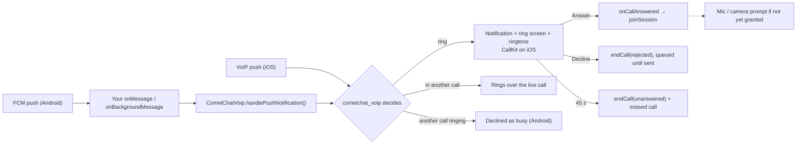

`cometchat_voip` turns a CometChat call push into a ringing phone: a call notification with Answer and Decline, a full-screen ring screen over the lock screen (CallKit on iOS), the ringtone, a ring timeout, missed calls and busy handling, whether your app is in the foreground, in the background or killed.

This page covers the push side of ringing. Starting, answering and ending calls with the Calls SDK is on the [Ringing](/calls/flutter/ringing) page.



## Prerequisites

- The [Calls SDK set up](/calls/flutter/setup) and the user [logged in](/calls/flutter/authentication).
- Push notifications enabled in the CometChat dashboard, with the push providers, Firebase project and Apple credentials set up. See [Getting Started](/notifications/push-getting-started). Keep each provider's **Provider ID** at hand.
- **Android:** Firebase set up in your app with `firebase_core` and `firebase_messaging`. Call pushes reach your app through `firebase_messaging`.
- **iOS:** an APNs provider that uses a token-based `.p8` key; a certificate provider serves only one of chat and VoIP pushes. Its Bundle ID must be your app's, and its production setting must match the build: a build run from Xcode gets a sandbox token. Test on a real device; CallKit and VoIP pushes don't run in the simulator.

## Step 1: Add the packages

```yaml
dependencies:
  cometchat_calls_sdk: ^5.1.0
  cometchat_voip: ^2.0.0
```

`cometchat_voip` brings `cometchat_calls_sdk` with it; list both so the Calls SDK version is yours to pin. The Calls SDK's own requirements on both platforms are on [Setup](/calls/flutter/setup).

<Tabs>
<Tab title="Android">
Set `minSdk 26` in `android/app/build.gradle`. `cometchat_voip` adds what ringing needs to your manifest: its ring screen, its ringing foreground service (type `phoneCall`) and the permissions for them, including `USE_FULL_SCREEN_INTENT` and `FOREGROUND_SERVICE_PHONE_CALL`, which Google Play asks you to justify.

It doesn't add the Calls SDK's ongoing call service. Your app declares that one, as described in [Background Handling](/calls/flutter/background-handling), or the microphone and camera stop when the answered call goes to the background.
</Tab>
<Tab title="iOS">
1. Build with Swift Package Manager, as [Setup](/calls/flutter/setup) describes, and set the deployment target to **15.1** on the Runner target.
2. In Xcode, add the **Push Notifications** capability, and under **Background Modes** check **Voice over IP** and **Remote notifications**.
3. Add `NSMicrophoneUsageDescription` to `Info.plist`, and `NSCameraUsageDescription` for video calls.

No `AppDelegate` code is needed: `cometchat_voip` creates the app's PushKit registry when it registers with Flutter in `didFinishLaunching`, and reports calls to CallKit. The generated `AppDelegate` is already right.
</Tab>
</Tabs>

<Warning>
Don't create a `PKPushRegistry` or a `CXProvider` of your own on iOS. A second registry takes the VoIP pushes, and those calls never ring, with no error. An app that needs to own PushKit uses `manual` mode.
</Warning>

## Step 2: Initialize

Initialize the Calls SDK and then `cometchat_voip` early in `main`, on every launch: a push that launched a killed app waits for Dart before the Calls SDK can connect the ring, and iOS doesn't wait for long. Build the configuration from the same `CallAppSettings` you give the Calls SDK, so the app ID and region match.

```dart
import 'package:cometchat_calls_sdk/cometchat_calls_sdk.dart';
import 'package:cometchat_voip/cometchat_voip.dart';

CallAppSettings callAppSettings = (CallAppSettingBuilder()
      ..appId = "APP_ID"
      ..region = "REGION")
    .build();

CometChatCalls.init(
  callAppSettings,
  onSuccess: (String success) {},
  onError: (CometChatCallsException e) {},
);

await CometChatVoip.init(
  CometChatVoipConfig.fromCallAppSettings(
    callAppSettings,
    providerId: "PROVIDER_ID", // the FCM provider on Android, the APNs provider on iOS
  ),
);
```

| Option | Default | What it does |
|--------|---------|--------------|
| `providerId` | none | The dashboard push provider the token is registered under |
| `callMode` | `CometChatCallMode.auto` | Who rings the call and draws the ring screen. See [Receive a call](#receive-a-call) |
| `defaultRingTimeout` | 45 seconds | How long a call rings when the push doesn't say |
| `showMissedCallNotification` | `true` | Show a notification for a call that rang out or was cancelled |
| `requestCallPermissions` | `true` | Ask for the microphone (and the camera for video) when the user answers |
| `requestNotificationPermission` | `true` | Ask for notification permission during `init` |
| `autoRegisterPushToken` | `true` | Register the push token again on every Calls SDK login. On Android, hand over the FCM token once first (Step 4) |
| `dropExpiredCalls` | `true` | Don't ring a push that arrives after its call stopped ringing |
| `callKit` | `CometChatCallKitOptions()` | iOS CallKit options: `localizedName`, `iconTemplateImageName`, `ringtoneSound`, `includesCallsInRecents`, `supportsVideo` |
| `incomingCallTheme` | none | Colours of the ring screen and the call notifications on Android, light and dark. See [Theming the ring screen](#theming-the-ring-screen) |
| `acceptOnAnswer` | `true` | Also mark the call answered with CometChat (status `ongoing`) when the user answers, the way the Chat SDK's `acceptCall` did. Keep it on while any caller is still on legacy ringing. See [While some users are still on legacy ringing](/calls/flutter/migrating-from-legacy-ringing#while-some-users-are-still-on-legacy-ringing) |
| `callKitAudio` | `false` | Let CallKit own the iOS audio session, with WebRTC starting audio when CallKit activates it |
| `extensionGroupID` | none | App Group shared with a Notification Service Extension |
| `authToken`, `timezone` | none | Overrides for the auth token the push token registers under and the timezone sent with it |

## Step 3: Hand call pushes to cometchat_voip

On Android, pass the data of every push your app receives to `handlePushNotification`, from both your foreground and your background message handlers. It returns `true` for a call push, which `cometchat_voip` then rings. Other pushes, such as chat messages, are left to your own handling.

```dart
// Foreground: register with FirebaseMessaging.onMessage.listen(onForegroundMessage)
Future<void> onForegroundMessage(RemoteMessage message) async {
  bool isCallPush = await CometChatVoip.handlePushNotification(
    message.data,
    sentTime: message.sentTime,
  );
  if (!isCallPush) {
    // Not a call: handle the push as you do today.
  }
}

// Background and killed: register with FirebaseMessaging.onBackgroundMessage(onBackgroundMessage)
@pragma('vm:entry-point')
Future<void> onBackgroundMessage(RemoteMessage message) async {
  // Runs in a separate isolate when the app is in the background or killed.
  await CometChatVoip.handlePushNotification(
    message.data,
    sentTime: message.sentTime,
  );
}
```

<Warning>
**Pass `sentTime` and hand over every push.** Firebase can hold a push while the phone dozes; without the sent time a push delivered late rings for a call that's already over. Don't skip call pushes when the app is in the foreground: `cometchat_voip` rings them in every app state.
</Warning>

You don't initialize anything in the background handler in the `auto` modes. `cometchat_voip` saved its configuration when `init` last ran, and the native side rings from that; if it needs the Calls SDK, for example to send a decline after the app was killed, it starts its own isolate. `CometChatVoip.init` must have run once on the device, and a call can't ring before that. In `manual` mode, where the ring is yours, initialize the Calls SDK and `cometchat_voip` in the handler first.

<Warning>
**Send call pushes at high priority.** Android only lets a background app stay alive through the answer when a high-priority push woke it.
</Warning>

On iOS there's nothing to hand over: VoIP pushes go straight to `cometchat_voip`. If your app also has chat notifications, see [If your app also rings calls](/notifications/flutter-push-notifications#if-your-app-also-rings-calls).

## Step 4: Register the push token

| Method | Platform | When |
|--------|----------|------|
| `registerPushToken(token:)` | Android | After login, on every launch, with the FCM token. In `manual` mode on iOS, with the PushKit token |
| `handleTokenRefresh(token)` | Android | When FCM issues a new token |
| `setPushToken(token)` | Android, iOS (`manual`) | When you have the token before anyone is logged in. The next Calls SDK login registers it |
| `unregisterPushToken()` | Android, iOS | Before logout, while the user's session still works |
| `handleRegistrationFailure(error)` | iOS (`manual`) | When iOS refuses to issue a token; it records the error for `getDiagnostics` |

**iOS:** in both `auto` modes `cometchat_voip` owns the `PKPushRegistry`: it obtains the PushKit VoIP token during `init` and registers it as soon as a user is logged in to the Calls SDK, at `init` if one already is, otherwise at the next login. There's nothing for you to pass.

**Android:** `cometchat_voip` can't see the FCM token, so hand it over. It keeps the token in memory only, so hand it over on every launch, not just the first: `unregisterPushToken` and `verifyPushSetup` need it in this run of the app. `unregisterPushToken` throws a `noPushToken` error if it hasn't been given one.

```dart
// Android: after login, on every launch
String? fcmToken = await FirebaseMessaging.instance.getToken();
if (fcmToken != null) {
  await CometChatVoip.registerPushToken(token: fcmToken);
}

// Android: when the token changes
FirebaseMessaging.instance.onTokenRefresh.listen(CometChatVoip.handleTokenRefresh);

// Before logout
await CometChatVoip.unregisterPushToken();
```

With `autoRegisterPushToken` on (the default), a later Calls SDK login in the same run registers the token again. A chat token registered with `cometchat_push_notifications` can be the same FCM token; CometChat keeps one entry per token.

## Step 5: Permissions and ring readiness

**Microphone and camera.** `cometchat_voip` asks on Answer, with `requestCallPermissions` on (the default), and the call joins whatever the user chose. The timing on each platform, and what happens on a locked phone, is under [Answer a call](/calls/flutter/ringing#answer-a-call). A screen of your own can check first with `permissionsToAnswer(call)` and ask with `requestCallPermissions(call)`. Nothing asks for the caller: request those permissions before `initiateCall`.

**Ring readiness.** Some device settings silence a call with no error anywhere. Check once after login and tell the user:

```dart
CometChatRingReadiness readiness = await CometChatVoip.checkRingReadiness();
if (readiness != CometChatRingReadiness.ready) {
  // Explain why to the user, then open the right settings page:
  await CometChatVoip.openSettings(readiness);
}
```

| Result | Meaning |
|--------|---------|
| `ready` | Nothing in the way |
| `notificationsOff` | The app can't show notifications (Android) |
| `channelMuted` | The user muted the incoming call notifications (Android) |
| `fullScreenIntentDenied` | Full-screen alerts aren't allowed (Android 14 and later): no ring screen on a locked phone, only the notification |
| `doNotDisturb` | Do Not Disturb is blocking calls (Android) |
| `microphoneDenied` | The user refused the microphone: calls still ring but join muted |
| `backgroundModeMissing` | The Voice over IP background mode is missing (iOS) |
| `voipEntitlementMissing` | The push notifications entitlement is missing (iOS) |

`CometChatVoip.verifyPushSetup()` checks the rest of the setup and reports `ok`, `notInitialized`, `notLoggedIn`, `tokenNotRegistered`, `tokenRegistrationFailed`, `notificationsBlocked` or `ringNotReady`. `CometChatVoip.getDiagnostics()` returns a snapshot that is safe to attach to a bug report: its `pushesSeen`, `pushesRung` and `pushesDropped` counts tell "no push arrived" from "a push arrived and was dropped".

## Receive a call

How an incoming call rings depends on `callMode`:

| | Auto | Auto + your own ring screen | Manual |
|---|---|---|---|
| `callMode` | `CometChatCallMode.auto` (default) | `CometChatCallMode.autoCustomScreen` | `CometChatCallMode.manual` |
| Ringing and the ring screen | `cometchat_voip` | `cometchat_voip` rings; the ring screen is your Flutter screen | Your app |
| Platforms | Android, iOS | Android (iOS behaves as Auto) | Android, iOS (on iOS your app owns the `PKPushRegistry`, forwards pushes with `handlePushNotification` and its token with `setPushToken`) |

In every mode, when the user answers, your app joins the call (see [Answer a call](/calls/flutter/ringing#answer-a-call)).

### Auto

`cometchat_voip` does all of the ringing, including its own ring screen. Listen for an answer, and for a call that stops ringing:

```dart
CometChatVoip.onCallAnswered.listen((CometChatVoipCall call) {
  // The user answered: show your call screen and join call.sessionId.
});

CometChatVoip.onCallEnded.listen((CometChatCallEnded ended) {
  // The call stopped ringing without an answer on this device.
  // ended.reason says why; ended.reason.isMissed is true for a missed call.
});
```

### Your own ring screen

With `callMode: CometChatCallMode.autoCustomScreen`, the full-screen alert and a tap on the notification open your Flutter ring screen instead of `cometchat_voip`'s. The notification, its ringtone, its Answer and Decline buttons and the ring timeout are still `cometchat_voip`'s. Android only.

```dart
CometChatVoip.onRingScreenRequested.listen((CometChatRingRequest request) {
  // Show your ring screen for request.call.
  // If request.answerEndsActiveCall is true, tell the user that answering ends their current call.
  // Answer button:  CometChatVoip.answer(request.call.sessionId)
  // Decline button: CometChatVoip.decline(request.call.sessionId)
});

CometChatVoip.onCallAnswered.listen((CometChatVoipCall call) {
  // Close your ring screen, then show your call screen and join.
});

CometChatVoip.onCallEnded.listen((CometChatCallEnded ended) {
  // The call stopped ringing: close your ring screen.
});
```

`answer` asks for the microphone (and the camera for a video call) by itself. A call that arrives while your app is in the foreground shows a notification instead of the full-screen alert; to show your ring screen then too, also listen to `CometChatVoip.onCallRinging`.

### Manual

With `callMode: CometChatCallMode.manual`, `cometchat_voip` only reads the push: it drops duplicates, expired calls, calls this user placed and calls meant for someone else, and passes every new call to `onCallRinging`. Every other step is yours. `ringSurfaces` is Android only and throws on iOS, where reporting a call to CallKit is the ring.

```dart
CometChatVoip.onCallRinging.listen((CometChatVoipCall call) async {
  await CometChatVoip.ringSurfaces.showIncomingNotification(call); // ring, keep alive, stop at call.expiresAt
  await CometChatVoip.ringSurfaces.verify(call);                   // the caller sees "Ringing…"
});

CometChatVoip.onCallEnded.listen((CometChatCallEnded ended) {
  CometChatVoip.ringSurfaces.stopRinging(ended.call.sessionId);
});
```

Report what the user chose with `CometChatVoip.accept(sessionId)` (fires `onCallAnswered`) or `CometChatVoip.decline(sessionId)`. `accept` reports the answer without touching a ring; in the `auto` modes use `answer`, which also stops it. For your own ring UI without `showIncomingNotification`, keep the app alive with `ringSurfaces.keepAlive(call)`, stop at `call.expiresAt` and show a missed call with `ringSurfaces.showMissedCall(call)`. A second call while one is ringing or live is yours to refuse with `decline(sessionId, busy: true)`. In Manual mode, `decline` retries a few times and then throws; it doesn't survive the app being killed.

<Warning>
In Manual mode with nothing built, the call is silently lost: no notification, no ringtone, no screen, nothing sent to the caller, who rings out to `unanswered`. Use Manual only if you are building the whole ring yourself.
</Warning>

## Theming the ring screen

On Android, the ring screen `cometchat_voip` draws in Auto mode, and its ring, connecting and missed call notifications, take each colour from, in order:

1. a `CometChatVoipIncomingCallTheme` set in code;
2. the `cometchat_voip_call_*` colour resources, which your app can override by name;
3. `cometchat_voip`'s defaults.

Each colour is looked up on its own, so a theme can set only the colours it needs. Without a theme or overrides, the screen is dark in both light and dark mode.

### In code

```dart
const theme = CometChatVoipIncomingCallTheme(
  mode: CometChatVoipIncomingCallThemeMode.system, // system (default), light or dark
  light: CometChatVoipIncomingCallColors(
    background: Color(0xFFFFFFFF),
    callerName: Color(0xFF141414),
    acceptButton: Color(0xFF09C26F),
    declineButton: Color(0xFFF44649),
  ),
  dark: CometChatVoipIncomingCallColors(
    background: Color(0xFF141414),
    callerName: Color(0xFFFFFFFF),
  ),
);

await CometChatVoip.init(
  CometChatVoipConfig.fromCallAppSettings(
    callAppSettings,
    providerId: "PROVIDER_ID",
    incomingCallTheme: theme,
  ),
);

// Later, when your app's colours change. Pass null to remove the theme.
await CometChatVoip.setIncomingCallTheme(newTheme);
```

- **Mode.** `system` follows the phone's light or dark setting when the call rings. If your app has its own light and dark switch, pass `light` or `dark`, and set the theme again when the user switches.
- **Saved.** The theme is saved when you pass it, so it also applies when a push starts your app from killed.
- **Kept across `init`.** An `init` without a theme, such as the one in your background message handler, keeps the saved theme. Remove it with `CometChatVoip.setIncomingCallTheme(null)`.
- **Last one wins.** Between `incomingCallTheme` and `setIncomingCallTheme`, the theme set last is used.
- **Only what you set.** A colour you leave out comes from its resource. In a light set, it comes from built-in light colours instead, so a light page never gets the dark default's light text.
- **Where it applies.** In Auto mode, the ring screen and the notifications. With [your own ring screen](#your-own-ring-screen), the screen is yours, so only the notifications. On iOS, CallKit draws the call and the theme does nothing.

### As resources

Override any of these by name in your app's `android/app/src/main/res/values/colors.xml`, and in `res/values-night/colors.xml` for dark mode. Your app's resource wins over `cometchat_voip`'s. Each one matches a field of `CometChatVoipIncomingCallColors`.

| Colour resource | Field | Default | Used for |
|-----------------|-------|---------|----------|
| `cometchat_voip_call_background` | `background` | `#0E0E10` | Screen, status bar and navigation bar |
| `cometchat_voip_call_text` | `callerName` | `#F2F2F2` | Caller name |
| `cometchat_voip_call_text_secondary` | `subtitle` | `#9A9AA1` | "Incoming audio call" line |
| `cometchat_voip_call_avatar` | `avatarBackground` | `#6852D6` | Initials circle, on the screen and in the notifications |
| `cometchat_voip_call_avatar_text` | `avatarText` | `#FFFFFF` | Initials |
| `cometchat_voip_call_accept` | `acceptButton` | `#1B8F3A` | Answer button, ring and connecting notification accent |
| `cometchat_voip_call_accept_icon` | `acceptIcon` | `#FFFFFF` | Icon on the Answer button |
| `cometchat_voip_call_accept_label` | `acceptLabel` | `text_secondary` | "Answer" label under the button |
| `cometchat_voip_call_decline` | `declineButton` | `#C62828` | Decline button, missed call notification accent |
| `cometchat_voip_call_decline_icon` | `declineIcon` | `#FFFFFF` | Icon on the Decline button |
| `cometchat_voip_call_decline_label` | `declineLabel` | `text_secondary` | "Decline" label under the button |

```xml android/app/src/main/res/values/colors.xml
<resources>
    <color name="cometchat_voip_call_background">#FFFFFF</color>
    <color name="cometchat_voip_call_text">#141414</color>
    <color name="cometchat_voip_call_accept">#09C26F</color>
    <color name="cometchat_voip_call_decline">#F44649</color>
</resources>
```

On Android 12 and later, the Answer and Decline buttons in the notification are drawn by the system, which treats your colours as a hint. To change more than the colours, show your own Flutter screen with [Your own ring screen](#your-own-ring-screen).

## Incoming call events

Listen to `cometchat_voip`'s events: `onCallAnswered` to join, `onCallEnded` to close. The Calls SDK's `IncomingCallListener` (`CometChatCalls.addIncomingCallListener`) reports the same rings and ends if you prefer it, and the caller uses it to learn that a call was declined. `CometChatVoip.onCallRinging` fires for a call that starts ringing, in every mode. Don't use the listener id `cometchat_voip`: the package registers under it, and ids are keys, so a second listener with that id replaces the first.

## How a ring ends

Every way out is handled by `cometchat_voip` and needs no code in your app.

| What happened | On the callee's phone | What the caller learns |
|---------------|-----------------------|------------------------|
| The user answers | The ring stops; `onCallAnswered` fires | `onParticipantJoined` |
| The user declines | The ring stops; `rejected` is sent from a queue, with retries | `onIncomingCallEnded` with `rejected` |
| The user declines while in another call | The same, with `busy` | `onIncomingCallEnded` with `busy` |
| The caller cancels | The ring stops; missed call | Nothing; the caller ended it |
| Nobody answers a 1:1 call | At the ring time (45 seconds by default) the ring stops, a missed call is shown and `unanswered` is sent | `onIncomingCallEnded` with `unanswered` |
| Answered on another device | The ring stops, no missed call | `onParticipantJoined` |
| Nobody answers a group call, or the user declines it | The ring stops here only; nothing is sent | Nothing; a group ring reports nothing back |

The caller's column depends on a push reaching the caller; see [Listen for calls ending](/calls/flutter/ringing#listen-for-calls-ending).

`CometChatCallEndReason.fromWire(reason)` turns a status into the same values `onCallEnded` reports, if you want one vocabulary. It maps both `busy` and `rejected` to `declined`, so compare the status itself to tell them apart.

## A call while in a call

Call waiting, the way the phone app does it. "In a call" means the Calls SDK is joined to a session.

| Situation | Android | iOS |
|-----------|---------|-----|
| A call while in a call | Rings over the live call; the ring adds "Answering ends your current call". The live call is untouched | CallKit call waiting |
| Answer | Ends the live call, then `onCallAnswered` fires for the new call | The same, through CallKit's **End & Accept** |
| Decline | `busy` to the caller; the live call continues | The same |
| No action | `unanswered` to the caller, missed call; the live call continues | The same |
| A call while another one is already ringing here | Declined as `busy` without ringing, missed call. The first keeps ringing | Reported to CallKit, which shows it |
| A call while the user's own outgoing call is ringing | Declined as `busy` without ringing, missed call | Reported to CallKit, which shows it |

In Manual mode, your app decides how to handle these calls.

## Calls this device places (iOS)

A call this device places is on CallKit too, so it survives a cellular call, can be ended from the lock screen and appears in Recents. `cometchat_voip` reports a session the Calls SDK owns by itself, under your app's name until a participant connects. Report it yourself to give CallKit the callee's name and the call type from the start:

```dart
await CometChatVoip.reportOutgoingCall(
  sessionId: call.sessionId,
  calleeName: "Alex",
  hasVideo: call.isVideo,
);
```

CallKit's own End button ends the CallKit call and nothing else, so listen for it. While the callee still rings, withdraw the call, or they go on ringing:

```dart
CometChatVoip.onOutgoingCallEnded.listen((String sessionId) {
  closeOutgoingScreen();
  if (!answered) {
    CometChatCalls.endCall(
      sessionId: sessionId,
      status: EndCallStatus.cancelled,
      onSuccess: () {},
      onError: (CometChatCallsException e) {},
    );
  }
});
```

## Reporting the session

`cometchat_voip` follows the Calls SDK's session and media events itself, so CallKit's timer, mute and hold follow the call without you doing anything. These calls are optional, for a session it never saw ring:

```dart
await CometChatVoip.reportCallConnected(sessionId);
await CometChatVoip.reportMuted(true);
await CometChatVoip.reportVideoPaused(true);
await CometChatVoip.reportCallEnded(
  sessionId,
  reason: CometChatCallEndReason.remoteEnded, // the default
);
```

`reason` is what CallKit records for the call: a `CometChatCallEndReason`, not a call status, so there is no `ended`. Android ignores it.

## A screen that already answers calls

If your app answers and declines through CometChat from its own screen, such as an overlay driven by the Chat SDK's calling, stop `cometchat_voip`'s ring without sending anything a second time:

```dart
CometChatVoip.dismissRinging(sessionId, answered: true);  // after acceptCall
CometChatVoip.dismissRinging(sessionId, answered: false); // after rejectCall
```

## Missed calls

With `showMissedCallNotification` on (the default), a missed call is shown when nobody answers in the ring time, or when the caller cancels before an answer. It isn't shown when the call is answered here or on another device, or declined here. On `onCallEnded`, `ended.reason.isMissed` is `true` for these calls.

## When the app is killed or the phone is locked

1. The call push wakes the app: a high-priority FCM push runs your background message handler on Android; a VoIP push wakes `cometchat_voip` on iOS.
2. On Android, the handler hands over the push (Step 3).
3. `cometchat_voip` rings: on Android on a foreground service that keeps the app alive through the answer, with the ring screen over the lock screen; on iOS through CallKit.
4. On **Answer**, Android asks for any missing microphone and camera permission and opens your app over the lock screen; iOS answers in CallKit and asks once the app is active. `onCallAnswered` fires as soon as your code listens. Join the call there, without waiting for your UI.
5. A decline or a timeout is sent from a queue, so it goes out even if the app is killed right after the tap.

Initialize the Calls SDK and `cometchat_voip`, and subscribe to `onCallAnswered`, at app start, not only after a screen opens, so an answered call finds a ready SDK. The Calls SDK restores its login from disk.

## Logout

Before logging the user out, call `CometChatVoip.unregisterPushToken()` while the session that owns the token still works, then log out of the Calls SDK with `CometChatCalls.logout`. Logging out stops a call still ringing for that user.

## Troubleshooting

| Symptom | Check |
|---------|-------|
| The phone doesn't ring when the app is killed (Android) | The background handler is registered and calls `handlePushNotification`, and `CometChatVoip.init` has run on this device at least once |
| The call rings, but the app is killed before the answer (Android) | Call pushes are sent at normal priority; send them at high priority |
| The phone doesn't ring at all | `CometChatVoip.verifyPushSetup()` and `CometChatVoip.checkRingReadiness()` say what's missing |
| iOS never rings | Push Notifications and the Voice over IP background mode are on, the APNs provider uses a `.p8` key and its production setting matches the build, and no other `PKPushRegistry` exists |
| `unregisterPushToken` throws `noPushToken` (Android) | The FCM token wasn't handed over in this run of the app. See [Step 4](#step-4-register-the-push-token) |
| The answered call ends after 20 seconds (iOS) | `joinSession` wasn't called in time, usually because it waited for a screen. Join from `onCallAnswered` |
| The caller never sees "Ringing…" | The callee's app has `cometchat_voip` initialized and a push token registered, and the caller doesn't join right after `initiateCall` |
| The caller doesn't learn about a decline | The caller's app has `cometchat_voip` initialized and a push token registered |
| An audio call rings as video | `InitiateCallOptions.type` isn't set; it defaults to video |
| The other person stays in the room after a hang-up | `setPeerCall(true)` wasn't in the settings passed to `initiateCall` |
| Two ringtones or two ring screens | Earlier ringing code is still in the app: your own CallKit or `flutter_callkit_incoming` handling, or a Chat SDK `CallListener` that shows an incoming call screen. Remove it |
| Calls still ring after sign-out | `unregisterPushToken()` wasn't called before logout |
| The ring screen is dark while the phone is in light mode (Android) | No theme is set, so the screen uses its dark default, or the theme's mode is `dark`. See [Theming the ring screen](#theming-the-ring-screen) |
| The ring screen keeps its old colours after `incomingCallTheme` was removed (Android) | The theme is saved. Call `CometChatVoip.setIncomingCallTheme(null)` once |

## Related

- [Ringing](/calls/flutter/ringing): start, answer, decline, cancel and end calls with the Calls SDK.
- [Migrating from Legacy Ringing](/calls/flutter/migrating-from-legacy-ringing).
- [Background Handling](/calls/flutter/background-handling): keep a joined call running when the app goes to the background.
