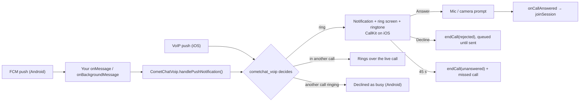

`cometchat_voip` turns a CometChat call push into a ringing phone: a call notification with Answer and Decline, a full-screen ring screen over the lock screen (CallKit on iOS), the ringtone, a ring timeout, missed calls and busy handling, whether your app is in the foreground, in the background or killed.

This page covers the push side of ringing. Starting, answering and ending calls with the Calls SDK is on the [Ringing](/calls/flutter/ringing) page.



{/* TODO(RC): every API on this page is from cometchat_calls_sdk 5.1.0-team and cometchat_voip release/2.0. Re-check the snippets against the released packages before publishing. */}

## Prerequisites

- The [Calls SDK set up](/calls/flutter/setup) and the user [logged in](/calls/flutter/authentication).
- Push notifications enabled in the CometChat dashboard, with the push providers, Firebase project and Apple credentials set up. See [Getting Started](/notifications/push-getting-started). Keep each provider's **Provider ID** at hand.
- **Android:** Firebase set up in your app with `firebase_core` and `firebase_messaging`. Call pushes reach your app through `firebase_messaging`.
- **iOS:** an APNs provider for VoIP pushes, set up as described in [Getting Started](/notifications/push-getting-started). Test on a real device; CallKit and VoIP pushes don't run in the simulator.

## Step 1: Add the packages

```yaml
dependencies:
  cometchat_calls_sdk: ^5.1.0
  cometchat_voip: ^2.0.0
```

{/* TODO(RC): confirm the published versions of cometchat_calls_sdk and cometchat_voip on pub.dev. */}

<Tabs>
<Tab title="Android">
Set `minSdk 26` in `android/app/build.gradle`. `cometchat_voip` adds the permissions, services and screens it needs to your manifest.
</Tab>
<Tab title="iOS">
1. Set `platform :ios, '15.1'` in the `Podfile`.
2. In Xcode, add the **Push Notifications** capability, and under **Background Modes** check **Voice over IP** and **Remote notifications**.
3. Add `NSMicrophoneUsageDescription` to `Info.plist`, and `NSCameraUsageDescription` for video calls.

No `AppDelegate` code is needed: `cometchat_voip` creates the app's PushKit registry and reports calls to CallKit.
</Tab>
</Tabs>

<Warning>
Don't create a `PKPushRegistry` of your own on iOS. A second registry takes the VoIP pushes, and those calls never ring, with no error.
</Warning>

## Step 2: Initialize

Initialize `cometchat_voip` after the Calls SDK, as early as possible at app start, and before your app handles any call push. Build its configuration from the same `CallAppSettings` you give the Calls SDK, so the app ID and region match.

```dart
CallAppSettings callAppSettings = (CallAppSettingBuilder()
      ..appId = "APP_ID"
      ..region = "REGION")
    .build();

// After CometChatCalls.init(callAppSettings, ...) succeeds:
await CometChatVoip.init(
  CometChatVoipConfig.fromCallAppSettings(
    callAppSettings,
    providerId: "PROVIDER_ID", // the FCM provider on Android, the APNs provider on iOS
  ),
);
```

| Option | Default | What it does |
|--------|---------|--------------|
| `providerId` | none | The dashboard push provider the token is registered under |
| `callMode` | `CometChatCallMode.auto` | Who rings the call and draws the ring screen. See [Receive a call](#receive-a-call) |
| `defaultRingTimeout` | 45 seconds | How long a call rings when the push doesn't say |
| `showMissedCallNotification` | `true` | Show a notification for a call that rang out or was cancelled |
| `requestCallPermissions` | `true` | Ask for the microphone (and the camera for video) when the user answers |
| `requestNotificationPermission` | `true` | Ask for notification permission during `init` |
| `autoRegisterPushToken` | `true` | Register the push token again on every Calls SDK login. On Android, hand over the FCM token once first (Step 4) |
| `dropExpiredCalls` | `true` | Don't ring a push that arrives after its call stopped ringing |
| `callKit` | `CometChatCallKitOptions()` | iOS CallKit options: icon, ringtone, whether calls appear in Recents |
| `incomingCallTheme` | none | Colours of the ring screen and the call notifications on Android, light and dark. See [Theming the ring screen](#theming-the-ring-screen) |
| `acceptOnAnswer` | `true` | Also mark the call answered with CometChat (status `ongoing`) when the user answers, the way the Chat SDK's `acceptCall` did. Keep it on while any caller is still on legacy ringing. See [Rolling out](/calls/flutter/migrating-from-legacy-ringing#rolling-out) |

## Step 3: Hand call pushes to cometchat_voip

On Android, pass the data of every push your app receives to `handlePushNotification`, from both your foreground and your background message handlers. It returns `true` for a call push, which `cometchat_voip` then rings. Other pushes, such as chat messages, are left to your own handling.

```dart
// Foreground: register with FirebaseMessaging.onMessage.listen(...)
Future<void> onForegroundMessage(RemoteMessage message) async {
  bool isCallPush = await CometChatVoip.handlePushNotification(
    message.data,
    sentTime: message.sentTime,
  );
  if (!isCallPush) {
    // Not a call: handle the push as you do today.
  }
}

// Background and killed: register with FirebaseMessaging.onBackgroundMessage(...)
@pragma('vm:entry-point')
Future<void> onBackgroundMessage(RemoteMessage message) async {
  // Runs in a separate isolate when the app is in the background or killed.
  // Your app's startup code hasn't run here, so initialize the Calls SDK and
  // cometchat_voip (Step 2) before handing over the push.
  if (!CometChatVoip.isInitialized) {
    // CometChatCalls.init(...), then CometChatVoip.init(...)
  }

  await CometChatVoip.handlePushNotification(
    message.data,
    sentTime: message.sentTime,
  );
}
```

<Warning>
**Pass `sentTime` and hand over every push.** Firebase can hold a push while the phone dozes; without the sent time a push delivered late rings for a call that's already over. Don't skip call pushes when the app is in the foreground: `cometchat_voip` rings them in every app state.
</Warning>

<Warning>
**Send call pushes at high priority.** Android only lets a background app stay alive through the answer when a high-priority push woke it.
</Warning>

On iOS there's nothing to hand over: VoIP pushes go straight to `cometchat_voip`.

## Step 4: Register the push token

| Method | Platform | When |
|--------|----------|------|
| `registerPushToken(token:)` | Android, iOS | After login, with the FCM token on Android and the APNs VoIP (PushKit) token on iOS |
| `handleTokenRefresh(token)` | Android, iOS | When FCM (Android) or PushKit (iOS) issues a new token |
| `unregisterPushToken()` | Android, iOS | Before logout, while the user's session still works |

On iOS, `cometchat_voip` owns the `PKPushRegistry` in both `auto` modes (`autoCustomScreen` rings in CallKit on iOS, so it behaves as `auto` there): it obtains the PushKit VoIP token during `init` and registers it as soon as a user is logged in to the Calls SDK — at `init` if one already is, otherwise at the next login — so there's nothing for you to pass. Pass the token yourself only in `manual` mode, where your app owns the registry.

```dart
// Android: after login
String? fcmToken = await FirebaseMessaging.instance.getToken();
if (fcmToken != null) {
  await CometChatVoip.registerPushToken(token: fcmToken);
}

// Android: when the token changes
FirebaseMessaging.instance.onTokenRefresh.listen(CometChatVoip.handleTokenRefresh);

// Before logout
await CometChatVoip.unregisterPushToken();
```

## Step 5: Permissions and ring readiness

**Microphone and camera.** `cometchat_voip` asks at the moment of answering (with `requestCallPermissions` on, the default): the ring stops, the system prompt appears, and the call joins whatever the user chose.

**Ring readiness.** Some device settings silence a call with no error anywhere. Check once after login and tell the user:

```dart
CometChatRingReadiness readiness = await CometChatVoip.checkRingReadiness();
if (readiness != CometChatRingReadiness.ready) {
  // Explain why to the user, then open the right settings page:
  await CometChatVoip.openSettings(readiness);
}
```

| Result | Meaning |
|--------|---------|
| `ready` | Nothing in the way |
| `notificationsOff` | The app can't show notifications |
| `channelMuted` | The user muted the incoming call notifications (Android) |
| `fullScreenIntentDenied` | Full-screen alerts aren't allowed (Android 14 and later): no ring screen on a locked phone, only the notification |
| `doNotDisturb` | Do Not Disturb is blocking calls |
| `microphoneDenied` | The user refused the microphone: calls still ring but join muted |
| `backgroundModeMissing` | The Voice over IP background mode is missing (iOS) |
| `voipEntitlementMissing` | The push notifications entitlement is missing (iOS) |

`CometChatVoip.verifyPushSetup()` checks the rest of the setup and reports `ok`, `notInitialized`, `notLoggedIn`, `tokenNotRegistered`, `tokenRegistrationFailed`, `notificationsBlocked` or `ringNotReady`.

## Receive a call

How an incoming call rings depends on `callMode`:

| | Auto | Auto + your own ring screen | Manual |
|---|---|---|---|
| `callMode` | `CometChatCallMode.auto` (default) | `CometChatCallMode.autoCustomScreen` | `CometChatCallMode.manual` |
| Ringing and the ring screen | `cometchat_voip` | `cometchat_voip` rings; the ring screen is your Flutter screen | Your app |
| Platforms | Android, iOS | Android (iOS behaves as Auto) | Android, iOS (on iOS your app owns the `PKPushRegistry` and forwards pushes with `handlePushNotification`) |

In every mode, when the user answers, your app joins the call (see [Answer a call](/calls/flutter/ringing#answer-a-call)).

### Auto

`cometchat_voip` does all of the ringing, including its own ring screen. Listen for an answer, and for a call that stops ringing:

```dart
CometChatVoip.onCallAnswered.listen((CometChatVoipCall call) {
  // The user answered: show your call screen and join call.sessionId.
});

CometChatVoip.onCallEnded.listen((CometChatCallEnded ended) {
  // The call stopped ringing without an answer on this device.
  // ended.reason says why; ended.reason.isMissed is true for a missed call.
});
```

### Your own ring screen

With `callMode: CometChatCallMode.autoCustomScreen`, the full-screen alert and a tap on the notification open your Flutter ring screen instead of `cometchat_voip`'s. The notification, its ringtone, its Answer and Decline buttons and the ring timeout are still `cometchat_voip`'s. Android only.

```dart
CometChatVoip.onRingScreenRequested.listen((CometChatRingRequest request) {
  // Show your ring screen for request.call.
  // If request.answerEndsActiveCall is true, tell the user that answering ends their current call.
  // Answer button:  CometChatVoip.answer(request.call.sessionId)
  // Decline button: CometChatVoip.decline(request.call.sessionId)
});

CometChatVoip.onCallAnswered.listen((CometChatVoipCall call) {
  // Close your ring screen, then show your call screen and join.
});

CometChatVoip.onCallEnded.listen((CometChatCallEnded ended) {
  // The call stopped ringing: close your ring screen.
});
```

`answer` asks for the microphone (and the camera for a video call) by itself. A call that arrives while your app is in the foreground shows a notification instead of the full-screen alert; to show your ring screen then too, also listen to `CometChatVoip.onCallRinging`.

### Manual

With `callMode: CometChatCallMode.manual`, `cometchat_voip` only reads the push: it drops duplicates, expired calls, calls this user placed and calls meant for someone else, and passes every new call to `onCallRinging`. Every other step is yours. Android only.

```dart
CometChatVoip.onCallRinging.listen((CometChatVoipCall call) async {
  await CometChatVoip.ringSurfaces.showIncomingNotification(call); // ring, keep alive, stop at call.expiresAt
  await CometChatVoip.ringSurfaces.verify(call);                   // the caller sees "Ringing…"
});

CometChatVoip.onCallEnded.listen((CometChatCallEnded ended) {
  CometChatVoip.ringSurfaces.stopRinging(ended.call.sessionId);
});
```

Report what the user chose with `CometChatVoip.accept(sessionId)` (fires `onCallAnswered`) or `CometChatVoip.decline(sessionId)`. For your own ring UI without `showIncomingNotification`, keep the app alive with `ringSurfaces.keepAlive(call)`, stop at `call.expiresAt` and show a missed call with `ringSurfaces.showMissedCall(call)`. A second call while one is ringing or live is yours to refuse with `decline(sessionId, busy: true)`. In Manual mode, `decline` retries a few times and then throws; it doesn't survive the app being killed.

<Warning>
In Manual mode with nothing built, the call is silently lost: no notification, no ringtone, no screen, nothing sent to the caller, who rings out to `unanswered`. Use Manual only if you are building the whole ring yourself.
</Warning>

## Theming the ring screen

On Android, the ring screen `cometchat_voip` draws in Auto mode, and its ring, connecting and missed call notifications, take each colour from, in order:

1. a `CometChatVoipIncomingCallTheme` set in code;
2. the `cometchat_voip_call_*` colour resources, which your app can override by name;
3. `cometchat_voip`'s defaults.

Each colour is looked up on its own, so a theme can set only the colours it needs. Without a theme or overrides, the screen is dark in both light and dark mode.

If you use the CometChat UI Kit, it builds this theme from your UI Kit colours; see [Styling the ring screen](/ui-kit/flutter/calling-integration#styling-the-ring-screen).

### In code

```dart
const theme = CometChatVoipIncomingCallTheme(
  mode: CometChatVoipIncomingCallThemeMode.system, // system (default), light or dark
  light: CometChatVoipIncomingCallColors(
    background: Color(0xFFFFFFFF),
    callerName: Color(0xFF141414),
    acceptButton: Color(0xFF09C26F),
    declineButton: Color(0xFFF44649),
  ),
  dark: CometChatVoipIncomingCallColors(
    background: Color(0xFF141414),
    callerName: Color(0xFFFFFFFF),
  ),
);

await CometChatVoip.init(
  CometChatVoipConfig.fromCallAppSettings(
    callAppSettings,
    providerId: "PROVIDER_ID",
    incomingCallTheme: theme,
  ),
);

// Later, when your app's colours change. Pass null to remove the theme.
await CometChatVoip.setIncomingCallTheme(newTheme);
```

- **Mode.** `system` follows the phone's light or dark setting when the call rings. If your app has its own light and dark switch, pass `light` or `dark`, and set the theme again when the user switches.
- **Saved.** The theme is saved when you pass it, so it also applies when a push starts your app from killed.
- **Kept across `init`.** An `init` without a theme, such as the one in your background message handler, keeps the saved theme. Remove it with `CometChatVoip.setIncomingCallTheme(null)`.
- **Last one wins.** Between `incomingCallTheme` and `setIncomingCallTheme`, the theme set last is used.
- **Only what you set.** A colour you leave out comes from its resource. In a light set, it comes from built-in light colours instead, so a light page never gets the dark default's light text.
- **Where it applies.** In Auto mode, the ring screen and the notifications. With [your own ring screen](#your-own-ring-screen), the screen is yours, so only the notifications. On iOS, CallKit draws the call and the theme does nothing.

### As resources

Override any of these by name in your app's `android/app/src/main/res/values/colors.xml`, and in `res/values-night/colors.xml` for dark mode. Your app's resource wins over `cometchat_voip`'s. Each one matches a field of `CometChatVoipIncomingCallColors`.

| Colour resource | Field | Default | Used for |
|-----------------|-------|---------|----------|
| `cometchat_voip_call_background` | `background` | `#0E0E10` | Screen, status bar and navigation bar |
| `cometchat_voip_call_text` | `callerName` | `#F2F2F2` | Caller name |
| `cometchat_voip_call_text_secondary` | `subtitle` | `#9A9AA1` | "Incoming audio call" line |
| `cometchat_voip_call_avatar` | `avatarBackground` | `#6852D6` | Initials circle, on the screen and in the notifications |
| `cometchat_voip_call_avatar_text` | `avatarText` | `#FFFFFF` | Initials |
| `cometchat_voip_call_accept` | `acceptButton` | `#1B8F3A` | Answer button, ring and connecting notification accent |
| `cometchat_voip_call_accept_icon` | `acceptIcon` | `#FFFFFF` | Icon on the Answer button |
| `cometchat_voip_call_accept_label` | `acceptLabel` | `text_secondary` | "Answer" label under the button |
| `cometchat_voip_call_decline` | `declineButton` | `#C62828` | Decline button, missed call notification accent |
| `cometchat_voip_call_decline_icon` | `declineIcon` | `#FFFFFF` | Icon on the Decline button |
| `cometchat_voip_call_decline_label` | `declineLabel` | `text_secondary` | "Decline" label under the button |

```xml android/app/src/main/res/values/colors.xml
<resources>
    <color name="cometchat_voip_call_background">#FFFFFF</color>
    <color name="cometchat_voip_call_text">#141414</color>
    <color name="cometchat_voip_call_accept">#09C26F</color>
    <color name="cometchat_voip_call_decline">#F44649</color>
</resources>
```

On Android 12 and later, the Answer and Decline buttons in the notification are drawn by the system, which treats your colours as a hint. To change more than the colours, show your own Flutter screen with [Your own ring screen](#your-own-ring-screen).

## Incoming call events

Listen to `cometchat_voip`'s events: `onCallAnswered` to join, `onCallEnded` to close. The Calls SDK's `IncomingCallListener` (`CometChatCalls.addIncomingCallListener`) reports the same rings and ends if you prefer it, and the caller uses it to learn that a call was declined.

## How a ring ends

Every way out is handled by `cometchat_voip` and needs no code in your app.

| What happened | On the callee's phone | What the caller learns |
|---------------|-----------------------|------------------------|
| The user answers | The ring stops; `onCallAnswered` fires | `onParticipantJoined` |
| The user declines | The ring stops; `rejected` is sent and retried until delivered | `onIncomingCallEnded`, normalising to `declined` |
| The user declines while in another call | The same, with `busy` | `onIncomingCallEnded`, also normalising to `declined` |
| The caller cancels | The ring stops; missed call | Nothing; the caller ended it |
| Nobody answers a 1:1 call | At the ring time (45 seconds by default) the ring stops, a missed call is shown and `unanswered` is sent | `onIncomingCallEnded`, normalising to `timedOut` |
| Answered on another device | The ring stops, no missed call | `onParticipantJoined` |
| Nobody answers a group call, or the user declines it | The ring stops here only; nothing is sent | Nothing; a group ring reports nothing back |

The reason `onIncomingCallEnded` hands the caller is the native end reason, worded differently on each platform. Pass it through `CometChatCallEndReason.fromWire(reason)` and compare the result, as [Listen for calls ending](/calls/flutter/ringing#listen-for-calls-ending) describes; `busy` normalises to `declined`, so the caller can't tell a busy decline from a plain one.

## A call while in a call

Call waiting, the way the phone app does it. "In a call" means the Calls SDK is joined to a session.

| Situation | Android | iOS |
|-----------|---------|-----|
| A call while in a call | Rings over the live call; the ring adds "Answering ends your current call". The live call is untouched | CallKit call waiting |
| Answer | Ends the live call, then `onCallAnswered` fires for the new call | The same, through CallKit's **End & Accept** |
| Decline | `busy` to the caller; the live call continues | The same |
| No action | `unanswered` to the caller, missed call; the live call continues | The same |
| A call while another one is already ringing here | Declined as `busy` without ringing, missed call. The first keeps ringing | Shown by CallKit |
| A call while the user's own outgoing call is ringing | Declined as `busy` without ringing, missed call | Shown by CallKit |

In Manual mode, your app decides how to handle these calls.

## Missed calls

With `showMissedCallNotification` on (the default), a missed call is shown when nobody answers in the ring time, or when the caller cancels before an answer. It isn't shown when the call is answered here or on another device, or declined here. On `onCallEnded`, `ended.reason.isMissed` is `true` for these calls.

## When the app is killed or the phone is locked

1. The call push wakes the app: a high-priority FCM push runs your background message handler on Android; a VoIP push wakes `cometchat_voip` on iOS.
2. On Android, the handler initializes the Calls SDK and `cometchat_voip` and hands over the push (Step 3).
3. `cometchat_voip` rings: on Android on a foreground service that keeps the app alive through the answer, with the ring screen over the lock screen; on iOS through CallKit.
4. On **Answer**, it asks for the microphone (and camera), opens the app, and `onCallAnswered` fires as soon as your code listens. Join the call there.
5. A decline or a timeout is sent from a queue, so it goes out even if the app is killed right after the tap.

Initialize the Calls SDK and `cometchat_voip`, and log the user in, at app start from stored credentials, not only after a screen opens, so an answered call finds a ready SDK.

## Logout

Before logging the user out, call `CometChatVoip.unregisterPushToken()` while the session that owns the token still works, then log out of the Calls SDK with `CometChatCalls.logout`.

## Troubleshooting

| Symptom | Check |
|---------|-------|
| The phone doesn't ring when the app is killed (Android) | The background handler is registered, initializes the Calls SDK and `cometchat_voip`, and calls `handlePushNotification` |
| The call rings, but the app is killed before the answer (Android) | Call pushes are sent at normal priority; send them at high priority |
| The phone doesn't ring at all | `CometChatVoip.verifyPushSetup()` and `CometChatVoip.checkRingReadiness()` say what's missing |
| iOS never rings | Push Notifications and the Voice over IP background mode are on, the APNs provider is set up as in Getting Started, and no other `PKPushRegistry` exists |
| The caller never sees "Ringing…" | The callee's app has `cometchat_voip` initialized and a push token registered, and the caller doesn't join right after `initiateCall` |
| The caller doesn't learn about a decline | The caller's app has `cometchat_voip` initialized and a push token registered |
| An audio call rings as video | `InitiateCallOptions.type` isn't set; it defaults to video |
| Two ringtones or two ring screens | Earlier ringing code is still in the app: your own CallKit or `flutter_callkit_incoming` handling, or a Chat SDK `CallListener` that shows an incoming call screen. Remove it |
| Calls still ring after sign-out | `unregisterPushToken()` wasn't called before logout |
| The ring screen is dark while the phone is in light mode (Android) | No theme is set, so the screen uses its dark default, or the theme's mode is `dark`. See [Theming the ring screen](#theming-the-ring-screen) |
| The ring screen keeps its old colours after `incomingCallTheme` was removed (Android) | The theme is saved. Call `CometChatVoip.setIncomingCallTheme(null)` once |

## Related

- [Ringing](/calls/flutter/ringing): start, answer, decline, cancel and end calls with the Calls SDK.
- [Migrating from Legacy Ringing](/calls/flutter/migrating-from-legacy-ringing).
- [Background Handling](/calls/flutter/background-handling): keep a joined call running when the app goes to the background.
