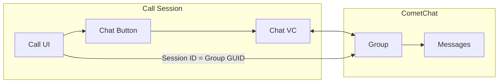

Add real-time messaging to your call experience using CometChat UI Kit. This allows participants to send text messages, share files, and communicate via chat while on a call.

## Overview

In-call chat creates a group conversation linked to the call session. When participants tap the chat button, they can:
- Send and receive text messages
- Share images, files, and media
- See message history from the current call
- Get unread message notifications via badge count



## Prerequisites

- CometChat Calls SDK integrated ([Setup](/calls/ios/setup))
- CometChat Chat SDK integrated ([Chat SDK](/sdk/ios/overview))
- CometChat UI Kit integrated ([UI Kit](/ui-kit/ios/overview))

<Note>
The Chat SDK and UI Kit are separate from the Calls SDK. You'll need to add both dependencies to your project.
</Note>

---

## Step 1: Add UI Kit Dependency

Add the CometChat UI Kit to your project via Swift Package Manager or CocoaPods:

**Swift Package Manager:**
```
https://github.com/cometchat/cometchat-chat-uikit-ios
```

**CocoaPods:**
```ruby
pod 'CometChatUIKitSwift', '~> 4.0'
```

---

## Step 2: Enable Chat Button

Configure session settings to show the chat button:

```swift
let sessionSettings = CometChatCalls.sessionSettingsBuilder
    .hideChatButton(false)  // Show the chat button
    .build()
```

---

## Step 3: Create Chat Group

Create or join a CometChat group using the session ID as the group GUID. This links the chat to the specific call session.

```swift
private func setupChatGroup(sessionId: String, meetingName: String) {
    // Try to get existing group first
    CometChat.getGroup(GUID: sessionId) { group in
        if !group.hasJoined {
            self.joinGroup(guid: sessionId, groupType: group.groupType)
        } else {
            print("Already joined group: \(group.name ?? "")")
        }
    } onError: { error in
        if error?.errorCode == "ERR_GUID_NOT_FOUND" {
            // Group doesn't exist, create it
            self.createGroup(guid: sessionId, name: meetingName)
        } else {
            print("Error getting group: \(error?.errorDescription ?? "")")
        }
    }
}

private func createGroup(guid: String, name: String) {
    let group = Group(guid: guid, name: name, groupType: .public, password: nil)
    
    CometChat.createGroup(group: group) { createdGroup in
        print("Group created: \(createdGroup.name ?? "")")
    } onError: { error in
        print("Group creation failed: \(error?.errorDescription ?? "")")
    }
}

private func joinGroup(guid: String, groupType: CometChat.groupType) {
    CometChat.joinGroup(GUID: guid, groupType: groupType, password: nil) { joinedGroup in
        print("Joined group: \(joinedGroup.name ?? "")")
    } onError: { error in
        print("Join group failed: \(error?.errorDescription ?? "")")
    }
}
```

---

## Step 4: Handle Chat Button Click

Listen for the chat button click and open your chat view controller:

```swift
private var unreadMessageCount = 0

private func setupChatButtonListener() {
    CallSession.shared.addButtonClickListener(self)
}

extension CallViewController: ButtonClickListener {
    
    func onChatButtonClicked() {
        // Reset unread count when opening chat
        unreadMessageCount = 0
        CallSession.shared.setChatButtonUnreadCount(0)
        
        // Open chat view controller
        let chatVC = ChatViewController()
        chatVC.sessionId = sessionId
        chatVC.meetingName = meetingName
        
        let navController = UINavigationController(rootViewController: chatVC)
        navController.modalPresentationStyle = .pageSheet
        
        if let sheet = navController.sheetPresentationController {
            sheet.detents = [.medium(), .large()]
            sheet.prefersGrabberVisible = true
        }
        
        present(navController, animated: true)
    }
}
```

---

## Step 5: Track Unread Messages

Listen for incoming messages and update the badge count on the chat button:

```swift
private func setupMessageListener() {
    CometChat.addMessageListener("CallChatListener", self)
}

extension CallViewController: CometChatMessageDelegate {
    
    func onTextMessageReceived(textMessage: TextMessage) {
        // Check if message is for our call's group
        if let receiver = textMessage.receiver as? Group,
           receiver.guid == sessionId {
            unreadMessageCount += 1
            CallSession.shared.setChatButtonUnreadCount(unreadMessageCount)
        }
    }
    
    func onMediaMessageReceived(mediaMessage: MediaMessage) {
        if let receiver = mediaMessage.receiver as? Group,
           receiver.guid == sessionId {
            unreadMessageCount += 1
            CallSession.shared.setChatButtonUnreadCount(unreadMessageCount)
        }
    }
}

deinit {
    CometChat.removeMessageListener("CallChatListener")
}
```

---

## Step 6: Create Chat View Controller

Create a chat view controller using UI Kit components:

```swift
import CometChatUIKitSwift

class ChatViewController: UIViewController {
    
    var sessionId: String = ""
    var meetingName: String = ""
    
    private let messageList = CometChatMessageList()
    private let messageComposer = CometChatMessageComposer()
    private let activityIndicator = UIActivityIndicatorView(style: .large)
    
    override func viewDidLoad() {
        super.viewDidLoad()
        setupUI()
        loadGroup()
    }
    
    private func setupUI() {
        view.backgroundColor = .systemBackground
        title = meetingName
        
        navigationItem.rightBarButtonItem = UIBarButtonItem(
            barButtonSystemItem: .close,
            target: self,
            action: #selector(dismissView)
        )
        
        // Setup message list
        messageList.translatesAutoresizingMaskIntoConstraints = false
        view.addSubview(messageList)
        
        // Setup message composer
        messageComposer.translatesAutoresizingMaskIntoConstraints = false
        view.addSubview(messageComposer)
        
        // Setup activity indicator
        activityIndicator.translatesAutoresizingMaskIntoConstraints = false
        activityIndicator.hidesWhenStopped = true
        view.addSubview(activityIndicator)
        
        NSLayoutConstraint.activate([
            messageList.topAnchor.constraint(equalTo: view.safeAreaLayoutGuide.topAnchor),
            messageList.leadingAnchor.constraint(equalTo: view.leadingAnchor),
            messageList.trailingAnchor.constraint(equalTo: view.trailingAnchor),
            messageList.bottomAnchor.constraint(equalTo: messageComposer.topAnchor),
            
            messageComposer.leadingAnchor.constraint(equalTo: view.leadingAnchor),
            messageComposer.trailingAnchor.constraint(equalTo: view.trailingAnchor),
            messageComposer.bottomAnchor.constraint(equalTo: view.safeAreaLayoutGuide.bottomAnchor),
            
            activityIndicator.centerXAnchor.constraint(equalTo: view.centerXAnchor),
            activityIndicator.centerYAnchor.constraint(equalTo: view.centerYAnchor)
        ])
    }
    
    @objc private func dismissView() {
        dismiss(animated: true)
    }
    
    private func loadGroup() {
        activityIndicator.startAnimating()
        
        CometChat.getGroup(GUID: sessionId) { [weak self] group in
            guard let self = self else { return }
            
            if !group.hasJoined {
                self.joinAndSetGroup(guid: self.sessionId, groupType: group.groupType)
            } else {
                self.setGroup(group)
            }
        } onError: { [weak self] error in
            guard let self = self else { return }
            
            if error?.errorCode == "ERR_GUID_NOT_FOUND" {
                self.createAndSetGroup()
            } else {
                self.activityIndicator.stopAnimating()
                print("Error: \(error?.errorDescription ?? "")")
            }
        }
    }
    
    private func createAndSetGroup() {
        let group = Group(guid: sessionId, name: meetingName, groupType: .public, password: nil)
        
        CometChat.createGroup(group: group) { [weak self] createdGroup in
            self?.setGroup(createdGroup)
        } onError: { [weak self] error in
            self?.activityIndicator.stopAnimating()
        }
    }
    
    private func joinAndSetGroup(guid: String, groupType: CometChat.groupType) {
        CometChat.joinGroup(GUID: guid, groupType: groupType, password: nil) { [weak self] joinedGroup in
            self?.setGroup(joinedGroup)
        } onError: { [weak self] error in
            self?.activityIndicator.stopAnimating()
        }
    }
    
    private func setGroup(_ group: Group) {
        activityIndicator.stopAnimating()
        
        messageList.set(group: group)
        messageComposer.set(group: group)
    }
}
```

---

## Related Documentation

- [UI Kit Overview](/ui-kit/ios/overview) - CometChat UI Kit components
- [Events](/calls/ios/events) - Button click events
- [Session Settings](/calls/ios/session-settings) - Configure chat button visibility
