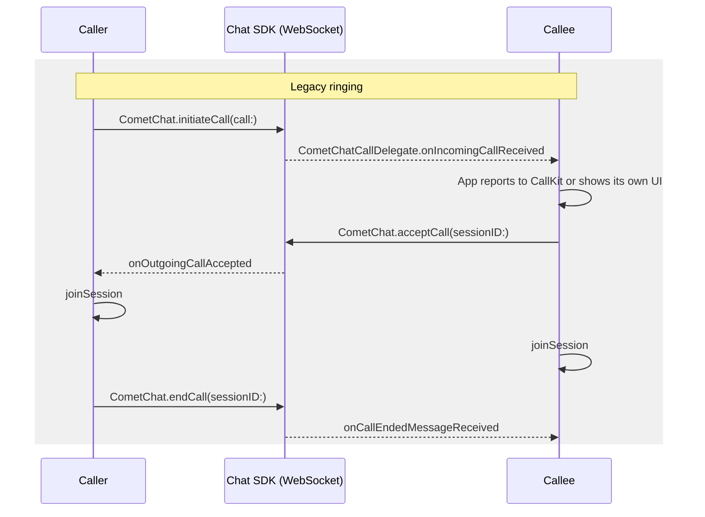
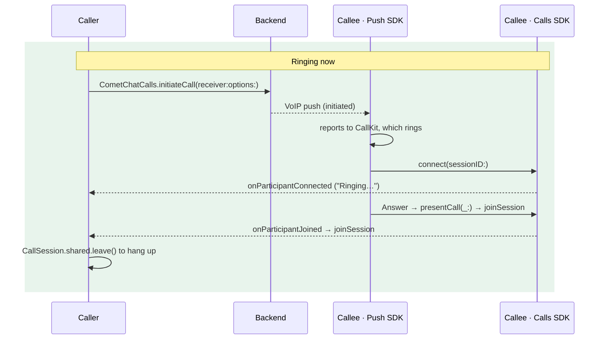

Legacy ringing signalled calls through the Chat SDK: `CometChat.initiateCall` created the call, a `CometChatCallDelegate` on the WebSocket told the callee, `acceptCall` and `rejectCall` answered, and the app rang the device itself, either with its own `PKPushRegistry` and `CXProvider` code or with the Push Notifications SDK 1.0. Ringing now runs on the Calls SDK and the Push Notifications SDK's Calls product. The Chat SDK's calling methods are superseded by the Calls SDK and no longer used; a coming Chat SDK release marks them deprecated.

This page is the diff. For the full description of the current flow see [Ringing](/calls/ios/ringing); for the push side see [Push ringing](/calls/ios/voip-calling).

## Before you start

Ringing with the Calls SDK is opt-in on the client: moving your app to the Calls SDK 5.1 and Push
Notifications SDK 2.0 APIs below is the migration. No dashboard setting is needed.

This page is for apps that use the SDKs directly. If you use the CometChat UI Kit, its support for
this flow comes with a coming UI Kit release; keep legacy ringing until then.

## Why it changed

| Legacy | Now |
|--------|-----|
| Incoming calls arrived on the Chat WebSocket, so a backgrounded or killed app needed a separate PushKit + CallKit integration to ring | One path: the VoIP push rings through CallKit in every app state, the app killed and the phone locked included |
| Your app wrote the `PKPushRegistryDelegate`, the `CXProviderDelegate`, the incoming UI and the busy check | The Push SDK owns PushKit and CallKit, handles busy, call waiting, the ring timeout and missed calls |
| `acceptCall` / `rejectCall` / `endCall` were HTTP calls your app had to sequence with `joinSession` | Answer = join. Decline, ring-out and busy are sent by the Push SDK through a queue that survives the app being suspended |
| Caller only knew "accepted" or "rejected" | Caller sees "Ringing…" (the callee's device was reached) and "answered". A decline, busy or ring-out is read from Call Logs while ringing |
| Chat SDK required for calling | Chat SDK needed for chat only; a calls-only app works |

## Before and after





## Step 1: Update dependencies

Both SDKs are distributed with Swift Package Manager. In Xcode's package dependencies:

| Package | Change | Products |
|---|---|---|
| `https://github.com/cometchat/calls-sdk-ios` | Up to Next Major from **5.1.0** (was 5.0.x) | `CometChatCallsSDK` |
| `https://github.com/cometchat/push-notifications-sdk-ios` | Up to Next Major from **2.0.0** (was 1.0) | `CometChatPushNotificationsSwift` (Core, as in 1.0), **`CometChatPushNotificationsCalls`** (new: the PushKit + CallKit ringer), `CometChatPushNotificationsChat` (only if you show chat notifications) |

`CometChatSDK` stays for chat; it is no longer used for calls. If your project added these SDKs with CocoaPods, remove their pods from the `Podfile` and add the packages instead: the Calls SDK 5.1 and Push Notifications SDK 2.0 are not published as pods. A Notification Service Extension links Core and Chat only, never Calls.

- Keep the **Push Notifications** capability and **Background Modes → Voice over IP** (and **Remote notifications** for chat pushes).
- Keep `NSMicrophoneUsageDescription` and `NSCameraUsageDescription` in `Info.plist`.

Linking the Calls product turns ringing on. There is no second initializer.

## Step 2: Replace the push configuration

<Tabs>
<Tab title="Before (Push SDK 1.0)">
```swift
// After CometChat.init(...)
CometChatPushNotifications.shared.initialize(config: .init(
    providerId: "YOUR_PROVIDER_ID",
    callkitIconName: "CallKitIcon"
))
CometChatPushNotifications.shared.delegate = self
```
</Tab>
<Tab title="After (Push SDK 2.0)">
```swift
// In application(_:didFinishLaunchingWithOptions:), before anything else
CometChatPushNotifications.shared.delegate = pushDelegate   // held weakly: keep it alive
CometChatPushNotifications.shared.initialize(config: PNConfiguration(
    appId: "APP_ID",
    region: "REGION",
    providerId: "YOUR_PROVIDER_ID",
    callKit: CallKitBranding(iconTemplateImageName: "CallKitIcon")
))
```
</Tab>
</Tabs>

`appId` and `region` are required in 2.0: the Push SDK registers tokens and brings the Calls SDK up in a process the push started, before your own code has initialized anything. `initialize` must run in `didFinishLaunching`, because it creates the PushKit registry and iOS only delivers the VoIP push that launched a killed app when that registry exists by the end of launch.

## Step 3: Replace the call delegate

<Tabs>
<Tab title="Before (Push SDK 1.0)">
```swift
func presentCallScreen(for call: Call, sessionId: String) {
    // open the call screen, which calls CometChat.acceptCall and joinSession
}
func onCallMissed(call: Call, reason: CometChatMissedCallReason) { }
func onCallCleanupComplete() { }

// after Calls SDK login:
CometChatPushNotifications.shared.notifyCallsSDKReady()
```
</Tab>
<Tab title="After (Push SDK 2.0)">
```swift
final class CallPushDelegate: NSObject, CometChatPushNotificationsCallsDelegate {
    func presentCall(_ call: IncomingCall) -> Bool {
        // present the call screen on the root view controller; it calls joinSession at once
        return true
    }
    func callDidEnd(_ call: IncomingCall, reason: CallEndReason) {
        // dismiss the call screen for call.sessionId
    }
}
// No notifyCallsSDKReady(): the Push SDK waits for the Calls SDK itself.
```
</Tab>
</Tabs>

`presentCall` fires immediately on Answer in every app state, the phone locked included, at most once per session. Return `false` when you cannot show the call, and the Push SDK ends it.

## Step 4: Delete the token code

The Push SDK registers the APNs and VoIP tokens on login by itself. Its own unregister at logout can run after the user's auth token is gone, so call `unregisterTokens` and wait for it before you log out ([Step 7](#step-7-change-the-logout)). Remove:

- `CometChatNotifications.registerPushToken(...)` after login and `unregisterPushToken(...)` before logout
- The VoIP token handling in your own `pushRegistry(_:didUpdate:for:)`

Keep forwarding the APNs device token with `CometChatPushNotifications.shared.registerDeviceToken(deviceToken)` in `application(_:didRegisterForRemoteNotificationsWithDeviceToken:)`; the VoIP token is captured by the Calls product. If your app must keep its own `PKPushRegistry`, see [Owning PushKit yourself](/calls/ios/voip-calling#owning-pushkit-yourself).

## Step 5: Delete the app-side ringing

Everything in this list is now done by the Push SDK. Remove it, or it will fight the SDK's ring (two CallKit calls, two providers that cannot end each other's calls, a busy reject sent on top of the SDK's).

- `CometChat.addCallListener(...)` / `CometChat.calldelegate` and the `onIncomingCallReceived` handler
- The incoming-call screen, banner or alert you showed from it, and your own ringtone for incoming calls
- Your `PKPushRegistry` and `PKPushRegistryDelegate`, `CXProvider`, `CXProviderDelegate`, `CXCallController` and the `CallManager` that tied them to CometChat (the pattern the earlier VoIP Calling guide described)
- Any `AVAudioSession.setActive(true)` in CallKit callbacks: CallKit owns the call's audio session, and activating it yourself causes one-way audio on lock-screen answers
- The "already in a call → reject with busy" check
- With Push SDK 1.0: `foregroundCallPresentation`, `CometChatIncomingCallView` / `incomingCallStyle`, `notifyCallsSDKReady()`

## Step 6: Rewrite the call code

| Legacy | Now | Notes |
|--------|-----|-------|
| `CometChat.initiateCall(call: Call(receiverId:callType:receiverType:), onSuccess:onError:)` | `CometChatCalls.initiateCall(receiver:options:onSuccess:onError:)` → `InitiatedCall` | Set `options.sessionSettings` with the session type, or an audio call opens the camera |
| `CometChat.initiateCall(call:timeout:onSuccess:onError:)` | No client timeout. The callee's device rings for 45 s (or the push's `ringTimeout`) and then ends a 1:1 call as `unanswered` | Run your own 45 s timer on the caller: if the callee's device is never reached, nothing else ends the caller's ringing for 5 minutes |
| `CometChatCallDelegate.onIncomingCallReceived(incomingCall:error:)` | Nothing to write; the Push SDK rings through CallKit. For your own state use `CometChatIncomingCallListener.onIncomingCallReceived(call:)` | One listener whether the call came by push to a killed app or a running one |
| `onOutgoingCallAccepted(acceptedCall:error:)` | `ParticipantEventListener.onParticipantJoined(participant:)` on `CallSession.shared`, the session `initiateCall` prepared | New in-between event: `onParticipantConnected` = the callee's device is ringing |
| `onOutgoingCallRejected(rejectedCall:error:)` | Poll [Call Logs](/calls/ios/call-logs) for the call's status while it rings; `SessionStatusListener.onConnectionClosed()` on the prepared session when it closes | Not reliably pushed to the caller on iOS: a busy decline, or a decline before the callee's device connected, closes nothing |
| `onIncomingCallCancelled(canceledCall:error:)` | `CometChatIncomingCallListener.onIncomingCallEnded(call:reason:)` on the callee, with `cancelled` or, once the callee's device had prepared the session, `ended`; CallKit has already stopped the ring | |
| `onCallEndedMessageReceived(endedCall:error:)` | `SessionStatusListener.onSessionLeft()` / `onConnectionClosed()` on the joined session | |
| `CometChat.acceptCall(sessionID:onSuccess:onError:)` then `joinSession` | `presentCall(_:)` opens your screen, which calls `joinSession(sessionID:...)`. Nothing else to send | The Push SDK asks for the microphone and camera after Answer |
| `CometChat.rejectCall(sessionID:status: .rejected, ...)` | CallKit's Decline. Your own button: `CometChatPushNotificationsCalls.decline(sessionId:)` | Sends `busy` automatically when in another call |
| `CometChat.rejectCall(sessionID:status: .busy, ...)` | Nothing; the Push SDK decides busy | |
| `CometChat.rejectCall(sessionID:status: .cancelled, ...)` | `CometChatCalls.endCall(sessionID:status: EndCallStatus.cancelled, onSuccess:onError:)` | Also tears down the caller's prepared session |
| `CallSession.shared.leaveSession()` + `CometChat.endCall(sessionID:)` | `CallSession.shared.leave()` | No status to send on a hang-up; the room tells the other side and the backend logs it |
| `CometChat.getActiveCall()` / `clearActiveCall()` | `CometChatCalls.getActiveSession()` (nil when no session is prepared or joined) | |
| `CometChat.startCall(...)`, Chat SDK `CallSettings` | `joinSession` + the 5.x listeners (see the [v5 migration guide](/calls/ios/migration-guide-v5)) | |
| Push SDK 1.0 `presentCallScreen(for:sessionId:)` | `presentCall(_:) -> Bool` | Takes the push SDK's `IncomingCall`, not a Chat SDK `Call` |
| Push SDK 1.0 `onCallMissed(call:reason:)` | `callDidEnd(_:reason:)` | CallKit writes the missed call to Recents |
| `CometChat.logout(...)` | `CometChatCalls.logout(...)` as well, after awaiting `unregisterTokens` | Otherwise the Calls SDK stays signed in as the old user |

### Caller screen, before and after

<Tabs>
<Tab title="Before">
```swift
CometChat.addCallListener(listenerId, self)

func onOutgoingCallAccepted(acceptedCall: Call?, error: CometChatException?) {
    joinCallSession(sessionId: acceptedCall?.sessionID ?? "")
}
func onOutgoingCallRejected(rejectedCall: Call?, error: CometChatException?) {
    dismiss(animated: true)
}

@objc func endTapped() {
    CometChat.rejectCall(sessionID: sessionId, status: .cancelled,
                         onSuccess: { _ in }, onError: { _ in })
}
```
</Tab>
<Tab title="After">
```swift
CallSession.shared.addSessionStatusListener(self)
CallSession.shared.addParticipantEventListener(self)

func onParticipantConnected(participant: Participant) { statusLabel.text = "Ringing…" }
func onParticipantJoined(participant: Participant) {
    joinCallSession(sessionId: sessionId, isVideo: isVideo)
}
func onConnectionClosed() {
    dismiss(animated: true)   // the prepared session closed; busy and early declines come from Call Logs
}

@objc func endTapped() {
    CometChatCalls.endCall(sessionID: sessionId, status: EndCallStatus.cancelled,
                           onSuccess: {}, onError: { _ in })
}
```
</Tab>
</Tabs>

### Callee screen, before and after

<Tabs>
<Tab title="Before">
```swift
// Called from your CometChatCallDelegate or your CXProviderDelegate's answer action
func answer(sessionId: String) {
    CometChat.acceptCall(sessionID: sessionId, onSuccess: { call in
        self.joinCallSession(sessionId: call?.sessionID ?? "")
    }, onError: { _ in })
}
func decline(sessionId: String) {
    CometChat.rejectCall(sessionID: sessionId, status: .rejected,
                         onSuccess: { _ in }, onError: { _ in })
}
```
</Tab>
<Tab title="After">
```swift
// Opened by your delegate's presentCall(_:): the user already answered on CallKit
override func viewDidLoad() {
    super.viewDidLoad()
    joinCallSession(sessionId: sessionId, isVideo: isVideo)
}
// There is no decline button here: CallKit's Decline sends it through the Push SDK.
```
</Tab>
</Tabs>

## Step 7: Change the logout

```swift
// Unregister first: both token DELETEs need the user's auth token.
CometChatPushNotifications.shared.unregisterTokens(completion: { _ in
    CometChat.logout(onSuccess: { _ in }, onError: { _ in })
    CometChatCalls.logout(onSuccess: { _ in }, onError: { _ in })   // new: stops a ringing call
})
```

## What users will notice

- Calls ring through CallKit with the app killed and from the lock screen, with no app code on the ring path.
- The caller sees "Ringing…" once the callee's phone is reached, and the call screen closes when the call is declined or missed (from the Call Logs status, or the ring timer).
- The callee stops ringing after 45 seconds, and the caller's screen closes on its own timer.
- Missed calls appear in the Phone app's Recents.
- A call during a call is call waiting (End & Accept ends the current call, Decline sends busy), not an automatic reject.
- The microphone and camera prompt appears after Answer the first time, on the device that answers; on a locked phone it waits for the unlock.
- Outgoing calls appear in Recents too, and survive an incoming cellular call.

## Checklist

- [ ] `CometChatCallsSDK` 5.1, Push SDK 2.0 Core + Calls products added; the Notification Service Extension links Core + Chat only
- [ ] Push Notifications capability, Background Modes → Voice over IP, microphone and camera usage strings
- [ ] `initialize(config:)` runs in `didFinishLaunching` with `appId`, `region` and `providerId`
- [ ] The delegate adopts `CometChatPushNotificationsCallsDelegate` and is kept alive; `presentCall(_:)` presents and joins at once
- [ ] Manual token registration and `notifyCallsSDKReady()` removed
- [ ] `CometChat.addCallListener`, your own PushKit / CallKit code, incoming UI, ringtone, busy check and `setActive` calls removed
- [ ] `initiateCall` sets the session type in `sessionSettings`, built with a new `SessionSettingsBuilder()`
- [ ] Caller listens on the prepared session and joins only on `onParticipantJoined`; runs a 45 s ring timer
- [ ] Hang-up uses `leave()`; no `CometChat.endCall`
- [ ] Logout awaits `unregisterTokens`, then logs out of the Calls SDK as well
- [ ] `ensureRingReady` runs after sign-in and anything other than `.ready` is shown to the user
- [ ] Tested on a device: ring with the app killed and the phone locked, decline, cancel, no answer, call during a call, logout while ringing
