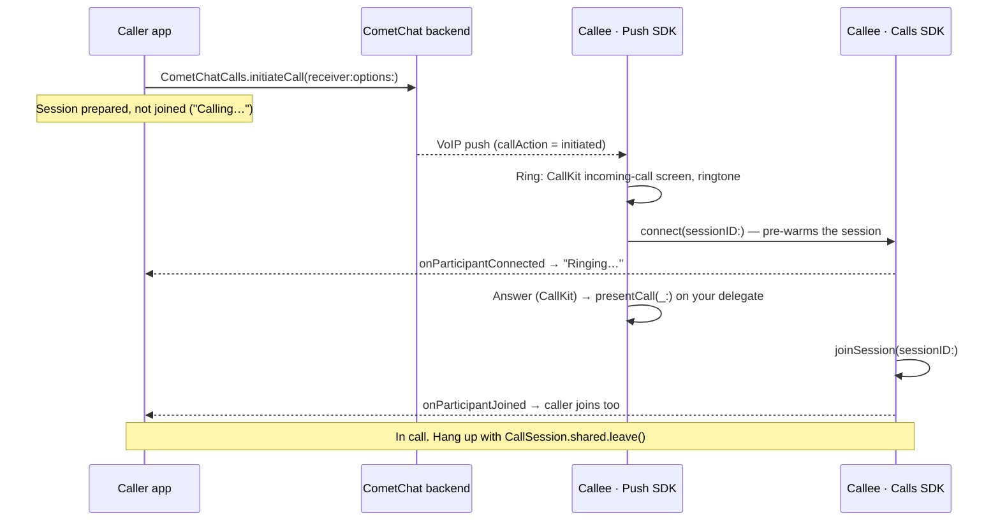

Ringing lets one user call another and lets the callee answer or decline, whether the callee's app is in the foreground, in the background, not running at all, or the phone is locked.

Two SDKs do the work:

| SDK | Owns |
|-----|------|
| **Calls SDK** (`CometChatCallsSDK` 5.1+) | Creating the call, the media session, answering, declining, cancelling, ending, and the call events your code listens to |
| **Push Notifications SDK, Calls product** (`CometChatPushNotificationsCalls` 2.0+) | Ringing the callee's device: the VoIP push (PushKit), the system incoming-call screen (CallKit), the ringtone, the ring timeout, missed calls in Recents, busy and call waiting. It also reports outgoing calls to CallKit; CallKit owns a call's audio while the call is on CallKit |

<Note>
**Coming from the earlier ringing flow?** The Chat SDK's calling methods (`CometChat.initiateCall`, `acceptCall`, `rejectCall`, `endCall`, `CometChatCallDelegate`) are superseded by the Calls SDK and no longer used; a coming Chat SDK release marks them deprecated. This page describes the replacement. See [Migrating from legacy ringing](/calls/ios/migrating-from-legacy-ringing) for a method-by-method mapping.
</Note>

## How ringing works

The caller creates the call with the Calls SDK. The CometChat backend sends a VoIP push to the callee. The Push SDK reports the call to CallKit, which rings the device, and when the callee answers, your call screen joins the session. The caller's app learns that the callee is ringing and has answered from the Calls SDK, without joining the session first.



What each side sees:

| Stage | Caller | Callee |
|-------|--------|--------|
| Call created | `initiateCall` succeeds; show "Calling…" | VoIP push arrives; CallKit rings |
| Callee's device reached | `onParticipantConnected` → show "Ringing…" | Ringing |
| Callee answers | `onParticipantJoined` → `joinSession` | `presentCall(_:)` → your call screen → `joinSession` |
| Callee declines / is busy / does not answer | Not reliably reported. `onConnectionClosed` fires only when the callee's device had prepared the session; a busy decline, or a decline before the callee's device connected, closes nothing. Poll [Call Logs](/calls/ios/call-logs) while ringing, and keep your [ring timer](#ring-timeout) | Ring stops; `callDidEnd(_:reason:)`; a missed call in Recents if unanswered |
| Caller cancels | — (you ended it) | Ring stops; `onIncomingCallEnded` with `cancelled`, or `ended` when the callee's device had prepared the session; a missed call in Recents |
| Either side hangs up | `onParticipantLeft` / `onSessionLeft` | same |

<Note>
On iOS the caller is not told when, or why, the callee ended the call: `onIncomingCallEnded` is not reported for your own outgoing call. A decline or ring-out closes the caller's prepared session (`onConnectionClosed`) only when the callee's device had prepared it. A busy decline never does (the callee is in another call and never joins the room), and neither does a decline made before the callee's device connected. So while the call rings, read its status from [Call Logs](/calls/ios/call-logs) every few seconds and end the screen on `rejected`, `busy` or `unanswered`, as the [ring timer](#ring-timeout) does when nothing arrives.
</Note>

## Prerequisites

- [Calls SDK set up](/calls/ios/setup) and the user [logged in](/calls/ios/authentication).
- Push notifications configured with the Push Notifications SDK 2.0 Core and Calls products. The whole push side of ringing is on the [Push ringing](/calls/ios/voip-calling) page; this page assumes it is done.
- `NSMicrophoneUsageDescription` and `NSCameraUsageDescription` in your `Info.plist`. Add the camera string even if your app only places audio calls: the Calls SDK links the camera.
- The **Push Notifications** capability and **Background Modes → Voice over IP** on your app target. Without them PushKit delivers no VoIP push and a killed app cannot ring.
- A physical device. PushKit and CallKit do not work in the Simulator.

Add the packages with Swift Package Manager (**File → Add Package Dependencies** in Xcode):

| Package | Version | Products |
|---|---|---|
| `https://github.com/cometchat/calls-sdk-ios` | Up to Next Major from 5.1.0 | `CometChatCallsSDK` |
| `https://github.com/cometchat/push-notifications-sdk-ios` | Up to Next Major from 2.0.0 | `CometChatPushNotificationsSwift` (Core), `CometChatPushNotificationsCalls` (the PushKit + CallKit ringer) |

<Warning>
Call `CometChatPushNotifications.shared.initialize(config:)` from `application(_:didFinishLaunchingWithOptions:)`. The Push SDK creates the PushKit registry inside `initialize`, and iOS only delivers the VoIP push that launched a killed app when that registry exists by the end of launch. Initialized any later, the first call after a cold start is lost.
</Warning>

## Start a call

`CometChatCalls.initiateCall` creates the call on the backend, which rings the callee, and prepares the caller's media session. The caller does **not** join yet.

<Tabs>
<Tab title="Swift">
```swift
let options = InitiateCallOptions()
options.type = CallSessionType.audio            // or CallSessionType.video (the default)
options.receiverType = CallReceiverType.user
options.sessionSettings = SessionSettingsBuilder()
    .setSessionType(.voice)                     // .video for a video call
    .setPeerCall(true)                          // 1:1: the call ends for both when either leaves
    .build()

CometChatCalls.initiateCall(receiver: receiverUid, options: options, onSuccess: { call in
    print("Calling \(call.receiver ?? ""), session \(call.sessionId)")
    DispatchQueue.main.async {
        self.showOutgoingScreen(call)
        self.listenOnPreparedSession(call)
    }
}, onError: { error in
    print("Could not start the call: \(error?.errorDescription ?? "")")
})
```
</Tab>
<Tab title="Objective-C">
```objectivec
InitiateCallOptions *options = [[InitiateCallOptions alloc] init];
options.type = CallSessionType.audio;            // or CallSessionType.video (the default)
options.receiverType = CallReceiverType.user;
options.sessionSettings = [[[[[SessionSettingsBuilder alloc] init]
    setSessionType:SessionTypeVoice]             // SessionTypeVideo for a video call
    setPeerCall:YES]                             // 1:1: the call ends for both when either leaves
    build];

[CometChatCalls initiateCallWithReceiver:receiverUid
                                 options:options
                               onSuccess:^(InitiatedCall * call) {
    NSLog(@"Calling %@, session %@", call.receiver, call.sessionId);
    dispatch_async(dispatch_get_main_queue(), ^{
        [self showOutgoingScreen:call];
        [self listenOnPreparedSession:call];
    });
} onError:^(CometChatCallException * error) {
    NSLog(@"Could not start the call: %@", error.errorDescription);
}];
```
</Tab>
</Tabs>

| Parameter | Description |
|-----------|-------------|
| `receiver` | UID of the user to call |
| `options.type` | `CallSessionType.audio` or `CallSessionType.video` (default) |
| `options.receiverType` | `CallReceiverType.user` (default), or `CallReceiverType.group` with the group's GUID as `receiver` (see [Group calls](#group-calls)) |
| `options.sessionSettings` | The settings the caller's session is prepared with. See the warning below. |

`InitiatedCall` gives you `sessionId`, `messageId` (the id of the call message in the conversation), `conversationId`, `sender`, `receiver`, `receiverType`, `type`, `status`, `initiatedAt` (in seconds) and `session`, the `CallSession` being prepared.

`initiateCall` fails with `SESSION_ALREADY_ACTIVE` while the user is joining or in another call; leave that call first.

<Warning>
**Always set the session type in `sessionSettings`.** The Calls SDK freezes the session settings when it prepares the session and its default is video, so an audio call started without `.setSessionType(.voice)` opens the caller's camera. The settings you pass here are the ones the caller later joins with.

Build them with a new `SessionSettingsBuilder()`. `CometChatCalls.sessionSettingsBuilder` is a single shared builder whose `build()` returns the same object every time, so a setting made for one call carries into the next.
</Warning>

<Note>
There is no client-side ring timeout. The callee's device stops at the ring window the push carries (`ringTimeout`), or the Push SDK's default of 45 seconds, and ends a 1:1 call as `unanswered`; that closes the caller's prepared session only when the callee's device had prepared it. If the callee's device is never reached, nothing ends the caller's ringing until its prepared session expires after 5 minutes, so run your own timer on the caller and end the call as `unanswered` after the same window, as shown under [Ring timeout](#ring-timeout).
</Note>

## Show "Ringing…" and detect the answer

The caller stays on the session that `initiateCall` prepared and listens to it. Do not call `joinSession` yet: joining only when the callee has joined keeps the caller's media off until there is someone to talk to, and it is what makes the two events below arrive.

Register on `CallSession.shared`. It is the session `initiateCall` is preparing (the same object `call.session` and `CometChatCalls.getActiveSession()` return), and registering on it works before the prepare has finished.

<Tabs>
<Tab title="Swift">
```swift
class OutgoingCallViewController: UIViewController, SessionStatusListener, ParticipantEventListener {

    var call: InitiatedCall!
    private var answered = false

    func listenOnPreparedSession(_ call: InitiatedCall) {
        self.call = call
        CallSession.shared.addSessionStatusListener(self)
        CallSession.shared.addParticipantEventListener(self)
    }

    // The callee's device received the push and is ringing.
    func onParticipantConnected(participant: Participant) {
        setStatus("Ringing…")
    }

    // The callee answered: now the caller joins.
    func onParticipantJoined(participant: Participant) {
        guard !answered else { return }
        answered = true
        removeListeners()   // the call screen registers its own
        joinCallSession(sessionId: call.sessionId, isVideo: call.type == CallSessionType.video)
    }

    // The prepared session closed before anyone joined: the call is over.
    func onConnectionClosed() {
        closeOutgoingScreen()
    }

    func removeListeners() {
        CallSession.shared.removeSessionStatusListener(self)
        CallSession.shared.removeParticipantEventListener(self)
    }

    deinit { removeListeners() }
}
```
</Tab>
<Tab title="Objective-C">
```objectivec
@interface OutgoingCallViewController () <SessionStatusListener, ParticipantEventListener>
@property (nonatomic, strong) InitiatedCall *call;
@property (nonatomic, assign) BOOL answered;
@end

@implementation OutgoingCallViewController

- (void)listenOnPreparedSession:(InitiatedCall *)call {
    self.call = call;
    [[CallSession shared] addSessionStatusListener:self];
    [[CallSession shared] addParticipantEventListener:self];
}

// The callee's device received the push and is ringing.
- (void)onParticipantConnectedWithParticipant:(Participant *)participant {
    [self setStatus:@"Ringing…"];
}

// The callee answered: now the caller joins.
- (void)onParticipantJoinedWithParticipant:(Participant *)participant {
    if (self.answered) return;
    self.answered = YES;
    [self removeListeners];   // the call screen registers its own
    [self joinCallSessionWithSessionId:self.call.sessionId
                               isVideo:[self.call.type isEqualToString:CallSessionType.video]];
}

// The prepared session closed before anyone joined: the call is over.
- (void)onConnectionClosed {
    [self closeOutgoingScreen];
}

- (void)removeListeners {
    [[CallSession shared] removeSessionStatusListener:self];
    [[CallSession shared] removeParticipantEventListener:self];
}

- (void)dealloc { [self removeListeners]; }

@end
```
</Tab>
</Tabs>

| Event | On the prepared session it means |
|-------|----------------------------------|
| `onConnected` | Your own prepare finished; the join will be near-instant |
| `onParticipantConnected(participant:)` | The callee's phone got the push and prepared the session: it is ringing there |
| `onParticipantJoined(participant:)` | The callee answered. Call `joinSession` now |
| `onConnectionClosed` | The call ended before anyone joined (declined, busy, rung out, cancelled, the session died, or the prepared session expired after 5 minutes). `onSessionTimedOut` is not part of this: it only reports an idle joined session |

The SDK holds these listeners weakly and does not remove them for you: remove them when the screen goes away, and when the call screen takes over.

## Listen for calls starting and ending

`CometChatCalls.addIncomingCallListener` reports calls ringing on this device and their end. The Push SDK feeds it from the VoIP push, including in a launch the push started, provided you register the listener in `application(_:didFinishLaunchingWithOptions:)`: events are delivered only to listeners registered at that moment and are not replayed. On iOS it reports **incoming** calls only; your own outgoing call ends through the prepared session, as described above.

<Tabs>
<Tab title="Swift">
```swift
final class CallEvents: NSObject, CometChatIncomingCallListener {

    func onIncomingCallReceived(call: CometChatIncomingCall) {
        // A call for this user is ringing. CallKit already shows the ring;
        // use this for your own state (badge, analytics, refreshing a list).
    }

    func onIncomingCallEnded(call: CometChatIncomingCall, reason: String) {
        // The ring ended before it was answered here: the caller cancelled (often reported
        // as `ended`), it was answered on another device, it rang out, or the session closed.
    }
}

let callEvents = CallEvents()   // the SDK holds listeners weakly: keep this reference
CometChatCalls.addIncomingCallListener("my-screen", callEvents)

// When the screen goes away:
CometChatCalls.removeIncomingCallListener("my-screen")
```
</Tab>
<Tab title="Objective-C">
```objectivec
@interface CallEvents : NSObject <CometChatIncomingCallListener>
@end

@implementation CallEvents

- (void)onIncomingCallReceivedWithCall:(CometChatIncomingCall *)call {
    // A call for this user is ringing. CallKit already shows the ring.
}

- (void)onIncomingCallEndedWithCall:(CometChatIncomingCall *)call reason:(NSString *)reason {
    // The ring ended before it was answered here.
}

@end

// Keep a strong reference: the SDK holds listeners weakly.
self.callEvents = [[CallEvents alloc] init];
[CometChatCalls addIncomingCallListener:@"my-screen" :self.callEvents];

// When the screen goes away:
[CometChatCalls removeIncomingCallListener:@"my-screen"];
```
</Tab>
</Tabs>

| Reason | Meaning |
|--------|---------|
| `cancelled` | The caller gave up |
| `ongoing` | Answered on another of the user's devices |
| `unanswered` | The call rang out |
| `rejected`, `busy` | Declined (on another device, or found declined when the session was prepared) |
| `ended` | The session prepared for the call closed before the answer. A caller's cancel usually arrives as `ended` once the callee's device had prepared the session (the Push SDK's delegate then gets `callDidEnd` with `.declined`), so don't label it "Declined" in your UI |

It fires once per call. Treat any other reason as "the ring is over". Answering on this device is not reported, and neither is a decline or ring-out on this device: those reach the Push SDK delegate's `callDidEnd(_:reason:)`.

`CometChatIncomingCall` carries `sessionId`, `callerUid`, `callerName`, `callerAvatarUrl`, `callType` (`audio` / `video`), `receiverType`, `receiverUid`, `conversationId`, `initiatedAt` (milliseconds), `isVideo` and `isPeerCall`.

<Warning>
Listener ids are keys. Registering the same id twice replaces the first listener instead of adding a second one, so give each screen a stable id, and do not use `cometchat-push-notifications`: the Push SDK registers under that id.
</Warning>

## Answer a call

CallKit shows the Answer button. When the user answers, the Push SDK calls `presentCall(_:)` on your `CometChatPushNotificationsCallsDelegate`. It fires immediately in every app state, the phone locked included (for End & Accept, once the previous call has left): present your call screen and join at once, so audio connects before the user unlocks. The Push SDK ends an answered call with `.failed` if the session has not joined within 20 seconds. If your UI may come up later than that, for example on an answer from the lock screen after a push started the app, don't wait for a window to join: create your call screen, call `joinSession` with its container view, and present it once a window exists. There is no separate "accept" call to make.

<Tabs>
<Tab title="Swift">
```swift
import CometChatPushNotificationsSwift
import CometChatPushNotificationsCalls

final class CallPushDelegate: NSObject, CometChatPushNotificationsCallsDelegate {

    private var pending: IncomingCall?

    // The user answered. Called at most once per session.
    // Always return true: false ends the call at once. On a lock-screen or cold-launch answer
    // the window may not exist yet, so keep the call and present it when the UI comes up.
    func presentCall(_ call: IncomingCall) -> Bool {
        guard let root = rootViewController() else { pending = call; return true }
        present(call, on: root)
        return true
    }

    /// Call when your UI comes up, for example from sceneDidBecomeActive(_:).
    func presentPendingCall() {
        guard let call = pending, let root = rootViewController() else { return }
        pending = nil
        present(call, on: root)
    }

    private func present(_ call: IncomingCall, on root: UIViewController) {
        let screen = CallViewController(sessionId: call.sessionId, isVideo: call.isVideo)
        screen.modalPresentationStyle = .fullScreen
        root.present(screen, animated: false)   // the screen joins in viewDidLoad
    }

    // The call is over (never called for an answer): dismiss your screen.
    func callDidEnd(_ call: IncomingCall, reason: CallEndReason) {
        if pending?.sessionId == call.sessionId { pending = nil }
        dismissCallScreen(for: call.sessionId)
    }
}

// In application(_:didFinishLaunchingWithOptions:), before initialize(config:).
// The Push SDK holds its delegate weakly, so keep this object alive.
CometChatPushNotifications.shared.delegate = pushDelegate
```
</Tab>
<Tab title="Objective-C">
```objectivec
@import CometChatPushNotificationsSwift;
@import CometChatPushNotificationsCalls;

@interface CallPushDelegate : NSObject <CometChatPushNotificationsCallsDelegate>
@property (nonatomic, strong, nullable) IncomingCall *pending;
@end

@implementation CallPushDelegate

// The user answered. Called at most once per session.
// Always return YES: NO ends the call at once. On a lock-screen or cold-launch answer
// the window may not exist yet, so keep the call and present it when the UI comes up.
- (BOOL)presentCall:(IncomingCall *)call {
    UIViewController *root = [self rootViewController];
    if (root == nil) { self.pending = call; return YES; }
    [self present:call on:root];
    return YES;
}

// Call when your UI comes up, for example from sceneDidBecomeActive:.
- (void)presentPendingCall {
    UIViewController *root = [self rootViewController];
    if (self.pending == nil || root == nil) return;
    IncomingCall *call = self.pending;
    self.pending = nil;
    [self present:call on:root];
}

- (void)present:(IncomingCall *)call on:(UIViewController *)root {
    CallViewController *screen = [[CallViewController alloc] initWithSessionId:call.sessionId
                                                                       isVideo:call.isVideo];
    screen.modalPresentationStyle = UIModalPresentationFullScreen;
    [root presentViewController:screen animated:NO completion:nil];   // joins in viewDidLoad
}

// The call is over (never called for an answer): dismiss your screen.
- (void)callDidEnd:(IncomingCall *)call reason:(CallEndReason)reason {
    if ([self.pending.sessionId isEqualToString:call.sessionId]) self.pending = nil;
    [self dismissCallScreenForSessionId:call.sessionId];
}

@end
```
</Tab>
</Tabs>

`IncomingCall` carries `sessionId`, `callerUid`, `callerName`, `callerAvatarUrl`, `callType`, `receiverType`, `receiverUid`, `conversationId`, `initiatedAtMs`, `ringTimeoutMs`, `isVideo` and `isPeerCall`.

After `presentCall`, the Push SDK asks for the microphone (and the camera for a video call) if the user has not decided yet. On a lock-screen answer the prompt waits until the app is active; a denied microphone joins muted. To ask earlier yourself, turn this off with `requestCallPermissions(false)` on the push configuration.

## Join the session

Both sides join the same way: the callee from the screen `presentCall` opened, the caller from `onParticipantJoined`. `joinSession` takes over the session that was prepared earlier, so it connects almost at once. On a prepared session the settings passed to `joinSession` are ignored: the ones frozen when the session was prepared apply. That is the caller's `options.sessionSettings` (if the prepare failed, `joinSession` joins directly with the settings it is given, so build those the same way, `setPeerCall(true)` included for a 1:1 call); the callee's session is prepared by the Push SDK with its own settings (the session type, the camera off for an audio call, the speaker, and peer call for a 1:1 call), so layout or hidden-button settings passed by the callee have no effect.

<Tabs>
<Tab title="Swift">
```swift
func joinCallSession(sessionId: String, isVideo: Bool) {
    let settings = SessionSettingsBuilder()
        .setSessionType(isVideo ? .video : .voice)
        .build()

    CometChatCalls.joinSession(
        sessionID: sessionId,
        callSetting: settings,
        container: callViewContainer,
        onSuccess: { _ in
            print("Joined \(sessionId)")
        },
        onError: { error in
            print("Join failed: \(error?.errorDescription ?? "")")
            DispatchQueue.main.async { self.dismiss(animated: true) }
        }
    )
}
```
</Tab>
<Tab title="Objective-C">
```objectivec
- (void)joinCallSessionWithSessionId:(NSString *)sessionId isVideo:(BOOL)isVideo {
    SessionSettings *settings = [[[[SessionSettingsBuilder alloc] init]
        setSessionType:(isVideo ? SessionTypeVideo : SessionTypeVoice)]
        build];

    [CometChatCalls joinSessionWithSessionID:sessionId
                                 callSetting:settings
                                   container:self.callViewContainer
                                   onSuccess:^(NSString * message) {
        NSLog(@"Joined %@", sessionId);
    } onError:^(CometChatCallException * error) {
        NSLog(@"Join failed: %@", error.errorDescription);
        dispatch_async(dispatch_get_main_queue(), ^{
            [self dismissViewControllerAnimated:YES completion:nil];
        });
    }];
}
```
</Tab>
</Tabs>

See [Join Session](/calls/ios/join-session) for the container, [Session Settings](/calls/ios/session-settings) for layouts and controls, and [Events](/calls/ios/events) for everything the joined session reports.

## Decline a call

Declining is handled by the Push SDK: CallKit's Decline button sends `endCall(sessionID:status:)` with `rejected`, and with `busy` instead when the user is already in another call. The decline goes through a queue that is replayed when the app next launches, if that is within 90 seconds, in case iOS suspends the app before it is sent. A group call's decline is local: nothing is sent. On the caller, the prepared session closes (`onConnectionClosed`).

You only write decline code when you offer a Decline button of your own, for example on an in-app banner (Swift only):

```swift
CometChatPushNotificationsCalls.decline(sessionId: sessionId)
```

Without the Push SDK, decline through the Calls SDK directly: `CometChatCalls.endCall(sessionID: sessionId, status: EndCallStatus.rejected, onSuccess:onError:)`.

## Cancel a call

The caller ends a call that is still ringing with `endCall` and the `cancelled` status. The SDK tears the caller's prepared session down first (your `onConnectionClosed` fires), then tells the server. The callee's ring stops and a missed call is left in Recents.

<Tabs>
<Tab title="Swift">
```swift
func cancelOutgoingCall(sessionId: String) {
    CometChatCalls.endCall(sessionID: sessionId, status: EndCallStatus.cancelled, onSuccess: {
        print("Cancelled \(sessionId)")
    }, onError: { error in
        print("Cancel failed: \(error?.errorDescription ?? "")")
    })
    closeOutgoingScreen()   // close locally either way
}
```
</Tab>
<Tab title="Objective-C">
```objectivec
- (void)cancelOutgoingCall:(NSString *)sessionId {
    [CometChatCalls endCallWithSessionID:sessionId
                                  status:EndCallStatus.cancelled
                               onSuccess:^{
        NSLog(@"Cancelled %@", sessionId);
    } onError:^(CometChatCallException * error) {
        NSLog(@"Cancel failed: %@", error.errorDescription);
    }];
    [self closeOutgoingScreen];   // close locally either way
}
```
</Tab>
</Tabs>

Disable the End button after the first tap, and ignore an `onParticipantJoined` that arrives after you cancelled: the cancel wins. If the screen goes away before `initiateCall` has returned, cancel the call from its `onSuccess`, or the callee rings for a call nobody is waiting on.

## Ring timeout

The callee's Push SDK ends an unanswered 1:1 call as `unanswered` when its ring window closes (45 seconds unless the push carries a `ringTimeout`), which closes the caller's prepared session. To close the caller's screen at the same moment even when the callee's device was never reached, run your own timer from `initiateCall` and end the call with the same status. The Push SDK's default window is `RingConstants.defaultRingTimeoutMs` (45 000 ms), public in `CometChatPushNotificationsCalls`, so the caller's timer can use the same value:

<Tabs>
<Tab title="Swift">
```swift
let ringTimeout = DispatchWorkItem { [weak self] in
    guard let self = self, !self.answered else { return }
    CometChatCalls.endCall(sessionID: sessionId, status: EndCallStatus.unanswered,
                           onSuccess: {}, onError: { _ in })
    self.closeOutgoingScreen()
}
DispatchQueue.main.asyncAfter(deadline: .now() + 45, execute: ringTimeout)

// On answer, cancel or close: ringTimeout.cancel()
```
</Tab>
<Tab title="Objective-C">
```objectivec
dispatch_after(dispatch_time(DISPATCH_TIME_NOW, 45 * NSEC_PER_SEC), dispatch_get_main_queue(), ^{
    if (self.answered || self.closed) return;
    [CometChatCalls endCallWithSessionID:sessionId
                                  status:EndCallStatus.unanswered
                               onSuccess:^{}
                                 onError:^(CometChatCallException * error) {}];
    [self closeOutgoingScreen];
});
```
</Tab>
</Tabs>

## End a call

Hang up by leaving the session. The room tells the other side, which receives `onParticipantLeft` and then `onSessionLeft` or `onConnectionClosed`. No status needs to be sent and the call is logged by the backend. In a peer call (`setPeerCall(true)`), the session ends for both as soon as either leaves.

<Tabs>
<Tab title="Swift">
```swift
// The default call UI's End button leaves the session itself; only clean up here.
func onLeaveSessionButtonClicked() {
    dismiss(animated: true)
}

// Your own hang-up control:
func hangUp() {
    CallSession.shared.leave()
    dismiss(animated: true)
}

// The other participant (SessionStatusListener):
func onSessionLeft() { dismiss(animated: true) }
func onConnectionClosed() { dismiss(animated: true) }
```
</Tab>
<Tab title="Objective-C">
```objectivec
// The default call UI's End button leaves the session itself; only clean up here.
- (void)onLeaveSessionButtonClicked {
    [self dismissViewControllerAnimated:YES completion:nil];
}

// Your own hang-up control:
- (void)hangUp {
    [[CallSession shared] leave];
    [self dismissViewControllerAnimated:YES completion:nil];
}

// The other participant (SessionStatusListener):
- (void)onSessionLeft { [self dismissViewControllerAnimated:YES completion:nil]; }
- (void)onConnectionClosed { [self dismissViewControllerAnimated:YES completion:nil]; }
```
</Tab>
</Tabs>

Ending the call from the lock screen or CallKit's own UI makes the SDK leave the session, which reaches your screen as `onSessionLeft`.

<Note>
`CallSession.leaveSession()` is deprecated in 5.1; use `leave()`. Leave only the session your screen owns: after answering a second call over a live one, the first screen's clean-up must not leave the new session.
</Note>

## Outgoing calls and CallKit

CallKit owns the Calls SDK's audio only while it has a call: an answered incoming call, or an outgoing call reported to it, until the last one ends. The Push SDK reports an outgoing call to CallKit by itself once the Calls SDK prepares or joins its session, so outgoing calls get CallKit-owned audio too: they keep their audio through a cellular call, appear in Recents and can be ended from the lock screen. A session CallKit has no call for uses WebRTC's normal audio handling. When the Calls product is linked, don't set `CometChatAudioSession.callKitAudioEnabled` yourself; the Push SDK manages it. To show the callee's name and the call type from the start, report it yourself right after `initiateCall` succeeds (Swift only):

```swift
CometChatPushNotificationsCalls.reportOutgoingCall(sessionId: call.sessionId,
                                                   calleeName: calleeName,
                                                   hasVideo: isVideo)
```

See [Push ringing](/calls/ios/voip-calling) for `reportCallConnected` and `reportCallEnded`.

## Second call while in a call

Handled by CallKit and the Push SDK, the same way a phone does it. A call that arrives while the user is in another call rings with CallKit's call-waiting buttons. **End & Accept** ends the live call and answers the new one, so `presentCall(_:)` fires again with the new session: open a fresh screen for it. **Decline** sends `busy` and keeps the live call. A call that arrives while another one is still ringing replaces it.

## Group calls

To ring a group, call `initiateCall` with the group's GUID as `receiver` and `options.receiverType = CallReceiverType.group`, and leave `setPeerCall` off so the call outlives any one member leaving. Every member's device rings through the push. You can also start a group call without ringing: share a session id (for example in a custom message) and have each member join it with `joinSession`. When a group call rings, declining it or letting it ring out sends nothing: the call carries on for the other members, and the decline is local to that device.

## Logout

Log out of the Calls SDK when the user signs out (`CometChatCalls.logout`). On that logout the Push SDK stops a call still ringing for the old user and tries to unregister the push tokens. A Chat SDK logout does the same when the Push SDK's Chat product is linked.

Unregistering needs the user's auth token, which may already be gone when the logout is reported, so call `CometChatPushNotifications.shared.unregisterTokens` and wait for it before logging out of either SDK. End or cancel any call of your own before logging out: `endCall` needs a logged-in user.

## Call status values

| Status | Meaning | Sent by |
|--------|---------|---------|
| `initiated` | Created, ringing | Backend, on `initiateCall` |
| `ongoing` | Answered | Backend, when the callee joins |
| `rejected` | Callee declined | Callee's Push SDK (`EndCallStatus.rejected`) |
| `busy` | Callee was in another call | Callee's Push SDK (`EndCallStatus.busy`) |
| `cancelled` | Caller ended it before an answer | Caller, `endCall` with `EndCallStatus.cancelled` |
| `unanswered` | Nobody answered in the ring window | Callee's Push SDK for a 1:1 call (and optionally the caller's timer, `EndCallStatus.unanswered`) |
| `ended` | Hung up after being answered | Backend, when the session ends |
| `missed` | How an unanswered or cancelled incoming call appears in call logs | Call logs |

## Related

- [Push ringing](/calls/ios/voip-calling): dependencies, capabilities, `PNConfiguration`, PushKit and CallKit, the delegate, outgoing calls on CallKit, readiness checks and what happens when the app is killed.
- [Migrating from legacy ringing](/calls/ios/migrating-from-legacy-ringing).
- [Events](/calls/ios/events), [Actions](/calls/ios/actions), [Call Logs](/calls/ios/call-logs).
