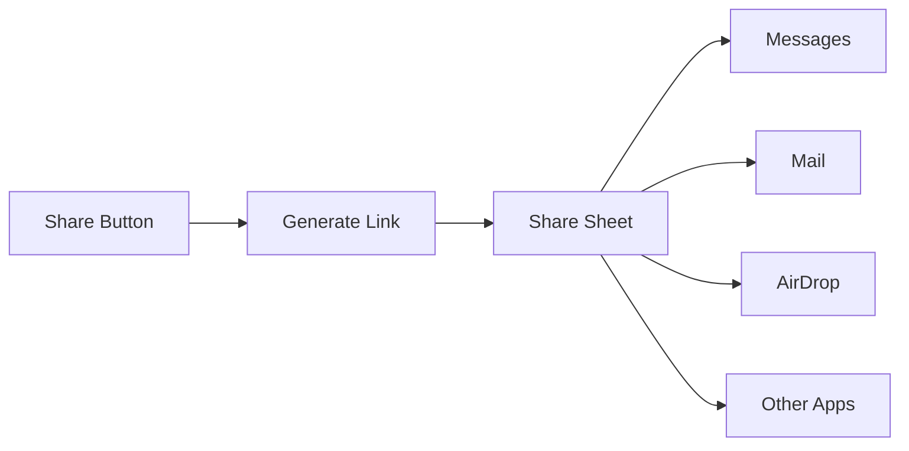

Enable participants to invite others to join a call by sharing a meeting link. The share invite button opens the system share sheet, allowing users to send the invite via any messaging app, email, or social media.

## Overview

The share invite feature:
- Generates a shareable meeting link with session ID
- Opens iOS's native share sheet
- Works with any app that supports text sharing
- Can be triggered from the default button or custom UI



## Prerequisites

- CometChat Calls SDK integrated ([Setup](/calls/ios/setup))
- Active call session ([Join Session](/calls/ios/join-session))

---

## Step 1: Enable Share Button

Configure session settings to show the share invite button:

```swift
let sessionSettings = CometChatCalls.sessionSettingsBuilder
    .hideShareInviteButton(false)  // Show the share button
    .build()
```

---

## Step 2: Handle Share Button Click

Listen for the share button click using `ButtonClickListener`:

```swift
private func setupShareButtonListener() {
    CallSession.shared.addButtonClickListener(self)
}

extension CallViewController: ButtonClickListener {
    
    func onShareInviteButtonClicked() {
        shareInviteLink()
    }
}
```

---

## Step 3: Generate and Share Link

Create the meeting invite URL and open the share sheet:

```swift
private func shareInviteLink() {
    let inviteUrl = generateInviteUrl(sessionId: sessionId, meetingName: meetingName)
    
    let activityItems: [Any] = [
        "Join my meeting: \(meetingName)",
        inviteUrl
    ]
    
    let activityVC = UIActivityViewController(
        activityItems: activityItems,
        applicationActivities: nil
    )
    
    // For iPad
    if let popover = activityVC.popoverPresentationController {
        popover.sourceView = view
        popover.sourceRect = CGRect(x: view.bounds.midX, y: view.bounds.midY, width: 0, height: 0)
        popover.permittedArrowDirections = []
    }
    
    present(activityVC, animated: true)
}

private func generateInviteUrl(sessionId: String, meetingName: String) -> URL {
    let encodedName = meetingName.addingPercentEncoding(withAllowedCharacters: .urlQueryAllowed) ?? meetingName
    
    // Replace with your app's deep link or web URL
    let urlString = "https://yourapp.com/join?sessionId=\(sessionId)&name=\(encodedName)"
    return URL(string: urlString)!
}
```

---

## Custom Share Message

Customize the share message with more details:

```swift
private func shareInviteLink() {
    let inviteUrl = generateInviteUrl(sessionId: sessionId, meetingName: meetingName)
    
    let shareMessage = """
    📞 Join my meeting: \(meetingName)
    
    Click the link below to join:
    \(inviteUrl.absoluteString)
    
    Meeting ID: \(sessionId)
    """
    
    let activityItems: [Any] = [shareMessage]
    
    let activityVC = UIActivityViewController(
        activityItems: activityItems,
        applicationActivities: nil
    )
    
    // For iPad
    if let popover = activityVC.popoverPresentationController {
        popover.sourceView = view
        popover.sourceRect = CGRect(x: view.bounds.midX, y: view.bounds.midY, width: 0, height: 0)
        popover.permittedArrowDirections = []
    }
    
    present(activityVC, animated: true)
}
```

---

## Deep Link Handling

To allow users to join directly from the shared link, implement deep link handling in your app.

### Configure Universal Links

Add Associated Domains capability in Xcode and configure your `apple-app-site-association` file on your server.

### Handle Deep Link

```swift
class SceneDelegate: UIResponder, UIWindowSceneDelegate {
    
    func scene(_ scene: UIScene, continue userActivity: NSUserActivity) {
        guard userActivity.activityType == NSUserActivityTypeBrowsingWeb,
              let url = userActivity.webpageURL else {
            return
        }
        
        handleDeepLink(url: url)
    }
    
    func scene(_ scene: UIScene, openURLContexts URLContexts: Set<UIOpenURLContext>) {
        guard let url = URLContexts.first?.url else { return }
        handleDeepLink(url: url)
    }
    
    private func handleDeepLink(url: URL) {
        guard let components = URLComponents(url: url, resolvingAgainstBaseURL: true),
              components.path == "/join" else {
            return
        }
        
        let queryItems = components.queryItems ?? []
        let sessionId = queryItems.first(where: { $0.name == "sessionId" })?.value
        let meetingName = queryItems.first(where: { $0.name == "name" })?.value
        
        guard let sessionId = sessionId else { return }
        
        // Check if user is logged in
        if CometChat.getLoggedInUser() != nil {
            joinCall(sessionId: sessionId, meetingName: meetingName ?? "Meeting")
        } else {
            // Save params and redirect to login
            saveJoinParams(sessionId: sessionId, meetingName: meetingName)
            showLoginScreen()
        }
    }
    
    private func joinCall(sessionId: String, meetingName: String) {
        let callVC = CallViewController()
        callVC.sessionId = sessionId
        callVC.meetingName = meetingName
        callVC.modalPresentationStyle = .fullScreen
        
        window?.rootViewController?.present(callVC, animated: true)
    }
    
    private func saveJoinParams(sessionId: String, meetingName: String?) {
        UserDefaults.standard.set(sessionId, forKey: "pendingSessionId")
        UserDefaults.standard.set(meetingName, forKey: "pendingMeetingName")
    }
    
    private func showLoginScreen() {
        // Navigate to login
    }
}
```

---

## Custom Share Button

If you want to use a custom share button instead of the default one, hide the default button and implement your own:

```swift
// Hide default share button
let sessionSettings = CometChatCalls.sessionSettingsBuilder
    .hideShareInviteButton(true)
    .build()

// Add your custom button
customShareButton.addTarget(self, action: #selector(shareInviteLink), for: .touchUpInside)
```

---

## Complete Example

```swift
class CallViewController: UIViewController {
    
    var sessionId: String = ""
    var meetingName: String = ""
    
    private let callContainer = UIView()
    
    override func viewDidLoad() {
        super.viewDidLoad()
        
        setupUI()
        setupShareButtonListener()
        joinCall()
    }
    
    private func setupUI() {
        view.backgroundColor = .black
        
        callContainer.translatesAutoresizingMaskIntoConstraints = false
        view.addSubview(callContainer)
        
        NSLayoutConstraint.activate([
            callContainer.topAnchor.constraint(equalTo: view.topAnchor),
            callContainer.leadingAnchor.constraint(equalTo: view.leadingAnchor),
            callContainer.trailingAnchor.constraint(equalTo: view.trailingAnchor),
            callContainer.bottomAnchor.constraint(equalTo: view.bottomAnchor)
        ])
    }
    
    private func setupShareButtonListener() {
        CallSession.shared.addButtonClickListener(self)
    }
    
    private func joinCall() {
        let sessionSettings = CometChatCalls.sessionSettingsBuilder
            .setTitle(meetingName)
            .hideShareInviteButton(false)
            .build()
        
        CometChatCalls.joinSession(
            sessionId: sessionId,
            sessionSettings: sessionSettings,
            view: callContainer
        ) { session in
            print("Joined call")
        } onError: { error in
            print("Join failed: \(error?.errorDescription ?? "")")
        }
    }
    
    @objc private func shareInviteLink() {
        let inviteUrl = generateInviteUrl(sessionId: sessionId, meetingName: meetingName)
        
        let shareMessage = "📞 Join my meeting: \(meetingName)\n\n\(inviteUrl.absoluteString)"
        
        let activityVC = UIActivityViewController(
            activityItems: [shareMessage],
            applicationActivities: nil
        )
        
        if let popover = activityVC.popoverPresentationController {
            popover.sourceView = view
            popover.sourceRect = CGRect(x: view.bounds.midX, y: view.bounds.midY, width: 0, height: 0)
            popover.permittedArrowDirections = []
        }
        
        present(activityVC, animated: true)
    }
    
    private func generateInviteUrl(sessionId: String, meetingName: String) -> URL {
        let encodedName = meetingName.addingPercentEncoding(withAllowedCharacters: .urlQueryAllowed) ?? meetingName
        return URL(string: "https://yourapp.com/join?sessionId=\(sessionId)&name=\(encodedName)")!
    }
}

extension CallViewController: ButtonClickListener {
    
    func onShareInviteButtonClicked() {
        shareInviteLink()
    }
}
```

---

## Related Documentation

- [Events](/calls/ios/events) - Button click events
- [Session Settings](/calls/ios/session-settings) - Configure share button visibility
- [Join Session](/calls/ios/join-session) - Join a call session
