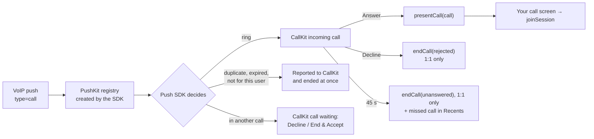

The Calls product of the Push Notifications SDK turns a CometChat VoIP push into a ringing phone. It owns the PushKit registry, reports every call to CallKit, connects to the call while it rings, and hands the answered call to your app. It works with the app in the foreground, in the background, killed, and on the lock screen. You write no `PKPushRegistryDelegate` and no `CXProviderDelegate`.

On iOS the ring is always CallKit's native incoming-call screen, in every app state. There is no custom incoming-call screen; your own UI starts when the user answers.

This page covers the push side of ringing. Starting, answering and ending calls with the Calls SDK is on the [Ringing](/calls/ios/ringing) page.



## Prerequisites

- [Calls SDK 5.1 set up](/calls/ios/setup) and the user logged in.
- Push Notifications enabled in the CometChat dashboard with an **APNs provider that uses a `.p8` auth key**, and that provider's id. The SDK registers both the APNs device token and the VoIP token under this one provider; a `.p12` certificate provider can serve only one of them.
  - The provider's **Bundle ID** must be your app's bundle ID. VoIP pushes go to the topic `<bundle id>.voip`.
  - The provider's **APNs environment must match the build.** A build run from Xcode gets a sandbox token, so it needs a provider with **Enable Production Mode** off. TestFlight and App Store builds need it on. On a mismatch APNs rejects the push and nothing rings.
- iOS 15.1 or later.
- A physical device. PushKit and CallKit do not work in the Simulator.

## Step 1: Add the SDK

The Push Notifications SDK ships as three products. For ringing you add **Core** and **Calls**; add **Chat** as well if the app shows chat notifications.

| Product / pod | Add it when | Depends on |
|---|---|---|
| `CometChatPushNotificationsSwift` (Core) | Always | No CometChat SDK |
| `CometChatPushNotificationsCalls` (Calls) | Incoming calls should ring | Core + `CometChatCallsSDK` 5.1.0 |
| `CometChatPushNotificationsChat` (Chat) | You show chat notifications | Core + `CometChatSDK` 4.1 |

<Tabs>
<Tab title="Swift Package Manager">
In Xcode, **File → Add Package Dependencies**, enter:

```
https://github.com/cometchat/push-notifications-sdk-ios
```

Pick version **2.0.0** and add `CometChatPushNotificationsSwift` and `CometChatPushNotificationsCalls` to your app target.
</Tab>
<Tab title="CocoaPods">
```ruby Podfile
platform :ios, '15.1'

target 'YourApp' do
  use_frameworks!
  pod 'CometChatCallsSDK', '~> 5.1.0'
  pod 'CometChatPushNotificationsSwift', '2.0.0'
  pod 'CometChatPushNotificationsCalls', '2.0.0'
end
```

Then run `pod install`.
</Tab>
</Tabs>

Linking the Calls product turns ringing on. The Chat SDK is optional: a calls-only app adds Core and Calls and never links it. `import CometChatPushNotificationsCalls` also brings the call types (`IncomingCall`, `CallEndReason`) with it.

The SDK links `PushKit`, `CallKit` and `AVFAudio` itself; you add nothing for them.

<Note>
CallKit is not allowed in apps sold in China. For a China App Store build, ship a target without the Calls product; it is the only product that uses CallKit.
</Note>

## Step 2: Capabilities and Info.plist

These are what Android declares in its manifest. Each one, when missing, silences calls without an error.

| What | Where | Why |
|---|---|---|
| **Push Notifications** capability (adds the `aps-environment` entitlement) | Signing & Capabilities | Without it iOS issues neither the APNs device token nor the VoIP token |
| **Background Modes → Voice over IP** (`voip` in `UIBackgroundModes`) | Signing & Capabilities | PushKit does not deliver VoIP pushes to an app without it, so a killed app cannot ring |
| **Background Modes → Audio, AirPlay, and Picture in Picture** (`audio`) | Signing & Capabilities | Keeps the call running when the user leaves the app; see [Background Handling](/calls/ios/background-handling) |
| **Background Modes → Remote notifications** (`remote-notification`) | Signing & Capabilities | Only for chat: silent pushes reach the app. Not needed for ringing |
| `NSMicrophoneUsageDescription` | `Info.plist` | The Calls SDK captures audio on join; iOS terminates an app that uses the microphone without it |
| `NSCameraUsageDescription` | `Info.plist` | Video calls. Add it even if you only place voice calls: the Calls SDK links the camera |

```xml Info.plist
<key>NSMicrophoneUsageDescription</key>
<string>Lets you talk on calls.</string>
<key>NSCameraUsageDescription</key>
<string>Lets you be seen on video calls.</string>
<key>UIBackgroundModes</key>
<array>
    <string>voip</string>
    <string>audio</string>
</array>
```

A development build carries `aps-environment` = `development`; TestFlight and App Store builds need `production`, which Xcode sets when you archive with a distribution profile.

## Step 3: Initialise in `didFinishLaunching`

Call `initialize(config:)` in `application(_:didFinishLaunchingWithOptions:)`, **on every launch**, before the user logs in. This is the one hard rule:

- The SDK creates its PushKit registry inside `initialize`. iOS delivers the VoIP push that launched a killed app only to a registry that exists by the time `didFinishLaunching` returns, so a later call loses the first call after a cold start.
- Token registration on login and logout only runs in a launch where `initialize` ran.
- `initialize` also sets itself as the `UNUserNotificationCenter` delegate, asks for notification permission (unless you turn it off), and saves the configuration so a launch started by a push still knows your app.

Set the delegate first. The SDK holds it weakly, so keep a strong reference to it, as the `AppDelegate` below does.

<Tabs>
<Tab title="Swift">
```swift AppDelegate.swift
import UIKit
import CometChatPushNotificationsSwift
import CometChatPushNotificationsCalls

@main
final class AppDelegate: UIResponder, UIApplicationDelegate {

    var window: UIWindow?

    // The SDK holds its delegate weakly: the app keeps it alive.
    let pushDelegate = PushDelegate()

    func application(_ application: UIApplication,
                     didFinishLaunchingWithOptions launchOptions: [UIApplication.LaunchOptionsKey: Any]?) -> Bool {
        CometChatPushNotifications.shared.delegate = pushDelegate
        CometChatPushNotifications.shared.initialize(config: PNConfiguration(
            appId: "APP_ID",
            region: "REGION",
            providerId: "PROVIDER_ID",                       // the APNs provider from the dashboard
            callKit: CallKitBranding(iconTemplateImageName: "CallKitIcon")
        ))
        return true
    }
}
```
</Tab>
<Tab title="Objective-C">
```objectivec AppDelegate.m
@import CometChatPushNotificationsSwift;
@import CometChatPushNotificationsCalls;

- (BOOL)application:(UIApplication *)application didFinishLaunchingWithOptions:(NSDictionary *)launchOptions {
    // self.pushDelegate is a strong property: the SDK holds its delegate weakly.
    CometChatPushNotifications.shared.delegate = self.pushDelegate;

    PNConfiguration *config = [[[[PNConfiguration builderWithAppId:@"APP_ID" region:@"REGION"]
        providerId:@"PROVIDER_ID"]
        callKitWithName:nil iconTemplateImageName:@"CallKitIcon" ringtone:nil includeInRecents:YES supportsVideo:YES]
        build];
    [CometChatPushNotifications.shared initializeWithConfig:config];
    return YES;
}
```
</Tab>
</Tabs>

In a SwiftUI app, put this in an `AppDelegate` attached with `@UIApplicationDelegateAdaptor`.

`PNConfiguration(appId:region:…)` takes every option below as a defaulted parameter. From Objective-C, or to chain setters, use `PNConfiguration.builder(appId:region:)` and finish with `build()`. If you already have the Calls SDK's `CallAppSettings`, `PNConfigurationBuilder.from(_:)` starts a builder with its app id and region (it returns `nil` if they are missing).

| Option | Default | What it does |
|--------|---------|--------------|
| `appId`, `region` | none; **required** | Your CometChat app. Must not be blank. Used to register tokens and to bring the Calls SDK up when a push starts the app |
| `providerId` | `nil`; **required to ring** | The dashboard APNs provider the tokens are registered under. Without it no token is registered (`PNError.Code.providerRequired`), so nothing rings, and `ensureRingReady` reports `.providerMissing` |
| `callKit` | `CallKitBranding()` | How CallKit shows your calls: icon, ringtone, Recents, video. See [Customising CallKit](#customising-callkit) |
| `requestCallPermissions` | `true` | Ask for the microphone (and the camera for a video call) after the user answers |
| `requestNotificationPermission` | `true` | Show the notification prompt and register for remote notifications in `initialize`. Calls ring without notification permission, so a calls-only app can set `false` |
| `autoRegisterTokens` | `true` | Register the tokens on login and unregister them on logout, with no code of yours |
| `tokenRegistrar` | `.auto` | Whose session registers the tokens: `.auto` (the Chat SDK if logged in, then the Calls SDK), `.chat` or `.calls` |
| `authToken` | `nil` | A user auth token to register with when neither SDK is logged in. Not saved to disk |
| `pushKitOwnership` | `.sdk` | `.app` if your app keeps its own `PKPushRegistry`; see [Owning PushKit yourself](#owning-pushkit-yourself) |
| `clientHost` (builder: `overrideClientHost(_:)`) | `nil` | Register tokens against this client host instead of the default one. Set it only if you give the Chat and Calls SDKs a client host override, and use the same value |
| `extensionGroupID`, `enableBadgeCount`, `showInAppNotifications` | `nil`, `true`, `true` | Chat notifications; see [iOS Push Notifications](/notifications/ios-push-notifications-sdk) |

A call rings for the ring timeout the push carries, or 45 seconds when it carries none, counted from when the caller started the call rather than from when the push arrived (the push's send time, or failing that its arrival, when the start time is missing), plus about 2 seconds of slack.

If the app also shows chat notifications, forward the APNs device token from your `AppDelegate` as described in [iOS Push Notifications](/notifications/ios-push-notifications-sdk#4-forward-the-apns-token). The VoIP token needs nothing: the SDK receives it from its own PushKit registry.

## Step 4: Join when the user answers

On **Answer** the SDK calls `presentCall(_:)` on your delegate. It fires at once in every app state (foreground, background, launched from killed, and with the phone locked), on the main queue, and at most once per call. Present your call screen and join at once: the join connects the audio while the phone may still be locked, and the screen becomes visible when the user unlocks. There is nothing to "accept".

Adopt `CometChatPushNotificationsCallsDelegate` on the object you set as the delegate:

```swift PushDelegate.swift
import UIKit
import CometChatPushNotificationsSwift
import CometChatPushNotificationsCalls

final class PushDelegate: NSObject, CometChatPushNotificationsCallsDelegate {

    // The user answered: show the call screen and join. Return false only when the app
    // cannot take the call at all; the SDK then ends the CallKit call.
    // The SDK calls both methods on the main queue.
    func presentCall(_ call: IncomingCall) -> Bool {
        MainActor.assumeIsolated { CallPresenter.shared.show(call) }
        return true
    }

    // The call is over (or never started): take the screen down. CallKit has already been told.
    func callDidEnd(_ call: IncomingCall, reason: CallEndReason) {
        MainActor.assumeIsolated { CallPresenter.shared.end(sessionId: call.sessionId) }
    }
}
```

A launch started by a push may not have a window when the user answers, so present on the top view controller when there is one, and otherwise as soon as your UI is up. The SDK ends an answered call with `.failed` if the session has not joined within 20 seconds, so if your UI may come up later than that (an answer from the lock screen of an app the push just started), start the join without waiting for the window: create the call screen, call `joinSession` with its container view, and present it once a window exists.

```swift CallPresenter.swift
import UIKit
import CometChatPushNotificationsCalls

@MainActor
final class CallPresenter {

    static let shared = CallPresenter()

    private var pending: IncomingCall?
    private weak var screen: CallViewController?

    func show(_ call: IncomingCall) {
        if screen?.call.sessionId == call.sessionId { return }
        guard let top = Self.topViewController() else {
            pending = call                     // no window yet: a launch started by the push
            return
        }
        let screen = CallViewController(call: call)
        self.screen = screen
        top.present(screen, animated: false)
    }

    /// Call when your UI comes up, for example from sceneDidBecomeActive(_:) or your root view's onAppear.
    func showPending() {
        guard let call = pending else { return }
        pending = nil
        show(call)
    }

    func end(sessionId: String) {
        if pending?.sessionId == sessionId { pending = nil }
        if screen?.call.sessionId == sessionId { screen?.dismiss(animated: true) }
    }

    private static func topViewController() -> UIViewController? {
        let windows = UIApplication.shared.connectedScenes
            .compactMap { $0 as? UIWindowScene }
            .flatMap { $0.windows }
        var top = (windows.first { $0.isKeyWindow } ?? windows.first)?.rootViewController
        while let presented = top?.presentedViewController { top = presented }
        return top
    }
}
```

The call screen joins by session id as soon as it loads:

```swift CallViewController.swift
import UIKit
import CometChatCallsSDK
import CometChatPushNotificationsCalls

final class CallViewController: UIViewController {

    let call: IncomingCall
    private let container = UIView()

    init(call: IncomingCall) {
        self.call = call
        super.init(nibName: nil, bundle: nil)
        modalPresentationStyle = .fullScreen
    }

    required init?(coder: NSCoder) { fatalError("init(coder:) is not supported") }

    override func viewDidLoad() {
        super.viewDidLoad()
        container.frame = view.bounds
        container.autoresizingMask = [.flexibleWidth, .flexibleHeight]
        view.addSubview(container)

        let settings = SessionSettingsBuilder()
            .setSessionType(call.isVideo ? .video : .voice)
            .startVideoPaused(!call.isVideo)
            .build()
        CometChatCalls.joinSession(sessionID: call.sessionId, callSetting: settings, container: container,
            onSuccess: { _ in },
            onError: { [weak self] _ in
                DispatchQueue.main.async { self?.dismiss(animated: true) }
            })
    }
}
```

`IncomingCall` gives you `sessionId`, `callerUid`, `callerName`, `callerAvatarUrl`, `callType`, `isVideo`, `isPeerCall` (a 1:1 call), `receiverType`, `receiverUid` and `conversationId`.

<Note>
While the phone rings, the SDK already connects to the call. `joinSession(sessionID:)` takes that prepared session over, so answering only adds the media. A prepared session keeps the settings it was prepared with (the session type, video paused for a voice call, speaker audio, and a peer call for 1:1), and the settings passed to `joinSession` are ignored for it.
</Note>

<Warning>
**SwiftUI: keep the delegate a plain `NSObject`.** The SDK holds its delegate as an Objective-C weak reference. Do not make an `ObservableObject` with `@Published` properties the delegate; have a small `NSObject` delegate forward to it, as `PushDelegate` forwards to `CallPresenter` above.
</Warning>

**Hanging up.** Leave the session as usual (`CallSession.shared.leave()`), or let the user end the call from the CallKit screen. Either way the SDK ends the CallKit call and calls `callDidEnd`.

**Answer without a join.** With no delegate adopting `CometChatPushNotificationsCallsDelegate`, or when `presentCall` returns `false`, the SDK ends the CallKit call at once and calls `callDidEnd` with `.failed`. If `presentCall` returned `true` but the session has not joined within 20 seconds of Answer, it does the same, rather than leave a silent call on screen. So return `true` and defer the presentation when your UI is not ready yet, as the sample above does, instead of returning `false`.

`callDidEnd(_:reason:)` gets one of:

| `CallEndReason` | Meaning |
|---|---|
| `.answeredElsewhere` | Answered on another of the user's devices |
| `.cancelled` | The caller cancelled before anyone answered |
| `.declined` | Declined on this device |
| `.timedOut` | Nobody answered within the ring window |
| `.remoteEnded` | The call ended: the other side or the user hung up, or the session ended |
| `.failed` | The call could not be set up or kept, including logout while it rang |
| `.filtered` | Dropped before ringing (not normally delivered) |

`.answered` is never delivered.

## Permissions and ring readiness

**Microphone and camera.** The SDK asks after Answer, without holding up the join. On a lock-screen answer the prompt appears when the user unlocks. A denied microphone joins muted and does not fail the call. Ask earlier as well (at sign-in, for example) so a call is not where the user first meets the prompt. If your app asks itself, turn the SDK prompt off with `requestCallPermissions: false`.

**Notifications.** Calls ring through CallKit whether or not the user allows notifications. Notification permission matters only for chat notifications.

**Ring readiness.** Several build and device settings silence a call with no error anywhere. Check once after sign-in and tell the user:

```swift
CometChatPushNotifications.shared.ensureRingReady { result in
    guard case .success(let readiness) = result, readiness != .ready else { return }
    showBanner("Incoming calls may not ring: \(readiness.name)")
    if readiness == .microphoneDenied || readiness == .notificationsOff,
       let url = URL(string: UIApplication.openSettingsURLString) {
        UIApplication.shared.open(url)
    }
}
```

The completion runs on the main queue and reports the first problem it finds, in this order:

| `RingReadiness` | Meaning |
|---|---|
| `.ready` | Nothing in the way |
| `.backgroundModeMissing` | `UIBackgroundModes` has no `voip`: a killed app cannot ring |
| `.voipEntitlementMissing` | The build has no `aps-environment` entitlement: no APNs or VoIP token. Checked on a device only |
| `.microphoneDenied` | The user refused the microphone: calls ring but join muted |
| `.providerMissing` | No `providerId` in the configuration |
| `.notificationsOff` | Notifications are denied. Calls still ring; chat notifications do not appear |

For a bug report, `CometChatPushNotifications.shared.getDiagnostics()` returns a dictionary of everything that affects ringing (products installed, login state, cached tokens, background modes, entitlement, permissions, usage strings), with no token or auth value in it. `verifyPushSetup(completion:)` registers the tokens and reports `.notLoggedIn`, `.tokenNotRegistered` or `.testPushUnavailable`; the last means registration succeeded but a round-trip test push is not available, so it is the success result today.

## How a ring ends

The SDK handles every way a ring ends; you write no code for it.

- **Decline, 1:1 call.** The SDK sends `rejected` to the caller, or `busy` when the user is in another call. A decline that iOS suspends the app before sending is retried when the app next launches, if that is within 90 seconds.
- **Decline, group call.** The ring stops on this device only. Nothing is sent, and the call continues for the others.
- **No answer, 1:1 call.** After the ring window the CallKit call ends as unanswered, which leaves a missed call in Recents, and the SDK sends `unanswered`.
- **No answer, group call.** The ring stops and leaves a missed call; nothing is sent.
- **Caller cancels.** The ring stops and leaves a missed call.
- **Answered on another device.** The ring stops here, with no missed call.
- **Late push.** A push that arrives after its ring window is not rung; it leaves a missed call.

The app hears about each through `callDidEnd`.

## A call during a call

A call that arrives while the user is in a CometChat call rings over it on CallKit's call-waiting screen with **Decline** and **End & Accept**. There is no Hold & Accept: the Calls SDK runs one session at a time.

- **Decline** sends `busy` to a 1:1 caller; the live call continues.
- **End & Accept** ends the live call (you get `callDidEnd` for it), waits for its session to leave, then delivers `presentCall` for the new call.

A call that arrives while another is still ringing replaces it: the first ring stops on this device and leaves a missed call in Recents. That first call gets no `callDidEnd`, and nothing is sent to its caller.

A cellular call that arrives during a CometChat call puts it on hold: the SDK mutes the microphone and pauses the video, and restores both when the cellular call ends.

## Missed calls

The SDK posts no missed-call notification on iOS. CallKit writes the missed call into the Phone app's **Recents** when a call stops ringing unanswered (timed out, cancelled by the caller, or ended while still ringing), as long as `includesCallsInRecents` is `true` (the default). Declined calls and calls answered elsewhere leave no missed call.

Your app gets `callDidEnd` with `.timedOut`, `.cancelled` or `.remoteEnded` (ended while still ringing), which is where to update your own missed-call UI. Call history comes from [Call Logs](/calls/ios/call-logs).

## When the app is killed

PushKit launches the app in the background, `didFinishLaunching` runs `initialize`, and the push reaches the SDK's registry, which reports the call to CallKit.

iOS requires every VoIP push to be reported to CallKit as a call; an app that does not is terminated, and iOS stops delivering VoIP pushes to it if it keeps happening. The SDK reports **every** VoIP push: one it does not ring (a duplicate, an expired call, a call to another user, a payload that is not a call) is reported and ended at once.

On a launch started by a push the SDK brings the Calls SDK up from the saved app id and region, and the Calls SDK restores the logged-in user from its own storage. Initialise the Calls SDK in your own startup code as usual as well, so the join after Answer finds it ready.

## Tokens and logout

You do not register push tokens. The SDK registers the VoIP token and, when the Chat product is linked, the APNs device token, both under your `providerId`, when the user logs in to either SDK (or in `initialize` if someone is already logged in). It registers a rotated token again, and unregisters a VoIP token that iOS invalidates. A calls-only app registers only the VoIP token.

To log out, **unregister first and wait for it**: the request is authenticated with the user's session, so it has to finish before that session ends.

```swift
CometChatPushNotifications.shared.unregisterTokens(completion: { _ in
    CometChatCalls.logout(onSuccess: { _ in }, onError: { _ in })
    // With the Chat SDK, also log out of it: CometChat.logout(...)
})
```

Logging out of the Calls SDK (or of the Chat SDK, when the Chat product is linked) also ends a call still ringing for the old user (and an answered call in progress, as `.failed`), tries to unregister the tokens and clears the app badge. That unregister can be too late because the session is already gone, which is why you call `unregisterTokens` first. The tokens stay cached on the device and are registered again for the next user who logs in.

## Customising CallKit

The incoming screen is CallKit's, so what you can change is CallKit's configuration, through `CallKitBranding`:

```swift
let branding = CallKitBranding(
    localizedName: nil,
    iconTemplateImageName: "CallKitIcon",   // asset-catalog image
    ringtoneSound: "ringtone.caf",          // sound file in the app bundle
    includesCallsInRecents: true,
    supportsVideo: true
)
```

| `CallKitBranding` | Default | What it does |
|---|---|---|
| `iconTemplateImageName` | `nil` | Asset-catalog name of a template image (40 × 40 pt, alpha only) shown on the CallKit screen |
| `ringtoneSound` | `nil` | A sound file in the app bundle; `nil` plays the user's own ringtone |
| `includesCallsInRecents` | `true` | Calls appear in the Phone app's Recents. Also what gives a missed call its entry |
| `supportsVideo` | `true` | CallKit offers video controls |
| `localizedName` | `nil` | Shown as the other party of an outgoing call the SDK puts on CallKit before the callee is known; `nil` uses your app's display name. CallKit itself shows your app's name |

The caller's name on the ring comes from the push. Pass the branding as `callKit:` in `PNConfiguration`, or with the builder's `callKit(_:)` or `callKit(name:iconTemplateImageName:ringtone:includeInRecents:supportsVideo:)`.

`CometChatPushNotificationsCalls.decline(sessionId:)` declines the ringing call exactly as CallKit's Decline does, for your own in-app controls or tests. `answer(sessionId:)` exists for tests only: it answers without going through CallKit, so the CallKit call is not updated and the audio session is not configured for the call. Answer from the CallKit screen in apps.

## Outgoing calls

Linking the Calls product hands the Calls SDK's audio to CallKit, so every call has to be a CallKit call, outgoing ones included. The SDK puts an outgoing call on CallKit by itself when the Calls SDK connects or joins its session, including a session you join directly, such as a meeting. It reports it under your app's name as a voice call and renames it when the other party joins.

To give CallKit the callee's name and the call type from the start, report the call yourself:

```swift
// When you start the outgoing call:
CometChatPushNotificationsCalls.reportOutgoingCall(sessionId: sessionId, calleeName: "Alice", hasVideo: true)
// When the session joins:
CometChatPushNotificationsCalls.reportCallConnected(sessionId: sessionId)
// When it is over (the reason defaults to .remoteEnded):
CometChatPushNotificationsCalls.reportCallEnded(sessionId: sessionId, reason: .remoteEnded)
```

A call on CallKit survives a cellular interruption, appears in Recents and can be ended from the lock screen.

<Warning>
**Do not create your own `CXProvider` or call `AVAudioSession.setActive`.** CallKit owns the audio session: the SDK sets the category on Answer and passes CallKit's activation to the Calls SDK. An app that activates the session itself gets one-way audio on lock-screen answers, and a second provider cannot end the SDK's calls.
</Warning>

## Knowing about a call in your own code

Listen on the Calls SDK, not on this SDK. It is the same event whether the call arrived by push on a killed app or on a running one:

```swift
final class CallEvents: NSObject, CometChatIncomingCallListener {
    func onIncomingCallReceived(call: CometChatIncomingCall) { /* badge, list refresh, analytics */ }
    func onIncomingCallEnded(call: CometChatIncomingCall, reason: String) { /* … */ }
}

let callEvents = CallEvents()   // the Calls SDK holds listeners weakly: keep a strong reference
CometChatCalls.addIncomingCallListener("my-screen", callEvents)
```

Ids are keys: registering the same id again replaces the listener. Use your own id, not `cometchat-push-notifications`, which the Push Notifications SDK uses for its own listener. Remove yours with `CometChatCalls.removeIncomingCallListener("my-screen")` when the screen goes away.

## Owning PushKit yourself

If your app already has a `PKPushRegistry` for other VoIP pushes, set `pushKitOwnership: .app` and forward to the SDK from your registry delegate:

```swift
func pushRegistry(_ registry: PKPushRegistry, didUpdate pushCredentials: PKPushCredentials, for type: PKPushType) {
    CometChatPushNotifications.shared.handleVoIPToken(pushCredentials.token)
}

func pushRegistry(_ registry: PKPushRegistry, didReceiveIncomingPushWith payload: PKPushPayload,
                  for type: PKPushType, completion: @escaping () -> Void) {
    let handled = CometChatPushNotifications.shared.handleIncomingVoIPPush(payload.dictionaryPayload, completion: completion)
    if !handled {
        // Not a CometChat call: report your own call to CallKit, then call completion().
    }
}
```

When `handleIncomingVoIPPush` returns `false` the SDK did not report anything and did not call `completion`, so reporting a call to CallKit is up to you. Your registry must still be created in `didFinishLaunching`.

## Troubleshooting

| Symptom | Check |
|---------|-------|
| Nothing rings when the app is killed | `voip` background mode; `initialize` called in `didFinishLaunching` on every launch; `ensureRingReady` is `.ready`. Then check the push itself (below) |
| A running app rings but a killed one does not | A running app can get the call over its live connection, so only a killed app proves the push works. Check the push itself (below) |
| Tokens never register | Push Notifications capability present; `providerId` set; the user logged in to the Chat or Calls SDK. `onPushTokenRegistrationFailed` on the delegate says why |
| Nothing happens in the Simulator | PushKit and CallKit need a physical device |
| Answer, then the call ends with `.failed` at once | No delegate adopting `CometChatPushNotificationsCallsDelegate`, the delegate was released (it is held weakly), or `presentCall` returned `false` |
| Answer, then the call ends with `.failed` after about 20 seconds | `presentCall` returned `true` but the screen never called `joinSession` |
| No audio, or the caller hears nothing after a lock-screen answer | The app calls `AVAudioSession.setActive` or has its own `CXProvider`; remove them |
| `joinSession` settings have no effect on an answered call | Expected: the prepared session keeps the settings it was prepared with |
| Ring keeps playing after the user logged out | The app did not log out of the Calls SDK (or the Chat SDK with the Chat product linked) |
| The device still rings for a user who logged out | `unregisterTokens` was not awaited before logout |
| No missed call in Recents | `includesCallsInRecents` is `false` |
| The push log shows APNs `400` for the VoIP token | The provider's APNs environment does not match the build (**Enable Production Mode** must be off for Xcode builds, on for TestFlight and App Store), or its Bundle ID is not the app's |
| The push log shows APNs `403` | The provider's `.p8` key, Key ID or Team ID is wrong |
| Two incoming-call screens, or a call that cannot be ended | Legacy app-side ringing (your own `PKPushRegistry`, `CXProvider` or `CallListener` ringing UI) is still in place; remove it |

### Check the push itself

When a killed app does not ring, look at what the server sent before debugging the app. In the dashboard, open **Notifications → Logs**, search for the call's message ID and find the row for the device's `APNS_IOS_VOIP` token.

- **Success `True`, `200`**: APNs accepted the push. Check the app (the rows above).
- **`400` or `403`**: APNs rejected the push, so the device was never woken. Fix the provider, not the app.
- **No row for the token**: the token is not registered. See *Tokens never register* above.

## Related

- [Ringing](/calls/ios/ringing): starting, answering and ending calls with the Calls SDK.
- [Migrating from legacy ringing](/calls/ios/migrating-from-legacy-ringing).
- [Background Handling](/calls/ios/background-handling): keeping the call running when the user leaves the app.
- [iOS Push Notifications](/notifications/ios-push-notifications-sdk): chat notifications with the same SDK.
