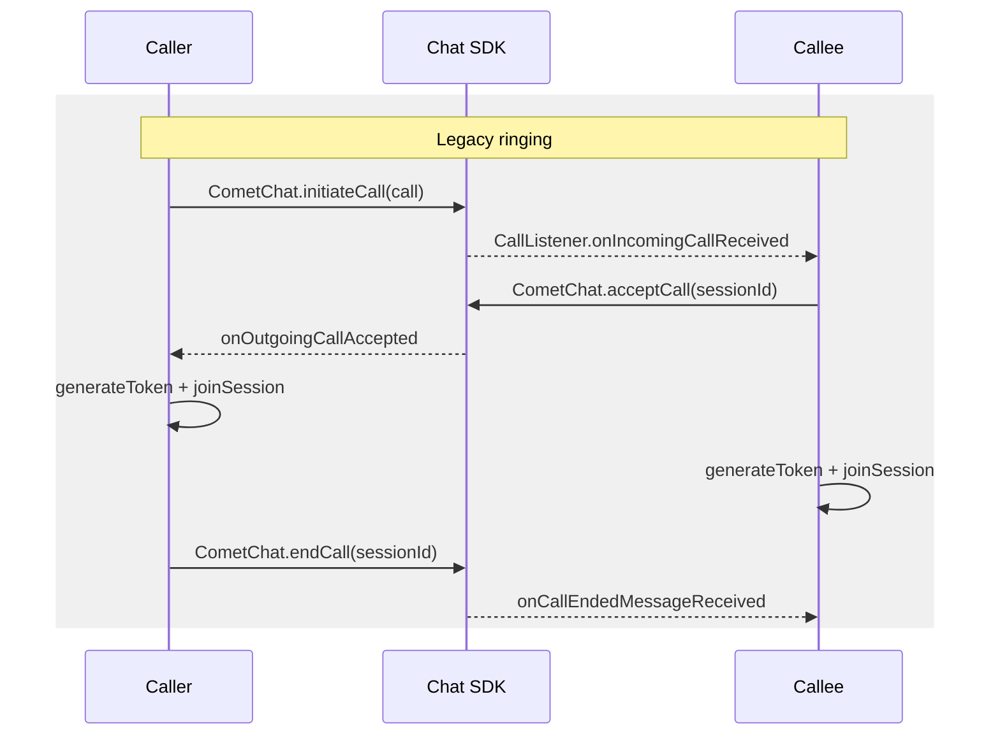
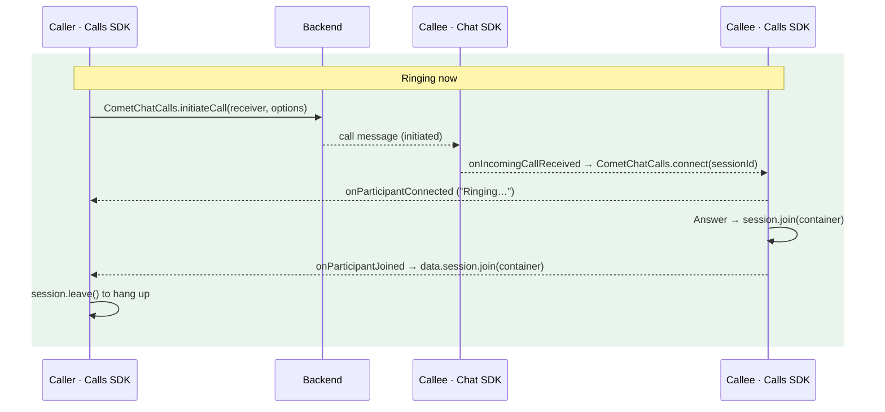

Legacy ringing signalled calls through the Chat SDK: `CometChat.initiateCall` created the call, a `CallListener` on the Chat SDK's real-time connection told the callee, and `acceptCall`, `rejectCall` and `endCall` answered, declined and ended it. Ringing now runs on the Calls SDK: it creates the call, prepares and joins the session, and ends the ring. The Chat SDK's calling methods are superseded by the Calls SDK and no longer used. On the web, the Chat SDK's `CallListener` stays: it is still how an incoming call reaches an open tab.

This page is the diff. For the full description of the current flow see [Ringing](/calls/javascript/ringing).

## Before you start

Ringing with the Calls SDK is opt-in on the client: update your app to the APIs below. While some of your users are still on legacy ringing, one dashboard setting lets the two flows call each other; see [While some users are still on legacy ringing](#while-some-users-are-still-on-legacy-ringing).
This page is for apps that use the SDKs directly. If you use the CometChat UI Kit, its
support for this flow comes with a coming UI Kit release; keep legacy ringing until then.

<Note>
Web and mobile apps ring each other on this flow when the mobile app also rings with the Calls SDK 5.1 and the Push Notifications SDK 2.0. Calls between an app on legacy ringing and an app on this flow ring once **Connect legacy ringing** is on in the dashboard; see [While some users are still on legacy ringing](#while-some-users-are-still-on-legacy-ringing).
</Note>

## Why it changed

| Legacy | Now |
|--------|-----|
| The Chat SDK created the call, and `acceptCall` / `rejectCall` / `endCall` were HTTP calls your app had to sequence with `generateToken` and `joinSession` | The Calls SDK creates the call and prepares its session. Answer = join; decline, busy, cancel and no answer are one `endCall(sessionId, status)` |
| The caller only knew "accepted" or "rejected" | The caller sees "Ringing…" (the callee's device was reached) and "answered" from the Calls SDK. A decline, busy or no answer still arrives as the Chat SDK's `onOutgoingCallRejected`, with the reason in its status |
| Joining took a token request and a full connect after the answer | The session is prepared while it rings, so the join is near-instant |
| Web and mobile rang through different paths | One call, rung in the callee's open tabs (Chat SDK) and on the callee's phones (Push Notifications SDK 2.0, in a mobile app on the Calls SDK 5.1) |

## Before and after





## Step 1: Update dependencies

```bash
npm install @cometchat/calls-sdk-javascript@5.1.0
# @cometchat/chat-sdk-javascript (4.2.1 or later) stays: chat, and incoming calls on the web
```

Keep both SDKs initialized and logged in as the same user: the Calls SDK for `initiateCall`, `connect` and `endCall`, the Chat SDK for the incoming call message.

For TypeScript: in 5.1 the error type of `joinSession()` and `session.join(container)` is `JoinSessionException` (it was `VerifyTokenException` in 5.0), which adds `SESSION_SETTINGS_REQUIRED`, `SESSION_ALREADY_PREPARED` and `SESSION_CANCELLED`. See "5.0 to 5.1" in the [v5 migration guide](/calls/javascript/migration-guide-v5).

## Step 2: Rewrite the caller

| Legacy | Now | Notes |
|--------|-----|-------|
| `CometChat.initiateCall(new CometChat.Call(receiverId, callType, receiverType))` | `CometChatCalls.initiateCall(receiver, { type, receiverType, sessionSettings })` → `{ data, error }` | `data.session` is the caller's session, already preparing. Set `sessionType` in `sessionSettings`, and `isPeerCall: true` for a 1:1 call |
| `CometChat.initiateCall(call, timeout)` | No timeout parameter | Run your own timer on the caller and end the call with `endCall(sessionId, "unanswered")` after 45 s, before a phone's 60-second ring runs out |
| `onOutgoingCallAccepted(call)` | `CometChatCalls.addEventListener("onParticipantJoined", ...)` on the prepared session, then `data.session.join(container)` | New in-between event: `onParticipantConnected` = the callee's device is ringing |
| `onOutgoingCallRejected(call)` | Unchanged: a decline, busy or no answer still arrives on the Chat SDK's `CallListener`, with the reason in `call.getStatus()`. Also `onConnectionClosed` when a callee that had prepared a 1:1 session declines | The Calls SDK reports no reason itself. Check `getCallInitiator()`: a 1:1 decline reaches the callee's other tabs too. Keep a 3 s status poll as a backstop for a message a tab missed (asleep, reconnecting) |
| `CometChat.rejectCall(sessionId, CometChat.CALL_STATUS.CANCELLED)` | `CometChatCalls.endCall(sessionId, "cancelled")` | Tears the caller's prepared session down first |
| `generateToken` + `joinSession` after the answer | `data.session.join(container)` | Takes no settings: the ones passed to `initiateCall` apply |

<Tabs>
<Tab title="Before">
```javascript
const call = new CometChat.Call(receiverId, CometChat.CALL_TYPE.VIDEO, CometChat.RECEIVER_TYPE.USER);
const outgoingCall = await CometChat.initiateCall(call);

CometChat.addCallListener("caller", new CometChat.CallListener({
  onOutgoingCallAccepted: async (accepted) => {
    const { token } = await CometChatCalls.generateToken(accepted.getSessionId());
    await CometChatCalls.joinSession(token, { sessionType: "VIDEO" }, container);
  },
  onOutgoingCallRejected: () => closeOutgoingScreen(),
}));

function cancel() {
  CometChat.rejectCall(outgoingCall.getSessionId(), CometChat.CALL_STATUS.CANCELLED);
}
```
</Tab>
<Tab title="After">
```javascript
const { data: call, error } = await CometChatCalls.initiateCall(receiverId, {
  type: "video",
  sessionSettings: { sessionType: "VIDEO", isPeerCall: true },
});
if (error) throw new Error(`Could not start the call: ${error.message}`);

const offConnected = CometChatCalls.addEventListener("onParticipantConnected", () => setStatus("Ringing…"));
const offJoined = CometChatCalls.addEventListener("onParticipantJoined", () => {
  stopWatching();
  call.session.join(container);
});
const offClosed = CometChatCalls.addEventListener("onConnectionClosed", () => closeOutgoingScreen());
const stopWatching = () => { offConnected(); offJoined(); offClosed(); };
// Keep onOutgoingCallRejected on your CallListener for a decline, busy or no answer.
// Plus: poll the call's status every 3 s as a backstop and a 45 s ring timer (see Ringing).

function cancel() {
  stopWatching();
  CometChatCalls.endCall(call.sessionId, "cancelled");
}
```
</Tab>
</Tabs>

## Step 3: Rewrite the callee

| Legacy | Now | Notes |
|--------|-----|-------|
| `CallListener.onIncomingCallReceived(call)` | Unchanged: the call still arrives on the Chat SDK's `CallListener`. Then prepare it with `CometChatCalls.connect(call.getSessionId(), settings)` | The caller's own tabs receive their 1:1 call as "incoming" too: skip calls whose `getCallInitiator()` is the logged-in user |
| `CometChat.acceptCall(sessionId)` then `generateToken` + `joinSession` | `session.join(container)` on the session `connect` prepared. Nothing else to send | If the prepare failed, `generateToken` + `joinSession` as before |
| `CometChat.rejectCall(sessionId, CometChat.CALL_STATUS.REJECTED)` | `CometChatCalls.endCall(sessionId, "rejected")` | `"busy"` when the user is in another call. A group call's decline is local: `session.leave()` |
| `onIncomingCallCancelled(call)` | Still fires (also when the caller gives up as `unanswered`); also `onConnectionClosed` on a prepared 1:1 session | Keep a 3 s status poll while ringing as a backstop for a message the tab missed (asleep, reconnecting) |
| — | Your own ring timer on the callee | Stop ringing after 60 s, a little after the caller gives up at 45 s |

<Tabs>
<Tab title="Before">
```javascript
CometChat.addCallListener("callee", new CometChat.CallListener({
  onIncomingCallReceived: (call) => showIncomingScreen(call),
  onIncomingCallCancelled: () => closeIncomingScreen(),
}));

async function answer(call) {
  await CometChat.acceptCall(call.getSessionId());
  const { token } = await CometChatCalls.generateToken(call.getSessionId());
  await CometChatCalls.joinSession(token, { sessionType: "VIDEO" }, container);
}

function decline(call) {
  CometChat.rejectCall(call.getSessionId(), CometChat.CALL_STATUS.REJECTED);
}
```
</Tab>
<Tab title="After">
```javascript
// Settings for an incoming 1:1 call: the type comes from the call, or an audio call opens the camera.
const settingsFor = (call) => ({
  sessionType: call.getType() === "audio" ? "VOICE" : "VIDEO",
  isPeerCall: true,
});

CometChat.addCallListener("callee", new CometChat.CallListener({
  onIncomingCallReceived: (call) => {
    if (call.getCallInitiator()?.getUid() === CometChatCalls.getLoggedInUser()?.uid) return;
    showIncomingScreen(call);
    CometChatCalls.connect(call.getSessionId(), settingsFor(call))
      .catch(() => {}); // answer falls back to a direct join
  },
  onIncomingCallCancelled: () => closeIncomingScreen(),
}));

async function answer(call) {
  const session = CometChatCalls.getActiveSession();
  if (session?.sessionId === call.getSessionId()) {
    await session.join(container);
  } else {
    const { token } = await CometChatCalls.generateToken(call.getSessionId());
    await CometChatCalls.joinSession(token, settingsFor(call), container);
  }
}

function decline(call) {
  CometChatCalls.endCall(call.getSessionId(), "rejected");
}
```
</Tab>
</Tabs>

## Step 4: Replace the remaining calls

| Legacy | Now | Notes |
|--------|-----|-------|
| `CometChat.endCall(sessionId)` after a call | `session.leave()` or `CometChatCalls.leaveSession()` | No status to send; with `isPeerCall` the call ends for both |
| `CometChat.getActiveCall()` | `CometChatCalls.getActiveSession()` | `null` when no session is preparing, prepared or joined. `session.sessionId` names the call for a session from `initiateCall` or `connect` (it is `null` after a direct `joinSession`) |
| `CometChat.clearActiveCall()` | Nothing | The Calls SDK clears its session when it ends |
| `onCallEndedMessageReceived(call)` | `onSessionLeft` / `onConnectionClosed` on the joined session | |
| `CometChat.startCall(...)`, Chat SDK `CallSettings` | `joinSession` + the 5.x events (see the [v5 migration guide](/calls/javascript/migration-guide-v5)) | |
| `CometChat.CALL_STATUS.*` values for a decline or cancel | `"rejected"`, `"busy"`, `"cancelled"`, `"unanswered"` strings passed to `endCall` | The `Call` message model and `CometChat.CALL_STATUS` still describe call messages in a conversation's history |

## While some users are still on legacy ringing

Your users don't all update at once, so during the rollout one CometChat app has devices on both flows. A device's flow comes from its push registration: a device on the Calls SDK 5.1 and Push Notifications SDK 2.0 receives only the call-initiated push, and a device still on legacy ringing keeps receiving the legacy call events.

To let users on the two flows call each other, turn on **Connect legacy ringing** in the CometChat dashboard under **Voice & Video Calls → Settings**. CometChat then also sends calls made on this flow as legacy call events, so devices on either flow ring for calls from the other.

- Turn it on before the first users update, and leave it on while any version of your apps still in use rings the legacy way.
- It can't be turned off from the dashboard.
- The six legacy call events (ongoing, cancelled, rejected, unanswered, busy and ended) are under **Show legacy** in **Notifications → Settings → Call Preferences**. They only reach devices on legacy ringing.

## What users will notice

- The caller sees "Ringing…" once the callee's tab or phone is reached, and the call screen closes when the call is declined, busy or missed (from `onOutgoingCallRejected`, the status poll, or the ring timer).
- Answering joins almost at once, because the session was prepared while it rang.
- Calls ring between web and mobile users in both directions, when the mobile app also rings with the Calls SDK 5.1 and the Push Notifications SDK 2.0. Calls between an app on legacy ringing and an app on this flow ring too, once **Connect legacy ringing** is on in the dashboard.
- The browser asks for the camera and microphone when the call is joined, not while it rings.

## Checklist

- [ ] `@cometchat/calls-sdk-javascript` 5.1; the Chat SDK (4.2.1 or later) stays, initialized and logged in as the same user
- [ ] The mobile apps your web app calls also ring with the Calls SDK 5.1 and the Push Notifications SDK 2.0, or **Connect legacy ringing** is on in the dashboard
- [ ] `initiateCall` passes `sessionSettings` with `sessionType`, and `isPeerCall: true` for a 1:1 call
- [ ] Caller listens for `onParticipantConnected` / `onParticipantJoined` / `onConnectionClosed` and joins only on `onParticipantJoined` with `data.session.join(container)`
- [ ] Caller ends the screen on `onOutgoingCallRejected`, polls the call's status every 3 s while ringing as a backstop, and runs a ring timer that ends the call as `unanswered`
- [ ] Callee skips its own outgoing calls, prepares with `connect`, and answers with `session.join(container)`
- [ ] Callee stops ringing on `onIncomingCallCancelled`, `onConnectionClosed`, its ring timer and the status poll
- [ ] Decline, busy and cancel use `CometChatCalls.endCall`; no `CometChat.acceptCall`, `rejectCall` or `endCall` left
- [ ] Hang-up uses `session.leave()` or `CometChatCalls.leaveSession()`
- [ ] Tested: web to web, web to phone and phone to web; decline, busy, cancel, no answer; two open tabs
