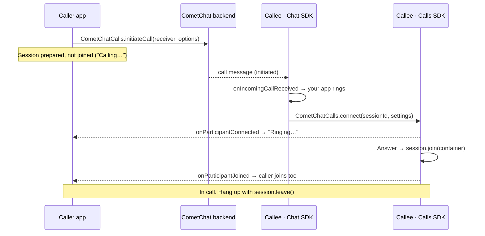

Ringing lets one user call another and lets the callee answer or decline. On the web, an incoming call rings in every open tab of your app where the callee is logged in.

Two SDKs do the work:

| SDK | Owns |
|-----|------|
| **Calls SDK** (`@cometchat/calls-sdk-javascript` 5.1+) | Creating the call, preparing and joining the session, declining, cancelling, ending, and the call events your code listens to |
| **Chat SDK** (`@cometchat/chat-sdk-javascript`) | Delivering an incoming call to an open tab: the call message arrives on the Chat SDK's real-time connection and is reported to `CometChat.addCallListener` |

The web has no VoIP push. A tab that is closed does not ring, and your app plays the ringtone, shows the incoming-call screen and stops ringing when the ring is over. A callee on Android or iOS rings through the Push Notifications SDK.

<Note>
Web and mobile users can call each other when the mobile app also rings with the Calls SDK 5.1 and the Push Notifications SDK 2.0. Calls between an app on legacy ringing (the Chat SDK's calling methods) and an app on this flow are not covered at launch: move the web and mobile apps that call each other to this flow together.
</Note>

<Note>
**Coming from the earlier ringing flow?** The Chat SDK's calling methods (`CometChat.initiateCall`, `acceptCall`, `rejectCall`, `endCall`, `startCall`) are superseded by the Calls SDK and are no longer used. `CometChat.addCallListener` is the exception on the web: it is still how an incoming call reaches a tab. See [Migrating from legacy ringing](/calls/javascript/migrating-from-legacy-ringing) for a method-by-method mapping.
</Note>

## How ringing works

The caller creates the call with the Calls SDK. The CometChat backend delivers the call message to the callee's open tabs through the Chat SDK, and to the callee's phones by push. The callee's tab rings and prepares the session while it rings; when the callee answers, it joins. The caller's app learns that the callee is ringing and has answered from the Calls SDK, without joining the session first.



What each side sees:

| Stage | Caller | Callee (web) |
|-------|--------|--------|
| Call created | `initiateCall` resolves; show "Calling…" | `onIncomingCallReceived` in each open tab; ring and call `connect` |
| Callee's device reached | `onParticipantConnected` → show "Ringing…" | Ringing |
| Callee answers | `onParticipantJoined` → `data.session.join(container)` | `session.join(container)` |
| Callee declines / is busy / does not answer | The Chat SDK's `onOutgoingCallRejected`, with `call.getStatus()` saying why; also `onConnectionClosed` when the callee had prepared a 1:1 session. [Poll the status](#detect-a-decline-busy-or-no-answer) and keep your [ring timer](#ring-timeout) as a backstop | `endCall(sessionId, "rejected")` or `"busy"`; your own ring timer |
| Caller cancels | — (you ended it) | `onIncomingCallCancelled`, or (1:1) `onConnectionClosed` on the prepared session; [poll the status](#stop-ringing-on-the-callee) as a backstop |
| Either side hangs up | `onParticipantLeft` / `onSessionLeft` | same |

<Note>
The Calls SDK does not report why a ring ended. `endCall` records the status on the server, which sends it as a Chat SDK call message: a decline, busy or no answer reaches the caller as `CallListener.onOutgoingCallRejected` (`call.getStatus()` is `rejected`, `busy` or `unanswered`), and a cancel reaches the callee as `onIncomingCallCancelled`. A 1:1 decline from a callee whose device had prepared the session also closes the caller's prepared session (`onConnectionClosed`), which carries no reason. A tab can still miss a message (it was asleep in the background, or reconnecting), and if the caller's own prepare failed, the caller is not in the room and hears neither the ring nor the answer. So while the call rings, also read its status from the server every 3 seconds as a backstop, and keep the [ring timer](#ring-timeout).
</Note>

## Prerequisites

- [Calls SDK set up](/calls/javascript/setup) and the user [logged in](/calls/javascript/authentication) with `CometChatCalls.login` or `loginWithAuthToken`. `initiateCall`, `connect` and `endCall` need a logged-in Calls SDK user.
- The Chat SDK (`@cometchat/chat-sdk-javascript` 4.2.1 or later) initialized and logged in as the **same user**, so that incoming calls, declines and cancels reach the tab. See [Chat SDK setup](/sdk/javascript/setup-sdk).
- HTTPS in production, for camera and microphone access.

```bash
npm install @cometchat/calls-sdk-javascript@5.1.0 @cometchat/chat-sdk-javascript@^4.2.1
```

## Start a call

`CometChatCalls.initiateCall` creates the call on the backend, which rings the callee, and starts preparing the caller's session. The caller does **not** join yet.

```javascript
import { CometChatCalls } from "@cometchat/calls-sdk-javascript";

const isGroup = false;            // true to ring a group (see Group calls)
const sessionSettings = {
  sessionType: "VOICE",           // "VIDEO" for a video call
  isPeerCall: !isGroup,           // 1:1: the call ends for both when either leaves
};

const { data: call, error } = await CometChatCalls.initiateCall(receiverUid, {
  type: "audio",                  // or "video" (the default)
  receiverType: isGroup ? "group" : "user",
  sessionSettings,
});

if (error) {
  console.error("Could not start the call:", error.name, error.message);
} else {
  console.log("Calling", call.receiver, "session", call.sessionId);
  showOutgoingScreen(call);
}
```

| Parameter | Description |
|-----------|-------------|
| `receiver` | UID of the user to call, or the group's GUID with `receiverType: "group"` (see [Group calls](#group-calls)) |
| `options.type` | `"audio"` or `"video"` (default) |
| `options.receiverType` | `"user"` (default) or `"group"` |
| `options.sessionSettings` | The [session settings](/calls/javascript/session-settings) the caller's session is prepared with. See the warning below |

`initiateCall` never rejects. It resolves with `{ data, error }`:

- `data` is the `InitiatedCall`: `sessionId`, `messageId` (the id of the call message in the conversation), `conversationId`, `sender`, `receiver`, `receiverType`, `type`, `status`, `initiatedAt` (in seconds) and `session`, the `CallSession` being prepared.
- `error` is set when no call was created: `USER_NOT_LOGGED_IN`, `VALIDATION_ERROR` (no receiver), `SESSION_ALREADY_ACTIVE` (the user is joining or in another call; leave it first), `BAD_RESPONSE`, or the failure of the request.

`initiateCall` resolves as soon as the call exists, before the caller's session has finished preparing: `call.session.prepareStatus` is `"pending"` at first. A failed prepare does not fail `initiateCall`, because the callee is already ringing; it shows on `call.session.prepareStatus` (`"failed"`) and `call.session.error`. After a failed prepare `call.session.join(container)` still performs a direct join, unless no call token came back with the call (it then resolves with `VALIDATION_ERROR`: generate a token and use `joinSession`, as `joinOutgoing` below does).

<Warning>
**Always set the session type in `sessionSettings`, and `isPeerCall: true` for a 1:1 call.** The Calls SDK freezes the session settings when it prepares the session, and `session.join(container)` takes no settings: the ones you pass here are the ones the caller joins with. The default session type is video, so an audio call started without `sessionType: "VOICE"` opens the caller's camera. Without `isPeerCall`, a hang-up only removes one side from the room and the other side stays in it alone.
</Warning>

## Show "Ringing…" and detect the answer

The caller stays on the session that `initiateCall` prepared and listens to it. Do not join yet: joining only when the callee has joined keeps the caller's camera and microphone off until there is someone to talk to. While the session is only prepared, the SDK still reports the callee's device reaching the room and the callee joining it.

Listeners registered with `CometChatCalls.addEventListener` (or `call.session.addEventListener`) are global: they work before the prepare has finished and stay registered across sessions until you call the function they return. Register them right after `initiateCall` resolves, and check that the event belongs to the call on screen.

```javascript
// State of the outgoing call on screen.
let answered = false;
let cancelled = false;
let ended = false;
let stopWatching = () => {};

function watchOutgoingCall(call, container, isGroup) {
  const me = CometChatCalls.getLoggedInUser()?.uid;
  answered = cancelled = ended = false;
  const done = () => answered || cancelled || ended;

  // Every way the ring can end goes through here, once.
  const finish = (endText) => {
    if (done()) return;
    ended = true;
    stopWatching();
    closeOutgoingScreen(endText);
  };

  // The callee's device received the call and prepared the session: it is ringing there.
  const offConnected = CometChatCalls.addEventListener("onParticipantConnected", (participant) => {
    if (!done() && participant.uid !== me) setStatus("Ringing…"); // not one of your own devices
  });

  // The callee answered: now the caller joins.
  const offJoined = CometChatCalls.addEventListener("onParticipantJoined", () => {
    if (done()) return;
    answered = true;
    stopWatching();
    joinOutgoing(call, container);
  });

  // The prepared session closed before anyone joined: the call is over.
  const offClosed = CometChatCalls.addEventListener("onConnectionClosed", async () => {
    if (done()) return;
    // The close carries no reason: ask the server (see the next section).
    finish(outgoingRingIsOver(await fetchCallStatus(call.sessionId)) ?? "Call ended");
  });

  // Read the call's status every 3 s (see the next section).
  const poll = setInterval(() => checkOutgoingStatus(call, container, finish), 3000);

  // Give up after 45 s (see Ring timeout).
  const ringTimer = setTimeout(() => {
    if (done()) return;
    // A group call is withdrawn ("cancelled"): "unanswered" is a 1:1 outcome.
    CometChatCalls.endCall(call.sessionId, isGroup ? "cancelled" : "unanswered");
    finish("No answer");
  }, 45_000);

  stopWatching = () => {
    offConnected();
    offJoined();
    offClosed();
    clearInterval(poll);
    clearTimeout(ringTimer);
  };
}

async function joinOutgoing(call, container) {
  const { error } = await call.session.join(container);
  if (error?.name === "VALIDATION_ERROR") {
    // No call token came with the call: generate one and join directly,
    // with the settings the call was started with.
    const { token } = await CometChatCalls.generateToken(call.sessionId);
    await CometChatCalls.joinSession(token, call.session.settings, container);
  } else if (error) {
    console.error("Join failed:", error);
  }
}
```

| Event | On the prepared session it means |
|-------|----------------------------------|
| `onConnected` | Your own prepare finished; the join will be near-instant |
| `onParticipantConnected(participant)` | The callee's device prepared the session: it is ringing there. `participant` carries `uid`, `name`, `pid` and `avatar` |
| `onParticipantJoined(participant)` | The callee answered. Join now |
| `onConnectionClosed` | The call ended before anyone joined (declined, cancelled, the room went away, or the prepared session expired after 5 minutes). It carries no reason. `onSessionTimedOut` is not part of this: it only reports an idle joined session |

`call.session.join(container)` called while the prepare is still running waits for it. See [Join the session](#join-the-session).

These events come from the room, so they only arrive while the caller's session is in it. If the caller's own prepare failed (`call.session.prepareStatus === "failed"`), neither arrives: the status poll below then reports the answer as `ongoing`.

## Detect a decline, busy or no answer

A decline, busy or no answer reaches the caller as `onOutgoingCallRejected` on the Chat SDK's `CallListener`, with the reason in `call.getStatus()` (see [Receive a call](#receive-a-call)). As a backstop for a message the tab missed, and for an answer the caller cannot hear because its own prepare failed, also read the call's status from the server every 3 seconds from the moment `initiateCall` resolves until the call is answered, cancelled or times out (`watchOutgoingCall` above starts and stops the poll). Start at once, not only after "Ringing…": a callee who declines before their device prepared the session never sends `onParticipantConnected`.

The status is the call's entry in [Call Logs](/calls/javascript/call-logs), read with the logged-in user's auth token:

```javascript
const APP_ID = "APP_ID";
const REGION = "us"; // your app's region, in lower case

async function fetchCallStatus(sessionId) {
  const authToken = CometChatCalls.getUserAuthToken();
  if (!authToken) return null;
  const url = `https://${APP_ID}.call-${REGION}.cometchat.io/v3.0/calls/${encodeURIComponent(sessionId)}`;
  try {
    const response = await fetch(url, {
      headers: { accept: "application/json", appid: APP_ID, authtoken: authToken },
    });
    if (!response.ok) return null;
    const body = await response.json();
    const entry = Array.isArray(body.data) ? body.data[0] : body.data;
    return entry?.status ?? null;
  } catch {
    return null; // offline or a failed request: keep ringing
  }
}

// What the caller's screen says, or null while the call still rings.
function outgoingRingIsOver(status) {
  if (!status) return null;
  switch (status.toLowerCase()) {
    case "initiated":
    case "ongoing":   // answered: handled separately
      return null;
    case "rejected":
      return "Declined";
    case "busy":
      return "Busy";
    default:
      return "Call ended";
  }
}

// Called every 3 s by watchOutgoingCall until the ring ends.
async function checkOutgoingStatus(call, container, finish) {
  const status = await fetchCallStatus(call.sessionId);
  if (answered || cancelled || ended) return;

  if (status?.toLowerCase() === "ongoing" && call.session.prepareStatus === "failed") {
    // Answered, but the caller is not in the room to hear onParticipantJoined.
    answered = true;
    stopWatching();
    joinOutgoing(call, container);
    return;
  }
  const endText = outgoingRingIsOver(status);
  if (endText) finish(endText);
}
```

<Warning>
`fetchCallStatus` calls a CometChat REST endpoint directly: the Calls SDK has no public method that returns a call's status, so this endpoint is not part of the SDK's API. The sample builds the URL for the default host, `{appId}.call-{region}.cometchat.io`; if your app initializes the Calls SDK with a custom host, build the URL from that host instead.
</Warning>

Never end a call because the status could not be read: `null` means "keep ringing". The Chat SDK's `CallListener.onOutgoingCallRejected` carries the same outcome (`rejected`, `busy` or `unanswered`); end the screen on whichever arrives first (see [Receive a call](#receive-a-call) for filtering it).

## Receive a call

On the web an incoming call arrives as a call message on the Chat SDK's real-time connection. Register a `CallListener` once, after the Chat SDK login, and remove it at logout.

```javascript
import { CometChat } from "@cometchat/chat-sdk-javascript";

const LISTENER_ID = "ringing";
const myUid = () => CometChatCalls.getLoggedInUser()?.uid;

CometChat.addCallListener(
  LISTENER_ID,
  new CometChat.CallListener({
    onIncomingCallReceived: (call) => {
      // The caller's own tabs receive their 1:1 call as "incoming" too.
      if (call.getCallInitiator()?.getUid() === myUid()) return;

      // A message delivered late (a sleeping tab, a reconnect) for a call that stopped ringing long ago.
      const initiatedAt = call.getInitiatedAt(); // seconds
      if (initiatedAt && Date.now() / 1000 - initiatedAt > 60) return;

      const isGroup = call.getReceiverType() === CometChat.RECEIVER_TYPE.GROUP;
      if (isBusy()) {
        // A 1:1 caller is told you are busy. A group call is just not shown.
        if (!isGroup) CometChatCalls.endCall(call.getSessionId(), "busy");
        return;
      }
      ringIncomingCall(call);
    },
    // The caller cancelled, or gave up ("unanswered"). A cancel reaches the caller's own tabs too.
    onIncomingCallCancelled: (call) => {
      stopRinging(call.getSessionId(), "over");
    },
    // A 1:1 "rejected" / "busy" reaches every tab of both users; "unanswered" reaches the caller.
    onOutgoingCallRejected: (call) => {
      if (call.getCallInitiator()?.getUid() === myUid()) {
        // Your own outgoing call: call.getStatus() is "rejected", "busy" or "unanswered".
        endOutgoingIfShowing(call.getSessionId(), call.getStatus());
      } else {
        // Declined on another of your tabs or devices.
        stopRinging(call.getSessionId(), "over");
      }
    },
  })
);

// At logout:
CometChat.removeCallListener(LISTENER_ID);
```

Your app does the ringing itself: play a ringtone, show the incoming-call screen, and, if the tab is in the background, show a browser notification (request the `Notification` permission on a user gesture, for example when the user places their first call). Browsers may block audio that starts without a user gesture on the page.

`endCall(sessionId, "busy")` while the user is in another call leaves that other call untouched: `endCall` only tears down the live session when it is the call being ended.

## Prepare the ringing call

As soon as the call rings, prepare its session with `CometChatCalls.connect`. Preparing is signalling only: no camera or microphone is opened and the caller does not see the callee in the call, but it is what turns the caller's screen to "Ringing…" and makes the answer near-instant. In a 1:1 call (`isPeerCall: true`) it also lets the caller's cancel reach this tab as `onConnectionClosed`, because the caller leaving a prepared peer session ends the room.

```javascript
// The incoming call on screen. state: "ringing" | "answered" | "over" | "elsewhere"
let ring = null;

function ringIncomingCall(call) {
  const thisRing = { call, state: "ringing" };
  ring = thisRing;
  const sessionId = call.getSessionId();
  showIncomingScreen(call);
  startRingtone();
  startIncomingRingTimer(sessionId);

  CometChatCalls.connect(sessionId, {
    sessionType: call.getType() === "audio" ? "VOICE" : "VIDEO",
    isPeerCall: call.getReceiverType() !== CometChat.RECEIVER_TYPE.GROUP,
  })
    .then((session) => {
      // The ring ended without an answer while the prepare ran: release it.
      if (thisRing.state === "over" && session.prepareStatus === "prepared" && !session.isSessionJoined()) {
        session.leave();
      }
    })
    .catch((error) => {
      // Answer falls back to a direct join; the status poll keeps watching the ring.
      console.warn("Preparing the call failed:", error);
    });
}
```

`connect(sessionId, sessionSettings)` resolves with the `CallSession` once the prepare has settled: `session.prepareStatus` is `"prepared"`, or `"cancelled"` when `leave()` was called meanwhile or a later `connect` for another session replaced it. Calling it again for the same session while it is preparing or prepared returns the same prepare. It rejects when the session could not be prepared, with one of two shapes:

- `{ errorCode, errorDescription }` before the prepare starts: `ERROR_SESSION_ID_MISSING`, `ERROR_USER_NOT_LOGGED_IN`, or a failed call token request.
- `{ name, message }` (`PrepareSessionException`) for everything after: a token verification, connection or conference failure, or `SESSION_ALREADY_ACTIVE` while another session is joined. The same error is left on `session.error`.

The settings you pass to `connect` are frozen: they are the ones the callee joins with. A prepared session that nobody joins within 5 minutes is torn down: `onConnectionClosed` fires and `getActiveSession()` returns `null`, while `session.prepareStatus` stays `"prepared"` (it is `"failed"` with `PREPARE_TIMEOUT` only if the prepare had not finished connecting by then). `onSessionTimedOut` does not fire for it.

<Warning>
**Leaving a prepared 1:1 session ends the room for everyone in it.** With `isPeerCall: true`, tearing down a prepared session that is in the room, whether by `leave()`, `endCall`, a `connect` or `initiateCall` for another session, or the 5-minute expiry, asks the server to end the room, not only to remove this tab. That is how a cancel or decline reaches the other side, and it does no harm once the ring is over.

It is a problem when the call was answered in another tab or on another device: that tab's prepared session is still in the room of the live call. Do not call `leave()` on it. That only delays the problem: the 5-minute expiry, or the next `connect` or `initiateCall` in that tab, tears the session down the same way. The Calls SDK has no local-only leave for a prepared 1:1 session, so there is no client-side way around this.
</Warning>

### Stop ringing on the callee

Stop ringing when any of these happens for the ringing call:

- `onIncomingCallCancelled` arrives on the Chat SDK listener (the caller cancelled or gave up).
- `onOutgoingCallRejected` arrives for a call you did not place (you declined it in another tab or on another device).
- `onConnectionClosed` fires while the call is still ringing and this tab had prepared it (in a 1:1 call: the caller cancelled, or the call ended).
- Your own ring timer runs out.
- Another of your tabs tells you it answered or declined the call (see [Several tabs and devices](#several-tabs-and-devices)).
- The call's status is no longer `initiated`. Poll it every 3 seconds while ringing, with the `fetchCallStatus` function above, as a backstop for a message this tab missed (it was asleep in the background, or reconnecting): `onConnectionClosed` only fires when the room is destroyed.

```javascript
// "over": the ring ended without an answer. "elsewhere": answered on another tab or device.
function stopRinging(sessionId, reason) {
  if (!ring || ring.state !== "ringing" || ring.call.getSessionId() !== sessionId) return;
  ring.state = reason;
  stopRingtone();
  stopIncomingRingTimer();
  closeIncomingScreen();
  // Release the prepared session only when the call is over (see the warning above).
  const session = CometChatCalls.getActiveSession();
  if (reason === "over" && session?.sessionId === sessionId && !session.isSessionJoined()) {
    session.leave();
  }
}

// From the status poll. A 1:1 call stops on anything but "initiated"; "ongoing" means it was answered
// on another of the user's devices. A group call keeps ringing while it goes on, until it is over.
function ringStatusReason(status, isGroup) {
  if (!status) return null; // could not read it: keep ringing
  const s = status.toLowerCase();
  if (isGroup) return ["ended", "cancelled", "unanswered", "rejected"].includes(s) ? "over" : null;
  if (s === "initiated") return null;
  return s === "ongoing" ? "elsewhere" : "over";
}
```

## Answer a call

There is no separate "accept" call. Answering is joining the session the tab prepared; if the prepare failed, join directly.

```javascript
async function answer(container) {
  if (!ring || ring.state !== "ringing") return;
  ring.state = "answered";
  const call = ring.call;
  const sessionId = call.getSessionId();
  stopRingtone();
  stopIncomingRingTimer();
  tellOtherTabs("handled", sessionId);

  // The session this tab prepared: join waits for a prepare still running, and joins
  // directly with the frozen settings if the prepare failed after it started.
  const session = CometChatCalls.getActiveSession();
  if (session?.sessionId === sessionId) {
    const { error } = await session.join(container);
    if (!error) return;
    if (error.name !== "VALIDATION_ERROR") return console.error("Join failed:", error);
    // VALIDATION_ERROR: no call token could be generated for the prepare; join directly below.
  }

  // Nothing prepared for this call (the prepare failed or never ran): join directly.
  const { token } = await CometChatCalls.generateToken(sessionId);
  const { error } = await CometChatCalls.joinSession(token, {
    sessionType: call.getType() === "audio" ? "VOICE" : "VIDEO",
    isPeerCall: call.getReceiverType() !== CometChat.RECEIVER_TYPE.GROUP,
  }, container);
  if (error) console.error("Join failed:", error);
}
```

The browser asks for the camera and microphone when the session is joined, not when it is prepared.

## Join the session

Both sides join the same way: the callee when the user answers, the caller from `onParticipantJoined`. `session.join(container)` mounts the call UI into `container` and takes no settings.

| State of the session | What `session.join(container)` does |
|----------------------|--------------------------------------|
| Prepared, or still preparing | The actual join, near-instant. `onSessionJoined` fires, then the camera and microphone open |
| The prepare failed or expired, and nothing is live | A normal direct join with the settings frozen at prepare. If no call token was generated (`TOKEN_GENERATION_FAILED`, or none came back with `initiateCall`), it resolves with `VALIDATION_ERROR`: use `generateToken` and `joinSession` instead |
| The prepare was cancelled (`leave()`) | Resolves with `SESSION_CANCELLED`: call `connect` again, or join directly |
| Already joined | Resolves with success and does nothing |

`session.join` resolves with `{ data, error }` like `joinSession`. `CometChatCalls.joinSession(token, settings, container)` refuses to run while a session is preparing or prepared (`SESSION_ALREADY_PREPARED`): join the prepared one with `session.join(container)`, or cancel it with `session.leave()` first.

<Note>
`CometChatCalls.getActiveSession()` returns the SDK's one `CallSession` while a session is preparing, prepared, being joined or joined: from the moment `connect` is called, or from the moment `initiateCall` has created the call. It returns `null` otherwise, including after a failed or cancelled prepare and after the 5-minute expiry. Always check it for `null` (`getActiveSession()?.leave()`), and compare `session.sessionId` with the call you mean: a later `connect` for another session re-points the same object, so an old reference describes the newer session. `sessionId` is set only for a session from `connect` or `initiateCall`; after a direct `joinSession` it is `null`.
</Note>

See [Join Session](/calls/javascript/join-session) for the container, [Session Settings](/calls/javascript/session-settings) for layouts and controls, and [Events](/calls/javascript/events) for everything the joined session reports.

## Decline a call

Decline a 1:1 call with `endCall` and the `rejected` status. When this tab had prepared the session, `endCall` first starts tearing it down (in a 1:1 call that asks the server to end the room), then tells the server the status. `onConnectionClosed` follows when the room closes.

```javascript
async function decline() {
  if (!ring || ring.state !== "ringing") return;
  ring.state = "over";
  const call = ring.call;
  stopRingtone();
  stopIncomingRingTimer();
  closeIncomingScreen();
  tellOtherTabs("handled", call.getSessionId());

  if (call.getReceiverType() === CometChat.RECEIVER_TYPE.GROUP) {
    // A group call's decline is local: the call carries on for the other members.
    const session = CometChatCalls.getActiveSession();
    if (session?.sessionId === call.getSessionId()) session.leave();
    return;
  }
  const { error } = await CometChatCalls.endCall(call.getSessionId(), "rejected");
  if (error) console.warn("Decline failed:", error);
}
```

Use `"busy"` instead of `"rejected"` when the user is already in another call.

`endCall(sessionId, status)` never rejects. It resolves with `{ data: undefined, error: null }` once the server has the new status, or with `error` set: `USER_NOT_LOGGED_IN`, `VALIDATION_ERROR` (no session ID), or the failure of the request. The status defaults to `"rejected"`.

## Cancel a call

The caller ends a call that is still ringing with `endCall` and the `cancelled` status. The SDK first starts tearing the caller's prepared session down, then tells the server; `onConnectionClosed` follows when the room closes (the sample below has already removed its own listener). The callee's ring stops.

```javascript
async function cancelOutgoingCall(sessionId) {
  cancelled = true;
  stopWatching();
  closeOutgoingScreen();   // close locally whatever the server says
  const { error } = await CometChatCalls.endCall(sessionId, "cancelled");
  if (error) console.warn("Cancel failed:", error);
}
```

Disable the cancel button after the first click, and ignore an `onParticipantJoined` that arrives after you cancelled: the cancel wins. If the user cancels before `initiateCall` has resolved, cancel the call when it resolves, or the callee rings for a call nobody is waiting on:

```javascript
let callSeq = 0;

async function startCall(receiverUid, options, container) {
  const seq = ++callSeq;
  const { data: call } = await CometChatCalls.initiateCall(receiverUid, options);
  if (seq !== callSeq) {
    // Cancelled while "Calling…" (the cancel button did ++callSeq): the call exists now, so withdraw it.
    if (call) CometChatCalls.endCall(call.sessionId, "cancelled");
    return;
  }
  if (call) watchOutgoingCall(call, container, options.receiverType === "group");
}
```

## Ring timeout

Nothing in the web SDKs ends a ring on a timer, so run a timer on both sides.

On the caller, start it when `initiateCall` resolves and end the call as `unanswered` when it runs out; `watchOutgoingCall` above does this. Use 45 seconds: a callee on a phone rings for 60 seconds, and giving up first means the callee never rings for a call the caller has stopped waiting on. A callee on a phone stops ringing at its Push SDK's ring window, but if the callee's device is never reached, nothing else ends the caller's ringing until the prepared session expires after 5 minutes. A group call the caller stops waiting on is withdrawn as `cancelled` instead: `unanswered` is a 1:1 outcome.

On the callee, stop ringing after 60 seconds, a little after the caller would have given up, with `stopRinging(sessionId, "over")`. Do not send a status: the caller ends the call.

## End a call

Hang up by leaving the session with `session.leave()` or `CometChatCalls.leaveSession()`. The other side receives `onParticipantLeft`, and in a peer call (`isPeerCall: true`) the session ends for both. No status needs to be sent and the call is logged by the backend.

```javascript
// The default call UI's Leave button leaves the session itself; only clean up here.
CometChatCalls.addEventListener("onLeaveSessionButtonClicked", () => {
  closeCallScreen();
});

// Your own hang-up control:
async function hangUp() {
  await CometChatCalls.getActiveSession()?.leave();
  closeCallScreen();
}

// The other participant ended the call:
CometChatCalls.addEventListener("onSessionLeft", closeCallScreen);
CometChatCalls.addEventListener("onConnectionClosed", closeCallScreen);
```

`onConnectionClosed` fires for a joined call that ends and for a prepared session that is torn down, so check which screen is showing before acting on it.

## Several tabs and devices

Every open tab where the callee is logged in receives the call and rings. Answering or declining in one tab does not stop the others by itself:

- Tell your other tabs, for example with a [`BroadcastChannel`](https://developer.mozilla.org/en-US/docs/Web/API/BroadcastChannel) (`tellOtherTabs` in the samples above). A tab that hears another tab answered calls `stopRinging(sessionId, "elsewhere")`, which does not call `leave()` on its prepared session, because releasing a prepared 1:1 session ends the room. The session still expires after 5 minutes, with the same effect (see the warning under [Prepare the ringing call](#prepare-the-ringing-call)). A tab that hears another tab declined calls `stopRinging(sessionId, "over")`.
- A 1:1 decline also reaches your other tabs as `onOutgoingCallRejected`, as shown in [Receive a call](#receive-a-call).
- The status poll is the backstop: a call answered on another of the user's devices reads `ongoing`, which stops a 1:1 ring as `"elsewhere"`.
- While one tab is in a call, keep your other tabs from ringing (tell them over the same channel), and have the tab in the call decline a 1:1 call with `busy`, as `isBusy()` in [Receive a call](#receive-a-call) does.

A tab that is already joined to a call cannot prepare another one: `connect` rejects with `SESSION_ALREADY_ACTIVE` and `initiateCall` returns `SESSION_ALREADY_ACTIVE`.

## Group calls

To ring a group, call `initiateCall` with the group's GUID as the receiver and `receiverType: "group"`, and leave `isPeerCall` off so the call outlives any one member leaving. Every member's open tabs (and phones) ring. When a group call rings, declining it or letting it ring out sends nothing: the call carries on for the other members, and the decline is local to that tab. You can also start a group call without ringing: share a session ID (for example in a custom message) and have each member join it with [`joinSession`](/calls/javascript/join-session).

## Logout

End or cancel any call of your own before logging out: `endCall` needs a logged-in user. Then remove the `CallListener`, stop any ring, and log out of both SDKs (`CometChatCalls.logout()` and `CometChat.logout()`).

## Call status values

| Status | Meaning | Sent by |
|--------|---------|---------|
| `initiated` | Created, ringing | Backend, on `initiateCall` |
| `ongoing` | Answered | Backend, when the callee joins |
| `rejected` | Callee declined | Callee, `endCall(sessionId, "rejected")` |
| `busy` | Callee was in another call | Callee, `endCall(sessionId, "busy")` |
| `cancelled` | Caller ended it before an answer | Caller, `endCall(sessionId, "cancelled")` |
| `unanswered` | Nobody answered in the ring window | Caller's timer, `endCall(sessionId, "unanswered")`, or a mobile callee's Push SDK |
| `ended` | Hung up after being answered | Backend, when the session ends |
| `missed` | How an unanswered or cancelled incoming call appears in call logs | Call logs |

## Related

- [Migrating from legacy ringing](/calls/javascript/migrating-from-legacy-ringing).
- [Events](/calls/javascript/events), [Actions](/calls/javascript/actions), [Call Logs](/calls/javascript/call-logs).
- Ringing on mobile: [Android](/calls/android/ringing) and [iOS](/calls/ios/ringing).
