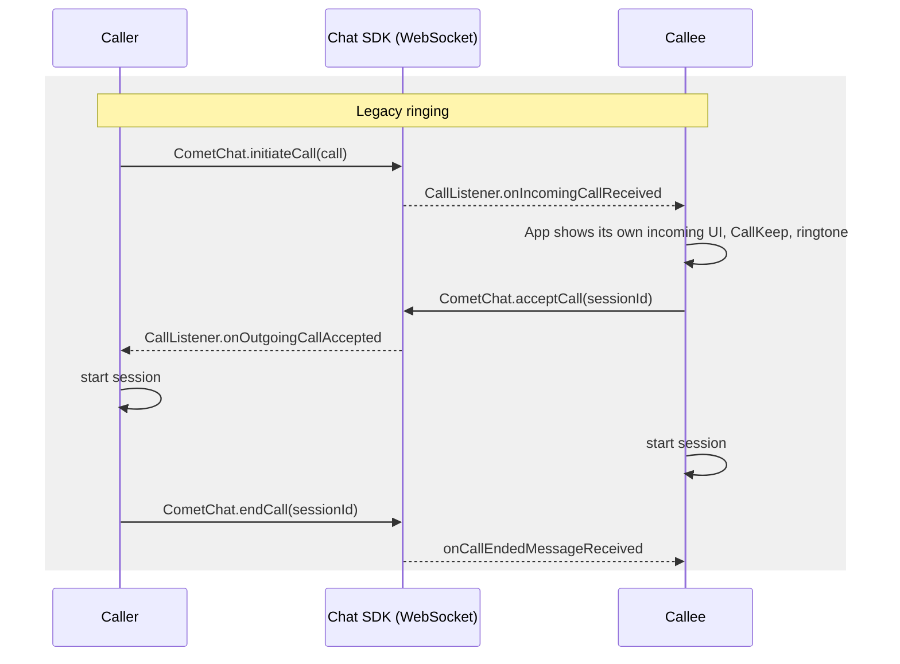
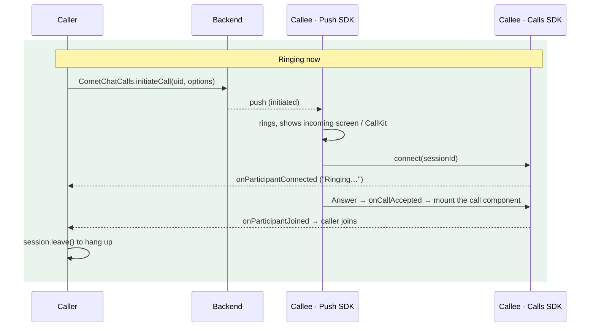

Legacy ringing signalled calls through the Chat SDK: `CometChat.initiateCall` created the call, a `CallListener` on the WebSocket told the callee, `acceptCall` and `rejectCall` answered, and the app rang the device itself — usually with `react-native-callkeep` and `react-native-voip-push-notification` wired up by hand. Ringing now runs on the Calls SDK and the Push Notifications SDK's VoIP package. The Chat SDK's calling methods are deprecated.

This page is the diff. For the full description of the current flow see [Ringing](/calls/react-native/ringing); for the push side see [Push ringing](/calls/react-native/voip-calling).

## Why it changed

| Legacy | Now |
|--------|-----|
| Incoming calls arrived on the Chat WebSocket, so a killed or backgrounded app needed a separate push + CallKeep integration to ring | One path: the push rings in every app state, with the app killed included |
| Four pieces of app code rang the device (listener, overlay, ringtone, busy check) | The Push SDK rings, draws the incoming screen, handles busy, timeout and missed calls |
| `acceptCall` / `rejectCall` / `endCall` were HTTP calls your app had to sequence with the session | Answer = join. Decline, timeout and busy are sent by the Push SDK through a durable queue |
| Caller only knew "accepted" or "rejected" | Caller sees "Ringing…" (the callee's device was reached), "answered", and the reason a call ended (`rejected`, `busy`, `unanswered`, `cancelled`) |
| Chat SDK required for calling | Chat SDK needed for chat only; a calls-only app works |

## Before and after





## Step 1: Update dependencies

```bash
npm install @cometchat/calls-sdk-react-native@^5.1.0 \
            @cometchat/push-notifications-react-native@^2.0.0 \
            @cometchat/push-notifications-voip-react-native@^2.0.0
cd ios && pod install
```

- `minSdkVersion` 26 or higher on Android, iOS 13+.
- Keep `@react-native-firebase/messaging` and `google-services.json`.
- Remove `react-native-callkeep` and `react-native-voip-push-notification` if nothing else uses them; the VoIP package registers with PushKit and CallKit itself.

<Warning>
`callMode` defaults to `'AUTO'`, which is what this page assumes. Installing the VoIP package is the opt-in: the core package detects it and installs the ringer.
</Warning>

## Step 2: Replace the push configuration

<Tabs>
<Tab title="Before (Push SDK 1.0)">
```ts
await CometChatPushNotifications.init({
  appId, region,
  notificationSmallIcon: 'ic_notification',
  voIPEnabled: true,
});

CometChatPushNotifications.setOnCallAnsweredHandler(async callInfo => {
  await CometChat.acceptCall(callInfo.sessionId);
  navigate('Call', { sessionId: callInfo.sessionId });
});
```
</Tab>
<Tab title="After (Push SDK 2.0)">
```ts
await CometChatPushNotifications.init({
  appId, region,
  fcmProviderId: FCM_PROVIDER_ID,
  apnsProviderId: APNS_PROVIDER_ID,
  notificationSmallIcon: 'ic_notification',
  callKitName: 'Acme',
});

await CometChatVoipNotifications.init();   // no config: the core already has it

CometChatVoipNotifications.onCallAccepted(call => {
  navigate('Call', { sessionId: call.sessionId });   // no acceptCall to make
});
```
</Tab>
</Tabs>

<Warning>
A **calls-only** app passes its configuration to `CometChatVoipNotifications.init(config)` instead and never calls the core's `init`. An app that does both must not pass a config to the VoIP `init()` — that re-runs the core initialisation and drops every chat option.
</Warning>

If your Chat and Calls SDKs point at a staging or dedicated deployment, pass the same host as `clientHost`. Otherwise the push token registers on the default host and no push ever arrives.

## Step 3: Make `init()` the first thing you await

```ts
// index.js / App.tsx
await CometChatVoipNotifications.init();   // FIRST
await CometChatUIKit.init(uiKitSettings);  // then everything else
await restoreSessionAndLogin();
```

A cold launch caused by a call push has a ring window measured from the caller's side. Anything awaited before `init()` — a stored-credentials read, a remote config fetch, a login — spends that window, and the call is lost before the ring is wired up.

## Step 4: Register the background task and delete the token code

```js index.js
import { registerBackgroundCallTask } from '@cometchat/push-notifications-voip-react-native';
registerBackgroundCallTask();
```

The Push SDK registers the token on login and unregisters it on logout by itself. Remove:

- `messaging().getToken()` + `registerPushToken(...)` after login
- `VoipPushNotification.addEventListener('register', …)` and the APNs VoIP token plumbing
- `unregisterPushToken(...)` before logout — replaced by `CometChatPushNotifications.unregister()`, which must run **before** `logout()`

## Step 5: Delete the app-side ringing

Everything in this list is now done by the Push SDK. Remove it, or it will fight the SDK's ring (two ringtones, two screens, a busy reject sent on top of the SDK's).

- `CometChat.addCallListener(...)` and its `onIncomingCallReceived` handler
- The incoming-call modal, overlay or screen you rendered from it
- Your own ringtone or sound player for incoming calls
- The "already in a call → reject with busy" check
- `RNCallKeep.setup`, `displayIncomingCall`, `answerCall`/`endCall` event wiring, `VoipPushNotification` handlers, and the `READ_PHONE_STATE` / `MANAGE_OWN_CALLS` / `ANSWER_PHONE_CALLS` permission chain
- Any foreground check around call pushes

Keep: `RECORD_AUDIO`, `CAMERA` and `POST_NOTIFICATIONS` in the manifest, and `NSMicrophoneUsageDescription`, `NSCameraUsageDescription` and the `voip` background mode in `Info.plist`. The SDKs request them but do not declare them.

## Step 6: Rewrite the call code

| Legacy | Now | Notes |
|--------|-----|-------|
| `CometChat.initiateCall(new CometChat.Call(uid, type, RECEIVER_TYPE_USER))` | `CometChatCalls.initiateCall(uid, { type, receiverType, sessionSettings })` | Set `sessionSettings.sessionType`, or an audio call opens the camera |
| `CometChat.initiateCall(call, timeoutSeconds)` | No client timeout. The ring window is 45 s on both sides (or the push's `ringTimeout`) | Run your own 45 s timer on the caller if you want the screen to close on its own |
| `CallListener.onIncomingCallReceived(call)` | Nothing to write; the Push SDK rings. For your own state use `CometChatVoipNotifications.onCallRinging` | Fires whether the call came by push on a killed process or on a live one |
| `CallListener.onOutgoingCallAccepted(call)` | `session.addEventListener('onParticipantJoined', …)` on the session `initiateCall` prepared, via `CometChatCalls.getActiveSession()` | New in-between event: `onParticipantConnected` = the callee's device is ringing |
| `CallListener.onOutgoingCallRejected(call)` | `CometChatVoipNotifications.onCallEnded` with reason `rejected` or `busy` | |
| `CallListener.onIncomingCallCancelled(call)` | `onCallEnded` with `cancelled`; the Push SDK has already stopped the ring | |
| `CallListener.onCallEndedMessageReceived(call)` | `onSessionLeft` / `onConnectionClosed` on the joined session; `onCallEnded` with `unanswered` while ringing | |
| `CometChat.acceptCall(sessionId)` then start the session | `onCallAccepted` fires; mount the call component | The Push SDK asked for mic/camera before opening your screen |
| `CometChat.rejectCall(sessionId, CALL_STATUS_REJECTED)` | Push SDK Decline button. Own incoming screen: `CometChatVoipNotifications.declineCall(sessionId)` | Sends `busy` automatically when in another call |
| `CometChat.rejectCall(sessionId, CALL_STATUS_BUSY)` | Nothing; the Push SDK decides busy | |
| `CometChat.rejectCall(sessionId, CALL_STATUS_CANCELLED)` | `CometChatCalls.endCall(sessionId, 'cancelled')` | |
| `CometChatCalls.startSession(...)` / `joinSession(...)` | `CometChatCalls.connect(sessionId)` then `<CometChatCalls.Component callToken={session.callToken} />` | The session is already prepared, so the join is near-instant |
| `session.leaveSession()` + `CometChat.endCall(sessionId)` | `session.leave()` | No status to send on a hang-up; the room tells the other side and the backend logs it |
| `CometChat.getActiveCall()` / `clearActiveCall()` | `CometChatCalls.getActiveSession()` (null when no session is prepared or joined) | |
| `CometChat.logout()` | `CometChatCalls.logout()` as well (the UI Kit's `CometChatUIKit.logout` does both), after `CometChatPushNotifications.unregister()` | Otherwise the Calls SDK stays signed in as the old user and a ring is not stopped |

### Caller screen, before and after

<Tabs>
<Tab title="Before">
```ts
CometChat.addCallListener(LISTENER_ID, new CometChat.CallListener({
  onOutgoingCallAccepted: call => startSession(call.getSessionId()),
  onOutgoingCallRejected: () => close('rejected'),
  onIncomingCallCancelled: () => close('cancelled'),
}));

const call = await CometChat.initiateCall(
  new CometChat.Call(uid, CometChat.CALL_TYPE.AUDIO, CometChat.RECEIVER_TYPE.USER),
);
setStatus('Calling…');
```
</Tab>
<Tab title="After">
```ts
const result = await CometChatCalls.initiateCall(uid, {
  type: 'audio',
  receiverType: 'user',
  sessionSettings: { sessionType: 'voice' },
});
if (!result.isSuccess) return showError(result.error);

const session = CometChatCalls.getActiveSession();
const me = CometChatCalls.getLoggedInUser()?.uid;
setStatus('Calling…');

session?.addEventListener('onParticipantConnected', p => {
  if (p.uid !== me) setStatus('Ringing…');       // new: the callee's device was reached
});
session?.addEventListener('onParticipantJoined', p => {
  if (p.uid !== me) joinCall(result.value.sessionId);
});

CometChatVoipNotifications.onCallEnded(e => close(e.reason));  // rejected / busy / unanswered
```
</Tab>
</Tabs>

### Callee screen, before and after

<Tabs>
<Tab title="Before">
```ts
CometChat.addCallListener(LISTENER_ID, new CometChat.CallListener({
  onIncomingCallReceived: async call => {
    if (inACall) return CometChat.rejectCall(call.getSessionId(), CometChat.CALL_STATUS.BUSY);
    playRingtone();
    RNCallKeep.displayIncomingCall(call.getSessionId(), call.getSender().getName());
    showIncomingModal(call);
  },
  onIncomingCallCancelled: () => { stopRingtone(); hideIncomingModal(); },
}));

async function onAnswerPressed(call) {
  stopRingtone();
  await CometChat.acceptCall(call.getSessionId());
  startSession(call.getSessionId());
}
```
</Tab>
<Tab title="After">
```ts
// Nothing rings here any more: the Push SDK does, in every app state.
CometChatVoipNotifications.onCallAccepted(call => {
  navigate('Call', { sessionId: call.sessionId });
});
```
</Tab>
</Tabs>

## Step 7: Change the logout

<Tabs>
<Tab title="Before">
```ts
await CometChat.logout();
```
</Tab>
<Tab title="After">
```ts
await CometChatPushNotifications.unregister();   // needs the credential; must come first
CometChatVoipNotifications.clearIdentity();
await CometChatUIKit.logout();                   // logs out Chat and Calls
```
</Tab>
</Tabs>

`unregister()` after `logout()` cannot authenticate the delete, so the token stays registered and the device goes on receiving the departed user's call pushes. Logging out of the Chat SDK alone leaves the Calls SDK signed in, so a ring keeps playing for the old user.

## If you drew your own incoming-call screen

You can keep it. Subscribe to `onCallRinging` instead of `CallListener.onIncomingCallReceived`, close it from `onRingEnded`, and answer and decline through `CometChatVoipNotifications.answerCall` / `declineCall`. Tell the SDK your screen is up with `notifyCallScreenOpen(sessionId)` so it does not also show its own. See [Your own incoming-call screen](/calls/react-native/voip-calling#your-own-incoming-call-screen).

This replaces the in-app screen only. A push that arrives while your app is killed still rings with the SDK's native screen on Android and CallKit on iOS — neither can be drawn from JavaScript that is not running.

## What users will notice

- Calls now ring with the app killed, and from the lock screen.
- The caller sees "Ringing…" once the callee's device has actually been reached, and a reason when a call ends.
- A second call rings over a live one instead of being silently rejected.
- Missed calls appear as their own notifications.

## Checklist

- [ ] Calls SDK 5.1, Push SDK 2.0 core **and** VoIP packages installed; CallKeep and VoIP-push libraries removed
- [ ] `CometChatVoipNotifications.init()` is the first `await` on startup, and the chat app passes it **no** config
- [ ] `registerBackgroundCallTask()` called at module scope in `index.js`
- [ ] All `CometChat.addCallListener` call handling, app-side ringtones and busy checks deleted
- [ ] Caller listens on the prepared session for `onParticipantConnected` / `onParticipantJoined`
- [ ] `onCallAccepted` subscribed before the first call can arrive
- [ ] Hang-up uses `session.leave()`, cancel uses `endCall(sessionId, 'cancelled')`
- [ ] Logout unregisters push first, then clears the identity, then logs out
- [ ] `ensureRingReady()` checked after sign-in; `NSMicrophoneUsageDescription` present
- [ ] Staging or dedicated host passed to the Push SDK as well
