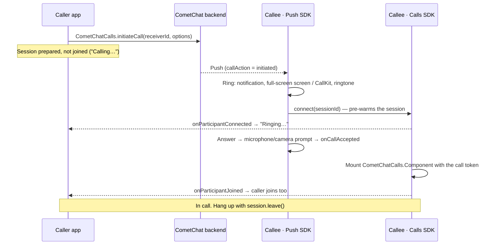

Ringing lets one user call another and lets the callee answer or decline, whether the callee's app is in the foreground, in the background or not running at all.

Two SDKs do the work:

| SDK | Owns |
|-----|------|
| **Calls SDK** (`@cometchat/calls-sdk-react-native` 5.1+) | Creating the call, the media session, answering, declining, cancelling, ending, and the call events your code listens to |
| **Push Notifications SDK, VoIP package** (`@cometchat/push-notifications-voip-react-native` 2.0+) | Ringing the callee's device: the call notification, the full-screen incoming-call screen on Android, CallKit on iOS, the ringtone, the ring timeout, missed calls and busy handling |

<Note>
**Coming from the earlier ringing flow?** The Chat SDK's calling methods (`CometChat.initiateCall`, `acceptCall`, `rejectCall`, `endCall`, `CallListener`) are deprecated and are replaced by what this page describes. See [Migrating from legacy ringing](/calls/react-native/migrating-from-legacy-ringing) for a method-by-method mapping.
</Note>

## How ringing works

The caller creates the call with the Calls SDK. The CometChat backend sends a push to the callee. The Push SDK rings the callee's device, and when the callee answers, your call screen joins the session. The caller's app learns that the callee is ringing and has answered from the Calls SDK, without joining the session first.



What each side sees:

| Stage | Caller | Callee |
|-------|--------|--------|
| Call created | `initiateCall` resolves; show "Calling…" | Push arrives; the Push SDK rings |
| Callee's device reached | `onParticipantConnected` → show "Ringing…" | Ringing |
| Callee answers | `onParticipantJoined` → mount the call component | `onCallAccepted` → mount the call component |
| Callee declines / is busy / does not answer | `onCallEnded` with reason `rejected` / `busy` / `unanswered` | Ring stops; missed call if unanswered |
| Caller cancels | — (you ended it) | Ring stops; missed call |
| Either side hangs up | `onParticipantLeft` / `onSessionLeft` | same |

## Prerequisites

- [Calls SDK set up](/calls/react-native/setup) and the user [logged in](/calls/react-native/authentication).
- Push notifications configured with the Push Notifications SDK 2.0. The whole push side of ringing is on the [Push ringing](/calls/react-native/voip-calling) page; this page assumes it is done.
- Microphone and camera permissions declared: `RECORD_AUDIO` and `CAMERA` in `AndroidManifest.xml`, `NSMicrophoneUsageDescription` and `NSCameraUsageDescription` in `Info.plist`. The SDKs request them at runtime but do not declare them.
- `minSdkVersion 26` on Android, iOS 13+.

```json package.json
{
  "dependencies": {
    "@cometchat/calls-sdk-react-native": "^5.1.0",
    "@cometchat/push-notifications-react-native": "^2.0.0",
    "@cometchat/push-notifications-voip-react-native": "^2.0.0"
  }
}
```

<Warning>
Send call pushes at **high** FCM priority. At normal priority the call still rings, but Android refuses the Push SDK's foreground service, so the process can be killed between the ring and the answer.
</Warning>

<Note>
**A missing `NSMicrophoneUsageDescription` crashes the app mid-ring on iOS.** The system terminates the process the moment the SDK touches the microphone, which looks exactly like the ring expiring on its own. Declare both usage strings before testing.
</Note>

## Start a call

`CometChatCalls.initiateCall` creates the call on the backend, which rings the callee, and prepares the caller's media session. The caller does **not** join yet.

```ts
import { CometChatCalls } from '@cometchat/calls-sdk-react-native';

const result = await CometChatCalls.initiateCall(receiverUid, {
  type: 'audio',                 // or 'video'
  receiverType: 'user',
  sessionSettings: { sessionType: 'voice' },   // 'video' for a video call
});

if (result.isSuccess) {
  const call = result.value;
  console.log(`Calling ${call.receiver}, session ${call.sessionId}`);
  showOutgoingScreen(call);
  listenOnPreparedSession(call);
} else {
  console.error('Could not start the call:', result.error);
}
```

| Parameter | Description |
|-----------|-------------|
| `receiverUid` | UID of the user to call |
| `options.type` | `'audio'` or `'video'` |
| `options.receiverType` | `'user'` |
| `options.sessionSettings` | The settings the caller's session is prepared with. See the warning below. |

`InitiatedCall` gives you `sessionId`, `messageId` (the id of the call message in the conversation), `sender`, `receiver`, `receiverType`, `type`, `status`, `initiatedAt`, `conversationId` and `session` — the session already being prepared for this call.

<Warning>
**Always set the session type in `sessionSettings`.** The Calls SDK freezes the session settings when it prepares the session and its default is video, so an audio call started without `sessionType: 'voice'` opens the caller's camera. The settings you pass here are the ones the caller later joins with.
</Warning>

<Note>
`initiateCall` resolves while the prepare is still in flight (`session.prepareStatus === 'pending'`). Await `session.settled` or read `session.prepareStatus` later for the outcome. **A failed prepare does not fail the call** — by then the call exists on the server and the callee is already ringing — and mounting the call component still works, falling back to a normal direct join.
</Note>

<Note>
There is no client-side ring timeout. Both sides stop at the ring window the backend sends in the push (45 seconds by default). A caller that wants its own screen to time out can end the call as `unanswered` after the same window, as shown under [Ring timeout](#ring-timeout).
</Note>

## Show "Ringing…" and detect the answer

The caller stays on the session that `initiateCall` prepared and listens to it. Do not join yet: joining only when the callee has joined keeps the caller's media off until there is someone to talk to, and it is what makes the two events below arrive.

```ts
function listenOnPreparedSession(call) {
  const session = CometChatCalls.getActiveSession();
  if (!session) return;
  const me = CometChatCalls.getLoggedInUser()?.uid;

  const offConnected = session.addEventListener('onParticipantConnected', participant => {
    // The callee's device received the push and is ringing.
    if (participant.uid === me) return;
    setStatus('Ringing…');
  });

  const offJoined = session.addEventListener('onParticipantJoined', participant => {
    // The callee answered: now the caller joins.
    if (participant.uid === me) return;
    joinCall(call.sessionId);
  });

  // The prepared session closed before anyone joined: the call is over.
  const offClosed = session.addEventListener('onConnectionClosed', closeOutgoingScreen);
  const offTimedOut = session.addEventListener('onSessionTimedOut', closeOutgoingScreen);

  return () => [offConnected, offJoined, offClosed, offTimedOut].forEach(off => off());
}
```

| Event | On the prepared session it means |
|-------|----------------------------------|
| `onParticipantConnected(callee)` | The callee's phone got the push and the Push SDK pre-warmed the session: it is ringing there |
| `onParticipantJoined(callee)` | The callee answered. Join now |
| `onConnectionClosed` / `onSessionTimedOut` | The call ended before anyone joined (declined, cancelled from another device, or the session died) |

`addEventListener` returns an unsubscribe function. Call it when your screen unmounts; listeners survive the session otherwise.

<Warning>
**A prepared session has no roster.** A ring-only connection receives `onParticipantLeft` but never `onParticipantJoined` for participants who were already there, because there are none. `onParticipantConnected` is the only caller-side signal that the callee's device has been reached.
</Warning>

<Note>
**The caller only shows "Ringing…" when the call was delivered by push.** A call delivered over the websocket to an app that is already in the foreground makes no pre-join on the callee's side, so no `onParticipantConnected` ever reaches the caller and the screen stays on "Calling…".
</Note>

## Listen for calls starting and ending

On React Native the Push SDK — not the Calls SDK — is where an incoming call announces itself and its end. It fires even when nothing of yours was running when the push arrived, because it buffers natively and drains the buffer at `init()`.

```ts
import { CometChatVoipNotifications } from '@cometchat/push-notifications-voip-react-native';

// A call for this user is ringing. The Push SDK already shows the ring;
// use this for your own state (badge, analytics, refreshing a list).
const offRinging = CometChatVoipNotifications.onCallRinging(call => {
  console.log('ringing', call.sessionId, 'from', call.callerUid);
});

// The user answered — open your call screen.
const offAccepted = CometChatVoipNotifications.onCallAccepted(call => {
  openCallScreen(call.sessionId, call.callType);
});

// The call ended. On the caller: "rejected", "busy", "cancelled" or "unanswered".
const offEnded = CometChatVoipNotifications.onCallEnded(event => {
  if (event.sessionId === currentSessionId) closeOutgoingScreen(event.reason);
});

// The ring itself stopped, whatever happened to the call.
const offRingEnded = CometChatVoipNotifications.onRingEnded(event => {
  dismissIncomingUi(event.sessionId);
});

// When the screen goes away:
[offRinging, offAccepted, offEnded, offRingEnded].forEach(off => off());
```

| Who | `onCallEnded` reason |
|-----|----------------------|
| Caller | `rejected` (callee declined), `busy` (callee was in another call), `unanswered` (nobody answered), `cancelled` (you cancelled from another device) |
| Callee, still ringing | `cancelled` (caller gave up), `ongoing` (answered on another device), `rejected` / `busy` (declined here), `unanswered` (ring timed out) |
| Callee, answered | Nothing; the joined session reports the end through `onSessionLeft` / `onConnectionClosed` |

<Note>
Each `on…` method returns an unsubscribe function, and subscribing late is safe: a call that was answered before your component mounted is held and delivered to the first subscriber.
</Note>

## Answer a call

The Push SDK rings and, on **Answer**, asks for the microphone (and the camera for a video call), brings your app to the front and emits `onCallAccepted`. There is no separate "accept" call to make.

```tsx
function App() {
  const [activeCall, setActiveCall] = useState(null);

  useEffect(() => CometChatVoipNotifications.onCallAccepted(call => {
    setActiveCall(call);           // call.sessionId, callerUid, callerName, callType
  }), []);

  if (activeCall) return <CallScreen call={activeCall} />;
  return <Chats />;
}
```

`PNCallInfo` carries `sessionId`, `callerUid`, `callerName`, `callerAvatar`, `callType`, `receiverId`, `receiverType`, `conversationId`, `source` and `expiresAtMs`.

<Warning>
**Every field of a call payload arrives from Android as a string.** `isPeerCall` is `"true"` / `"false"`, not a boolean, and `expiresAtMs` is a string of digits. Compare against strings or coerce before use.
</Warning>

<Note>
**On iOS, a programmatic answer from a cold or background launch is refused by CallKit.** The user's own tap on the CallKit screen is the only thing that can answer a call in that state, which also means automated cold-launch answer tests need a real tap.
</Note>

## Join the session

Both sides join the same way: mount the Calls SDK's call component with the token of the prepared session. Because the session was prepared while ringing, the join is near-instant.

```tsx
import { CometChatCalls } from '@cometchat/calls-sdk-react-native';

function CallScreen({ sessionId }) {
  const [callToken, setCallToken] = useState(null);

  useEffect(() => {
    (async () => {
      // Hands back the session already prepared for this call, without minting a second token.
      const session = await CometChatCalls.connect(sessionId, { sessionType: 'voice' });
      setCallToken(session.callToken);
    })();
  }, [sessionId]);

  if (!callToken) return <Connecting />;
  return <CometChatCalls.Component callToken={callToken} onCallEnded={() => goBack()} />;
}
```

See [Join Session](/calls/react-native/join-session) for the component, [Session Settings](/calls/react-native/session-settings) for layouts and controls, and [Events](/calls/react-native/events) for everything the joined session reports.

## Decline a call

Declining is handled by the Push SDK: the Decline button on the notification, on its full-screen incoming-call screen and on CallKit sends `endCall(sessionId, 'rejected')` through a queue that survives the process dying, and sends `'busy'` instead when the user is already in another call. The caller receives `onCallEnded` with that reason.

You only write decline code when you draw your own incoming-call screen:

```ts
CometChatVoipNotifications.declineCall(sessionId);
```

Without the Push SDK's VoIP package, decline through the Calls SDK directly:

```ts
await CometChatCalls.endCall(sessionId, 'rejected');
```

<Note>
**Android can decline from a fully killed app.** Register the background task so the decline survives the process going away:

```ts
import { registerBackgroundCallTask } from '@cometchat/push-notifications-voip-react-native';
registerBackgroundCallTask();   // in index.js, at module scope
```
</Note>

## Cancel a call

The caller ends a call that is still ringing with `endCall` and the `cancelled` status. The callee's ring stops and a missed call is posted there.

```ts
async function cancelOutgoingCall(sessionId: string) {
  const result = await CometChatCalls.endCall(sessionId, 'cancelled');
  if (!result.isSuccess) console.error('Cancel failed:', result.error);
  closeOutgoingScreen();          // close locally either way
}
```

Disable the End button after the first tap, and ignore an `onParticipantJoined` that arrives after you cancelled: the cancel wins.

## Ring timeout

A call that rings out sends nothing from the callee. When the ring window closes (45 seconds unless the push carries a `ringTimeout`) the callee's Push SDK stops the ring and posts a missed call locally — it does not call `endCall`. The caller's `unanswered` comes from the backend when the same window closes there. To close the caller's screen at that moment even if the push is late, run your own timer from `initiateCall`:

```ts
const timer = setTimeout(async () => {
  if (!answered) {
    await CometChatCalls.endCall(sessionId, 'unanswered');
    closeOutgoingScreen();
  }
}, 45_000);

// clear it on answer, cancel and unmount
```

## End a call

Hang up by leaving the session. The room tells the other side, which receives `onParticipantLeft` and then `onSessionLeft` or `onConnectionClosed`. No status needs to be sent and the call is logged by the backend.

```ts
async function hangUp() {
  await CometChatCalls.getActiveSession()?.leave();
  goBack();
}
```

The other participant:

```ts
const session = CometChatCalls.getActiveSession();
session?.addEventListener('onSessionLeft', goBack);
session?.addEventListener('onConnectionClosed', goBack);
```

<Note>
`leaveSession()` is deprecated in 5.1; use `session.leave()`. Leave only the session your screen owns: after answering a second call over a live one, the first screen's clean-up must not leave the new session.
</Note>

<Warning>
`leave()` takes the Calls SDK through a re-initialisation. A `connect()` issued inside that window never resolves, so wait for the leave to settle before preparing the next session — which is what the Push SDK does for you when a second call is answered over a live one.
</Warning>

## Second call while in a call

Handled by the Push SDK, the same way a phone does it. A call that arrives while the user is in another call rings over it with "Answering ends your current call". **Answer** leaves the live call, prepares the new one and emits `onCallAccepted` again for the new session — open a fresh screen for it. **Decline** sends `busy` and keeps the live call. A call that arrives while another is already ringing, or while the user's own outgoing call is ringing, is declined as `busy` without ringing.

## Group calls

`initiateCall` is for 1:1 calls. A group call is a session every member joins with a session id you share with them (for example in a custom message). A group call that rings through the push behaves the same as a 1:1 one: declining it sends `rejected`, and letting it ring out sends nothing. The difference is only in what that means — the session carries on for the other members either way, so neither action ends the call.

## Logout

Log out of the Calls SDK when the user signs out (`CometChatCalls.logout`, or `CometChatUIKit.logout` when you use the UI Kit), and unregister push **before** the session goes away:

```ts
await CometChatPushNotifications.unregister();   // needs the credential; must come first
CometChatVoipNotifications.clearIdentity();
await CometChatUIKit.logout();
```

`unregister()` deletes the token from the backend and needs the logged-in credential, so after `logout()` there is nothing left to authenticate the delete. Skipping it leaves the device receiving the departed user's call pushes.

<Note>
The Push SDK keeps the ring identity in step with the Calls SDK's login listener: logging in writes the uid, logging out clears it. An app that logs the **Chat** SDK in and out without `CometChatCalls.login` / `logout` must call `clearIdentity()` itself, as above.
</Note>

## Call status values

| Status | Meaning | Sent by |
|--------|---------|---------|
| `initiated` | Created, ringing | Backend, on `initiateCall` |
| `ongoing` | Answered | Backend, when the callee joins |
| `rejected` | Callee declined | Callee's Push SDK |
| `busy` | Callee was in another call | Callee's Push SDK |
| `cancelled` | Caller ended it before an answer | Caller, `endCall` |
| `unanswered` | Nobody answered in the ring window | Backend, when the ring window closes (or the caller's own timer) |
| `ended` | Hung up after being answered | Backend, when the session ends |
| `missed` | How an unanswered or cancelled incoming call appears in call logs | Call logs |

## Related

- [Push ringing](/calls/react-native/voip-calling): dependencies, `PNConfiguration`, the Firebase and PushKit setup, your own incoming-call screen, readiness checks and what happens when the app is killed.
- [Migrating from legacy ringing](/calls/react-native/migrating-from-legacy-ringing).
- [Events](/calls/react-native/events), [Actions](/calls/react-native/actions), [Call Logs](/calls/react-native/call-logs).
