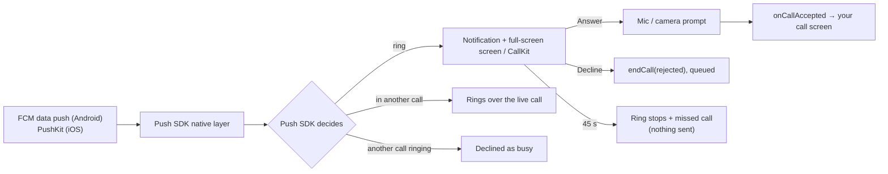

The Push Notifications SDK's VoIP package turns a CometChat call push into a ringing phone: on Android a call-style notification with Answer and Decline, a full-screen screen over the lock screen and the ringtone; on iOS a CallKit call. It works with the app in the foreground, in the background or not running at all.

This page covers the push side of ringing. Starting, answering and ending calls with the Calls SDK is on the [Ringing](/calls/react-native/ringing) page.



## Prerequisites

- [Calls SDK 5.1 set up](/calls/react-native/setup) and the user logged in.
- **Android**: a Firebase project with your app, `google-services.json` in `android/app/`, and `@react-native-firebase/app` + `@react-native-firebase/messaging` installed.
- **iOS**: a VoIP Services certificate uploaded to the CometChat dashboard, and the **Push Notifications** capability plus the **Voice over IP** background mode enabled in Xcode.
- Push notifications enabled in the CometChat dashboard with an **FCM** provider (Android) and an **APNs** provider (iOS), and those providers' ids.
- `minSdkVersion 26` on Android, iOS 13+.

## Step 1: Add the dependencies

```bash
npm install @cometchat/push-notifications-react-native \
            @cometchat/push-notifications-voip-react-native \
            @cometchat/calls-sdk-react-native
cd ios && pod install
```

```json package.json
{
  "dependencies": {
    "@cometchat/calls-sdk-react-native": "^5.1.0",
    "@cometchat/push-notifications-react-native": "^2.0.0",
    "@cometchat/push-notifications-voip-react-native": "^2.0.0"
  }
}
```

Installing the VoIP package is the whole opt-in: the core package detects it and installs the ringer. The Chat SDK is optional for both packages; a calls-only app works.

<Note>
The Calls SDK is a dependency of the VoIP package, not a peer: the package calls into it to pre-warm and leave sessions, and a version mismatch there is a silent failure rather than a build error.
</Note>

## Step 2: Initialise once

Run this once per app start, as early as you can — the configuration is saved natively, so a push that wakes a cold process still finds it.

There are two shapes, and which one you use matters.

**A calls-only app** passes its configuration to the VoIP package and calls nothing else. Calling still needs a push token, and the core package is what registers it, so this initialises the core for you:

```ts
import { CometChatVoipNotifications } from '@cometchat/push-notifications-voip-react-native';

await CometChatVoipNotifications.init({
  appId: APP_ID,
  region: REGION,
  fcmProviderId: FCM_PROVIDER_ID,
  apnsProviderId: APNS_PROVIDER_ID,
  callKitName: 'Acme',
});
```

**An app that also does chat** initialises the core with its own settings first, then calls the VoIP `init()` with **no arguments**:

```ts
import { CometChatPushNotifications } from '@cometchat/push-notifications-react-native';
import { CometChatVoipNotifications } from '@cometchat/push-notifications-voip-react-native';

await CometChatPushNotifications.init({
  appId: APP_ID,
  region: REGION,
  fcmProviderId: FCM_PROVIDER_ID,
  apnsProviderId: APNS_PROVIDER_ID,
  notificationSmallIcon: 'ic_notification',
  androidChannelId: 'chat_messages',
  callKitName: 'Acme',
});

await CometChatVoipNotifications.init();   // no config
```

<Warning>
**Passing a config to `CometChatVoipNotifications.init()` when the core is already initialised re-runs that initialisation and drops the chat options you set.** A chat app that calls `init(config)` on the VoIP package silently loses `notificationSmallIcon`, `androidChannelId` and every other chat-side setting.
</Warning>

<Warning>
**`CometChatVoipNotifications.init()` must be the first thing you `await` on startup.** Anything awaited before it — a stored-credentials read, a chat login, a remote config fetch — eats the cold-launch ring window, and a call that woke the process is lost before the ring is wired up.
</Warning>

| Option | Default | What it does |
|--------|---------|--------------|
| `appId`, `region` | none | Your CometChat app; required unless the Chat SDK already initialised |
| `fcmProviderId` / `apnsProviderId` | none | The dashboard providers the token is registered under |
| `callMode` | `'AUTO'` | `'AUTO'` rings. `'MANUAL'` only parses and forwards; see [MANUAL mode](#manual-mode) |
| `notificationSmallIcon` | none | Status-bar icon for every notification (Android) |
| `androidChannelId` / `androidChannelName` | SDK defaults | The channel chat notifications are posted on |
| `defaultRingTimeoutMs` | `45000` | Ring window when the push carries no `ringTimeout` |
| `showMissedCallNotification` | `true` | Post a missed-call notification |
| `ringInForeground` | `true` | Ring even when your app is in the foreground |
| `showInForeground` | `false` | Show chat notifications while the app is in the foreground |
| `callKitName` | app name | The name CallKit shows in the system call log (iOS) |
| `callKitIconName`, `callKitRingtone`, `callKitSupportsVideo`, `callKitIncludeInRecents` | SDK defaults | CallKit appearance and behaviour (iOS) |
| `clientHost` | none | Same value as the Chat SDK's host override; see [Staging deployments](#staging-or-dedicated-deployments) |
| `enableBadgeCount`, `sendDeliveryReceipts` | `true` | Chat notification behaviour |
| `tokenRegistrar`, `authToken` | auto | Token registration; leave the defaults |

## Step 3: Register the background task

Android can decline or time out a call while your app is fully killed. Register the background task at module scope in `index.js`, before `AppRegistry.registerComponent`:

```js index.js
import { registerBackgroundCallTask } from '@cometchat/push-notifications-voip-react-native';

registerBackgroundCallTask();
```

Without it, a decline tapped on a killed app is never delivered and the caller rings on to `unanswered`.

## Step 4: Firebase delegation (only if you own the transport)

**You normally skip this step.** The package ships its own Firebase messaging service and registers it in its manifest, so call pushes reach it without any code of yours. Declaring your own service in addition is what breaks delivery, not what fixes it.

Delegate only if your app already owns a `setBackgroundMessageHandler`:

```js index.js
import messaging from '@react-native-firebase/messaging';
import { CometChatPushNotifications } from '@cometchat/push-notifications-react-native';

messaging().setBackgroundMessageHandler(async remoteMessage => {
  // A background handler is a fresh JS runtime with none of your app's state:
  // initialise CometChat here before handling.
  const handled = await CometChatPushNotifications.handlePushNotification(
    remoteMessage.data ?? {},
    remoteMessage.sentTime,
  );
  if (!handled) { /* not a CometChat push: your own handling */ }
});
```

<Warning>
**Pass `sentTime` and hand over every push.** Firebase queues pushes while a device dozes; without the sent time a push delivered late looks fresh and rings for a call that is already over. And do not skip call pushes when the app is in the foreground: the push is the only signal that a call is coming in, in every app state.
</Warning>

<Warning>
**Send call pushes at high FCM priority.** Android lets a background app start a foreground service only with the temporary allowlist that a high-priority data message grants. At normal priority the call still rings, but the process can be killed between the ring and the answer.
</Warning>

<Note>
**More than one messaging service is not a conflict.** Every app that includes Firebase declares `FirebaseMessagingService` at priority −500; what matters is the service Android actually resolves to. The SDK reports that in `getDiagnostics()` as `competingMessagingService`, which is `null` when all is well.
</Note>

## Step 5: Answer and join

On **Answer** the SDK stops the ring, asks for the microphone (and the camera for a video call), brings your app to the front and emits `onCallAccepted`. There is nothing to "accept".

```tsx
function App() {
  const [activeCall, setActiveCall] = useState(null);

  useEffect(() => {
    const off = CometChatVoipNotifications.onCallAccepted(call => setActiveCall(call));
    const offEnded = CometChatVoipNotifications.onCallEnded(() => setActiveCall(null));
    return () => { off(); offEnded(); };
  }, []);

  if (activeCall) return <CallScreen sessionId={activeCall.sessionId} />;
  return <Chats />;
}
```

`PNCallInfo` fields: `sessionId`, `callerUid`, `callerName`, `callerAvatar`, `callType`, `receiverId`, `receiverType`, `conversationId`, `initiatedAtMs`, `expiresAtMs`, `isPeerCall` and `source` (`push` or `websocket`). The ring window is anchored to the caller's `initiatedAtMs`, not to a timer on this device, so both sides stop ringing together however late the push arrived; prefer `expiresAtMs` to a timer of your own.

<Warning>
**Every field arrives from Android as a string**, including `isPeerCall` (`"true"` / `"false"`) and `expiresAtMs`. Coerce before use.
</Warning>

<Note>
A call answered before your JavaScript existed — the killed-app case this package is for — is buffered natively and replayed to the first `onCallAccepted` subscriber. Subscribing late is safe; not subscribing at all means the user answers and nothing happens.
</Note>

## Step 6: Permissions and ring readiness

Declare in the manifest and `Info.plist` what the SDKs only request:

```xml android/app/src/main/AndroidManifest.xml
<uses-permission android:name="android.permission.POST_NOTIFICATIONS" />
<uses-permission android:name="android.permission.RECORD_AUDIO" />
<uses-permission android:name="android.permission.CAMERA" />
```

```xml ios/YourApp/Info.plist
<key>NSMicrophoneUsageDescription</key>
<string>Used for voice and video calls.</string>
<key>NSCameraUsageDescription</key>
<string>Used for video calls.</string>
<key>UIBackgroundModes</key>
<array><string>voip</string><string>audio</string></array>
```

Everything else (full-screen intent, foreground service of type `phoneCall`, wake lock, vibrate, the ring activity and the ring service on Android; CallKit and PushKit on iOS) comes from the packages' own manifests.

<Warning>
**A missing `NSMicrophoneUsageDescription` terminates the app mid-ring on iOS.** It looks exactly like the ring expiring early. Check the device's crash reports before treating a short ring as an SDK bug.
</Warning>

**Microphone and camera.** The SDK asks at the moment of answering: the answer is recorded first so the ring stops, the system prompt appears, and your screen opens whatever the user chose. A denied microphone joins muted and never fails the call. Ask earlier as well (at sign-in, for example) with `CometChatPNHelper.requestCallPermissions()` so the first call is not where the user meets the prompt.

**Ring readiness.** Several device settings silence a call with no error anywhere. Check once after sign-in and tell the user:

```ts
const readiness = await CometChatPushNotifications.ensureRingReady();
if (readiness !== 'ready') {
  showBanner(`Incoming calls may not ring: ${readiness}`);
  await CometChatPushNotifications.openRingSettings();
}
```

| Result | Meaning |
|--------|---------|
| `ready` | Nothing in the way |
| `notificationsOff` | The app cannot post notifications |
| `channelMuted` | The user muted or downgraded the incoming-call channel |
| `fullScreenIntentRevoked` | Android 14+ revoked full-screen intents: no ring screen on a locked device, only the heads-up notification |
| `dndBlocking` | Do Not Disturb is filtering |
| `overlayDenied` | The ring screen cannot be drawn over other apps |
| `batteryOptimised` | The process may be frozen before the push arrives |
| `autostartDisabled` | An OEM autostart restriction blocks the push wake |
| `voipBackgroundModeMissing` | iOS: the `voip` background mode is not declared |
| `voipTokenMissing` | iOS: PushKit never issued a token, so no call push can arrive |
| `microphoneDenied` | The user refused the microphone at an answer; calls still ring but join muted |

**Diagnostics for a bug report.** `getDiagnostics()` returns a redacted snapshot (whether a provider id exists, never what it is; never a token or payload):

| Key | Read it as |
|-----|------------|
| `voip` | `false`: the VoIP package was never initialised, nothing will ring |
| `hasLoggedInUid` | `false`: the ring gates have no identity, and a user's own outgoing call can ring their own phone |
| `competingMessagingService` | non-`null`: another service is resolving ahead of the SDK's |
| `canUseFullScreenIntent` | `false` on Android 14+: no ring screen on a locked device |
| `callChannelImportance` | below `IMPORTANCE_HIGH`: no heads-up and no sound |
| `interruptionFilter` | anything but `1`: Do Not Disturb is filtering |
| `ringReadiness`, `ignoringBatteryOptimizations`, `canDrawOverlays` | Why a push may never reach the device |
| `callMode`, `ringInForeground`, `defaultRingTimeoutMs` | `MANUAL` explains a phone that never rings by design |
| `aggressiveOem`, `manufacturer`, `model`, `sdkInt`, `platform` | OEM background restrictions |

`verifyPushSetup()` registers the token and reports `ok`, `tokenNotRegistered`, `notLoggedIn`, `testPushUnavailable` (registration worked, the loopback test push is not available on the backend yet: a warning, not a failure) or `testPushTimeout` (the test push never arrived: delivery is broken). The token value is never logged, only its length and a short prefix.

## How a ring ends

Every way out is handled by the SDK and needs no code in your app.

| What happened | On the callee's device | What the caller learns |
|---------------|------------------------|------------------------|
| The user answers | Ring stops, `onCallAccepted` | `onParticipantJoined` |
| The user declines | Ring stops; `endCall(sessionId, 'rejected')` is queued and retried across process death | `onCallEnded` with `rejected` |
| The user declines while in another call | Same, with `busy` | `busy` |
| The caller cancels | Ring stops on the `cancelled` push, or sooner when the prepared session closes; missed-call notification | Nothing; the caller ended it |
| Nobody answers | At the ring window the ring stops and a missed call is posted; **nothing is sent** | `unanswered`, from the backend's own ring window |
| Answered on another device | Ring stops on the `ongoing` push, no missed call | `onParticipantJoined` |
| The user logs out while ringing | Ring stops, nothing sent, no missed call | Rings to its own window, then `unanswered` |

Once the session is prepared, the Calls SDK reporting it ended also stops the ring immediately, without waiting for a terminal push.

<Note>
**An `ongoing` push is addressed to the CALLER, not the callee.** Its `sender` is whoever performed the action — the callee who answered — so neither a sender nor a receiver comparison can tell you whether it concerns you. The SDK gates it on local ring state instead.
</Note>

## A call while in a call

Call waiting, the way the phone app does it. "In a call" means the Calls SDK is joined to a session, or a call answered here is still joining; a session that is only prepared while it rings does not count.

| Situation | Behaviour |
|-----------|-----------|
| Call while in a call | Rings over the live call with the normal ring; the text adds "Answering ends your current call". The live call is untouched |
| Answer (End & accept) | Leaves the live call, waits for the Calls SDK to release it, prepares the new session, emits `onCallAccepted` for it |
| Decline | `busy` to the caller; the live call continues |
| No action | `unanswered` to the caller, missed call; the live call continues |
| Call while another one is already ringing here | Declined as `busy` without ringing, missed call. The first keeps ringing |
| Call while the user's own outgoing call is ringing | Declined as `busy` without ringing, missed call |

<Note>
End & accept waits for the new session's prepare to settle, up to 5 seconds, before handing the call to your screen. Joining before the previous session has been released is what silently never completes.
</Note>

## Missed calls

Posted as "Missed call" / "Missed group call" with the caller's name and call type, one per session, grouped under the SDK's own summary so Android never folds them into your other notifications.

Posted when: nobody answers in the ring window; a `cancelled`, `unanswered` or `timed_out` push ends a ring here; such a push arrives for a call that never rang here (the `initiated` push was lost or overtaken); an `initiated` push arrives already expired; a call is declined as busy without ringing.

Not posted when: answered here or on another device; declined (`rejected` or `busy`) here; ended; the user's own outgoing call; logout while ringing.

Turn missed calls off with `showMissedCallNotification: false`. This is a notification only; call history comes from [Call Logs](/calls/react-native/call-logs).

## When the app is killed

This is the case the push exists for.

1. The high-priority data push (Android) or the PushKit push (iOS) starts the app process.
2. The native layer finds no in-memory configuration and restores it from disk.
3. The ring runs on a foreground service of type `phoneCall` on Android, so the system keeps the process alive through the answer; on iOS CallKit holds the call. An alarm backs up the ring timeout.
4. On Answer, the SDK asks for permissions, launches your app and buffers the answered call until your JavaScript subscribes.
5. A decline or timeout is sent through the background task, so it goes out even if the process dies right after the tap.

Call `CometChatVoipNotifications.init()` as the first `await` in your app's entry point, from stored credentials, so the answer finds a ready SDK.

<Note>
**On iOS, APNs and VoIP pushes really are delivered to the Simulator** and will cold-launch a killed app. Only CallKit's own call presentation does not appear there, so test the ring on a device and the delivery path anywhere.
</Note>

## Staging or dedicated deployments

If your Chat and Calls SDKs point at a staging or dedicated host, give the Push SDK the same one. Otherwise the token is registered on the default production host, where your app id does not exist, and no push ever arrives.

```ts
await CometChatVoipNotifications.init({
  appId: APP_ID,
  region: REGION,
  clientHost: `${APP_ID}.apiclient-us.cometchat-staging.com/v3.0`,
});
```

<Warning>
**The host override shapes differ between SDKs.** The Chat SDK wants a bare host, the Calls SDK a full URL, and giving one the other's shape hangs login forever rather than failing. The Calls SDK also has three base URLs — admin, client and calls — and setting only one splits call start and call end across environments.
</Warning>

## Tokens

You do not register the push token. The SDK fetches it from Firebase or PushKit and registers it on login, under the Chat auth token when there is one and the Calls auth token otherwise; it unregisters on logout.

Unregister **before** the session goes away:

```ts
await CometChatPushNotifications.unregister();   // needs the credential; must come first
CometChatVoipNotifications.clearIdentity();
await CometChatUIKit.logout();
```

`unregister()` deletes the token from the backend and needs the logged-in credential, so after `logout()` there is nothing left to authenticate the delete, and the device goes on receiving the departed user's call pushes.

<Note>
The SDK keeps its ring identity in step with the Calls SDK's login listener: logging in writes the uid, logging out clears it, and `init()` re-reads it to heal a login it missed. An app that logs the **Chat** SDK in and out without `CometChatCalls.login` / `logout` must call `clearIdentity()` itself.
</Note>

<Warning>
In a calls-only app, `logout()` needs the Chat SDK — so use `clearIdentity()` and `unregister()` instead, and call `init()` again before the next login or the device stays silent.
</Warning>

## Your own incoming-call screen

Subscribe to `onCallRinging` and draw your own UI. The SDK still owns the ringtone, the pre-warm, the timeout, the keep-alive and the decline queue; only the UI is yours.

```tsx
function IncomingCallOverlay() {
  const [call, setCall] = useState(null);

  useEffect(() => {
    const off = CometChatVoipNotifications.onCallRinging(setCall);
    // Close when the ring ends elsewhere: caller cancelled, answered on another device, timed out.
    const offEnd = CometChatVoipNotifications.onRingEnded(e => {
      setCall(c => (c?.sessionId === e.sessionId ? null : c));
    });
    return () => { off(); offEnd(); };
  }, []);

  if (!call) return null;

  return (
    <Modal visible>
      <Text>{call.callerName}</Text>
      <Button title="Answer"  onPress={() => CometChatVoipNotifications.answerCall(call.sessionId)} />
      <Button title="Decline" onPress={() => CometChatVoipNotifications.declineCall(call.sessionId)} />
    </Modal>
  );
}
```

Tell the SDK when your screen is up and down, so it does not also show its own and so it knows a ring is being presented:

```ts
CometChatVoipNotifications.notifyCallScreenOpen(sessionId);
CometChatVoipNotifications.notifyCallScreenClosed(sessionId);
```

Without `onRingEnded`, a cancelled call leaves your screen showing an Answer button for a call that no longer exists.

<Note>
This replaces the **in-app** screen only. A push that arrives while your app is killed still rings with the SDK's own native screen on Android and CallKit on iOS, because neither can be drawn from JavaScript that is not running.
</Note>

## Theming the ring

The native ring screen is drawn before any JavaScript exists — that is what lets a push ring a killed app — so the UI Kit's theme cannot reach it. **Android** gives you two ways to colour it; on **iOS** the screen is CallKit's and belongs to the system.

### A theme, set from JavaScript (Android)

```ts
await CometChatPushNotifications.init({
  appId: APP_ID,
  region: REGION,
  incomingCallTheme: {
    mode: "system",                       // "system" | "light" | "dark"
    light: { background: "#FFFFFF", callerName: "#141414", acceptButton: "#09C26F" },
    dark:  { background: "#141414", callerName: "#FFFFFF", acceptButton: "#09C26F" },
  },
});

// or later, to follow a theme the user changes at runtime:
CometChatPushNotifications.setIncomingCallTheme(theme);   // null removes it
```

The theme is written to disk, because the screen it paints is drawn when a push wakes a **killed** process — there is no JavaScript running then to ask for colours. `mode: "system"` is read when the screen is drawn, so a call arriving after the user switches the device to dark is drawn dark without your app running.

| Field | Paints |
|-------|--------|
| `background` | The screen background |
| `callerName` | The caller's name |
| `subtitle` | The "Incoming audio call" line |
| `avatarBackground` / `avatarText` | The initials circle and the initials |
| `acceptButton` / `acceptIcon` | The answer button and its phone glyph |
| `declineButton` / `declineIcon` | The decline button and its glyph |

Set `acceptIcon` whenever you set a light `acceptButton`, or the white glyph disappears into it.

### Colour resources (Android)

Every field above falls back to a `cometchat_pn_call_*` colour resource, which your app can replace at build time by declaring the same name — an app's resource wins over a library's. Use this when the colours never change at runtime, or to set a colour the theme leaves out.

```xml android/app/src/main/res/values/colors.xml
<color name="cometchat_pn_call_background">#FFFFFF</color>
<color name="cometchat_pn_call_text">#141414</color>
<color name="cometchat_pn_call_text_secondary">#727272</color>
<color name="cometchat_pn_call_avatar">#6852D6</color>
<color name="cometchat_pn_call_avatar_text">#FFFFFF</color>
<color name="cometchat_pn_call_accept">#09C26F</color>
<color name="cometchat_pn_call_accept_icon">#FFFFFF</color>
<color name="cometchat_pn_call_decline">#F44649</color>
<color name="cometchat_pn_call_decline_icon">#FFFFFF</color>
```

**The order is: the theme, then the resource, then the SDK's own default.** Every colour is optional at every level, so setting one does not mean restating the rest.

### Strings and the call icon (Android)

Declared the same way, by name. This is also how you localise the ring.

- **Strings**: `cometchat_pn_incoming_call`, `cometchat_pn_call`, `cometchat_pn_unknown_caller`, `cometchat_pn_incoming_audio_call`, `cometchat_pn_incoming_video_call`, `cometchat_pn_missed_audio_call`, and the other `cometchat_pn_*` strings.
- **Drawable**: `cometchat_pn_ic_call`.

```xml android/app/src/main/res/values/strings.xml
<string name="cometchat_pn_incoming_audio_call">Incoming call</string>
```

### iOS

CallKit draws the incoming call and its appearance belongs to the system. `callKitName`, `callKitIconName`, `callKitRingtone`, `callKitSupportsVideo` and `callKitIncludeInRecents` on `PNConfiguration` are the whole surface; `incomingCallTheme` is ignored there. The native iOS SDK has the same limit — it is not a React Native one.

<Note>
The colours above paint the **full-screen ring**. Android styles the call-style notification itself, so a heads-up ring on an unlocked device keeps the system's colours.
</Note>

If you want the in-app ring to match your brand exactly, draw it yourself with `ringInForeground: false` and your own component on `onCallRinging` — see [Your own incoming-call screen](#your-own-incoming-call-screen). That covers a call arriving while your app is open; a push to a killed app still rings with the native screen, which is the point of it.

The avatar is always the caller's initials; the screen does not load the avatar URL. The ringtone is the device's default on the incoming-call channel; because Android freezes a channel's sound at creation, the SDK never changes it afterwards.

## MANUAL mode

`callMode: 'MANUAL'` makes the SDK parse, gate and forward only. It never rings on its own. The call reaches `onCallRinging`, and from there every step is yours:

```ts
CometChatVoipNotifications.showIncomingCall(payload);   // post the ring, arm expiry
CometChatVoipNotifications.keepAlive(payload);          // foreground service while ringing
CometChatVoipNotifications.showMissedCall(payload);
CometChatVoipNotifications.endCallUI(sessionId);
```

<Warning>
In MANUAL mode with nothing built, the call is silently lost: no notification, no ringtone, no screen, nothing sent to the caller, who rings out to `unanswered`. Use MANUAL only if you are rebuilding the whole ring.
</Warning>

## Reporting a call you placed yourself

An outgoing call made from your own screen can be reported so the system call UI and the call log know about it:

```ts
CometChatVoipNotifications.reportOutgoingCall(sessionId, calleeName, hasVideo);
CometChatVoipNotifications.reportCallConnected(sessionId);
CometChatVoipNotifications.reportCallEnded(sessionId, 'ended');
```

## Troubleshooting

| Symptom | Check |
|---------|-------|
| No push arrives | Package name matches the Firebase app baked into the build; `google-services.json` present and for the right project; provider id set; the user is logged in (the token registers on login); `clientHost` matches the Chat and Calls SDKs |
| Push arrives, nothing rings | The VoIP package was initialised (`voip: true` in diagnostics); `ensureRingReady()` is `ready`; the push was not older than its ring window |
| Rings but no full-screen screen on a locked phone | `fullScreenIntentRevoked` on Android 14+: send the user to the settings page with `openRingSettings()` |
| Rings, then the process dies before Answer | Call pushes sent at normal priority; send at high priority |
| Answer opens the app but nothing happens | No `onCallAccepted` subscriber, or the app awaited something else before `init()` |
| Answer joins fail with "app id does not exist" | Staging or dedicated host not given to the Push SDK |
| Caller never sees "Ringing…" | The caller joined right after `initiateCall` instead of listening on the prepared session, or the call was delivered over the websocket rather than by push |
| Incoming calls stopped after a user switch | The ring identity is stale; check `hasLoggedInUid` and that logout calls `clearIdentity()` |
| Ring keeps playing after the user logged out | The app logged out of the Chat SDK only; also log out of the Calls SDK |
| Two ringtones or two screens | Legacy app-side ringing (`CallListener` overlay, own sound) still in place; remove it |

## Related

- [Ringing](/calls/react-native/ringing): starting, answering and ending calls with the Calls SDK.
- [Migrating from legacy ringing](/calls/react-native/migrating-from-legacy-ringing).
- [Background Handling](/calls/react-native/background-handling).
- [React Native Push Notifications](/notifications/react-native-push-notifications-android): chat notifications with the same SDK.
