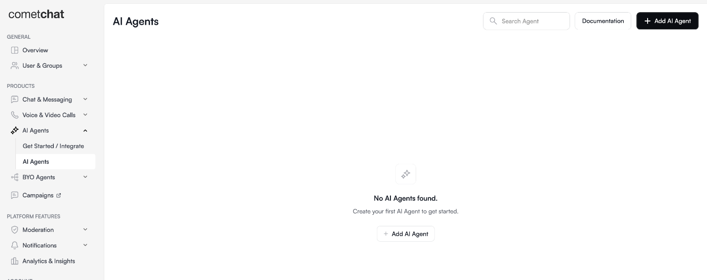

**AI Agents** lists the agents you build with CometChat's Agent Builder.

**Where:** left navigation → **AI Agents** → **AI Agents**.

<Frame>
  
</Frame>

| Element | Description |
| --- | --- |
| **Search Agent** | Filter agents by name. |
| **Documentation** | Opens the AI Agents docs. |
| **Add AI Agent** | Opens the Agent Builder to create a new agent. |

The Agent Builder covers the agent's instructions, knowledge base, tools, frontend actions, variables, card messages, and MCP servers. It's documented in detail in the [Agent Builder docs](/ai-agents/agent-builder/overview).
