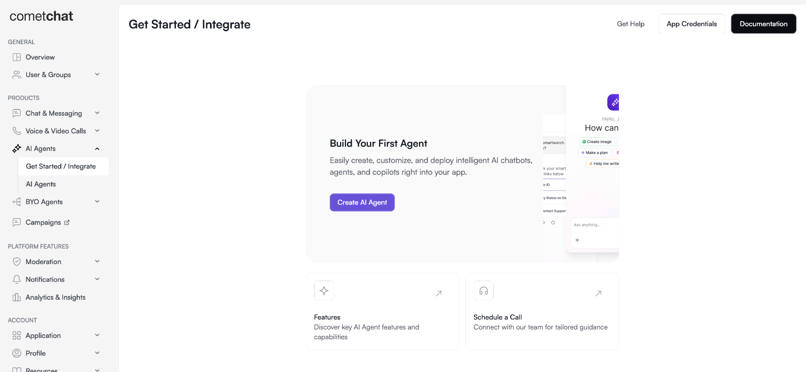

**Get Started / Integrate** shows how to build an AI agent with CometChat's Agent Builder and put it in your app.

**Where:** left navigation → **AI Agents** → **Get Started / Integrate**. The **AI Agents** card on [Overview](/dashboard/overview) opens the same page.

<Frame>
  
</Frame>

| Element | Description |
| --- | --- |
| **Create AI Agent** | Starts a new agent in the Agent Builder. See [AI Agents](/dashboard/ai-agents/ai-agents). |
| **Features** | Key AI agent features and capabilities. |
| **Schedule a Call** | Book time with the CometChat team. |

## Integrate AI Agents

<Steps>
  <Step title="Choose Your AI Agent">
    Use the AI Agent Builder to create and manage agents inside CometChat. **Connect AI Agent Builder** starts the builder; **Go to Docs** opens the [Agent Builder docs](/ai-agents/agent-builder/overview).
  </Step>
  <Step title="Add AI Agent to your Frontend">
    **Customize and Deploy** lets you style the agent and copy the embed code for your site or app.
  </Step>
</Steps>

**Advanced Customization:** for full control, use the **React UI Kits** (pre-built components) or the **JavaScript SDK** (your own UI and logic). Each has **Go to Docs**.

<Note>
Agent usage consumes AI agent credits. See [Plans & Billing → AI Agents](/dashboard/application/plans-billing#ai-agents).
</Note>
