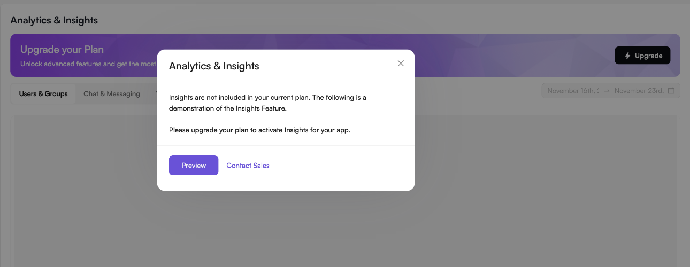
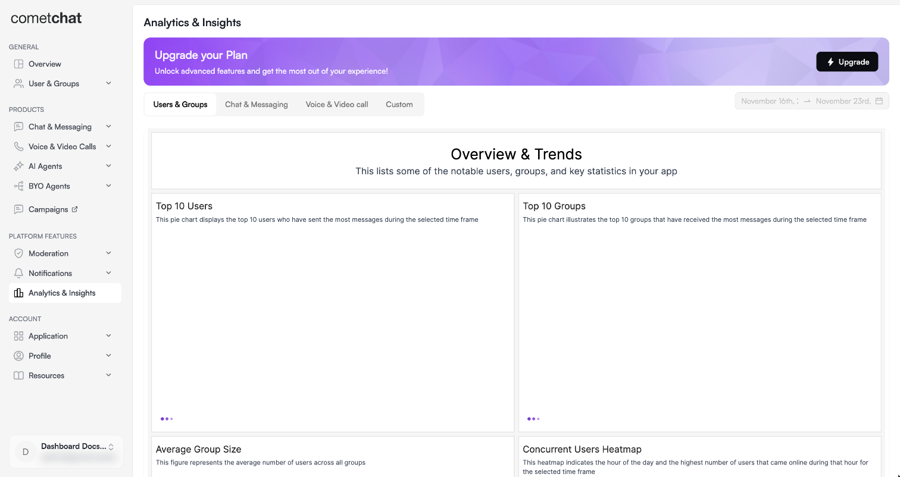

**Analytics & Insights** shows charts about your users, groups, messages, and calls.

**Where:** left navigation → **Platform Features** → **Analytics & Insights**. **Chat & Messaging → Analytics & Insights** and **Voice & Video Calls → Insights** open the same page.

## Plan requirement

Insights are included on higher plans. On a plan without Insights (such as the free **Build** plan), the page opens with a notice. Click **Preview** to see a demonstration with sample charts, or **Contact Sales** to upgrade. The **Upgrade your Plan** banner links to [Plans & Billing](/dashboard/application/plans-billing).

<Frame>
  
</Frame>

## Tabs and filters

<Frame>
  
</Frame>

| Tab | What it covers |
| --- | --- |
| **Users & Groups** | Engagement and population: top users and groups, average group size, concurrent-users heatmap, growth, churn and retention. |
| **Chat & Messaging** | Messaging metrics such as message volume and trends. |
| **Voice & Video call** | Calling metrics: call duration, participation, concurrent-calls heatmap, calls per day, and engagement frequency. |
| **Custom** | Custom graphs CometChat builds on request. |

Use the date-range picker (top right) to choose the start and end dates. The range applies to all tabs.

For a description of every chart, see [Data Insights](/insights).
