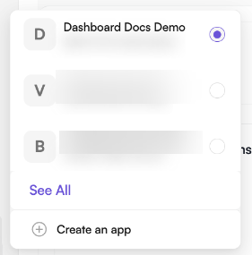
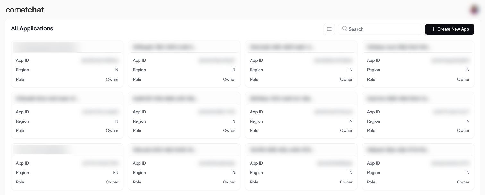
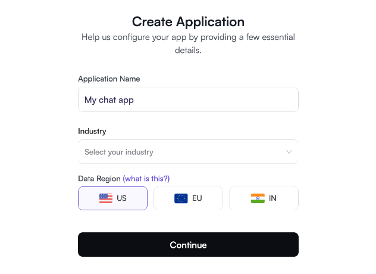
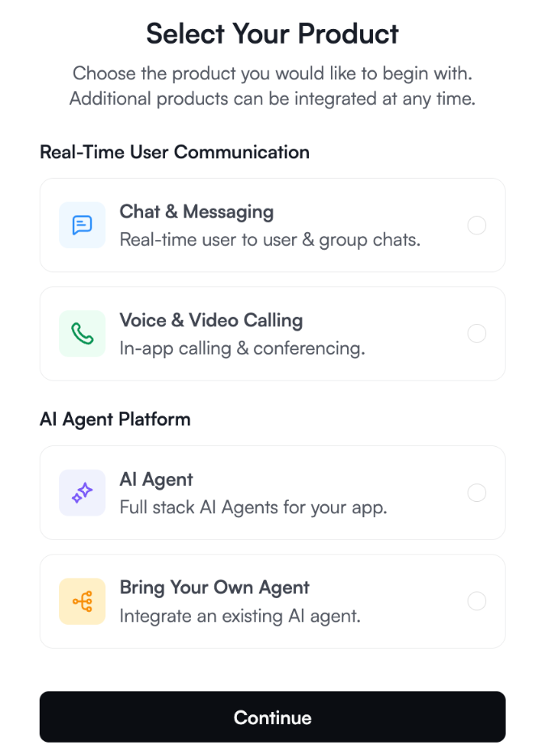
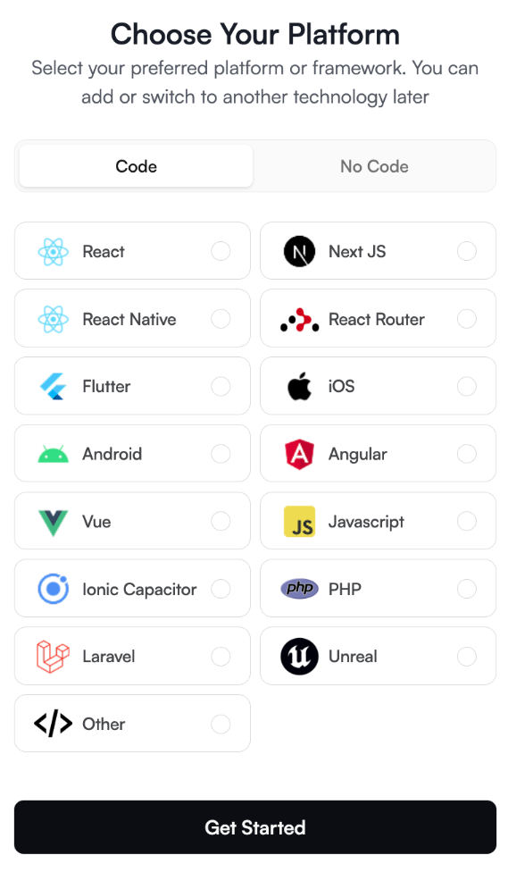
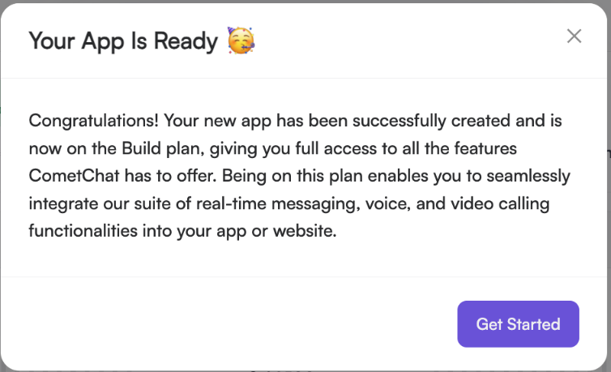

Every page in the dashboard belongs to the app selected in the **app switcher** at the bottom of the left navigation. It shows the app's name and App ID.

## Switch apps

Click the app switcher to open the menu.

<Frame>
  
</Frame>

| Item | Action |
| --- | --- |
| App rows | Your most recent apps. The selected app has a filled radio button. Click another app to switch to it. |
| **See All** | Opens **All Applications**. |
| **Create an app** | Opens **Create Application**. |

## All Applications

Lists every app you own or collaborate on, at [app.cometchat.com/apps](https://app.cometchat.com/apps).

<Frame>
  
</Frame>

| Element | Description |
| --- | --- |
| App cards | Each card shows the app name, **App ID**, **Region**, and your **Role** on that app (for example **Owner**). Click a card to open the app. |
| View toggle | Switch between card and list view. |
| **Search** | Find an app by name. |
| **Create New App** | Opens **Create Application**. |
| Pagination | Page through your apps. |

<a id="create-an-app" />
## Create an app

<Steps>
  <Step title="Create Application">
    <Frame>
      
    </Frame>

    | Field | Description |
    | --- | --- |
    | **Application Name** | Name of the app (prefilled with `My chat app`). You can rename it later in [Settings](/dashboard/application/settings). |
    | **Industry** | Online Marketplaces, Healthcare, Dating, Events & Streaming, Online Education, Community & Social, SaaS & Multi-Tenant, Sports & Gaming, Team Comms & Workflows, or On-Demand Services. |
    | **Data Region** | Where the app's data is stored: **US** (default), **EU**, or **IN**. Pick the region closest to your users or required for compliance. **You can't change it later** without contacting CometChat. |

    Click **Continue**.
  </Step>
  <Step title="Select Your Product">
    <Frame>
      
    </Frame>

    Choose what to start with. You can add other products at any time.

    - **Real-Time User Communication**: **Chat & Messaging** (user-to-user and group chat) or **Voice & Video Calling** (in-app calling and conferencing).
    - **AI Agent Platform**: **AI Agent** (full-stack AI agents for your app) or **Bring Your Own Agent** (integrate an existing agent).

    Click **Continue**.
  </Step>
  <Step title="Choose Your Platform">
    <Frame>
      
    </Frame>

    - **Code**: React, Next.js, React Native, React Router, Flutter, iOS, Android, Angular, Vue, JavaScript, Ionic Capacitor, PHP, Laravel, Unreal, or Other.
    - **No Code**: WordPress, HTML, Webflow, Shopify, Wix, Squarespace, or Other.

    You can switch technology later. Click **Get Started**. CometChat prepares your app; this can take up to a minute.
  </Step>
  <Step title="Your app is ready">
    <Frame>
      
    </Frame>

    New apps start on the free **Build** plan with access to all features within its limits. Click **Get Started** to open the integration guide for the product and platform you picked.
  </Step>
</Steps>

Each new app includes sample users (`cometchat-uid-1` to `cometchat-uid-5`) and a sample group (`cometchat-guid-1`) for testing. Find your keys in [Credentials](/dashboard/application/credentials).
