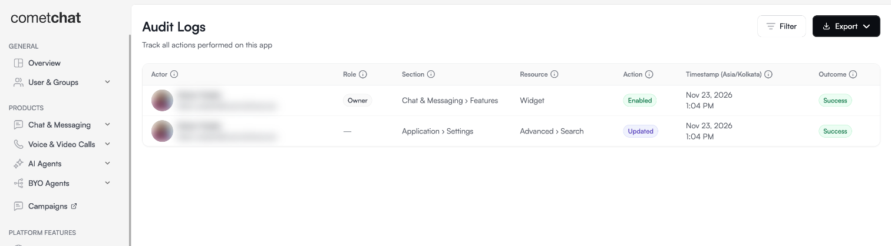

**Audit Logs** records the actions team members perform on the app, for security reviews and troubleshooting.

**Where:** left navigation → **Account** → **Application** → **Audit Logs**.

<Frame>
  
</Frame>

| Column | Description |
| --- | --- |
| **Actor** | Who performed the action (name and email). |
| **Role** | The actor's team role, for example **Owner**. |
| **Section** | Where in the dashboard the change was made, for example **Chat & Messaging › Features**. |
| **Resource** | What changed, for example **Widget** or **Advanced › Search**. |
| **Action** | What happened, for example **Enabled** or **Updated**. |
| **Timestamp** | When it happened, in your time zone (shown in the column header). |
| **Outcome** | **Success** or failure. |

## Filter and export

- **Filter** adds **Time range** (or **Custom dates**), **Section**, and **Action** filters.
- **Export** downloads the audit log.
