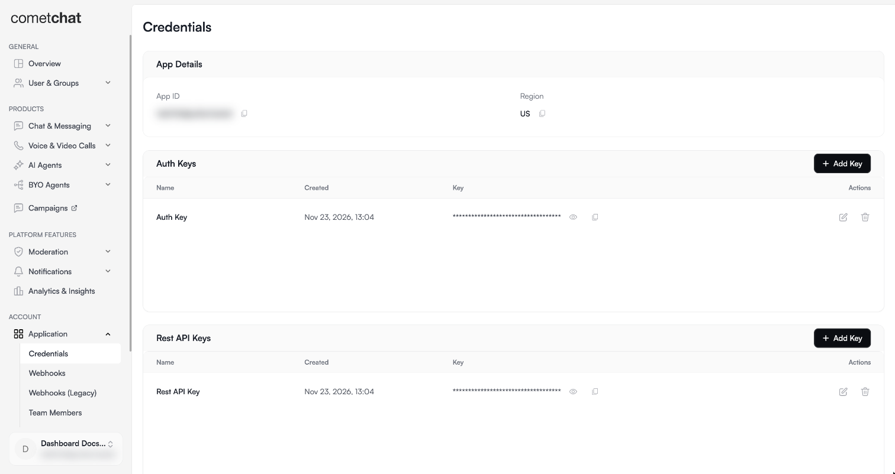

**Credentials** holds the identifiers and keys your client and server code use to talk to CometChat.

**Where:** left navigation → **Account** → **Application** → **Credentials**. The **App Credentials** button on Overview and Get Started pages opens the same page.

<Frame>
  
</Frame>

## App Details

| Field | Description |
| --- | --- |
| **App ID** | Unique identifier of the app. Used by the SDKs, UI Kits, and REST API. |
| **Region** | Data region (`US`, `EU`, or `IN`). The region is fixed when you create the app; to change it, contact CometChat. |

## Auth Keys

**Auth Keys** let client apps log users in by UID during development. A new app has one key named **Auth Key**.

## Rest API Keys

**REST API Keys** authenticate server-to-server calls to the [REST API](/rest-api/chat-apis). A new app has one key named **Rest API Key**.

## Managing keys

Both tables have **Name**, **Created**, **Key**, and **Actions** columns. Keys are masked.

| Control | Action |
| --- | --- |
| Eye icon | Reveal the key. |
| Copy icon | Copy the key. |
| Pencil icon | Rename the key. |
| Trash icon | Delete the key. Apps using it stop working. |
| **Add Key** | Create another key, for example one per environment or service, so you can rotate or revoke keys independently. |

<Warning>
- Never ship a **REST API Key** in client code; keep it on your server.
- Use the **Auth Key** only for development. In production, create users and [auth tokens](/rest-api/auth-tokens) from your server.
- If a key leaks, create a new key, update your apps, then delete the old key.
</Warning>

See [API keys](/rest-api/api-keys) to manage keys with the REST API.
