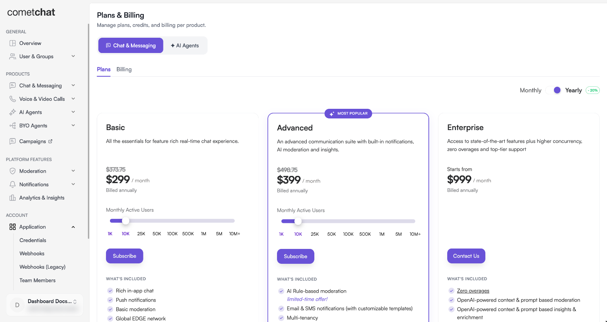
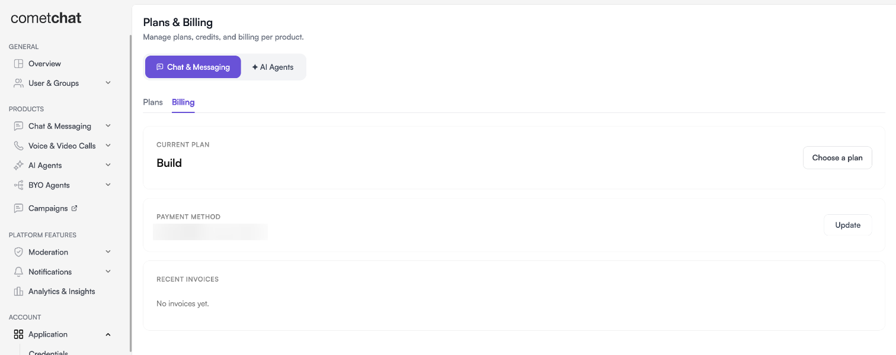
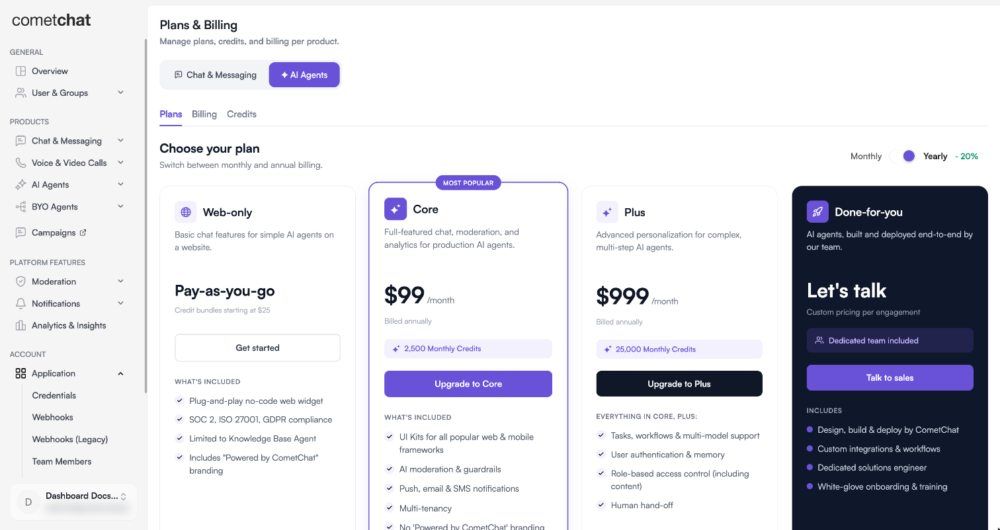
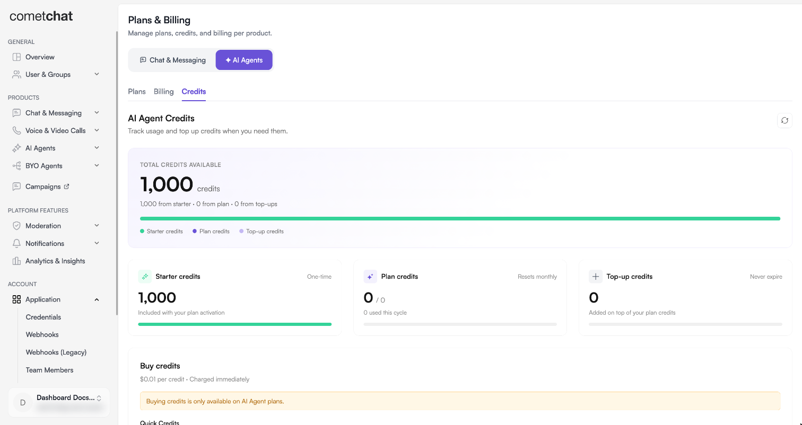

**Plans & Billing** manages plans, credits, and billing **per product**. Choose **Chat & Messaging** or **AI Agents** at the top, then a tab.

**Where:** left navigation → **Account** → **Application** → **Plans & Billing**.

<Note>
Prices in the screenshots are examples and may change. The dashboard always shows current pricing.
</Note>

## Chat & Messaging

### Plans

<Frame>
  
</Frame>

| Control | Description |
| --- | --- |
| **Monthly** / **Yearly** | Billing period. Yearly shows the annual discount. |
| **Monthly Active Users** slider | Pick your MAU tier (1K to 10M+). The price updates. |
| **Subscribe** | Start the checkout for **Basic** or **Advanced**. |
| **Contact Us** | Talk to sales about **Enterprise**. |

| Plan | Summary |
| --- | --- |
| **Basic** | Essentials for real-time chat: rich in-app chat, push notifications, basic moderation, global edge network. |
| **Advanced** | Adds AI rule-based moderation, email and SMS notifications with templates, multi-tenancy, AI smart replies and summaries, in-depth insights, HIPAA/BAA, advanced search, and message translation. |
| **Enterprise** | Higher concurrency, zero overages, OpenAI-powered moderation and insights, and top-tier support. |

New apps start on the free **Build** plan.

### Billing

<Frame>
  
</Frame>

| Section | Description |
| --- | --- |
| **Current Plan** | Your plan (for example **Build**). **Choose a plan** opens **Plans**. |
| **Payment Method** | The card on file. **Update** changes it. |
| **Recent Invoices** | Past invoices to view or download. |

<a id="ai-agents" />
## AI Agents

### Plans

<Frame>
  
</Frame>

| Plan | Summary |
| --- | --- |
| **Web-only** | Pay-as-you-go credit bundles. No-code web widget, Knowledge Base agent only, "Powered by CometChat" branding. **Get started**. |
| **Core** | Monthly credits; UI Kits for web and mobile, AI moderation and guardrails, notifications, multi-tenancy, no branding, advanced search, 100+ tools and frontend actions. **Upgrade to Core**. |
| **Plus** | More monthly credits; adds tasks, workflows and multi-model support, user authentication and memory, role-based access control, and human hand-off. **Upgrade to Plus**. |
| **Done-for-you** | CometChat designs, builds, and deploys agents for you. **Talk to sales**. |

### Billing

Your current AI Agents plan, payment method, and invoices, as for Chat & Messaging.

### Credits

AI agents consume credits.

<Frame>
  
</Frame>

| Section | Description |
| --- | --- |
| **Total credits available** | Sum of starter, plan, and top-up credits. |
| **Starter credits** | One-time credits included when the plan is activated (1,000 on a new app). |
| **Plan credits** | Credits included with your plan; reset monthly. |
| **Top-up credits** | Credits you buy; never expire. |
| **Buy credits** | Buy credit bundles (**Quick Credits** 2,500, 5,000, 7,500, or 10,000, or a custom amount; minimum 2,500). Charged immediately. Available only on AI Agent plans. |
| **Auto top-up** | Buy credits automatically when the balance falls below a **Trigger threshold**: set the **Top-up amount** (USD) and **Max top-up per cycle** (USD), then **Save settings**. Requires an active AI Agent plan. |

Use the refresh icon to reload balances.
