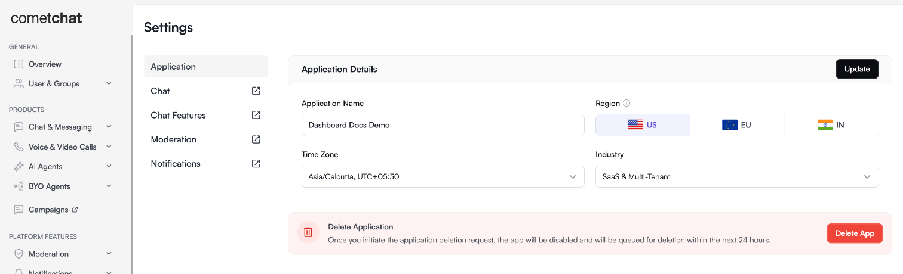

**Settings** holds the app's basic details and the option to delete it.

**Where:** left navigation → **Account** → **Application** → **Settings**.

<Frame>
  
</Frame>

## Application Details

| Field | Description |
| --- | --- |
| **Application Name** | The app's name in the dashboard and app switcher. |
| **Region** | The data region (**US**, **EU**, or **IN**) chosen at creation. Read-only; contact CometChat to change it. |
| **Time Zone** | Time zone used for dates in the dashboard, for example audit log timestamps. |
| **Industry** | Your app's industry: Online Marketplaces, Healthcare, Dating, Events & Streaming, Online Education, Community & Social, SaaS & Multi-Tenant, Sports & Gaming, Team Comms & Workflows, or On-Demand Services. |

Click **Update** to save.

## Settings menu

The menu on the left links to other settings pages (↗):

| Item | Opens |
| --- | --- |
| **Application** | This page. |
| **Chat** | [Chat & Messaging → Settings](/dashboard/chat/settings) |
| **Chat Features** | [Chat & Messaging → Features](/dashboard/chat/features) |
| **Moderation** | [Moderation → Settings](/dashboard/moderation/settings) |
| **Notifications** | [Notifications → Settings](/dashboard/notifications/settings) |

## Delete Application

**Delete App** disables the app immediately and queues it for deletion within the next 24 hours. All users, messages, and settings are removed.

<Warning>
Deleting an app can't be undone. Export any data you need first.
</Warning>
