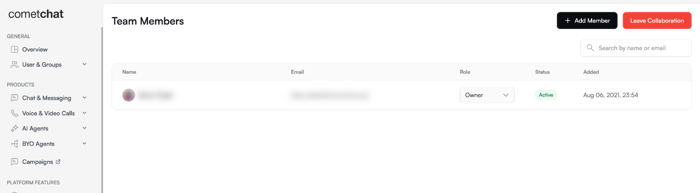
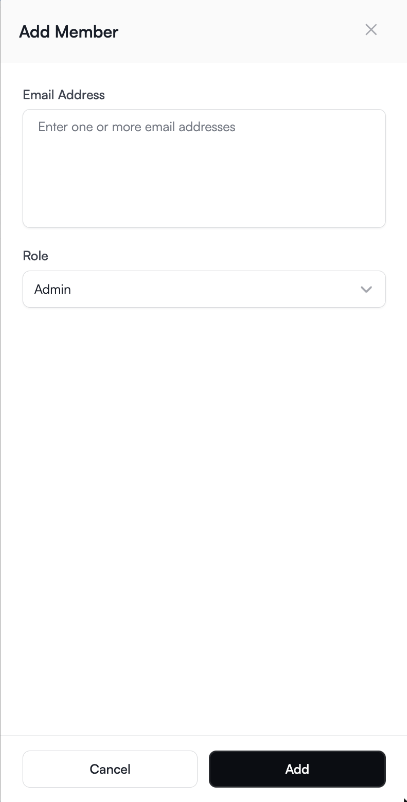

**Team Members** controls who on your team can open this app in the dashboard and what they can do. Team members are dashboard users, not CometChat chat users.

**Where:** left navigation → **Account** → **Application** → **Team Members**.

<Frame>
  
</Frame>

Columns: **Name**, **Email**, **Role**, **Status**, **Added**. Change a member's role from the **Role** dropdown in their row. Search by name or email.

## Add members

Click **Add Member**.

<Frame>
  
</Frame>

| Field | Description |
| --- | --- |
| **Email Address** | One or more email addresses to invite. |
| **Role** | **Developer**, **Moderator**, **Admin** (default), **Billing**, or **Analyst**. |

Click **Add** to send the invitations.

The app creator has the **Owner** role.

## Leave Collaboration

**Leave Collaboration** removes you from an app someone else owns. You lose access until you're invited again.
