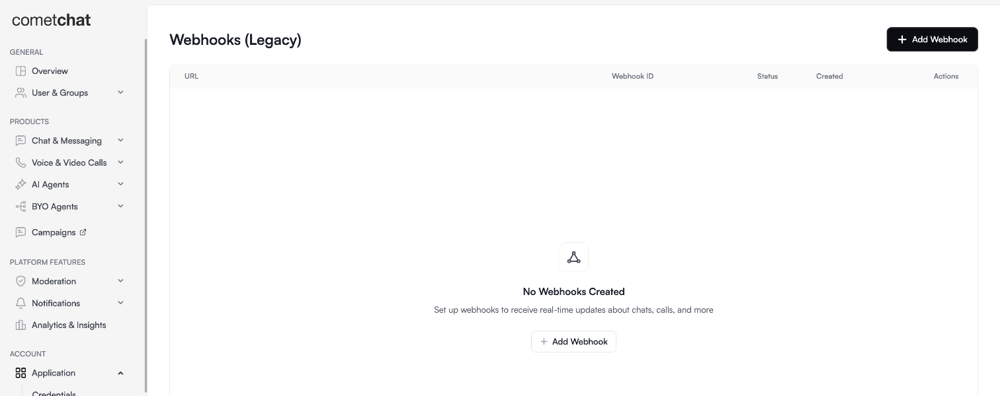

**Webhooks (Legacy)** manages webhooks created with the original webhook system. For new integrations, use [Webhooks](/dashboard/application/webhooks).

**Where:** left navigation → **Account** → **Application** → **Webhooks (Legacy)**.

<Frame>
  
</Frame>

## Add a legacy webhook

Click **Add Webhook** and fill:

| Field | Description |
| --- | --- |
| **Webhook ID** | Unique identifier of the webhook. |
| **URL** | Webhook data is sent as JSON in the body of a POST request to this endpoint. |
| **Triggers** | `after_connection_status_changed` (beta: after a user connects to or disconnects from the WebSocket server), `after_message` (after a message is sent), `before_message` (before a message is saved to the database), `message_delivery_receipt` (beta), `message_read_receipt` (beta). |
| **Enable Webhook** | Turn the webhook on. |
| **Auth for Callback URL** | Add a **Username** and **Password** to secure the URL. |

Click **Save**. See [Legacy webhooks](/fundamentals/webhooks).
