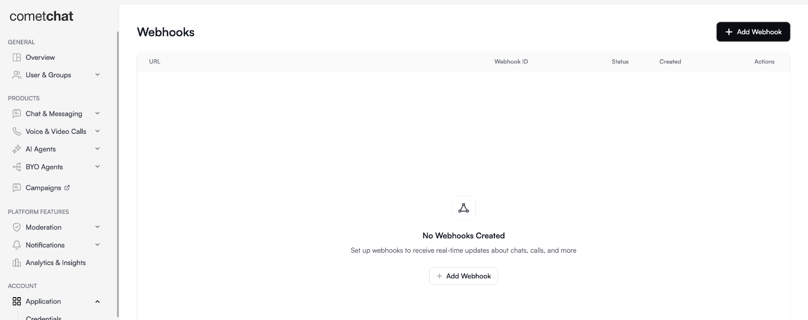
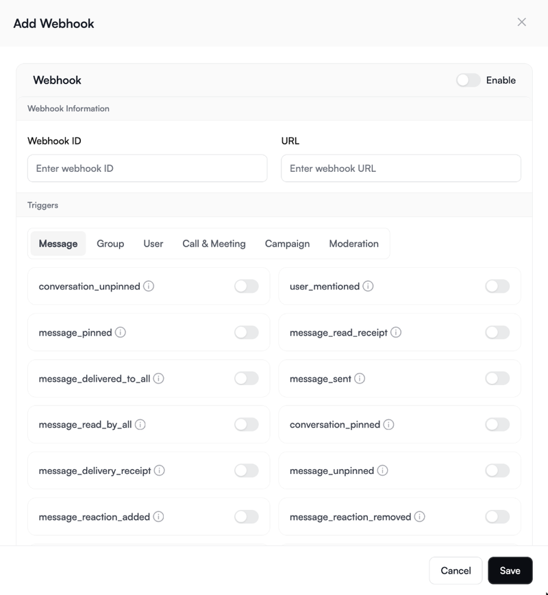

**Webhooks** sends an HTTP POST to your server when events happen in your app, so your backend can react (for example, to sync data, trigger workflows, or log activity).

**Where:** left navigation → **Account** → **Application** → **Webhooks**.

<Frame>
  
</Frame>

Columns: **URL**, **Webhook ID**, **Status**, **Created**, **Actions**.

## Add a webhook

Click **Add Webhook**.

<Frame>
  
</Frame>

| Field | Description |
| --- | --- |
| **Enable** | Turn the webhook on. Off by default. |
| **Webhook ID** | Unique identifier for this webhook. |
| **URL** | Your HTTPS endpoint. |
| **Triggers** | Turn on the events to send. Each trigger has an info icon describing it. |
| **Auth for Callback URL** | Protect the URL with basic authentication (username and password). |
| **Retry on failure** | Retry failed deliveries up to 2 more times. |

Click **Save**.

### Triggers

| Tab | Triggers |
| --- | --- |
| **Message** | `message_sent`, `message_edited`, `message_deleted`, `message_delivery_receipt`, `message_read_receipt`, `message_delivered_to_all`, `message_read_by_all`, `message_reaction_added`, `message_reaction_removed`, `message_pinned`, `message_unpinned`, `conversation_pinned`, `conversation_unpinned`, `user_mentioned` |
| **Group** | `group_created`, `group_updated`, `group_deleted`, `group_member_added`, `group_member_joined`, `group_member_left`, `group_member_kicked`, `group_member_banned`, `group_member_unbanned`, `group_member_scope_changed`, `group_owner_transferred` |
| **User** | `user_connection_status_changed`, `user_blocked`, `user_unblocked` |
| **Call & Meeting** | `call_initiated`, `call_started`, `call_ended`, `call_busy`, `call_unanswered`, `call_rejected`, `call_cancelled`, `call_participant_joined`, `call_participant_left`, `meeting_started`, `meeting_ended`, `meeting_participant_joined`, `meeting_participant_left`, `recording_generated`, `transcription_generated` |
| **Campaign** | `after_notification_created`, `after_campaign_completed`, `after_campaign_failed`, `after_push_notification_sent`, `after_push_notification_delivered`, `after_push_notification_clicked`, `after_feed_item_sent`, `after_feed_item_delivered`, `after_feed_item_read`, `after_feed_item_interacted` |
| **Moderation** | `moderation_engine_approved`, `moderation_engine_blocked`, `moderation_engine_failed`, `moderation_manual_approved` |

See [Webhooks overview](/fundamentals/webhooks-overview) for payloads and security, and [Call webhooks](/calls/webhooks) for call events.
