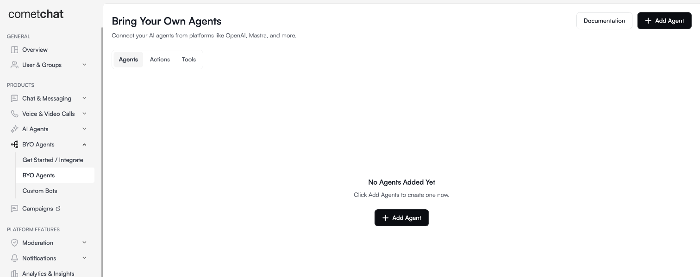
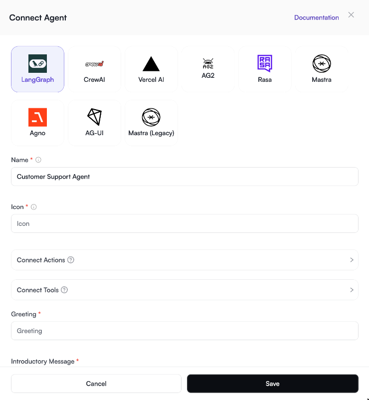

**Bring Your Own Agents** connects AI agents you host yourself (on OpenAI, Mastra, LangGraph, and more) to CometChat, and manages the actions and tools those agents can call.

**Where:** left navigation → **BYO Agents** → **BYO Agents**.

<Frame>
  
</Frame>

## Tabs

| Tab | Columns | Button |
| --- | --- | --- |
| **Agents** | Your connected agents | **Add Agent** |
| **Actions** | **Name**, **Description**, **Actions** | **Add Action** — frontend actions the agent can trigger in your app. See [Actions](/ai-agents/actions). |
| **Tools** | **Name**, **Actions** | **Add Tool** — backend tools the agent can call. See [Tools](/ai-agents/tools). |

## Connect an agent

Click **Add Agent** to open **Connect Agent**.

<Frame>
  
</Frame>

| Field | Required | Description |
| --- | --- | --- |
| Framework | Yes | **LangGraph**, **CrewAI**, **Vercel AI**, **AG2**, **Rasa**, **Mastra**, **Agno**, **AG-UI**, or **Mastra (Legacy)**. |
| **Name** | Yes | Agent display name, for example `Customer Support Agent`. |
| **Icon** | Yes | Agent avatar. |
| **Connect Actions** | No | Pick actions from the **Actions** tab that this agent can use. |
| **Connect Tools** | No | Pick tools from the **Tools** tab that this agent can use. |
| **Greeting** | Yes | Greeting shown when a conversation starts. |
| **Introductory Message** | Yes | First message the agent shows. |
| **Suggested messages** | No | Starter prompts users can tap. Click **Add Suggested messages**. |
| **Deployment URL** | Yes | The public endpoint of your agent. |
| **Headers** | No | Extra HTTP headers CometChat sends to your agent, one `key:value` per line; must be valid JSON. |

Click **Save** to connect the agent, or **Cancel**. **Documentation** (top of the panel) opens the guide for the selected framework.
