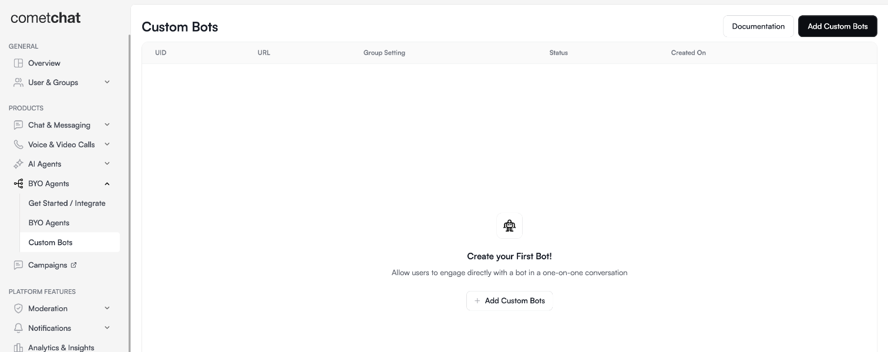
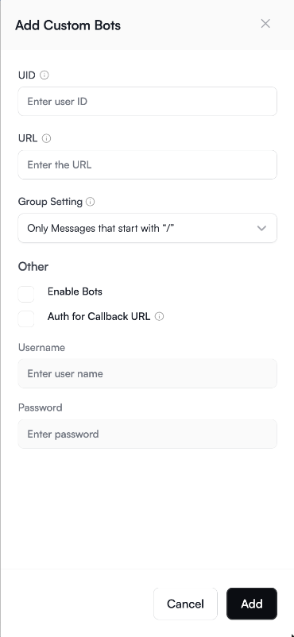

**Custom Bots** connects a CometChat user to your own bot server. When users message the bot, CometChat sends the message to your callback URL, and your server replies as the bot.

**Where:** left navigation → **BYO Agents** → **Custom Bots**.

<Frame>
  
</Frame>

Columns: **UID**, **URL**, **Group Setting**, **Status**, **Created On**.

## Add a custom bot

Click **Add Custom Bots**.

<Frame>
  
</Frame>

| Field | Description |
| --- | --- |
| **UID** | Unique identifier of the CometChat user that acts as the bot. |
| **URL** | Your callback endpoint. Bot data is sent as JSON in the body of a POST request. |
| **Group Setting** | Which messages to forward from groups the bot is a member of: **Only Messages that start with "/"** (default), **Mentioned Messages**, or **All Messages**. |
| **Enable Bots** | Turn the bot on. |
| **Auth for Callback URL** | Add basic authentication to secure your callback URL. Fill **Username** and **Password**. |

Click **Add** to save.

See [Bots REST API](/rest-api/bots) to manage bots from code.
