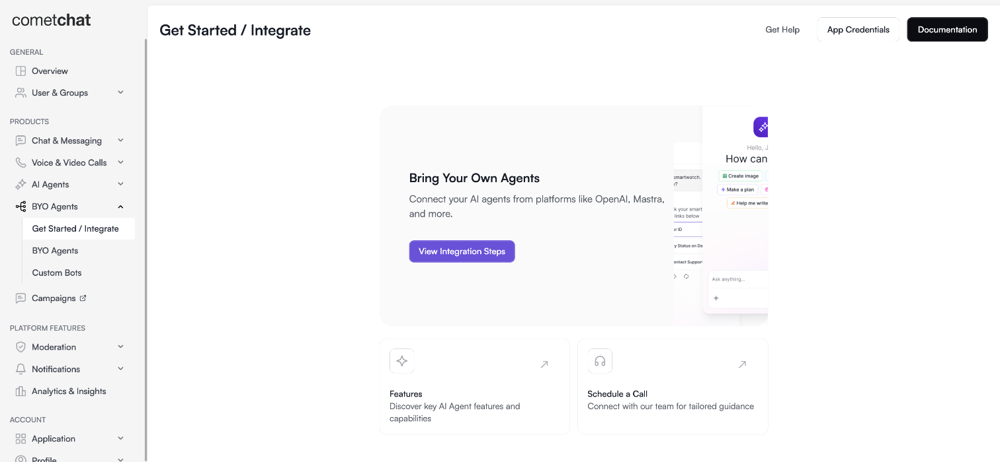

**Get Started / Integrate** shows how to bring an existing AI agent into CometChat so your users can chat with it.

**Where:** left navigation → **BYO Agents** → **Get Started / Integrate**. The **BYO Agents** card on [Overview](/dashboard/overview) opens the same page.

<Frame>
  
</Frame>

## Integrate BYO Agents

<Steps>
  <Step title="Connect Agent">
    Choose the framework your agent runs on: **LangGraph**, **CrewAI**, **Vercel AI**, **AG2**, **Rasa**, **Mastra**, **Agno**, **AG-UI**, or **Mastra (Legacy)**. Each opens the integration guide. Then add the agent in [BYO Agents](/dashboard/byo-agents/byo-agents).
  </Step>
  <Step title="Add Agent to your Frontend">
    **Customize and Deploy** lets you style the agent and copy the embed code.
  </Step>
</Steps>

**Advanced Customization:** use the **React UI Kits** or the **JavaScript SDK** for your own experience.

Framework guides: [Mastra](/ai-agents/mastra), [CrewAI](/ai-agents/crew-ai), [Agno](/ai-agents/agno), [Vercel AI](/ai-agents/vercel), [LangGraph](/ai-agents/langgraph), [AG2](/ai-agents/ag2), [AG-UI](/ai-agents/ag-ui).
