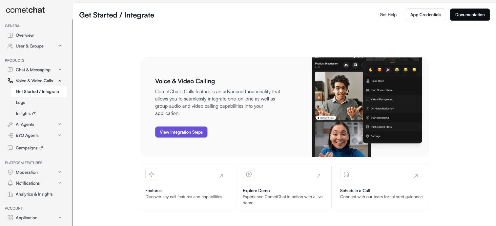

**Get Started / Integrate** guides you through adding one-on-one and group audio and video calling to your app.

**Where:** left navigation → **Voice & Video Calls** → **Get Started / Integrate**. The **Voice & Video Calling** card on [Overview](/dashboard/overview) opens the same page.

<Frame>
  
</Frame>

Click **View Integration Steps** to show the guide. The cards link to **Features**, **Explore Demo**, and **Schedule a Call**.

## Integrate Voice & Video Calling

<Steps>
  <Step title="Do you already have Chat & Messaging integrated?">
    - **Yes, I have Chat & Messaging**: add calling to your existing integration.
    - **No, Starting Fresh**: integrate calling as a standalone product.
  </Step>
  <Step title="Add Voice & Video Calling to your frontend">
    Pick your platform: React, React Router, Next.js, React Native, Flutter, iOS, Android, Angular, Vue, JavaScript, Ionic, PHP, Laravel, or Others. The dashboard shows the matching SDK or UI Kit with **Go to Docs** and a **Learn More** section.

    For the JavaScript Calls SDK, for example, you install the Calls SDK, initialize it with your **App ID** and **Region**, and choose an implementation: **Ringing** (complete call flow), **Call Session** (your own call logic), or **Standalone** (calls without chat).
  </Step>
</Steps>

See the [Calling docs](/calls) for platform guides, and [Call Logs](/dashboard/calls/logs) to verify calls once you integrate.
