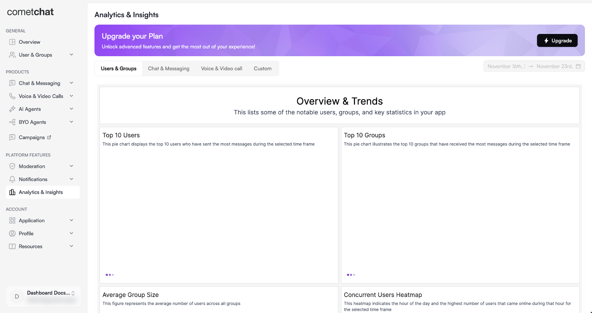

**Insights** under **Voice & Video Calls** is a shortcut (marked ↗ in the navigation). It opens the app-wide [Analytics & Insights](/dashboard/analytics) page, where the **Voice & Video call** tab shows calling metrics.

<Frame>
  
</Frame>

See [Analytics & Insights](/dashboard/analytics) for plan requirements and filters, and [Data Insights](/insights#calling) for the calling metrics.
