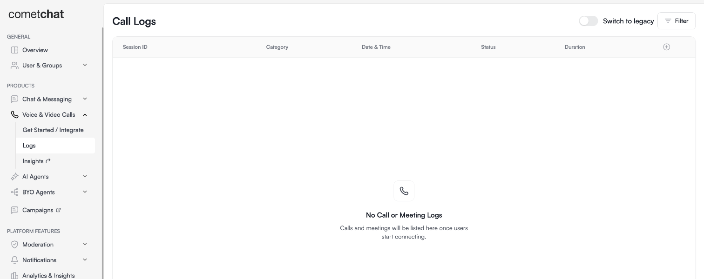

**Call Logs** lists the calls and meetings in your app. Use it to confirm calls connect, check durations and usage, and find recordings.

**Where:** left navigation → **Voice & Video Calls** → **Logs**.

<Frame>
  
</Frame>

## Columns

Default columns are **Session ID**, **Category**, **Date & Time**, **Status**, and **Duration**. Click the **+** icon at the end of the header row to show more columns.

## Filters

Click **Filter** to add filter chips:

| Filter | Description |
| --- | --- |
| **Category** | Type of session, such as a call or a meeting. |
| **Status** | Status of the call. |
| **Select Date** | Date range. |
| **Has Recording** | Only calls with a recording. |
| **Receiver Type** | User (one-on-one) or group. |
| **Duration** | Call length. |
| **Total Participants** | Number of participants. |
| **Voice Minutes** / **Video Minutes** | Minutes used. |

## Switch to legacy

The **Switch to legacy** toggle shows the older call logs view.

To receive call events on your server instead, subscribe to the call triggers in [Webhooks](/dashboard/application/webhooks).
