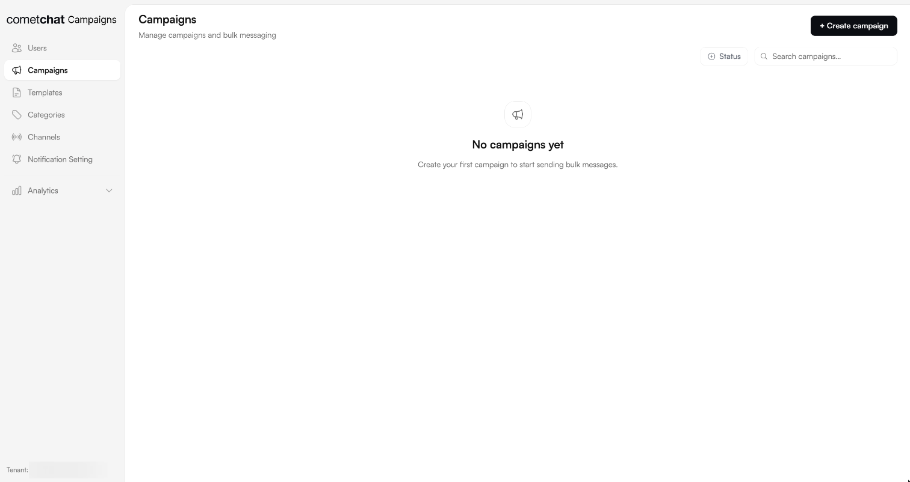

**Campaigns** opens the CometChat Campaigns console for the current app in a new tab. Use it to send targeted, bulk messages and notifications to your users.

**Where:** left navigation → **Products** → **Campaigns** (marked ↗; opens in a new tab).

<Frame>
  
</Frame>

The Campaigns console has its own navigation:

| Item | What you do there | Docs |
| --- | --- | --- |
| **Users** | See the users campaigns can target. | [Users](/campaigns/users) |
| **Campaigns** | Create, schedule, and track campaigns. Filter by **Status** and search by name. Click **+ Create campaign** to start. | [Campaigns](/campaigns/campaigns) |
| **Templates** | Design reusable message templates. | [Templates](/campaigns/templates) |
| **Categories** | Group campaigns so users can manage their preferences. | [Categories](/campaigns/categories) |
| **Channels** | Configure delivery channels. | [Channels](/campaigns/channels) |
| **Notification Setting** | Delivery settings for campaign notifications. | [Notification settings](/campaigns/notification-settings) |
| **Analytics** | Delivery and engagement reports. | [Analytics](/campaigns/analytics) |

The **Tenant** at the bottom of the Campaigns navigation is your App ID.
