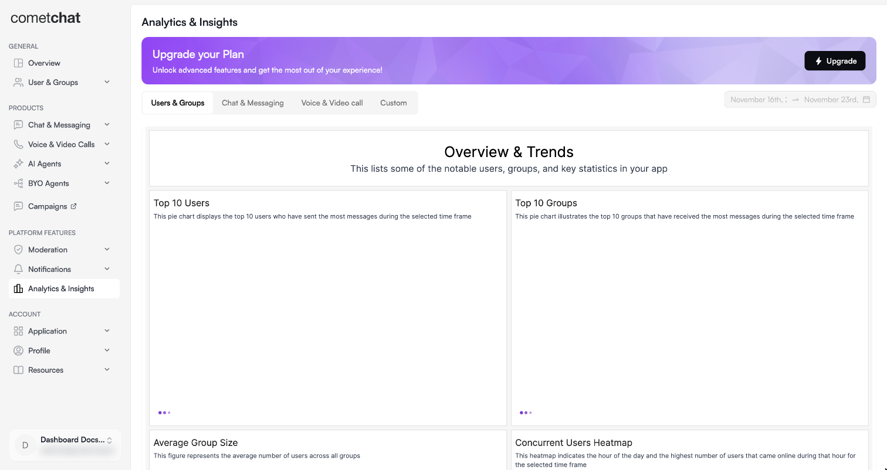

**Analytics & Insights** under **Chat & Messaging** is a shortcut (marked ↗ in the navigation). It opens the app-wide [Analytics & Insights](/dashboard/analytics) page, where the **Chat & Messaging** tab shows messaging metrics.

<Frame>
  
</Frame>

See [Analytics & Insights](/dashboard/analytics) for the tabs, date filter, and plan requirements, and [Data Insights](/insights) for a description of every metric.
