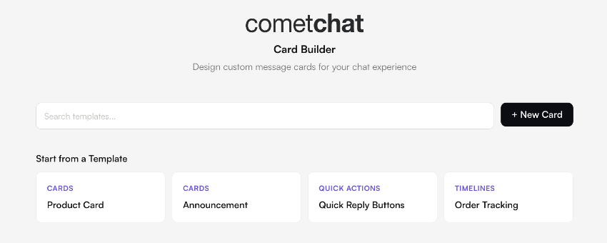

**Card Builder** opens a full-page editor for designing rich message cards (product cards, announcements, quick-reply buttons, order timelines) that you send as card messages.

**Where:** left navigation → **Chat & Messaging** → **Card Builder** (marked ↗; it opens the Card Builder app for the current app).

<Frame>
  
</Frame>

| Element | Description |
| --- | --- |
| **Search templates** | Find saved and ready-made templates. |
| **+ New Card** | Start a blank card. |
| **Start from a Template** | Ready-made templates by category: **Cards** (Product Card, Announcement), **Quick Actions** (Quick Reply Buttons), **Timelines** (Order Tracking). |

For the editor, elements, actions, and JSON schema, see the [Card Builder docs](/card-builder/overview).
