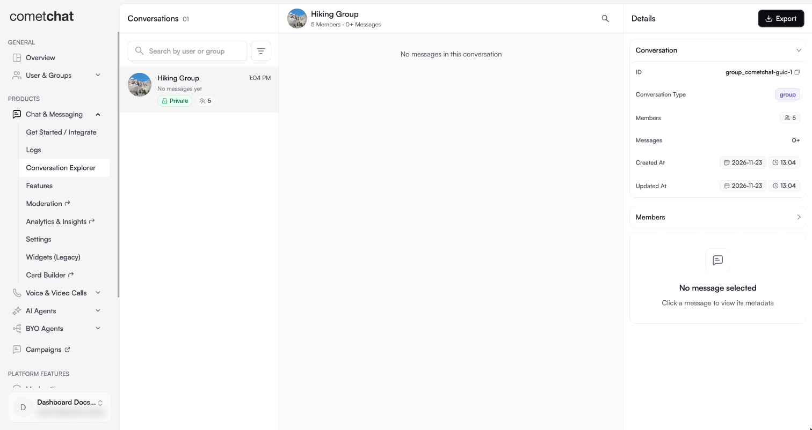

**Conversation Explorer** lets you read conversations the way your users see them and drill into individual messages for debugging and support.

**Where:** left navigation → **Chat & Messaging** → **Conversation Explorer**.

<Frame>
  
</Frame>

## Layout

| Pane | What it shows |
| --- | --- |
| **Conversations** (left) | All conversations with their name, last message, time, type badge (for example **Private**), and member count. Search by user or group. |
| **Messages** (middle) | Messages in the selected conversation, with member and message counts in the header. Use the search icon to find messages in this conversation. |
| **Details** (right) | **Conversation** details (**ID**, **Conversation Type**, **Members**, **Messages**, **Created At**, **Updated At**), a **Members** list, and, when you click a message, that message's metadata, delivery details, reactions, and moderation insights. |

## Filters

Click the filter icon next to the search box to show:

| Filter | Description |
| --- | --- |
| **On behalf of** | Show conversations as a specific user sees them. |
| **Type** | Show only user (one-on-one) or group conversations. |

## Export

**Export** (top of the **Details** pane) downloads the selected conversation.

<Note>
Conversation Explorer shows messages only when **Chat Logs & Conversation Explorer** is turned on in [Chat & Messaging → Settings](/dashboard/chat/settings).
</Note>
