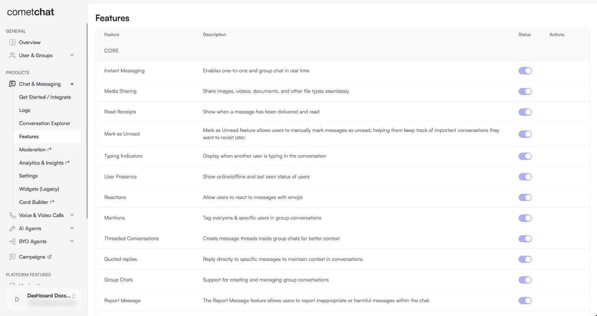
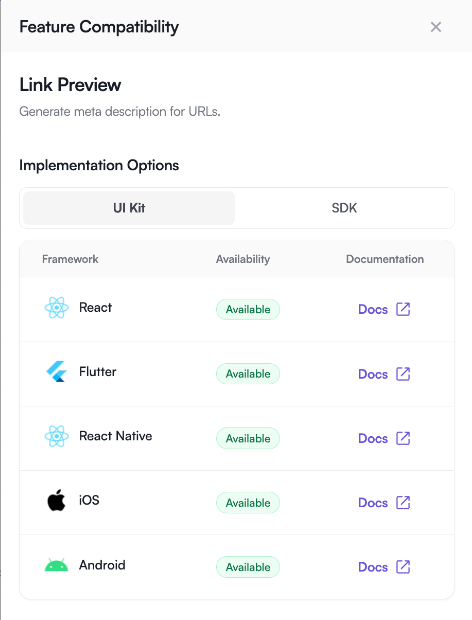
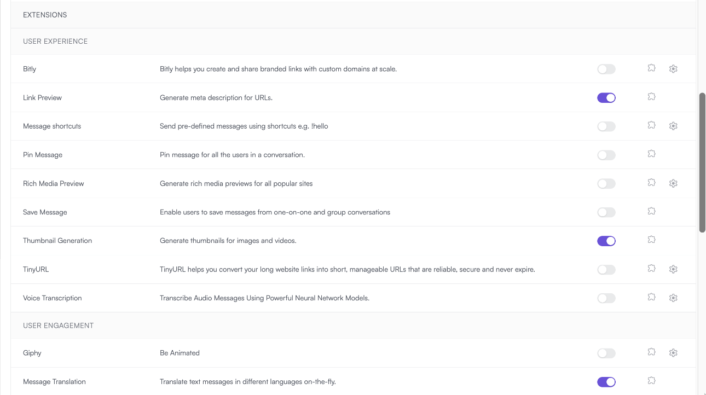
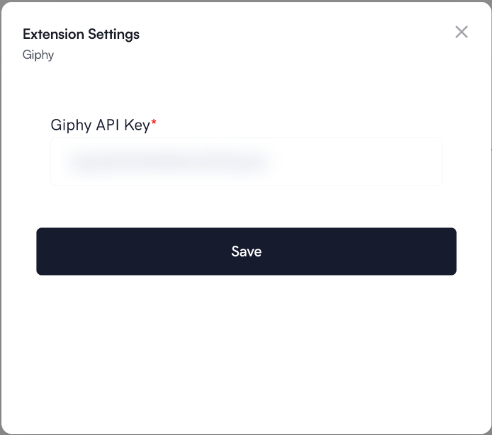

**Features** lists every chat capability in the app: core features that are always on, and extensions you can enable. Each row has a **Status** toggle and **Actions**.

**Where:** left navigation → **Chat & Messaging** → **Features**.

<Frame>
  
</Frame>

## Actions

| Icon | Action |
| --- | --- |
| Puzzle piece | Opens **Feature Compatibility**: which UI Kits and SDKs support the feature, with links to their docs. |
| Gear | Opens the extension's settings (only on extensions that need configuration). |
| **Status** toggle | Turns the feature or extension on or off for the whole app. Locked (dimmed) toggles can't be turned off. |

<Frame>
  
</Frame>

<Note>
Turning a feature on here enables it on the server. Your UI Kit or SDK code must also support it. Check **Feature Compatibility** before you enable it.
</Note>

## Core

Always on (locked) unless noted:

| Feature | Description |
| --- | --- |
| Instant Messaging | One-to-one and group chat in real time. |
| Media Sharing | Share images, videos, documents, and other files. |
| Read Receipts | Show when a message has been delivered and read. |
| Mark as Unread | Users mark messages as unread to revisit later. |
| Typing Indicators | Show when someone is typing. |
| User Presence | Online/offline and last-seen status. |
| Reactions | React to messages with emojis. |
| Mentions | Tag everyone or specific users in group conversations. |
| Threaded Conversations | Reply in threads inside group chats. |
| Quoted replies | Reply to a specific message to keep context. |
| Group Chats | Create and manage group conversations. |
| Report Message | Users report inappropriate or harmful messages (see [Moderation](/dashboard/moderation/logs)). |
| Conversation and Advanced Search | Search conversations by user or group name and filter messages by links, attachments, reactions, mentions, or mentioned UIDs. **Can be turned off.** On by default. |

## Extensions

Defaults are for a new app. Extensions marked ⚙ have settings.

<Frame>
  
</Frame>

| Category | Extension | Default | Description |
| --- | --- | --- | --- |
| User Experience | Bitly ⚙ | Off | Shorten links with Bitly. |
| | Link Preview | On | Generate a description for URLs. |
| | Message shortcuts ⚙ | Off | Send predefined messages with shortcuts such as `!hello`. |
| | Pin Message | Off | Pin a message for everyone in a conversation. |
| | Rich Media Preview ⚙ | Off | Rich previews for popular sites. |
| | Save Message | Off | Users save messages from one-on-one and group conversations. |
| | Thumbnail Generation | On | Generate thumbnails for images and videos. |
| | TinyURL ⚙ | Off | Shorten links with TinyURL. |
| | Voice Transcription ⚙ | Off | Transcribe audio messages. |
| User Engagement | Giphy ⚙ | Off | Send GIFs from Giphy. |
| | Message Translation | On | Translate text messages on the fly. |
| | Polls | On | Ask quick polls in chats. |
| | Reminders | Off | Create reminders for messages or anything else. |
| | Stickers ⚙ | On | Send and manage stickers. |
| | Stipop ⚙ | Off | Stickers from Stipop. |
| | Tenor ⚙ | Off | Send GIFs from Tenor. |
| Collaboration | Collaborative document | On | Create and share documents. |
| | Collaborative whiteboard | On | Create and share whiteboards. |
| Security | Disappearing messages | Off | Messages that disappear after an interval. |
| Customer Support | Chatwoot ⚙ | Off | Exchange messages between CometChat and Chatwoot. |
| | Intercom ⚙ | Off | Exchange messages between CometChat and Intercom. |
| Smart Chat Features | Conversation Starter ⚙ | Off | AI-suggested first message. |
| | Smart Replies ⚙ | Off | AI-suggested replies. |
| | Conversation Summary ⚙ | Off | AI-generated conversation summary. |

## Extension settings

Click the gear icon to open **Extension Settings** for that extension. Fill the fields and click **Save**.

<Frame>
  
</Frame>

| Extension | Fields |
| --- | --- |
| Bitly | **Bitly Access Token**, **Bitly Group GUID** |
| Message shortcuts | **Global Message shortcuts**: pairs of shortcut (for example `!hbd`) and expansion text. Add or remove pairs. |
| Rich Media Preview | **Rich Media Preview** API key |
| TinyURL | **TinyURL API Token**, **BYO domain** (for example `tiny.one`) |
| Voice Transcription | **Revai API Key** (Rev.ai) |
| Giphy | **Giphy API Key** |
| Stickers | Manage sticker sets: **Default Set** and **Custom Set** |
| Stipop | **Stipop App ID**, **Stipop API Key** |
| Tenor | **Tenor API Key** |
| Chatwoot | **Chatwoot Access token**, **Chatwoot Account id**, **Chatwoot Inbox id**, **Customer Support UID** |
| Intercom | **Intercom Access token**, **Customer Support UID** (the CometChat user that represents your support team) |
| Conversation Starter, Smart Replies, Conversation Summary | The gear opens [Chat & Messaging → Settings](/dashboard/chat/settings#ai-copilot), where you set the OpenAI model, key, temperature, and custom instructions. |

See [Extensions overview](/fundamentals/extensions-overview) for how each extension works in your app.
