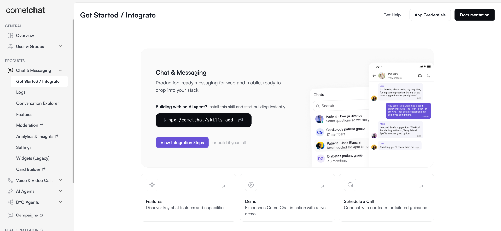
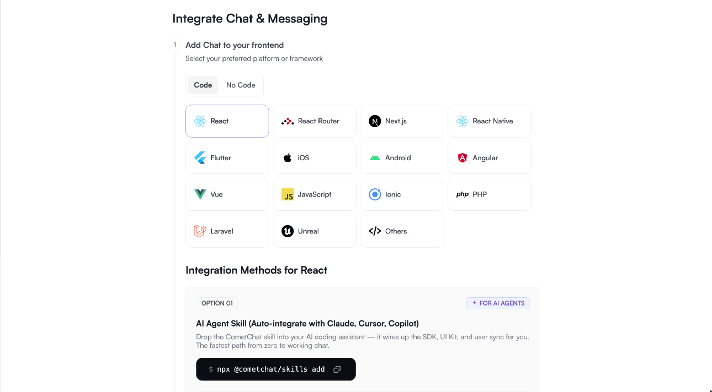

**Get Started / Integrate** walks you through adding chat to your app for the framework you choose.

**Where:** left navigation → **Chat & Messaging** → **Get Started / Integrate**. The **Chat & Messaging** card on [Overview](/dashboard/overview) opens the same page.

<Frame>
  
</Frame>

## Top of the page

| Element | Description |
| --- | --- |
| **Building with an AI agent?** | Shows `npx @cometchat/skills add`. Run it in your project to install the CometChat skill into your AI coding assistant (Claude Code, Cursor, Copilot, and others). See [Agent Skills](/agent-skills). |
| **View Integration Steps** | Scrolls to the step-by-step guide below. |
| **Features** | Opens the list of chat features. |
| **Demo** | Opens a live CometChat demo. |
| **Schedule a Call** | Book time with the CometChat team. |

## Integrate Chat & Messaging

<Frame>
  
</Frame>

<Steps>
  <Step title="Add Chat to your frontend">
    Choose **Code** or **No Code**, then pick a platform.

    - **Code**: React, React Router, Next.js, React Native, Flutter, iOS, Android, Angular, Vue, JavaScript, Ionic, PHP, Laravel, Unreal, Others.
    - **No Code**: website builders such as WordPress, HTML, Webflow, Shopify, Wix, and Squarespace. See [Widget Builder](/widget/html/overview).

    The dashboard then lists **Integration Methods** for that platform. For React, for example:

    | Option | Method | When to use |
    | --- | --- | --- |
    | 01 · For AI agents | **AI Agent Skill**: `npx @cometchat/skills add` | Fastest path. Your coding agent installs the SDK and UI Kit, initializes, logs in, and builds a working chat screen. |
    | 02 · Recommended | **UI Kit Builder** (pre-assembled UI) | Configure features visually, export the code, and customize it later. **Launch UI Kit Builder** opens the builder. |
    | 03 | **UI Components** (assemble it yourself) | Use individual UI Kit components (conversation list, message list, composer) for full control of layout. |
    | 04 | **SDK** (build from scratch) | Build every screen yourself on top of the SDK. |

    Each option has **Go to Docs** and a **Learn More** section that explains how it works and why to choose it.
  </Step>
  <Step title="User Sync – Create user in CometChat">
    Create a CometChat user for each user in your app, usually from your backend at sign-up. **Go to Docs** opens the user-sync guide.
  </Step>
</Steps>

### Next steps

- **Authenticate Users Securely**: set up server-side auth tokens instead of the Auth Key. See [User Authentication](/fundamentals/user-auth).
- **Setup Notification**: configure push, email, or SMS. See [Notifications → Get Started](/dashboard/notifications/get-started).

You need your **App ID**, **Region**, and **Auth Key** from [Credentials](/dashboard/application/credentials) to initialize the SDK.
