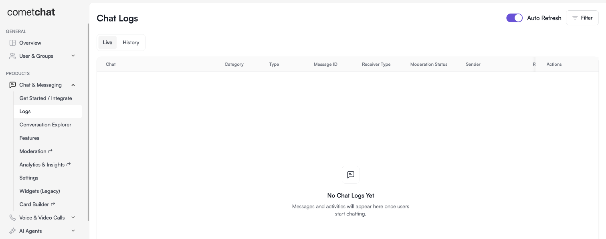
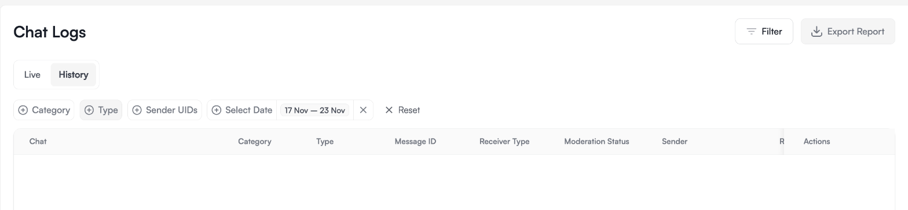

**Chat Logs** shows the messages and activity in your app, live or historically. Use it to debug message delivery, verify moderation outcomes, and audit conversations.

**Where:** left navigation → **Chat & Messaging** → **Logs**.

<Frame>
  
</Frame>

<Note>
If messages don't appear, check that **Chat Logs & Conversation Explorer** is on in [Chat & Messaging → Settings](/dashboard/chat/settings).
</Note>

## Tabs

| Tab | Description |
| --- | --- |
| **Live** | New messages and activity appear as they happen. Turn **Auto Refresh** on to update the table automatically, or off to pause it while you read. |
| **History** | Search past messages. Adds a **Select Date** filter (defaults to the last 7 days) and an **Export Report** button that downloads the filtered results. |

<Frame>
  
</Frame>

## Filters

Click **Filter** to show the filter chips. Click a chip, select values, then click **Apply** (or **Clear**). **Reset** removes all filters.

| Filter | Values |
| --- | --- |
| **Category** | Message, Call, Action, Custom, Agentic, Card |
| **Type** | The message type within the category (for example text or image) |
| **Sender UIDs** | One or more sender user IDs |
| **Select Date** | Date range (History tab only) |

## Columns

**Chat**, **Category**, **Type**, **Message ID**, **Receiver Type** (user or group), **Moderation Status**, **Sender**, **Receiver**, **Date**, and **Actions**.

To read a whole conversation in context, use [Conversation Explorer](/dashboard/chat/conversation-explorer).
