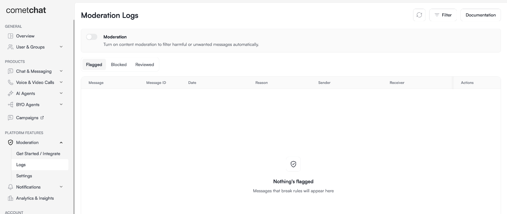

**Moderation** under **Chat & Messaging** is a shortcut (marked ↗ in the navigation). It opens **Moderation Logs**, the same page as **Platform Features → Moderation → Logs**.

<Frame>
  
</Frame>

See:

- [Moderation → Logs](/dashboard/moderation/logs) to review flagged, blocked, and reviewed messages.
- [Moderation → Settings](/dashboard/moderation/settings) to turn moderation on and manage rules, lists, and flag reasons.
