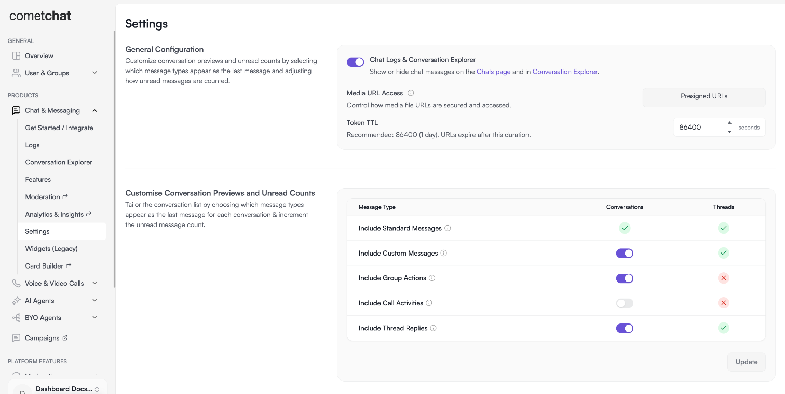
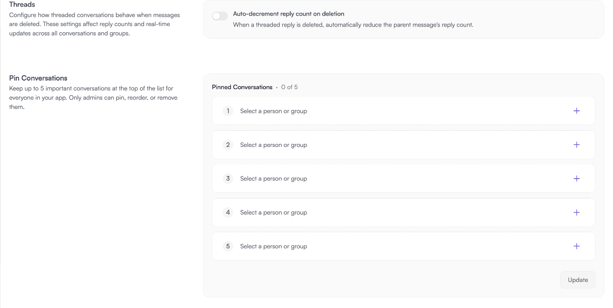
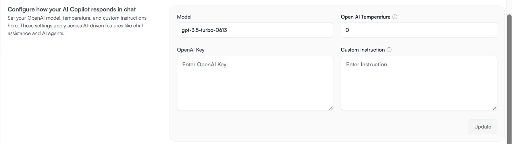

**Settings** holds app-wide chat behavior. Each section has its own **Update** button; changes take effect only after you click it.

**Where:** left navigation → **Chat & Messaging** → **Settings**.

<Frame>
  
</Frame>

## General Configuration

| Setting | Default | Description |
| --- | --- | --- |
| **Chat Logs & Conversation Explorer** | On | Show or hide message content on [Chat Logs](/dashboard/chat/logs) and in [Conversation Explorer](/dashboard/chat/conversation-explorer). Turn it off if dashboard users shouldn't be able to read messages. |
| **Media URL Access** | Presigned URLs | How media file URLs are secured. **Presigned URLs** are time-limited links. See [Presigned URLs](/fundamentals/presigned-urls). |
| **Token TTL** | `86400` seconds | How long a presigned media URL stays valid. Recommended: 86400 (1 day). URLs expire after this duration. |

## Customise Conversation Previews and Unread Counts

Choose which message types become the **last message** of a conversation (shown in conversation lists) and **increment the unread count**, separately for **Conversations** and **Threads**. A ✓ means always included and ✕ means never included; toggles are configurable.

| Message type | Conversations (default) | Threads | Notes |
| --- | --- | --- | --- |
| **Include Standard Messages** | ✓ (always) | ✓ | Text, media, and interactive messages. |
| **Include Custom Messages** | On | ✓ | Custom-category messages. They also appear when sent with `data.updateConversation` set, even if the toggle is off. |
| **Include Group Actions** | On | ✕ | Member joined, left, kicked, and similar actions. |
| **Include Call Activities** | Off | ✕ | Call action messages. |
| **Include Thread Replies** | On | ✓ | Replies in threads update the parent conversation. |

## Threads

| Setting | Default | Description |
| --- | --- | --- |
| **Auto-decrement reply count on deletion** | Off | When a threaded reply is deleted, reduce the parent message's reply count automatically. Affects reply counts and real-time updates across all conversations and groups. |

## Pin Conversations

Keep up to **5** important conversations at the top of the conversation list for **everyone** in your app. Click **+** on a slot, select a person or group, and click **Update**. Only admins can pin, reorder, or remove these conversations.

<Frame>
  
</Frame>

<a id="ai-copilot" />
## Configure how your AI Copilot responds in chat

Settings used by AI-driven chat features such as [Smart Replies](/fundamentals/ai-user-copilot/smart-replies), [Conversation Starter](/fundamentals/ai-user-copilot/conversation-starter), and [Conversation Summary](/fundamentals/ai-user-copilot/conversation-summary).

<Frame>
  
</Frame>

| Field | Default | Description |
| --- | --- | --- |
| **Model** | `gpt-3.5-turbo-0613` | OpenAI model name to use. |
| **Open AI Temperature** | `0` | Randomness of responses, from 0.0 to 1.0. 0.0–0.3 is more deterministic (factual or technical tasks); 0.4–0.6 is balanced; 0.7–1.0 is more creative. For consistency, keep it near 0.2–0.4. |
| **OpenAI Key** | Empty | Your OpenAI API key. |
| **Custom Instruction** | Empty | Preferences or requirements the AI should consider. A brief description of your app and use case helps. |

<Warning>
Your OpenAI key is a secret. Don't paste it into shared screenshots or client-side code.
</Warning>
