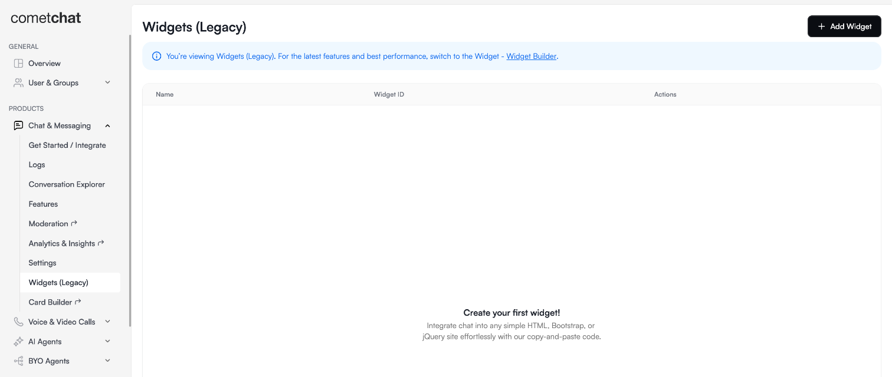
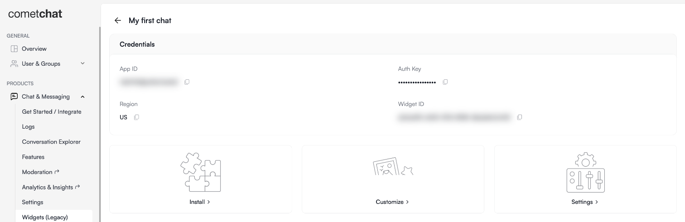

**Widgets (Legacy)** manages the original copy-and-paste chat widget. For new projects, use the [Widget Builder](/widget/html/overview) instead; it has the latest features and better performance.

**Where:** left navigation → **Chat & Messaging** → **Widgets (Legacy)**.

<Frame>
  
</Frame>

## Widget list

Columns: **Name**, **Widget ID**, **Actions**. Click a widget to open it.

<Warning>
**Add Widget** creates a new widget immediately (named **My first chat**) and opens it. There's no form to cancel.
</Warning>

## Widget page

<Frame>
  
</Frame>

**Credentials** shows the **App ID**, **Auth Key**, **Region**, and **Widget ID** to paste into the embed code. Below are three sections:

| Section | Contents |
| --- | --- |
| **Install** | Instructions for **WordPress**, **PHP**, **Laravel**, and **Custom** sites, each with **Learn more**. |
| **Customize** | **Basic**: widget **Name**, **Docked Layout** options such as **Icon Background** (default `#03a9f4`), **Open Chat Button Icon** and **Close Chat Button Icon** (upload, recommended 60×60). **Global Customization**: **Custom JS** and **Custom CSS** (each with **Update**). Click **Publish Changes** to apply. |
| **Settings** | **Sidebar** and **Chat Component** settings: default lists for **Chats** (user and group chats) and **Users** (all users), and **Sidebar Tabs** (reorder tabs; **Show Chats**, **Show Users**, **Show Groups**). Click **Publish Changes** to apply. |

See [Widget migration](/widget/migration) to move from the legacy widget to the Widget Builder.
