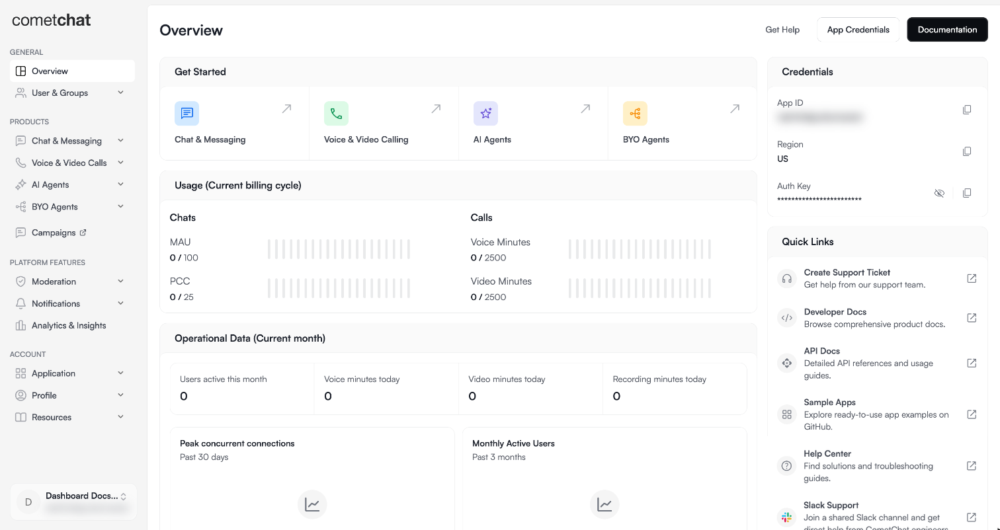
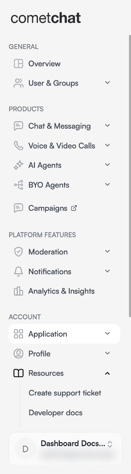

The CometChat dashboard ([app.cometchat.com](https://app.cometchat.com)) is where you create apps, get credentials, manage users and groups, turn features on and off, and configure moderation, notifications, webhooks, billing, and your team. Everything you can do in the dashboard is scoped to **one app at a time**. Switch apps from the [app switcher](/dashboard/app-switcher) at the bottom of the left navigation.

<Frame>
  
</Frame>

## How the dashboard is organized

The left navigation is split into four sections. The pages in this section of the docs follow the same order and nesting.

<Frame>
  
</Frame>

| Section | Items | What you do there |
| --- | --- | --- |
| **General** | [Overview](/dashboard/overview), User & Groups ([Users](/dashboard/users-groups/users), [Groups](/dashboard/users-groups/groups), [User Roles](/dashboard/users-groups/user-roles)) | See usage and credentials at a glance; manage the people and groups in your app. |
| **Products** | [Chat & Messaging](/dashboard/chat/get-started), [Voice & Video Calls](/dashboard/calls/get-started), [AI Agents](/dashboard/ai-agents/get-started), [BYO Agents](/dashboard/byo-agents/get-started), [Campaigns](/dashboard/campaigns) | Integrate each product, inspect logs, and configure product-specific features. |
| **Platform Features** | [Moderation](/dashboard/moderation/get-started), [Notifications](/dashboard/notifications/get-started), [Analytics & Insights](/dashboard/analytics) | Configure capabilities that apply across products. |
| **Account** | Application ([Credentials](/dashboard/application/credentials), [Webhooks](/dashboard/application/webhooks), [Webhooks (Legacy)](/dashboard/application/webhooks-legacy), [Team Members](/dashboard/application/team-members), [Audit Logs](/dashboard/application/audit-logs), [Plans & Billing](/dashboard/application/plans-billing), [Settings](/dashboard/application/settings)), Profile ([What's New](/dashboard/profile/whats-new), [Account Settings](/dashboard/profile/account-settings), [Log Out](/dashboard/profile/log-out)), [Resources](/dashboard/resources) | App-level keys, integrations, team access, and billing; your personal account; links to help. |

Items with an arrow icon (↗) next to them in the navigation are shortcuts to a page that lives elsewhere in the dashboard, or links that open in a new tab.

## Common page elements

Many pages share the same controls:

| Element | Where | What it does |
| --- | --- | --- |
| **Get Help** | Top-right of Overview and every **Get Started / Integrate** page | Opens CometChat support options. |
| **App Credentials** | Top-right of Overview and **Get Started / Integrate** pages | Jumps to [Credentials](/dashboard/application/credentials). |
| **Documentation** | Top-right of most pages | Opens the docs for that area. |
| **Filter** | Top-right of logs and lists | Adds filter chips (for example **Category**, **Type**, **Select Date**) above the table. Click a chip to choose values, then **Apply**. |
| **Search** | Above lists | Filters the current list by name or ID. |

## Before you start

<Steps>
  <Step title="Sign in or sign up">
    Go to [app.cometchat.com](https://app.cometchat.com) and sign in. New accounts land on **Create Application**.
  </Step>
  <Step title="Create an app">
    Follow [Create an app](/dashboard/app-switcher#create-an-app). Each app has its own App ID, region, users, data, and settings.
  </Step>
  <Step title="Copy your credentials">
    Open [Credentials](/dashboard/application/credentials) to get the **App ID**, **Region**, **Auth Key**, and **REST API Key** your code needs.
  </Step>
  <Step title="Integrate a product">
    Open **Get Started / Integrate** under the product you want (for example [Chat & Messaging](/dashboard/chat/get-started)) and follow the steps for your framework.
  </Step>
</Steps>

<Tip>
Building with an AI coding agent? Run `npx @cometchat/skills add` in your project. See [Agent Skills](/agent-skills). You can also manage apps from your agent with the [CometChat MCP server](/mcp-server).
</Tip>
