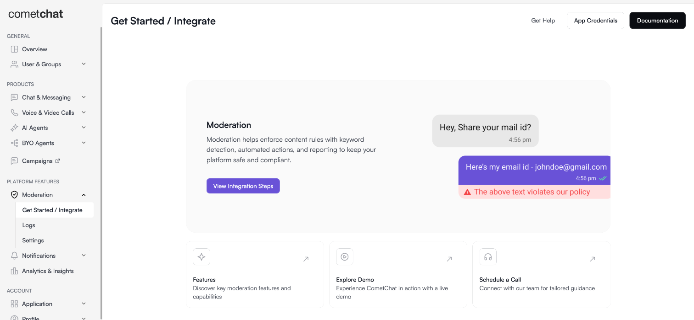

**Get Started / Integrate** walks you through enabling moderation for your app.

**Where:** left navigation → **Platform Features** → **Moderation** → **Get Started / Integrate**.

<Frame>
  
</Frame>

Click **View Integration Steps** to show the guide.

<Steps>
  <Step title="Enable Moderation">
    Switch moderation **On** to filter harmful or unwanted messages automatically. This is the same switch as the **Moderation** toggle on [Logs](/dashboard/moderation/logs) and [Settings](/dashboard/moderation/settings).
  </Step>
  <Step title="Setup Rules">
    Define content rules. **Go to Rules Settings** opens [Moderation → Settings](/dashboard/moderation/settings); **Go to Docs** opens [Rules management](/moderation/rules-management).
  </Step>
  <Step title="Add Moderation to your frontend">
    Choose **Code** or **No Code** and your platform. For React, for example, the **UI Kit Builder** handles blocked and flagged messages in the UI, lets users report messages, and offers moderator controls (kick, ban, promote/demote).
  </Step>
</Steps>

See the [AI Moderation docs](/moderation/overview) for how moderation works end to end.
